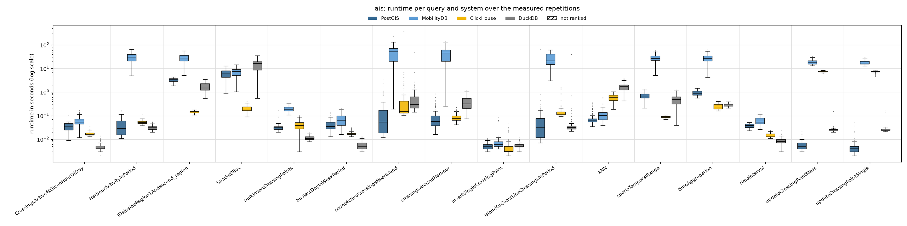
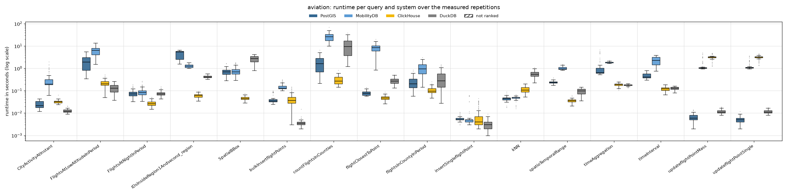
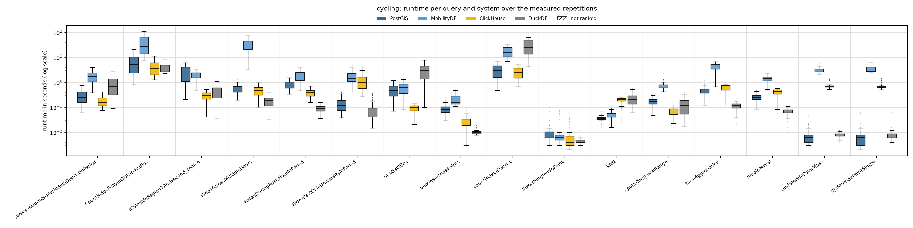
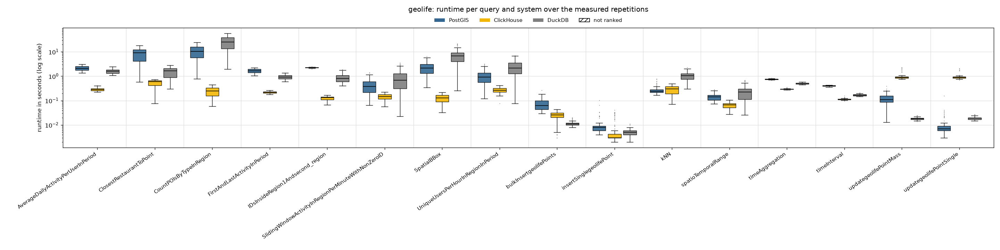

# Reads and writes 75/25, 1 client thread

Run of 2026-10-27 to 2026-10-28. Every system alone on the five-node cluster, one system after the other; 1 client thread taking the queries from one shared queue. Each of the 48 read queries runs with **128 measured parameter sets** (the same sets in every client-thread run) after 1 warm-up repetition. Write queries (inserts, updates, bulk inserts of 10 rows) are mixed in: 25 % of the measured executions; everything they added is removed after each system (`purge_writes.sh`). Systems without write support are not part of this workload. Timeout 600 s per query. The configuration of every system is described in the [main README](../../../../../README.md#configuration). All numbers below come from the CSV files in this folder (`build_results.py`, `empty_results.py`); [`tables.md`](tables.md) has every table in full.

## Summary

| System | Queries won | Ranked on | Geo-mean slowdown vs fastest | Median slowdown | Measured executions | Failed |
|---|---:|---:|---:|---:|---:|---:|
| ClickHouse | 29 | 48 of 48 | 1.56× | 1.00× | 7,937 | 2 |
| DuckDB | 14 | 48 of 48 | 3.79× | 3.24× | 7,937 | 2 |
| PostGIS | 5 | 48 of 48 | 4.35× | 3.73× | 7,937 | 2 |
| MobilityDB | 0 | 36 of 36 | 23.96× | 19.48× | 5,889 | 2 |

Wins and slowdowns count the read queries only (comparable with the read-only runs); the writes are below (*Writes*). *Slowdown*: a system's mean runtime on a query divided by the fastest ranked system's, over the queries the system is ranked on. A system is ranked on a query when every measured repetition succeeded and its results match PostGIS (pre-run equivalence check; accepted: nearest-neighbour ties, numbers within 1 %, an empty answer as no row or one row of zeros).

**Wins by scenario and by query type:**

| | PostGIS | ClickHouse | DuckDB |
|---|---:|---:|---:|
| AIS | 2 | 5 | 5 |
| Aviation | 1 | 8 | 3 |
| Cycling | 1 | 5 | 6 |
| Geolife | 1 | 11 | – |
| spatial | 5 | 10 | 1 |
| temporal | – | 7 | 9 |
| spatiotemporal | – | 12 | 4 |

## Total runtime, pair by pair

Sum of the measured repetitions' runtimes over only the queries both systems completed.

| System A | System B | Common queries | A | B | A / B |
|---|---|---:|---:|---:|---:|
| PostGIS | MobilityDB | 48 | 77.7 min | 890.7 min | 0.09 |
| PostGIS | ClickHouse | 64 | 145.0 min | 92.7 min | 1.56 |
| PostGIS | DuckDB | 64 | 145.0 min | 189.2 min | 0.77 |
| MobilityDB | ClickHouse | 48 | 890.7 min | 82.7 min | 10.77 |
| MobilityDB | DuckDB | 48 | 890.7 min | 93.0 min | 9.58 |
| ClickHouse | DuckDB | 64 | 92.7 min | 189.2 min | 0.49 |

## Failures

Parameter sets left out for every system:

| Scenario | Query | Repetition | Reason |
|---|---|---:|---|
| ais | countActiveCrossingsNearIsland | 80 | every system timed out |
| ais | countActiveCrossingsNearIsland | 95 | every system timed out |

Measured executions that did not succeed (including those in the parameter sets above):

| System | Scenario | Query | Status | Count |
|---|---|---|---|---:|
| ClickHouse | ais | countActiveCrossingsNearIsland | timeout | 2 |
| DuckDB | ais | countActiveCrossingsNearIsland | timeout | 2 |
| MobilityDB | ais | countActiveCrossingsNearIsland | timeout | 2 |
| PostGIS | ais | countActiveCrossingsNearIsland | timeout | 2 |

## Writes

Mean (95th percentile) runtime of each write query, over its measured executions; **bold**: fastest. An update moves points that an insert of the same run added; ClickHouse writes an update as a re-insert plus a lightweight delete, MobilityDB writes into its trajectories.

| Scenario | Write query | PostGIS | MobilityDB | ClickHouse | DuckDB |
|---|---|---:|---:|---:|---:|
| AIS | bulkInsertCrossingPoints | 34 ms (46 ms) | 199 ms (305 ms) | 40 ms (84 ms) | **12 ms** (16 ms) |
| AIS | insertSingleCrossingPoint | **5 ms** (9 ms) | 11 ms (61 ms) | 7 ms (26 ms) | 5 ms (9 ms) |
| AIS | updateCrossingPointMass | **6 ms** (10 ms) | 18.84 s (27.47 s) | 7.41 s (8.10 s) | 26 ms (30 ms) |
| AIS | updateCrossingPointSingle | **5 ms** (9 ms) | 18.45 s (25.91 s) | 7.36 s (8.11 s) | 27 ms (31 ms) |
| Aviation | bulkInsertflightPoints | 44 ms (88 ms) | 146 ms (233 ms) | 41 ms (94 ms) | **4 ms** (6 ms) |
| Aviation | insertSingleflightPoint | 6 ms (8 ms) | 8 ms (56 ms) | 9 ms (32 ms) | **3 ms** (5 ms) |
| Aviation | updateflightPointMass | **7 ms** (10 ms) | 1.29 s (3.09 s) | 3.15 s (4.23 s) | 12 ms (17 ms) |
| Aviation | updateflightPointSingle | **5 ms** (7 ms) | 1.23 s (2.26 s) | 3.09 s (3.84 s) | 12 ms (15 ms) |
| Cycling | bulkInsertridePoints | 88 ms (160 ms) | 224 ms (434 ms) | 27 ms (45 ms) | **10 ms** (12 ms) |
| Cycling | insertSingleridePoint | 10 ms (22 ms) | 15 ms (66 ms) | 9 ms (31 ms) | **4 ms** (6 ms) |
| Cycling | updateridePointMass | 8 ms (23 ms) | 3.27 s (5.42 s) | 705 ms (1.15 s) | **8 ms** (12 ms) |
| Cycling | updateridePointSingle | 9 ms (20 ms) | 3.39 s (5.47 s) | 714 ms (1.19 s) | **8 ms** (12 ms) |
| Geolife | bulkInsertgeolifePoints | 75 ms (137 ms) | – | 25 ms (37 ms) | **11 ms** (16 ms) |
| Geolife | insertSinglegeolifePoint | 10 ms (23 ms) | – | 7 ms (29 ms) | **5 ms** (8 ms) |
| Geolife | updategeolifePointMass | 122 ms (223 ms) | – | 962 ms (1.59 s) | **18 ms** (22 ms) |
| Geolife | updategeolifePointSingle | **10 ms** (27 ms) | – | 933 ms (1.05 s) | 19 ms (23 ms) |

| System | Write queries won | Geo-mean slowdown vs fastest |
|---|---:|---:|
| PostGIS | 6 | 2.08× |
| MobilityDB | 0 | 73.54× |
| ClickHouse | 0 | 25.90× |
| DuckDB | 10 | 1.38× |

## Latency per scenario

One section per scenario. The box plot shows every system's runtimes over the measured repetitions that succeeded (box: 25th to 75th percentile, line: median, whiskers: 1.5 × the box height, dots: outliers; log scale; hatched: not ranked). The table below it gives mean, median, 95th and 99th percentile and standard deviation over those repetitions (n); the variance (standard deviation squared, ms²) is in `summary.csv` (`var_ms2`). **Bold**: fastest ranked system on the query (by mean).

### AIS

| Query | System | n | Mean | Median | p95 | p99 | Std dev |
|---|---|---:|---:|---:|---:|---:|---:|
| `CrossingsActiveAtGivenHourOfDay` | PostGIS | 128 | 35 ms | 36 ms | 53 ms | 54 ms | 15 ms |
|  | MobilityDB | 128 | 60 ms | 53 ms | 118 ms | 146 ms | 30 ms |
|  | ClickHouse | 128 | 17 ms | 16 ms | 23 ms | 27 ms | 3 ms |
|  | **DuckDB** | 128 | **5 ms** | 4 ms | 9 ms | 13 ms | 2 ms |
| `HarbourActivityInPeriod` | PostGIS | 128 | 41 ms | 28 ms | 96 ms | 148 ms | 32 ms |
|  | MobilityDB | 128 | 31.52 s | 30.05 s | 56.92 s | 61.40 s | 13.71 s |
|  | ClickHouse | 128 | 53 ms | 52 ms | 66 ms | 74 ms | 9 ms |
|  | **DuckDB** | 128 | **31 ms** | 31 ms | 46 ms | 52 ms | 7 ms |
| `IDsInsideRegion1Andsecond_region` | PostGIS | 128 | 3.32 s | 3.38 s | 4.13 s | 4.27 s | 535 ms |
|  | MobilityDB | 128 | 29.25 s | 27.73 s | 52.03 s | 53.89 s | 11.51 s |
|  | **ClickHouse** | 128 | **144 ms** | 145 ms | 168 ms | 174 ms | 15 ms |
|  | DuckDB | 128 | 1.77 s | 1.79 s | 2.89 s | 3.44 s | 726 ms |
| `SpatialBBox` | PostGIS | 128 | 6.56 s | 6.39 s | 11.53 s | 12.76 s | 2.60 s |
|  | MobilityDB | 128 | 7.46 s | 7.43 s | 12.73 s | 13.87 s | 2.91 s |
|  | **ClickHouse** | 128 | **211 ms** | 209 ms | 327 ms | 390 ms | 62 ms |
|  | DuckDB | 128 | 15.59 s | 16.35 s | 30.57 s | 33.87 s | 8.32 s |
| `bulkInsertCrossingPoints` | PostGIS | 128 | 34 ms | 31 ms | 46 ms | 89 ms | 16 ms |
|  | MobilityDB | 128 | 199 ms | 187 ms | 305 ms | 329 ms | 53 ms |
|  | ClickHouse | 128 | 40 ms | 38 ms | 84 ms | 93 ms | 23 ms |
|  | **DuckDB** | 128 | **12 ms** | 11 ms | 16 ms | 19 ms | 2 ms |
| `busiestDayInWeekPeriod` | PostGIS | 128 | 47 ms | 34 ms | 114 ms | 132 ms | 28 ms |
|  | MobilityDB | 128 | 75 ms | 64 ms | 159 ms | 178 ms | 41 ms |
|  | ClickHouse | 128 | 18 ms | 17 ms | 27 ms | 31 ms | 4 ms |
|  | **DuckDB** | 128 | **6 ms** | 5 ms | 11 ms | 22 ms | 4 ms |
| `countActiveCrossingsNearIsland` | **PostGIS** | 126 | **590 ms** | 54 ms | 1.69 s | 5.00 s | 3.48 s |
|  | MobilityDB | 126 | 48.87 s | 50.52 s | 96.91 s | 126.68 s | 34.24 s |
|  | ClickHouse | 126 | 4.29 s | 154 ms | 5.76 s | 48.51 s | 33.55 s |
|  | DuckDB | 126 | 948 ms | 299 ms | 1.98 s | 5.67 s | 4.44 s |
| `crossingsAroundHarbour` | PostGIS | 128 | 110 ms | 57 ms | 345 ms | 614 ms | 132 ms |
|  | MobilityDB | 128 | 43.71 s | 45.04 s | 86.62 s | 136.58 s | 28.57 s |
|  | **ClickHouse** | 128 | **88 ms** | 78 ms | 153 ms | 213 ms | 35 ms |
|  | DuckDB | 128 | 390 ms | 313 ms | 793 ms | 1.13 s | 234 ms |
| `insertSingleCrossingPoint` | **PostGIS** | 128 | **5 ms** | 5 ms | 9 ms | 10 ms | 2 ms |
|  | MobilityDB | 128 | 11 ms | 6 ms | 61 ms | 64 ms | 16 ms |
|  | ClickHouse | 128 | 7 ms | 3 ms | 26 ms | 32 ms | 8 ms |
|  | DuckDB | 128 | 5 ms | 5 ms | 9 ms | 10 ms | 2 ms |
| `islandOrCoastLineCrossingsInPeriod` | PostGIS | 128 | 561 ms | 31 ms | 196 ms | 708 ms | 5.69 s |
|  | MobilityDB | 128 | 27.99 s | 21.28 s | 55.75 s | 60.01 s | 16.49 s |
|  | ClickHouse | 128 | 1.19 s | 116 ms | 864 ms | 3.62 s | 11.04 s |
|  | **DuckDB** | 128 | **351 ms** | 32 ms | 117 ms | 571 ms | 3.48 s |
| `kNN` | **PostGIS** | 128 | **83 ms** | 60 ms | 231 ms | 320 ms | 61 ms |
|  | MobilityDB | 128 | 130 ms | 102 ms | 320 ms | 580 ms | 100 ms |
|  | ClickHouse | 128 | 606 ms | 608 ms | 947 ms | 1.03 s | 204 ms |
|  | DuckDB | 128 | 1.75 s | 1.75 s | 3.02 s | 3.53 s | 707 ms |
| `spatioTemporalRange` | PostGIS | 128 | 709 ms | 688 ms | 1.03 s | 1.25 s | 211 ms |
|  | MobilityDB | 128 | 28.41 s | 26.93 s | 47.00 s | 55.89 s | 10.34 s |
|  | **ClickHouse** | 128 | **91 ms** | 90 ms | 107 ms | 126 ms | 11 ms |
|  | DuckDB | 128 | 481 ms | 483 ms | 896 ms | 1.15 s | 262 ms |
| `timeAggregation` | PostGIS | 128 | 936 ms | 906 ms | 1.31 s | 1.44 s | 208 ms |
|  | MobilityDB | 128 | 28.39 s | 25.93 s | 48.74 s | 53.75 s | 11.14 s |
|  | **ClickHouse** | 128 | **249 ms** | 234 ms | 364 ms | 387 ms | 61 ms |
|  | DuckDB | 128 | 290 ms | 288 ms | 354 ms | 382 ms | 38 ms |
| `timeInterval` | PostGIS | 128 | 38 ms | 38 ms | 48 ms | 51 ms | 7 ms |
|  | MobilityDB | 128 | 61 ms | 54 ms | 94 ms | 108 ms | 22 ms |
|  | ClickHouse | 128 | 15 ms | 15 ms | 19 ms | 22 ms | 2 ms |
|  | **DuckDB** | 128 | **8 ms** | 8 ms | 14 ms | 18 ms | 3 ms |
| `updateCrossingPointMass` | **PostGIS** | 128 | **6 ms** | 5 ms | 10 ms | 18 ms | 3 ms |
|  | MobilityDB | 128 | 18.84 s | 17.41 s | 27.47 s | 30.91 s | 4.24 s |
|  | ClickHouse | 128 | 7.41 s | 7.46 s | 8.10 s | 8.39 s | 577 ms |
|  | DuckDB | 128 | 26 ms | 25 ms | 30 ms | 35 ms | 12 ms |
| `updateCrossingPointSingle` | **PostGIS** | 128 | **5 ms** | 4 ms | 9 ms | 33 ms | 6 ms |
|  | MobilityDB | 128 | 18.45 s | 17.02 s | 25.91 s | 28.96 s | 3.82 s |
|  | ClickHouse | 128 | 7.36 s | 7.51 s | 8.11 s | 8.24 s | 659 ms |
|  | DuckDB | 128 | 27 ms | 25 ms | 31 ms | 114 ms | 16 ms |

### Aviation

| Query | System | n | Mean | Median | p95 | p99 | Std dev |
|---|---|---:|---:|---:|---:|---:|---:|
| `CityActivityAtInstant` | PostGIS | 128 | 26 ms | 22 ms | 37 ms | 42 ms | 9 ms |
|  | MobilityDB | 128 | 308 ms | 200 ms | 886 ms | 1.45 s | 280 ms |
|  | ClickHouse | 128 | 32 ms | 32 ms | 40 ms | 43 ms | 5 ms |
|  | **DuckDB** | 128 | **13 ms** | 12 ms | 17 ms | 19 ms | 2 ms |
| `FlightsAtLowAltitudeInPeriod` | PostGIS | 128 | 2.06 s | 1.93 s | 4.17 s | 5.45 s | 1.30 s |
|  | MobilityDB | 128 | 6.40 s | 6.38 s | 10.70 s | 12.26 s | 2.77 s |
|  | ClickHouse | 128 | 219 ms | 204 ms | 352 ms | 489 ms | 76 ms |
|  | **DuckDB** | 128 | **133 ms** | 128 ms | 214 ms | 244 ms | 53 ms |
| `FlightsAtNightInPeriod` | PostGIS | 128 | 78 ms | 73 ms | 123 ms | 163 ms | 26 ms |
|  | MobilityDB | 128 | 90 ms | 82 ms | 154 ms | 234 ms | 35 ms |
|  | **ClickHouse** | 128 | **27 ms** | 26 ms | 38 ms | 49 ms | 7 ms |
|  | DuckDB | 128 | 76 ms | 72 ms | 112 ms | 132 ms | 18 ms |
| `IDsInsideRegion1Andsecond_region` | PostGIS | 128 | 4.49 s | 5.41 s | 6.22 s | 6.59 s | 1.68 s |
|  | MobilityDB | 128 | 1.28 s | 1.27 s | 1.58 s | 1.67 s | 186 ms |
|  | **ClickHouse** | 128 | **62 ms** | 61 ms | 81 ms | 89 ms | 12 ms |
|  | DuckDB | 128 | 428 ms | 416 ms | 535 ms | 555 ms | 56 ms |
| `SpatialBBox` | PostGIS | 128 | 699 ms | 696 ms | 1.03 s | 1.51 s | 242 ms |
|  | MobilityDB | 128 | 766 ms | 704 ms | 1.41 s | 1.75 s | 320 ms |
|  | **ClickHouse** | 128 | **46 ms** | 45 ms | 62 ms | 66 ms | 8 ms |
|  | DuckDB | 128 | 2.69 s | 2.76 s | 3.95 s | 4.14 s | 894 ms |
| `bulkInsertflightPoints` | PostGIS | 122 | 44 ms | 35 ms | 88 ms | 93 ms | 20 ms |
|  | MobilityDB | 122 | 146 ms | 130 ms | 233 ms | 300 ms | 41 ms |
|  | ClickHouse | 122 | 41 ms | 36 ms | 94 ms | 136 ms | 28 ms |
|  | **DuckDB** | 122 | **4 ms** | 4 ms | 6 ms | 7 ms | 2 ms |
| `countFlightsInCounties` | PostGIS | 53 | 1.91 s | 1.63 s | 4.06 s | 5.82 s | 1.43 s |
|  | MobilityDB | 53 | 26.86 s | 26.07 s | 48.48 s | 59.17 s | 12.34 s |
|  | **ClickHouse** | 53 | **318 ms** | 273 ms | 569 ms | 715 ms | 148 ms |
|  | DuckDB | 53 | 11.00 s | 9.50 s | 24.93 s | 35.42 s | 8.77 s |
| `flightClosestToPoint` | PostGIS | 128 | 79 ms | 77 ms | 117 ms | 132 ms | 18 ms |
|  | MobilityDB | 128 | 8.37 s | 8.42 s | 14.19 s | 16.29 s | 3.35 s |
|  | **ClickHouse** | 128 | **48 ms** | 48 ms | 65 ms | 74 ms | 10 ms |
|  | DuckDB | 128 | 287 ms | 268 ms | 463 ms | 502 ms | 84 ms |
| `flightsInCountyInPeriod` | PostGIS | 128 | 246 ms | 205 ms | 510 ms | 709 ms | 145 ms |
|  | MobilityDB | 128 | 1.05 s | 954 ms | 2.16 s | 2.49 s | 585 ms |
|  | **ClickHouse** | 128 | **105 ms** | 96 ms | 164 ms | 201 ms | 36 ms |
|  | DuckDB | 128 | 376 ms | 276 ms | 873 ms | 1.40 s | 301 ms |
| `insertSingleflightPoint` | PostGIS | 122 | 6 ms | 5 ms | 8 ms | 10 ms | 1 ms |
|  | MobilityDB | 122 | 8 ms | 5 ms | 56 ms | 60 ms | 13 ms |
|  | ClickHouse | 122 | 9 ms | 4 ms | 32 ms | 36 ms | 10 ms |
|  | **DuckDB** | 122 | **3 ms** | 3 ms | 5 ms | 7 ms | 1 ms |
| `kNN` | **PostGIS** | 128 | **45 ms** | 46 ms | 56 ms | 70 ms | 9 ms |
|  | MobilityDB | 128 | 48 ms | 50 ms | 58 ms | 62 ms | 8 ms |
|  | ClickHouse | 128 | 115 ms | 106 ms | 181 ms | 197 ms | 37 ms |
|  | DuckDB | 128 | 571 ms | 550 ms | 876 ms | 961 ms | 179 ms |
| `spatioTemporalRange` | PostGIS | 128 | 239 ms | 238 ms | 285 ms | 330 ms | 30 ms |
|  | MobilityDB | 128 | 1.01 s | 961 ms | 1.28 s | 1.49 s | 150 ms |
|  | **ClickHouse** | 128 | **36 ms** | 36 ms | 46 ms | 54 ms | 6 ms |
|  | DuckDB | 128 | 96 ms | 98 ms | 138 ms | 146 ms | 30 ms |
| `timeAggregation` | PostGIS | 128 | 1.07 s | 638 ms | 3.94 s | 5.61 s | 1.12 s |
|  | MobilityDB | 128 | 1.86 s | 1.85 s | 2.05 s | 2.14 s | 114 ms |
|  | ClickHouse | 128 | 188 ms | 191 ms | 244 ms | 252 ms | 33 ms |
|  | **DuckDB** | 128 | **179 ms** | 181 ms | 195 ms | 203 ms | 14 ms |
| `timeInterval` | PostGIS | 128 | 462 ms | 416 ms | 675 ms | 737 ms | 120 ms |
|  | MobilityDB | 128 | 2.28 s | 2.25 s | 3.41 s | 3.74 s | 906 ms |
|  | **ClickHouse** | 128 | **125 ms** | 124 ms | 176 ms | 189 ms | 27 ms |
|  | DuckDB | 128 | 128 ms | 130 ms | 156 ms | 161 ms | 19 ms |
| `updateflightPointMass` | **PostGIS** | 122 | **7 ms** | 6 ms | 10 ms | 13 ms | 2 ms |
|  | MobilityDB | 122 | 1.29 s | 1.04 s | 3.09 s | 4.41 s | 736 ms |
|  | ClickHouse | 122 | 3.15 s | 3.16 s | 4.23 s | 4.68 s | 561 ms |
|  | DuckDB | 122 | 12 ms | 11 ms | 17 ms | 19 ms | 2 ms |
| `updateflightPointSingle` | **PostGIS** | 121 | **5 ms** | 5 ms | 7 ms | 9 ms | 1 ms |
|  | MobilityDB | 121 | 1.23 s | 1.07 s | 2.26 s | 3.40 s | 520 ms |
|  | ClickHouse | 121 | 3.09 s | 3.15 s | 3.84 s | 4.34 s | 538 ms |
|  | DuckDB | 121 | 12 ms | 11 ms | 15 ms | 17 ms | 2 ms |

### Cycling

| Query | System | n | Mean | Median | p95 | p99 | Std dev |
|---|---|---:|---:|---:|---:|---:|---:|
| `AverageUpdatesPerRideInDistrictInPeriod` | PostGIS | 128 | 301 ms | 251 ms | 657 ms | 785 ms | 185 ms |
|  | MobilityDB | 128 | 1.76 s | 1.72 s | 3.20 s | 3.78 s | 864 ms |
|  | **ClickHouse** | 128 | **182 ms** | 158 ms | 350 ms | 411 ms | 82 ms |
|  | DuckDB | 128 | 967 ms | 670 ms | 2.76 s | 3.70 s | 852 ms |
| `CountRidesFullyInDistrictRadius` | PostGIS | 128 | 6.73 s | 5.10 s | 17.51 s | 20.51 s | 5.17 s |
|  | MobilityDB | 128 | 41.32 s | 27.68 s | 95.36 s | 106.31 s | 30.01 s |
|  | ClickHouse | 128 | 4.30 s | 3.55 s | 9.54 s | 11.31 s | 2.62 s |
|  | **DuckDB** | 128 | **4.12 s** | 3.69 s | 7.05 s | 8.25 s | 1.59 s |
| `IDsInsideRegion1Andsecond_region` | PostGIS | 128 | 2.52 s | 1.64 s | 5.36 s | 5.97 s | 1.65 s |
|  | MobilityDB | 128 | 2.02 s | 2.14 s | 2.83 s | 3.15 s | 620 ms |
|  | **ClickHouse** | 128 | **294 ms** | 302 ms | 471 ms | 510 ms | 116 ms |
|  | DuckDB | 128 | 457 ms | 410 ms | 877 ms | 1.18 s | 262 ms |
| `RidesAcrossMultipleHours` | PostGIS | 128 | 561 ms | 539 ms | 970 ms | 1.04 s | 218 ms |
|  | MobilityDB | 128 | 33.72 s | 31.76 s | 63.85 s | 65.94 s | 16.09 s |
|  | ClickHouse | 128 | 484 ms | 482 ms | 851 ms | 872 ms | 206 ms |
|  | **DuckDB** | 128 | **185 ms** | 184 ms | 325 ms | 364 ms | 80 ms |
| `RidesDuringRushHourInPeriod` | PostGIS | 128 | 818 ms | 792 ms | 1.26 s | 1.40 s | 283 ms |
|  | MobilityDB | 128 | 1.88 s | 1.65 s | 3.43 s | 3.85 s | 880 ms |
|  | ClickHouse | 128 | 390 ms | 378 ms | 639 ms | 664 ms | 132 ms |
|  | **DuckDB** | 128 | **90 ms** | 88 ms | 138 ms | 157 ms | 28 ms |
| `RidesPastOrToUniversityInPeriod` | PostGIS | 128 | 148 ms | 118 ms | 337 ms | 407 ms | 96 ms |
|  | MobilityDB | 128 | 1.72 s | 1.49 s | 3.25 s | 3.87 s | 861 ms |
|  | ClickHouse | 128 | 1.34 s | 963 ms | 3.51 s | 4.55 s | 1.04 s |
|  | **DuckDB** | 128 | **89 ms** | 58 ms | 262 ms | 354 ms | 76 ms |
| `SpatialBBox` | PostGIS | 128 | 505 ms | 468 ms | 923 ms | 1.12 s | 262 ms |
|  | MobilityDB | 128 | 649 ms | 605 ms | 1.21 s | 1.57 s | 346 ms |
|  | **ClickHouse** | 128 | **92 ms** | 98 ms | 130 ms | 142 ms | 30 ms |
|  | DuckDB | 128 | 3.07 s | 3.02 s | 6.08 s | 7.56 s | 1.92 s |
| `bulkInsertridePoints` | PostGIS | 119 | 88 ms | 83 ms | 160 ms | 246 ms | 42 ms |
|  | MobilityDB | 119 | 224 ms | 158 ms | 434 ms | 583 ms | 117 ms |
|  | ClickHouse | 119 | 27 ms | 26 ms | 45 ms | 90 ms | 16 ms |
|  | **DuckDB** | 119 | **10 ms** | 10 ms | 12 ms | 16 ms | 2 ms |
| `countRideInDistrict` | PostGIS | 12 | 3.26 s | 2.92 s | 6.43 s | 6.95 s | 2.18 s |
|  | MobilityDB | 12 | 19.58 s | 15.71 s | 39.29 s | 44.54 s | 11.82 s |
|  | **ClickHouse** | 12 | **2.67 s** | 2.56 s | 4.63 s | 4.99 s | 1.42 s |
|  | DuckDB | 12 | 29.57 s | 24.20 s | 57.30 s | 62.07 s | 20.26 s |
| `insertSingleridePoint` | PostGIS | 118 | 10 ms | 7 ms | 22 ms | 68 ms | 12 ms |
|  | MobilityDB | 118 | 15 ms | 6 ms | 66 ms | 88 ms | 22 ms |
|  | ClickHouse | 118 | 9 ms | 4 ms | 31 ms | 38 ms | 10 ms |
|  | **DuckDB** | 118 | **4 ms** | 5 ms | 6 ms | 9 ms | 2 ms |
| `kNN` | **PostGIS** | 128 | **36 ms** | 36 ms | 51 ms | 64 ms | 9 ms |
|  | MobilityDB | 128 | 51 ms | 50 ms | 76 ms | 90 ms | 14 ms |
|  | ClickHouse | 128 | 194 ms | 208 ms | 241 ms | 252 ms | 50 ms |
|  | DuckDB | 128 | 228 ms | 202 ms | 419 ms | 526 ms | 110 ms |
| `spatioTemporalRange` | PostGIS | 128 | 174 ms | 168 ms | 260 ms | 298 ms | 50 ms |
|  | MobilityDB | 128 | 754 ms | 762 ms | 1.02 s | 1.28 s | 211 ms |
|  | **ClickHouse** | 128 | **70 ms** | 73 ms | 104 ms | 121 ms | 24 ms |
|  | DuckDB | 128 | 136 ms | 117 ms | 309 ms | 410 ms | 94 ms |
| `timeAggregation` | PostGIS | 128 | 535 ms | 458 ms | 946 ms | 1.79 s | 325 ms |
|  | MobilityDB | 128 | 4.27 s | 4.57 s | 5.96 s | 6.45 s | 1.35 s |
|  | ClickHouse | 128 | 605 ms | 652 ms | 840 ms | 849 ms | 185 ms |
|  | **DuckDB** | 128 | **115 ms** | 118 ms | 166 ms | 176 ms | 36 ms |
| `timeInterval` | PostGIS | 128 | 260 ms | 258 ms | 398 ms | 470 ms | 84 ms |
|  | MobilityDB | 128 | 1.39 s | 1.46 s | 1.86 s | 2.04 s | 351 ms |
|  | ClickHouse | 128 | 410 ms | 432 ms | 563 ms | 578 ms | 119 ms |
|  | **DuckDB** | 128 | **70 ms** | 73 ms | 97 ms | 104 ms | 18 ms |
| `updateridePointMass` | PostGIS | 118 | 8 ms | 6 ms | 23 ms | 47 ms | 9 ms |
|  | MobilityDB | 118 | 3.27 s | 2.84 s | 5.42 s | 7.02 s | 1.04 s |
|  | ClickHouse | 118 | 705 ms | 669 ms | 1.15 s | 1.29 s | 150 ms |
|  | **DuckDB** | 118 | **8 ms** | 8 ms | 12 ms | 14 ms | 2 ms |
| `updateridePointSingle` | PostGIS | 118 | 9 ms | 6 ms | 20 ms | 66 ms | 12 ms |
|  | MobilityDB | 118 | 3.39 s | 2.82 s | 5.47 s | 6.15 s | 1.03 s |
|  | ClickHouse | 118 | 714 ms | 666 ms | 1.19 s | 1.46 s | 184 ms |
|  | **DuckDB** | 118 | **8 ms** | 8 ms | 12 ms | 16 ms | 6 ms |

### Geolife

| Query | System | n | Mean | Median | p95 | p99 | Std dev |
|---|---|---:|---:|---:|---:|---:|---:|
| `AverageDailyActivityPerUserInPeriod` | PostGIS | 128 | 2.14 s | 2.08 s | 2.82 s | 2.96 s | 434 ms |
|  | **ClickHouse** | 128 | **289 ms** | 286 ms | 348 ms | 397 ms | 38 ms |
|  | DuckDB | 128 | 1.62 s | 1.58 s | 2.23 s | 2.40 s | 336 ms |
| `ClosestRestaurantToPoint` | PostGIS | 128 | 8.70 s | 9.21 s | 16.78 s | 17.95 s | 5.02 s |
|  | **ClickHouse** | 128 | **536 ms** | 595 ms | 714 ms | 724 ms | 169 ms |
|  | DuckDB | 128 | 1.56 s | 1.65 s | 2.57 s | 2.74 s | 701 ms |
| `CountPOIsByTypeInRegion` | PostGIS | 128 | 11.23 s | 10.37 s | 21.93 s | 23.47 s | 6.47 s |
|  | **ClickHouse** | 128 | **256 ms** | 248 ms | 422 ms | 438 ms | 110 ms |
|  | DuckDB | 128 | 27.49 s | 25.25 s | 55.37 s | 57.22 s | 16.26 s |
| `FirstAndLastActivityInPeriod` | PostGIS | 128 | 1.68 s | 1.65 s | 2.19 s | 2.26 s | 319 ms |
|  | **ClickHouse** | 128 | **220 ms** | 220 ms | 255 ms | 266 ms | 21 ms |
|  | DuckDB | 128 | 926 ms | 920 ms | 1.22 s | 1.30 s | 185 ms |
| `IDsInsideRegion1Andsecond_region` | PostGIS | 128 | 2.24 s | 2.25 s | 2.36 s | 2.44 s | 76 ms |
|  | **ClickHouse** | 128 | **126 ms** | 131 ms | 164 ms | 168 ms | 24 ms |
|  | DuckDB | 128 | 876 ms | 816 ms | 1.51 s | 1.78 s | 352 ms |
| `SlidingWindowActivityInRegionPerMinuteWithNonZeroID` | PostGIS | 128 | 440 ms | 386 ms | 1.01 s | 1.35 s | 300 ms |
|  | **ClickHouse** | 128 | **148 ms** | 148 ms | 211 ms | 219 ms | 40 ms |
|  | DuckDB | 128 | 893 ms | 679 ms | 2.55 s | 3.38 s | 771 ms |
| `SpatialBBox` | PostGIS | 128 | 2.29 s | 2.13 s | 4.23 s | 5.62 s | 1.19 s |
|  | **ClickHouse** | 128 | **126 ms** | 130 ms | 197 ms | 209 ms | 50 ms |
|  | DuckDB | 128 | 7.12 s | 6.83 s | 16.28 s | 21.02 s | 4.39 s |
| `UniqueUsersPerHourInRegionInPeriod` | PostGIS | 128 | 1.07 s | 909 ms | 2.39 s | 2.96 s | 660 ms |
|  | **ClickHouse** | 128 | **274 ms** | 268 ms | 385 ms | 408 ms | 64 ms |
|  | DuckDB | 128 | 2.60 s | 2.14 s | 5.84 s | 6.68 s | 1.69 s |
| `bulkInsertgeolifePoints` | PostGIS | 128 | 75 ms | 62 ms | 137 ms | 178 ms | 38 ms |
|  | ClickHouse | 128 | 25 ms | 26 ms | 37 ms | 41 ms | 9 ms |
|  | **DuckDB** | 128 | **11 ms** | 11 ms | 16 ms | 20 ms | 2 ms |
| `insertSinglegeolifePoint` | PostGIS | 128 | 10 ms | 8 ms | 23 ms | 57 ms | 11 ms |
|  | ClickHouse | 128 | 7 ms | 3 ms | 29 ms | 34 ms | 8 ms |
|  | **DuckDB** | 128 | **5 ms** | 5 ms | 8 ms | 11 ms | 2 ms |
| `kNN` | **PostGIS** | 128 | **272 ms** | 237 ms | 475 ms | 700 ms | 101 ms |
|  | ClickHouse | 128 | 288 ms | 300 ms | 467 ms | 488 ms | 118 ms |
|  | DuckDB | 128 | 1.07 s | 1.04 s | 1.84 s | 2.03 s | 429 ms |
| `spatioTemporalRange` | PostGIS | 128 | 142 ms | 142 ms | 219 ms | 268 ms | 44 ms |
|  | **ClickHouse** | 128 | **64 ms** | 66 ms | 92 ms | 104 ms | 18 ms |
|  | DuckDB | 128 | 233 ms | 222 ms | 611 ms | 665 ms | 152 ms |
| `timeAggregation` | PostGIS | 128 | 756 ms | 754 ms | 816 ms | 827 ms | 28 ms |
|  | **ClickHouse** | 128 | **297 ms** | 296 ms | 321 ms | 332 ms | 12 ms |
|  | DuckDB | 128 | 512 ms | 518 ms | 569 ms | 577 ms | 35 ms |
| `timeInterval` | PostGIS | 128 | 405 ms | 411 ms | 429 ms | 435 ms | 20 ms |
|  | **ClickHouse** | 128 | **114 ms** | 113 ms | 124 ms | 137 ms | 8 ms |
|  | DuckDB | 128 | 169 ms | 168 ms | 190 ms | 205 ms | 13 ms |
| `updategeolifePointMass` | PostGIS | 128 | 122 ms | 108 ms | 223 ms | 292 ms | 61 ms |
|  | ClickHouse | 128 | 962 ms | 896 ms | 1.59 s | 2.17 s | 275 ms |
|  | **DuckDB** | 128 | **18 ms** | 18 ms | 22 ms | 24 ms | 2 ms |
| `updategeolifePointSingle` | **PostGIS** | 128 | **10 ms** | 7 ms | 27 ms | 40 ms | 15 ms |
|  | ClickHouse | 128 | 933 ms | 893 ms | 1.05 s | 1.98 s | 205 ms |
|  | DuckDB | 128 | 19 ms | 19 ms | 23 ms | 27 ms | 2 ms |

## Hardware

Means over the five nodes and over the time the system ran (5 s samples; per scenario and node in `hardware_by_phase.csv`).

| System | Run time | CPU busy | Memory used | Disk read |
|---|---:|---:|---:|---:|
| PostGIS | 2.8 h | 25 % | 15.5 GB | 979 MB/s |
| MobilityDB | 15.3 h | 7 % | 15.5 GB | 682 MB/s |
| ClickHouse | 1.9 h | 39 % | 4.5 GB | 12 MB/s |
| DuckDB | 3.5 h | 19 % | 10.5 GB | 62 MB/s |

## Caveats

- **SpaceTime's Geolife data** differs slightly from the other systems'; its Geolife queries whose results differ from PostGIS (SlidingWindowActivityInRegionPerMinuteWithNonZeroID, UniqueUsersPerHourInRegionInPeriod, timeAggregation) are ranked on request (`equivalence.csv`).
- **Client host:** the benchmark client runs on a separate host with one CPU core and 1 GB of RAM. Results are read in batches of 100,000 rows; with several client threads, the client can become a limit for queries with large results.
- **Sedona** skips GeoParquet files by their bounding box only when a query compares with a constant geometry; joins with a whole reference table (harbours, islands, districts, counties) read the whole table.
- **Parameters** are drawn where the data is (points, regions, time windows and places from a sample of the loaded data; see benchmark/configuration/README.md), each measured parameter set of a query distinct; every system answers the same parameter sets.

## Files

| File | One row per |
|---|---|
| `executions.csv` | query execution (scenario, system, query, repetition, warm-up, status, duration, parameters, SQL) |
| `summary.csv` | (scenario, query, system): runs, failures, mean/median/p95/p99/min/max/std dev/variance, equivalence, rank |
| `winners.csv` | (scenario, query): fastest ranked system, runner-up, margin |
| `system_scores.csv` | system: wins, completed and ranked queries, slowdowns |
| `pairwise_total_time.csv` | pair of systems: total runtime over the queries both completed |
| `empty_results.csv` | (scenario, query, system): measured executions without a row |
| `equivalence.csv` | (scenario, query, system): result compared with PostGIS |
| `hardware_by_phase.csv` | (scenario, system): CPU, memory, disk and network per node |
| `dropped_parameter_sets.csv` | parameter sets left out for every system |
| `tables.md`, `plots/` | the tables and figures generated from the above (`plots/boxplot_<scenario>.png`: the box plots) |
| `raw/` | client logs, query files, hardware samples, the equivalence check |
