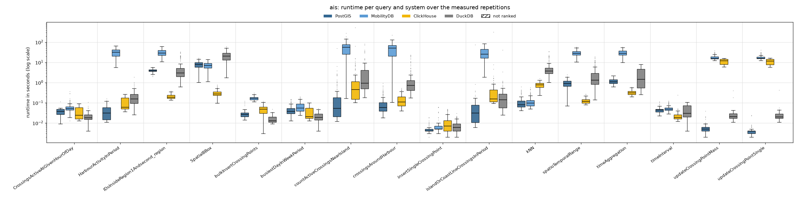
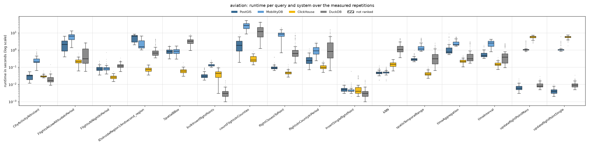
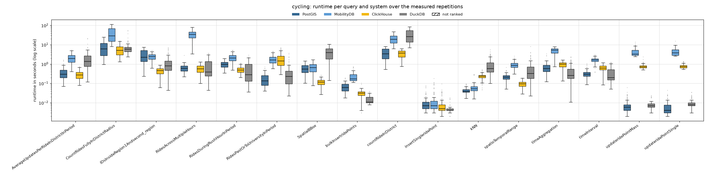
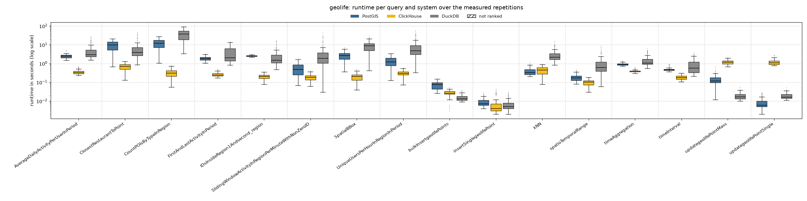

# Reads and writes 75/25, 2 client threads

Run of 2026-10-26 to 2026-10-27. Every system alone on the five-node cluster, one system after the other; 2 client threads taking the queries from one shared queue (so 2 queries run at the same time). Each of the 48 read queries runs with **128 measured parameter sets** (the same sets in every client-thread run) after 2 warm-up repetitions. Write queries (inserts, updates, bulk inserts of 10 rows) are mixed in: 25 % of the measured executions; everything they added is removed after each system (`purge_writes.sh`). Systems without write support are not part of this workload. Timeout 600 s per query. The configuration of every system is described in the [main README](../../../../../README.md#configuration). All numbers below come from the CSV files in this folder (`build_results.py`, `empty_results.py`); [`tables.md`](tables.md) has every table in full.

## Summary

| System | Queries won | Ranked on | Geo-mean slowdown vs fastest | Median slowdown | Measured executions | Failed |
|---|---:|---:|---:|---:|---:|---:|
| ClickHouse | 34 | 48 of 48 | 1.37× | 1.00× | 7,937 | 2 |
| PostGIS | 9 | 48 of 48 | 3.32× | 2.50× | 7,937 | 2 |
| DuckDB | 5 | 48 of 48 | 8.13× | 9.29× | 7,937 | 2 |
| MobilityDB | 0 | 36 of 36 | 16.08× | 10.86× | 5,889 | 2 |

Wins and slowdowns count the read queries only (comparable with the read-only runs); the writes are below (*Writes*). *Slowdown*: a system's mean runtime on a query divided by the fastest ranked system's, over the queries the system is ranked on. A system is ranked on a query when every measured repetition succeeded and its results match PostGIS (pre-run equivalence check; accepted: nearest-neighbour ties, numbers within 1 %, an empty answer as no row or one row of zeros).

**Wins by scenario and by query type:**

| | PostGIS | ClickHouse | DuckDB |
|---|---:|---:|---:|
| AIS | 4 | 5 | 3 |
| Aviation | 1 | 10 | 1 |
| Cycling | 3 | 8 | 1 |
| Geolife | 1 | 11 | – |
| spatial | 6 | 10 | – |
| temporal | 1 | 12 | 3 |
| spatiotemporal | 2 | 12 | 2 |

## Total runtime, pair by pair

Sum of the measured repetitions' runtimes over only the queries both systems completed.

| System A | System B | Common queries | A | B | A / B |
|---|---|---:|---:|---:|---:|
| PostGIS | MobilityDB | 48 | 93.3 min | 955.1 min | 0.1 |
| PostGIS | ClickHouse | 64 | 171.4 min | 138.3 min | 1.24 |
| PostGIS | DuckDB | 64 | 171.4 min | 373.9 min | 0.46 |
| MobilityDB | ClickHouse | 48 | 955.1 min | 125.2 min | 7.63 |
| MobilityDB | DuckDB | 48 | 955.1 min | 187.6 min | 5.09 |
| ClickHouse | DuckDB | 64 | 138.3 min | 373.9 min | 0.37 |

## Failures

Parameter sets left out for every system:

| Scenario | Query | Repetition | Reason |
|---|---|---:|---|
| ais | countActiveCrossingsNearIsland | 81 | every system timed out |
| ais | countActiveCrossingsNearIsland | 96 | every system timed out |

Measured executions that did not succeed (including those in the parameter sets above):

| System | Scenario | Query | Status | Count |
|---|---|---|---|---:|
| ClickHouse | ais | countActiveCrossingsNearIsland | timeout | 2 |
| DuckDB | ais | countActiveCrossingsNearIsland | timeout | 2 |
| MobilityDB | ais | countActiveCrossingsNearIsland | timeout | 2 |
| PostGIS | ais | countActiveCrossingsNearIsland | timeout | 2 |

## Writes

Mean (95th percentile) runtime of each write query, over its measured executions; **bold**: fastest. An update moves points that an insert of the same run added; ClickHouse writes an update as a re-insert plus a lightweight delete, MobilityDB writes into its trajectories.

| Scenario | Write query | PostGIS | MobilityDB | ClickHouse | DuckDB |
|---|---|---:|---:|---:|---:|
| AIS | bulkInsertCrossingPoints | 29 ms (41 ms) | 173 ms (255 ms) | 47 ms (82 ms) | **16 ms** (28 ms) |
| AIS | insertSingleCrossingPoint | **5 ms** (10 ms) | 9 ms (33 ms) | 12 ms (40 ms) | 8 ms (19 ms) |
| AIS | updateCrossingPointMass | **6 ms** (10 ms) | 17.86 s (27.89 s) | 11.10 s (15.19 s) | 27 ms (40 ms) |
| AIS | updateCrossingPointSingle | **4 ms** (7 ms) | 17.77 s (29.04 s) | 11.04 s (15.49 s) | 26 ms (40 ms) |
| Aviation | bulkInsertflightPoints | 36 ms (82 ms) | 138 ms (186 ms) | 42 ms (89 ms) | **4 ms** (8 ms) |
| Aviation | insertSingleflightPoint | 5 ms (8 ms) | 6 ms (9 ms) | 8 ms (30 ms) | **4 ms** (14 ms) |
| Aviation | updateflightPointMass | **7 ms** (12 ms) | 1.23 s (2.82 s) | 5.58 s (6.88 s) | 10 ms (18 ms) |
| Aviation | updateflightPointSingle | **4 ms** (6 ms) | 1.28 s (2.81 s) | 5.59 s (6.84 s) | 10 ms (19 ms) |
| Cycling | bulkInsertridePoints | 70 ms (129 ms) | 224 ms (437 ms) | 30 ms (46 ms) | **15 ms** (29 ms) |
| Cycling | insertSingleridePoint | 11 ms (31 ms) | 18 ms (86 ms) | 10 ms (34 ms) | **5 ms** (8 ms) |
| Cycling | updateridePointMass | 8 ms (24 ms) | 4.33 s (9.12 s) | 773 ms (1.13 s) | **8 ms** (18 ms) |
| Cycling | updateridePointSingle | **7 ms** (23 ms) | 4.58 s (8.60 s) | 779 ms (1.17 s) | 10 ms (20 ms) |
| Geolife | bulkInsertgeolifePoints | 73 ms (135 ms) | – | 27 ms (40 ms) | **15 ms** (29 ms) |
| Geolife | insertSinglegeolifePoint | 9 ms (20 ms) | – | 8 ms (28 ms) | **7 ms** (21 ms) |
| Geolife | updategeolifePointMass | 148 ms (320 ms) | – | 1.20 s (1.70 s) | **19 ms** (35 ms) |
| Geolife | updategeolifePointSingle | **9 ms** (23 ms) | – | 1.21 s (1.84 s) | 19 ms (32 ms) |

| System | Write queries won | Geo-mean slowdown vs fastest |
|---|---:|---:|
| PostGIS | 7 | 1.79× |
| MobilityDB | 0 | 70.12× |
| ClickHouse | 0 | 30.85× |
| DuckDB | 9 | 1.47× |

## Latency per scenario

One section per scenario. The box plot shows every system's runtimes over the measured repetitions that succeeded (box: 25th to 75th percentile, line: median, whiskers: 1.5 × the box height, dots: outliers; log scale; hatched: not ranked). The table below it gives mean, median, 95th and 99th percentile and standard deviation over those repetitions (n); the variance (standard deviation squared, ms²) is in `summary.csv` (`var_ms2`). **Bold**: fastest ranked system on the query (by mean).

### AIS

| Query | System | n | Mean | Median | p95 | p99 | Std dev |
|---|---|---:|---:|---:|---:|---:|---:|
| `CrossingsActiveAtGivenHourOfDay` | PostGIS | 128 | 36 ms | 38 ms | 53 ms | 55 ms | 15 ms |
|  | MobilityDB | 128 | 62 ms | 52 ms | 128 ms | 292 ms | 48 ms |
|  | ClickHouse | 128 | 37 ms | 24 ms | 76 ms | 84 ms | 23 ms |
|  | **DuckDB** | 128 | **22 ms** | 18 ms | 42 ms | 65 ms | 12 ms |
| `HarbourActivityInPeriod` | **PostGIS** | 128 | **40 ms** | 31 ms | 98 ms | 130 ms | 32 ms |
|  | MobilityDB | 128 | 32.47 s | 31.40 s | 57.31 s | 65.20 s | 14.24 s |
|  | ClickHouse | 128 | 110 ms | 60 ms | 236 ms | 260 ms | 72 ms |
|  | DuckDB | 128 | 211 ms | 154 ms | 497 ms | 996 ms | 222 ms |
| `IDsInsideRegion1Andsecond_region` | PostGIS | 128 | 3.98 s | 3.89 s | 5.25 s | 5.71 s | 720 ms |
|  | MobilityDB | 128 | 31.22 s | 29.16 s | 55.86 s | 59.09 s | 11.80 s |
|  | **ClickHouse** | 128 | **207 ms** | 190 ms | 323 ms | 356 ms | 57 ms |
|  | DuckDB | 128 | 6.26 s | 2.96 s | 20.82 s | 31.70 s | 7.56 s |
| `SpatialBBox` | PostGIS | 128 | 7.99 s | 7.88 s | 13.58 s | 15.58 s | 2.99 s |
|  | MobilityDB | 128 | 7.27 s | 7.11 s | 12.28 s | 13.41 s | 2.61 s |
|  | **ClickHouse** | 128 | **305 ms** | 274 ms | 527 ms | 679 ms | 122 ms |
|  | DuckDB | 128 | 21.10 s | 20.22 s | 38.71 s | 53.13 s | 11.64 s |
| `bulkInsertCrossingPoints` | PostGIS | 128 | 29 ms | 27 ms | 41 ms | 99 ms | 14 ms |
|  | MobilityDB | 128 | 173 ms | 164 ms | 255 ms | 270 ms | 41 ms |
|  | ClickHouse | 128 | 47 ms | 49 ms | 82 ms | 105 ms | 26 ms |
|  | **DuckDB** | 128 | **16 ms** | 13 ms | 28 ms | 34 ms | 7 ms |
| `busiestDayInWeekPeriod` | PostGIS | 128 | 49 ms | 38 ms | 112 ms | 146 ms | 30 ms |
|  | MobilityDB | 128 | 69 ms | 55 ms | 146 ms | 176 ms | 39 ms |
|  | ClickHouse | 128 | 36 ms | 21 ms | 85 ms | 95 ms | 24 ms |
|  | **DuckDB** | 128 | **21 ms** | 19 ms | 42 ms | 46 ms | 10 ms |
| `countActiveCrossingsNearIsland` | **PostGIS** | 126 | **712 ms** | 54 ms | 2.24 s | 5.78 s | 4.47 s |
|  | MobilityDB | 126 | 56.28 s | 55.79 s | 125.58 s | 184.45 s | 42.93 s |
|  | ClickHouse | 126 | 6.12 s | 450 ms | 8.81 s | 52.33 s | 46.76 s |
|  | DuckDB | 126 | 4.75 s | 943 ms | 25.66 s | 63.93 s | 11.51 s |
| `crossingsAroundHarbour` | **PostGIS** | 128 | **118 ms** | 58 ms | 404 ms | 688 ms | 148 ms |
|  | MobilityDB | 128 | 49.79 s | 50.72 s | 107.07 s | 128.48 s | 35.07 s |
|  | ClickHouse | 128 | 148 ms | 108 ms | 386 ms | 475 ms | 106 ms |
|  | DuckDB | 128 | 2.48 s | 723 ms | 13.31 s | 21.93 s | 4.72 s |
| `insertSingleCrossingPoint` | **PostGIS** | 128 | **5 ms** | 4 ms | 10 ms | 18 ms | 3 ms |
|  | MobilityDB | 128 | 9 ms | 5 ms | 33 ms | 61 ms | 12 ms |
|  | ClickHouse | 128 | 12 ms | 7 ms | 40 ms | 46 ms | 12 ms |
|  | DuckDB | 128 | 8 ms | 6 ms | 19 ms | 22 ms | 5 ms |
| `islandOrCoastLineCrossingsInPeriod` | PostGIS | 128 | 633 ms | 32 ms | 169 ms | 710 ms | 6.50 s |
|  | MobilityDB | 128 | 31.61 s | 25.63 s | 68.88 s | 77.48 s | 19.19 s |
|  | ClickHouse | 128 | 2.89 s | 154 ms | 1.50 s | 6.80 s | 27.88 s |
|  | **DuckDB** | 128 | **558 ms** | 140 ms | 885 ms | 2.84 s | 3.62 s |
| `kNN` | **PostGIS** | 128 | **114 ms** | 79 ms | 319 ms | 432 ms | 93 ms |
|  | MobilityDB | 128 | 128 ms | 98 ms | 319 ms | 478 ms | 95 ms |
|  | ClickHouse | 128 | 790 ms | 780 ms | 1.24 s | 1.33 s | 267 ms |
|  | DuckDB | 128 | 6.05 s | 3.76 s | 19.81 s | 33.81 s | 6.42 s |
| `spatioTemporalRange` | PostGIS | 128 | 974 ms | 915 ms | 1.67 s | 2.02 s | 390 ms |
|  | MobilityDB | 128 | 29.36 s | 28.43 s | 45.66 s | 55.85 s | 9.58 s |
|  | **ClickHouse** | 128 | **128 ms** | 116 ms | 206 ms | 246 ms | 37 ms |
|  | DuckDB | 128 | 3.25 s | 1.34 s | 11.99 s | 17.00 s | 4.07 s |
| `timeAggregation` | PostGIS | 128 | 1.18 s | 1.08 s | 1.99 s | 2.17 s | 394 ms |
|  | MobilityDB | 128 | 29.90 s | 28.38 s | 48.03 s | 53.09 s | 9.86 s |
|  | **ClickHouse** | 128 | **326 ms** | 307 ms | 514 ms | 574 ms | 94 ms |
|  | DuckDB | 128 | 2.39 s | 1.47 s | 6.92 s | 7.72 s | 2.29 s |
| `timeInterval` | PostGIS | 128 | 45 ms | 44 ms | 68 ms | 102 ms | 14 ms |
|  | MobilityDB | 128 | 53 ms | 49 ms | 97 ms | 111 ms | 18 ms |
|  | **ClickHouse** | 128 | **24 ms** | 19 ms | 40 ms | 51 ms | 21 ms |
|  | DuckDB | 128 | 44 ms | 30 ms | 96 ms | 104 ms | 30 ms |
| `updateCrossingPointMass` | **PostGIS** | 128 | **6 ms** | 5 ms | 10 ms | 21 ms | 4 ms |
|  | MobilityDB | 128 | 17.86 s | 15.95 s | 27.89 s | 32.42 s | 4.52 s |
|  | ClickHouse | 128 | 11.10 s | 11.90 s | 15.19 s | 15.68 s | 3.26 s |
|  | DuckDB | 128 | 27 ms | 21 ms | 40 ms | 142 ms | 36 ms |
| `updateCrossingPointSingle` | **PostGIS** | 128 | **4 ms** | 4 ms | 7 ms | 19 ms | 3 ms |
|  | MobilityDB | 128 | 17.77 s | 15.76 s | 29.04 s | 31.13 s | 4.77 s |
|  | ClickHouse | 128 | 11.04 s | 11.48 s | 15.49 s | 16.06 s | 3.35 s |
|  | DuckDB | 128 | 26 ms | 20 ms | 40 ms | 54 ms | 37 ms |

### Aviation

| Query | System | n | Mean | Median | p95 | p99 | Std dev |
|---|---|---:|---:|---:|---:|---:|---:|
| `CityActivityAtInstant` | PostGIS | 128 | 29 ms | 32 ms | 43 ms | 55 ms | 10 ms |
|  | MobilityDB | 128 | 272 ms | 207 ms | 622 ms | 808 ms | 162 ms |
|  | ClickHouse | 128 | 31 ms | 29 ms | 41 ms | 49 ms | 6 ms |
|  | **DuckDB** | 128 | **22 ms** | 17 ms | 41 ms | 61 ms | 15 ms |
| `FlightsAtLowAltitudeInPeriod` | PostGIS | 128 | 2.26 s | 2.08 s | 4.68 s | 5.60 s | 1.44 s |
|  | MobilityDB | 128 | 6.24 s | 6.42 s | 11.12 s | 12.82 s | 2.74 s |
|  | **ClickHouse** | 128 | **227 ms** | 208 ms | 359 ms | 494 ms | 82 ms |
|  | DuckDB | 128 | 696 ms | 306 ms | 2.03 s | 2.56 s | 699 ms |
| `FlightsAtNightInPeriod` | PostGIS | 128 | 89 ms | 79 ms | 153 ms | 222 ms | 34 ms |
|  | MobilityDB | 128 | 92 ms | 80 ms | 141 ms | 271 ms | 65 ms |
|  | **ClickHouse** | 128 | **27 ms** | 26 ms | 37 ms | 43 ms | 7 ms |
|  | DuckDB | 128 | 128 ms | 119 ms | 223 ms | 243 ms | 48 ms |
| `IDsInsideRegion1Andsecond_region` | PostGIS | 128 | 5.41 s | 6.41 s | 7.65 s | 7.94 s | 2.07 s |
|  | MobilityDB | 128 | 2.36 s | 1.55 s | 5.67 s | 6.24 s | 1.58 s |
|  | **ClickHouse** | 128 | **76 ms** | 74 ms | 119 ms | 137 ms | 23 ms |
|  | DuckDB | 128 | 1.03 s | 654 ms | 3.56 s | 4.26 s | 973 ms |
| `SpatialBBox` | PostGIS | 128 | 854 ms | 802 ms | 1.43 s | 1.74 s | 326 ms |
|  | MobilityDB | 128 | 898 ms | 844 ms | 1.56 s | 1.72 s | 356 ms |
|  | **ClickHouse** | 128 | **62 ms** | 59 ms | 93 ms | 124 ms | 21 ms |
|  | DuckDB | 128 | 3.38 s | 3.26 s | 6.33 s | 7.41 s | 1.39 s |
| `bulkInsertflightPoints` | PostGIS | 122 | 36 ms | 30 ms | 82 ms | 91 ms | 18 ms |
|  | MobilityDB | 122 | 138 ms | 128 ms | 186 ms | 254 ms | 30 ms |
|  | ClickHouse | 122 | 42 ms | 44 ms | 89 ms | 104 ms | 24 ms |
|  | **DuckDB** | 122 | **4 ms** | 3 ms | 8 ms | 16 ms | 3 ms |
| `countFlightsInCounties` | PostGIS | 53 | 2.17 s | 1.89 s | 4.72 s | 6.73 s | 1.61 s |
|  | MobilityDB | 53 | 26.18 s | 26.21 s | 44.95 s | 50.19 s | 10.97 s |
|  | **ClickHouse** | 53 | **324 ms** | 261 ms | 582 ms | 719 ms | 152 ms |
|  | DuckDB | 53 | 14.19 s | 11.52 s | 35.34 s | 42.84 s | 10.79 s |
| `flightClosestToPoint` | PostGIS | 128 | 100 ms | 91 ms | 145 ms | 325 ms | 42 ms |
|  | MobilityDB | 128 | 8.40 s | 8.32 s | 14.23 s | 18.43 s | 3.40 s |
|  | **ClickHouse** | 128 | **50 ms** | 46 ms | 76 ms | 104 ms | 15 ms |
|  | DuckDB | 128 | 1.49 s | 630 ms | 6.76 s | 7.40 s | 2.02 s |
| `flightsInCountyInPeriod` | PostGIS | 128 | 289 ms | 240 ms | 605 ms | 979 ms | 190 ms |
|  | MobilityDB | 128 | 1.02 s | 906 ms | 2.06 s | 2.55 s | 581 ms |
|  | **ClickHouse** | 128 | **106 ms** | 98 ms | 163 ms | 218 ms | 36 ms |
|  | DuckDB | 128 | 2.29 s | 820 ms | 9.66 s | 15.23 s | 3.26 s |
| `insertSingleflightPoint` | PostGIS | 122 | 5 ms | 5 ms | 8 ms | 10 ms | 2 ms |
|  | MobilityDB | 122 | 6 ms | 4 ms | 9 ms | 49 ms | 7 ms |
|  | ClickHouse | 122 | 8 ms | 4 ms | 30 ms | 31 ms | 9 ms |
|  | **DuckDB** | 122 | **4 ms** | 3 ms | 14 ms | 18 ms | 4 ms |
| `kNN` | **PostGIS** | 128 | **51 ms** | 47 ms | 84 ms | 105 ms | 16 ms |
|  | MobilityDB | 128 | 52 ms | 50 ms | 81 ms | 97 ms | 15 ms |
|  | ClickHouse | 128 | 150 ms | 147 ms | 241 ms | 272 ms | 50 ms |
|  | DuckDB | 128 | 1.52 s | 1.04 s | 4.38 s | 4.61 s | 1.15 s |
| `spatioTemporalRange` | PostGIS | 128 | 311 ms | 277 ms | 549 ms | 649 ms | 112 ms |
|  | MobilityDB | 128 | 1.69 s | 1.14 s | 4.23 s | 4.84 s | 1.17 s |
|  | **ClickHouse** | 128 | **44 ms** | 40 ms | 73 ms | 89 ms | 14 ms |
|  | DuckDB | 128 | 480 ms | 306 ms | 1.43 s | 2.21 s | 479 ms |
| `timeAggregation` | PostGIS | 128 | 1.28 s | 768 ms | 3.90 s | 6.04 s | 1.27 s |
|  | MobilityDB | 128 | 2.63 s | 2.02 s | 5.36 s | 5.83 s | 1.20 s |
|  | **ClickHouse** | 128 | **230 ms** | 218 ms | 336 ms | 449 ms | 63 ms |
|  | DuckDB | 128 | 632 ms | 306 ms | 2.47 s | 3.03 s | 721 ms |
| `timeInterval` | PostGIS | 128 | 571 ms | 462 ms | 1.01 s | 1.69 s | 275 ms |
|  | MobilityDB | 128 | 2.45 s | 2.53 s | 3.73 s | 4.11 s | 956 ms |
|  | **ClickHouse** | 128 | **152 ms** | 142 ms | 233 ms | 291 ms | 47 ms |
|  | DuckDB | 128 | 601 ms | 378 ms | 1.94 s | 2.32 s | 629 ms |
| `updateflightPointMass` | **PostGIS** | 122 | **7 ms** | 6 ms | 12 ms | 18 ms | 3 ms |
|  | MobilityDB | 122 | 1.23 s | 1.04 s | 2.82 s | 3.44 s | 588 ms |
|  | ClickHouse | 122 | 5.58 s | 5.80 s | 6.88 s | 7.12 s | 1.04 s |
|  | DuckDB | 122 | 10 ms | 8 ms | 18 ms | 21 ms | 4 ms |
| `updateflightPointSingle` | **PostGIS** | 121 | **4 ms** | 4 ms | 6 ms | 9 ms | 1 ms |
|  | MobilityDB | 121 | 1.28 s | 1.05 s | 2.81 s | 5.50 s | 812 ms |
|  | ClickHouse | 121 | 5.59 s | 5.78 s | 6.84 s | 7.14 s | 1.01 s |
|  | DuckDB | 121 | 10 ms | 9 ms | 19 ms | 21 ms | 4 ms |

### Cycling

| Query | System | n | Mean | Median | p95 | p99 | Std dev |
|---|---|---:|---:|---:|---:|---:|---:|
| `AverageUpdatesPerRideInDistrictInPeriod` | PostGIS | 128 | 396 ms | 295 ms | 943 ms | 1.51 s | 294 ms |
|  | MobilityDB | 128 | 2.08 s | 1.95 s | 3.82 s | 4.91 s | 1.07 s |
|  | **ClickHouse** | 128 | **305 ms** | 274 ms | 640 ms | 696 ms | 157 ms |
|  | DuckDB | 128 | 2.19 s | 1.36 s | 5.37 s | 17.83 s | 2.89 s |
| `CountRidesFullyInDistrictRadius` | PostGIS | 128 | 7.91 s | 6.13 s | 20.50 s | 23.73 s | 6.12 s |
|  | MobilityDB | 128 | 41.71 s | 28.88 s | 93.60 s | 111.60 s | 29.95 s |
|  | **ClickHouse** | 128 | **5.84 s** | 5.04 s | 13.11 s | 14.94 s | 3.44 s |
|  | DuckDB | 128 | 7.36 s | 5.96 s | 14.88 s | 47.85 s | 7.26 s |
| `IDsInsideRegion1Andsecond_region` | PostGIS | 128 | 3.13 s | 2.22 s | 6.72 s | 7.27 s | 2.03 s |
|  | MobilityDB | 128 | 2.50 s | 2.43 s | 4.22 s | 4.94 s | 951 ms |
|  | **ClickHouse** | 128 | **454 ms** | 462 ms | 779 ms | 864 ms | 198 ms |
|  | DuckDB | 128 | 1.30 s | 796 ms | 5.01 s | 6.59 s | 1.43 s |
| `RidesAcrossMultipleHours` | PostGIS | 128 | 657 ms | 600 ms | 1.12 s | 1.20 s | 314 ms |
|  | MobilityDB | 128 | 35.88 s | 34.66 s | 64.94 s | 73.66 s | 16.27 s |
|  | **ClickHouse** | 128 | **605 ms** | 572 ms | 1.09 s | 1.28 s | 283 ms |
|  | DuckDB | 128 | 815 ms | 390 ms | 2.49 s | 3.33 s | 849 ms |
| `RidesDuringRushHourInPeriod` | PostGIS | 128 | 999 ms | 957 ms | 1.60 s | 1.85 s | 364 ms |
|  | MobilityDB | 128 | 2.27 s | 2.08 s | 4.29 s | 5.13 s | 1.04 s |
|  | **ClickHouse** | 128 | **525 ms** | 498 ms | 952 ms | 1.07 s | 196 ms |
|  | DuckDB | 128 | 617 ms | 282 ms | 1.98 s | 2.30 s | 646 ms |
| `RidesPastOrToUniversityInPeriod` | **PostGIS** | 128 | **179 ms** | 136 ms | 419 ms | 601 ms | 129 ms |
|  | MobilityDB | 128 | 1.84 s | 1.62 s | 3.55 s | 4.37 s | 918 ms |
|  | ClickHouse | 128 | 1.96 s | 1.44 s | 5.20 s | 6.49 s | 1.49 s |
|  | DuckDB | 128 | 413 ms | 226 ms | 1.53 s | 3.08 s | 594 ms |
| `SpatialBBox` | PostGIS | 128 | 606 ms | 550 ms | 1.13 s | 1.39 s | 317 ms |
|  | MobilityDB | 128 | 689 ms | 650 ms | 1.29 s | 1.50 s | 354 ms |
|  | **ClickHouse** | 128 | **118 ms** | 118 ms | 192 ms | 235 ms | 47 ms |
|  | DuckDB | 128 | 4.06 s | 3.88 s | 8.75 s | 10.14 s | 2.63 s |
| `bulkInsertridePoints` | PostGIS | 119 | 70 ms | 62 ms | 129 ms | 186 ms | 37 ms |
|  | MobilityDB | 119 | 224 ms | 169 ms | 437 ms | 688 ms | 127 ms |
|  | ClickHouse | 119 | 30 ms | 31 ms | 46 ms | 83 ms | 14 ms |
|  | **DuckDB** | 119 | **15 ms** | 11 ms | 29 ms | 35 ms | 7 ms |
| `countRideInDistrict` | PostGIS | 12 | 3.94 s | 3.40 s | 8.11 s | 8.17 s | 2.77 s |
|  | MobilityDB | 12 | 22.41 s | 19.13 s | 43.48 s | 46.25 s | 13.56 s |
|  | **ClickHouse** | 12 | **3.64 s** | 3.65 s | 6.10 s | 6.17 s | 1.79 s |
|  | DuckDB | 12 | 35.66 s | 26.52 s | 75.20 s | 83.08 s | 26.26 s |
| `insertSingleridePoint` | PostGIS | 118 | 11 ms | 7 ms | 31 ms | 69 ms | 12 ms |
|  | MobilityDB | 118 | 18 ms | 7 ms | 86 ms | 114 ms | 28 ms |
|  | ClickHouse | 118 | 10 ms | 5 ms | 34 ms | 46 ms | 12 ms |
|  | **DuckDB** | 118 | **5 ms** | 4 ms | 8 ms | 18 ms | 3 ms |
| `kNN` | **PostGIS** | 128 | **42 ms** | 39 ms | 72 ms | 89 ms | 15 ms |
|  | MobilityDB | 128 | 64 ms | 53 ms | 107 ms | 291 ms | 48 ms |
|  | ClickHouse | 128 | 239 ms | 236 ms | 373 ms | 484 ms | 79 ms |
|  | DuckDB | 128 | 1.02 s | 593 ms | 3.09 s | 4.49 s | 1.01 s |
| `spatioTemporalRange` | PostGIS | 128 | 225 ms | 212 ms | 364 ms | 473 ms | 90 ms |
|  | MobilityDB | 128 | 970 ms | 859 ms | 1.75 s | 2.06 s | 399 ms |
|  | **ClickHouse** | 128 | **98 ms** | 96 ms | 175 ms | 190 ms | 36 ms |
|  | DuckDB | 128 | 658 ms | 324 ms | 2.46 s | 4.01 s | 984 ms |
| `timeAggregation` | PostGIS | 128 | 698 ms | 578 ms | 1.40 s | 2.75 s | 460 ms |
|  | MobilityDB | 128 | 4.88 s | 5.28 s | 7.06 s | 7.73 s | 1.63 s |
|  | ClickHouse | 128 | 939 ms | 1.00 s | 1.38 s | 1.49 s | 312 ms |
|  | **DuckDB** | 128 | **486 ms** | 260 ms | 1.60 s | 2.28 s | 511 ms |
| `timeInterval` | **PostGIS** | 128 | **325 ms** | 295 ms | 575 ms | 911 ms | 148 ms |
|  | MobilityDB | 128 | 1.63 s | 1.63 s | 2.40 s | 2.83 s | 476 ms |
|  | ClickHouse | 128 | 641 ms | 620 ms | 1.00 s | 1.16 s | 225 ms |
|  | DuckDB | 128 | 346 ms | 200 ms | 1.03 s | 1.23 s | 297 ms |
| `updateridePointMass` | PostGIS | 118 | 8 ms | 6 ms | 24 ms | 34 ms | 8 ms |
|  | MobilityDB | 118 | 4.33 s | 3.32 s | 9.12 s | 11.14 s | 2.18 s |
|  | ClickHouse | 118 | 773 ms | 712 ms | 1.13 s | 1.65 s | 234 ms |
|  | **DuckDB** | 118 | **8 ms** | 7 ms | 18 ms | 22 ms | 4 ms |
| `updateridePointSingle` | **PostGIS** | 118 | **7 ms** | 4 ms | 23 ms | 28 ms | 6 ms |
|  | MobilityDB | 118 | 4.58 s | 3.79 s | 8.60 s | 9.61 s | 2.19 s |
|  | ClickHouse | 118 | 779 ms | 737 ms | 1.17 s | 1.37 s | 181 ms |
|  | DuckDB | 118 | 10 ms | 8 ms | 20 ms | 32 ms | 5 ms |

### Geolife

| Query | System | n | Mean | Median | p95 | p99 | Std dev |
|---|---|---:|---:|---:|---:|---:|---:|
| `AverageDailyActivityPerUserInPeriod` | PostGIS | 128 | 2.54 s | 2.49 s | 3.39 s | 4.76 s | 625 ms |
|  | **ClickHouse** | 128 | **359 ms** | 330 ms | 565 ms | 653 ms | 100 ms |
|  | DuckDB | 128 | 5.56 s | 2.99 s | 17.36 s | 24.06 s | 5.63 s |
| `ClosestRestaurantToPoint` | PostGIS | 128 | 9.75 s | 9.83 s | 18.49 s | 20.05 s | 5.34 s |
|  | **ClickHouse** | 128 | **694 ms** | 693 ms | 1.14 s | 1.22 s | 267 ms |
|  | DuckDB | 128 | 7.51 s | 3.84 s | 27.47 s | 41.70 s | 8.98 s |
| `CountPOIsByTypeInRegion` | PostGIS | 128 | 12.93 s | 12.06 s | 24.91 s | 25.95 s | 7.06 s |
|  | **ClickHouse** | 128 | **324 ms** | 313 ms | 611 ms | 718 ms | 159 ms |
|  | DuckDB | 128 | 36.85 s | 37.13 s | 67.29 s | 84.34 s | 20.69 s |
| `FirstAndLastActivityInPeriod` | PostGIS | 128 | 1.89 s | 1.85 s | 2.58 s | 3.14 s | 425 ms |
|  | **ClickHouse** | 128 | **269 ms** | 246 ms | 403 ms | 471 ms | 70 ms |
|  | DuckDB | 128 | 4.00 s | 2.05 s | 12.31 s | 13.60 s | 3.69 s |
| `IDsInsideRegion1Andsecond_region` | PostGIS | 128 | 2.55 s | 2.56 s | 2.82 s | 2.91 s | 160 ms |
|  | **ClickHouse** | 128 | **203 ms** | 201 ms | 294 ms | 319 ms | 55 ms |
|  | DuckDB | 128 | 2.98 s | 1.50 s | 10.88 s | 15.78 s | 3.46 s |
| `SlidingWindowActivityInRegionPerMinuteWithNonZeroID` | PostGIS | 128 | 586 ms | 484 ms | 1.39 s | 1.64 s | 418 ms |
|  | **ClickHouse** | 128 | **192 ms** | 182 ms | 361 ms | 401 ms | 77 ms |
|  | DuckDB | 128 | 4.79 s | 1.90 s | 25.10 s | 31.01 s | 7.48 s |
| `SpatialBBox` | PostGIS | 128 | 2.71 s | 2.70 s | 4.98 s | 6.38 s | 1.31 s |
|  | **ClickHouse** | 128 | **201 ms** | 204 ms | 328 ms | 457 ms | 86 ms |
|  | DuckDB | 128 | 9.14 s | 8.86 s | 19.36 s | 24.36 s | 5.35 s |
| `UniqueUsersPerHourInRegionInPeriod` | PostGIS | 128 | 1.43 s | 1.23 s | 3.00 s | 3.31 s | 812 ms |
|  | **ClickHouse** | 128 | **309 ms** | 293 ms | 455 ms | 563 ms | 84 ms |
|  | DuckDB | 128 | 9.19 s | 4.70 s | 33.17 s | 48.43 s | 10.98 s |
| `bulkInsertgeolifePoints` | PostGIS | 128 | 73 ms | 74 ms | 135 ms | 146 ms | 32 ms |
|  | ClickHouse | 128 | 27 ms | 26 ms | 40 ms | 48 ms | 9 ms |
|  | **DuckDB** | 128 | **15 ms** | 13 ms | 29 ms | 36 ms | 6 ms |
| `insertSinglegeolifePoint` | PostGIS | 128 | 9 ms | 7 ms | 20 ms | 24 ms | 5 ms |
|  | ClickHouse | 128 | 8 ms | 4 ms | 28 ms | 38 ms | 10 ms |
|  | **DuckDB** | 128 | **7 ms** | 5 ms | 21 ms | 28 ms | 6 ms |
| `kNN` | **PostGIS** | 128 | **392 ms** | 334 ms | 730 ms | 910 ms | 175 ms |
|  | ClickHouse | 128 | 447 ms | 446 ms | 768 ms | 880 ms | 205 ms |
|  | DuckDB | 128 | 3.43 s | 2.15 s | 9.73 s | 14.99 s | 3.04 s |
| `spatioTemporalRange` | PostGIS | 128 | 187 ms | 172 ms | 371 ms | 422 ms | 80 ms |
|  | **ClickHouse** | 128 | **101 ms** | 103 ms | 152 ms | 173 ms | 33 ms |
|  | DuckDB | 128 | 1.21 s | 619 ms | 4.51 s | 7.16 s | 1.59 s |
| `timeAggregation` | PostGIS | 128 | 920 ms | 858 ms | 1.26 s | 1.35 s | 155 ms |
|  | **ClickHouse** | 128 | **396 ms** | 386 ms | 548 ms | 576 ms | 59 ms |
|  | DuckDB | 128 | 1.67 s | 1.07 s | 4.47 s | 5.06 s | 1.28 s |
| `timeInterval` | PostGIS | 128 | 496 ms | 462 ms | 809 ms | 946 ms | 122 ms |
|  | **ClickHouse** | 128 | **187 ms** | 177 ms | 279 ms | 292 ms | 50 ms |
|  | DuckDB | 128 | 911 ms | 564 ms | 2.59 s | 3.25 s | 804 ms |
| `updategeolifePointMass` | PostGIS | 128 | 148 ms | 116 ms | 320 ms | 562 ms | 104 ms |
|  | ClickHouse | 128 | 1.20 s | 1.16 s | 1.70 s | 1.93 s | 299 ms |
|  | **DuckDB** | 128 | **19 ms** | 16 ms | 35 ms | 49 ms | 8 ms |
| `updategeolifePointSingle` | **PostGIS** | 128 | **9 ms** | 6 ms | 23 ms | 27 ms | 6 ms |
|  | ClickHouse | 128 | 1.21 s | 1.10 s | 1.84 s | 2.62 s | 408 ms |
|  | DuckDB | 128 | 19 ms | 16 ms | 32 ms | 39 ms | 7 ms |

## Hardware

Means over the five nodes and over the time the system ran (5 s samples; per scenario and node in `hardware_by_phase.csv`).

| System | Run time | CPU busy | Memory used | Disk read |
|---|---:|---:|---:|---:|
| PostGIS | 1.6 h | 46 % | 16.4 GB | 1724 MB/s |
| MobilityDB | 8.3 h | 12 % | 16.2 GB | 1291 MB/s |
| ClickHouse | 1.3 h | 51 % | 7.3 GB | 17 MB/s |
| DuckDB | 3.4 h | 20 % | 13.3 GB | 59 MB/s |

## Caveats

- **SpaceTime's Geolife data** differs slightly from the other systems'; its Geolife queries whose results differ from PostGIS (SlidingWindowActivityInRegionPerMinuteWithNonZeroID, UniqueUsersPerHourInRegionInPeriod, timeAggregation) are ranked on request (`equivalence.csv`).
- **Client host:** the benchmark client runs on a separate host with one CPU core and 1 GB of RAM. Results are read in batches of 100,000 rows; with several client threads, the client can become a limit for queries with large results.
- **Sedona** skips GeoParquet files by their bounding box only when a query compares with a constant geometry; joins with a whole reference table (harbours, islands, districts, counties) read the whole table.
- **Parameters** are drawn where the data is (points, regions, time windows and places from a sample of the loaded data; see benchmark/configuration/README.md), each measured parameter set of a query distinct; every system answers the same parameter sets.

## Files

| File | One row per |
|---|---|
| `executions.csv` | query execution (scenario, system, query, repetition, warm-up, status, duration, parameters, SQL) |
| `summary.csv` | (scenario, query, system): runs, failures, mean/median/p95/p99/min/max/std dev/variance, equivalence, rank |
| `winners.csv` | (scenario, query): fastest ranked system, runner-up, margin |
| `system_scores.csv` | system: wins, completed and ranked queries, slowdowns |
| `pairwise_total_time.csv` | pair of systems: total runtime over the queries both completed |
| `empty_results.csv` | (scenario, query, system): measured executions without a row |
| `equivalence.csv` | (scenario, query, system): result compared with PostGIS |
| `hardware_by_phase.csv` | (scenario, system): CPU, memory, disk and network per node |
| `dropped_parameter_sets.csv` | parameter sets left out for every system |
| `tables.md`, `plots/` | the tables and figures generated from the above (`plots/boxplot_<scenario>.png`: the box plots) |
| `raw/` | client logs, query files, hardware samples, the equivalence check |
