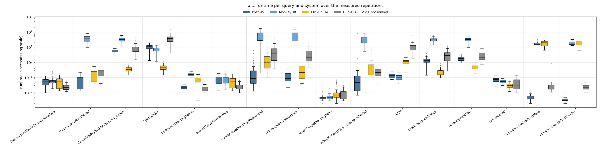
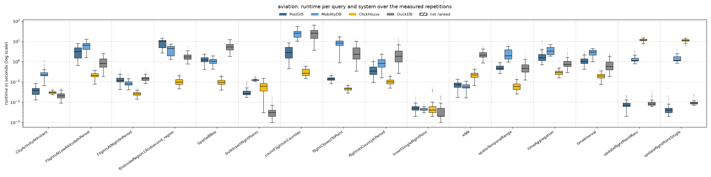
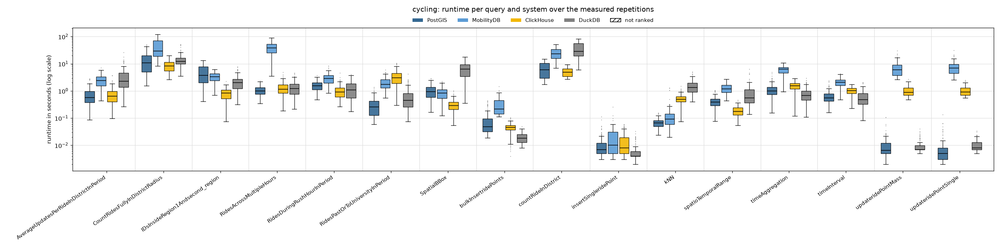
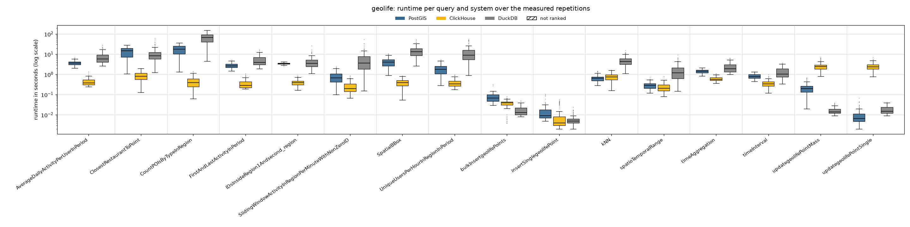

# Reads and writes 75/25, 4 client threads

Run of 2026-10-27 to 2026-10-27. Every system alone on the five-node cluster, one system after the other; 4 client threads taking the queries from one shared queue (so 4 queries run at the same time). Each of the 48 read queries runs with **128 measured parameter sets** (the same sets in every client-thread run) after 4 warm-up repetitions. Write queries (inserts, updates, bulk inserts of 10 rows) are mixed in: 25 % of the measured executions; everything they added is removed after each system (`purge_writes.sh`). Systems without write support are not part of this workload. Timeout 600 s per query. The configuration of every system is described in the [main README](../../../../../README.md#configuration). All numbers below come from the CSV files in this folder (`build_results.py`, `empty_results.py`); [`tables.md`](tables.md) has every table in full.

## Summary

| System | Queries won | Ranked on | Geo-mean slowdown vs fastest | Median slowdown | Measured executions | Failed |
|---|---:|---:|---:|---:|---:|---:|
| ClickHouse | 32 | 48 of 48 | 1.44× | 1.00× | 7,937 | 2 |
| PostGIS | 9 | 48 of 48 | 3.46× | 3.03× | 7,937 | 2 |
| DuckDB | 5 | 48 of 48 | 8.09× | 7.51× | 7,937 | 2 |
| MobilityDB | 2 | 36 of 36 | 12.91× | 9.72× | 5,889 | 2 |

Wins and slowdowns count the read queries only (comparable with the read-only runs); the writes are below (*Writes*). *Slowdown*: a system's mean runtime on a query divided by the fastest ranked system's, over the queries the system is ranked on. A system is ranked on a query when every measured repetition succeeded and its results match PostGIS (pre-run equivalence check; accepted: nearest-neighbour ties, numbers within 1 %, an empty answer as no row or one row of zeros).

**Wins by scenario and by query type:**

| | PostGIS | MobilityDB | ClickHouse | DuckDB |
|---|---:|---:|---:|---:|
| AIS | 4 | 1 | 5 | 2 |
| Aviation | – | 1 | 10 | 1 |
| Cycling | 4 | – | 6 | 2 |
| Geolife | 1 | – | 11 | – |
| spatial | 4 | 2 | 10 | – |
| temporal | 1 | – | 11 | 4 |
| spatiotemporal | 4 | – | 11 | 1 |

## Total runtime, pair by pair

Sum of the measured repetitions' runtimes over only the queries both systems completed.

| System A | System B | Common queries | A | B | A / B |
|---|---|---:|---:|---:|---:|
| PostGIS | MobilityDB | 48 | 145.4 min | 1087.6 min | 0.13 |
| PostGIS | ClickHouse | 64 | 257.4 min | 242.7 min | 1.06 |
| PostGIS | DuckDB | 64 | 257.4 min | 618.5 min | 0.42 |
| MobilityDB | ClickHouse | 48 | 1087.6 min | 219.8 min | 4.95 |
| MobilityDB | DuckDB | 48 | 1087.6 min | 320.5 min | 3.39 |
| ClickHouse | DuckDB | 64 | 242.7 min | 618.5 min | 0.39 |

## Failures

Parameter sets left out for every system:

| Scenario | Query | Repetition | Reason |
|---|---|---:|---|
| ais | countActiveCrossingsNearIsland | 83 | every system timed out |
| ais | countActiveCrossingsNearIsland | 98 | every system timed out |

Measured executions that did not succeed (including those in the parameter sets above):

| System | Scenario | Query | Status | Count |
|---|---|---|---|---:|
| ClickHouse | ais | countActiveCrossingsNearIsland | timeout | 2 |
| DuckDB | ais | countActiveCrossingsNearIsland | timeout | 2 |
| MobilityDB | ais | countActiveCrossingsNearIsland | timeout | 2 |
| PostGIS | ais | countActiveCrossingsNearIsland | timeout | 2 |

## Writes

Mean (95th percentile) runtime of each write query, over its measured executions; **bold**: fastest. An update moves points that an insert of the same run added; ClickHouse writes an update as a re-insert plus a lightweight delete, MobilityDB writes into its trajectories.

| Scenario | Write query | PostGIS | MobilityDB | ClickHouse | DuckDB |
|---|---|---:|---:|---:|---:|
| AIS | bulkInsertCrossingPoints | 26 ms (42 ms) | 163 ms (235 ms) | 72 ms (150 ms) | **20 ms** (33 ms) |
| AIS | insertSingleCrossingPoint | **5 ms** (8 ms) | 6 ms (10 ms) | 15 ms (55 ms) | 9 ms (20 ms) |
| AIS | updateCrossingPointMass | **5 ms** (10 ms) | 18.36 s (30.92 s) | 18.72 s (28.30 s) | 30 ms (42 ms) |
| AIS | updateCrossingPointSingle | **4 ms** (9 ms) | 19.92 s (34.21 s) | 19.81 s (28.64 s) | 24 ms (42 ms) |
| Aviation | bulkInsertflightPoints | 35 ms (84 ms) | 129 ms (180 ms) | 63 ms (126 ms) | **4 ms** (11 ms) |
| Aviation | insertSingleflightPoint | 6 ms (14 ms) | **5 ms** (7 ms) | 10 ms (42 ms) | 5 ms (18 ms) |
| Aviation | updateflightPointMass | **8 ms** (19 ms) | 1.37 s (2.73 s) | 11.47 s (14.16 s) | 11 ms (22 ms) |
| Aviation | updateflightPointSingle | **5 ms** (14 ms) | 1.46 s (2.42 s) | 11.08 s (14.01 s) | 10 ms (21 ms) |
| Cycling | bulkInsertridePoints | 92 ms (319 ms) | 319 ms (846 ms) | 45 ms (77 ms) | **19 ms** (34 ms) |
| Cycling | insertSingleridePoint | 12 ms (38 ms) | 21 ms (44 ms) | 15 ms (45 ms) | **6 ms** (19 ms) |
| Cycling | updateridePointMass | 12 ms (27 ms) | 7.16 s (13.77 s) | 1.07 s (2.07 s) | **10 ms** (24 ms) |
| Cycling | updateridePointSingle | **10 ms** (35 ms) | 7.75 s (13.96 s) | 1.07 s (1.95 s) | 11 ms (23 ms) |
| Geolife | bulkInsertgeolifePoints | 78 ms (132 ms) | – | 37 ms (61 ms) | **17 ms** (35 ms) |
| Geolife | insertSinglegeolifePoint | 15 ms (36 ms) | – | 11 ms (43 ms) | **6 ms** (15 ms) |
| Geolife | updategeolifePointMass | 226 ms (542 ms) | – | 2.61 s (5.13 s) | **16 ms** (30 ms) |
| Geolife | updategeolifePointSingle | **10 ms** (29 ms) | – | 2.49 s (4.59 s) | 18 ms (31 ms) |

| System | Write queries won | Geo-mean slowdown vs fastest |
|---|---:|---:|
| PostGIS | 7 | 1.88× |
| MobilityDB | 1 | 66.55× |
| ClickHouse | 0 | 44.01× |
| DuckDB | 8 | 1.44× |

## Latency per scenario

One section per scenario. The box plot shows every system's runtimes over the measured repetitions that succeeded (box: 25th to 75th percentile, line: median, whiskers: 1.5 × the box height, dots: outliers; log scale; hatched: not ranked). The table below it gives mean, median, 95th and 99th percentile and standard deviation over those repetitions (n); the variance (standard deviation squared, ms²) is in `summary.csv` (`var_ms2`). **Bold**: fastest ranked system on the query (by mean).

### AIS

| Query | System | n | Mean | Median | p95 | p99 | Std dev |
|---|---|---:|---:|---:|---:|---:|---:|
| `CrossingsActiveAtGivenHourOfDay` | PostGIS | 128 | 56 ms | 56 ms | 99 ms | 114 ms | 26 ms |
|  | MobilityDB | 128 | 63 ms | 53 ms | 122 ms | 242 ms | 48 ms |
|  | ClickHouse | 128 | 62 ms | 58 ms | 145 ms | 152 ms | 42 ms |
|  | **DuckDB** | 128 | **25 ms** | 22 ms | 48 ms | 59 ms | 11 ms |
| `HarbourActivityInPeriod` | **PostGIS** | 128 | **66 ms** | 42 ms | 171 ms | 211 ms | 56 ms |
|  | MobilityDB | 128 | 38.03 s | 35.77 s | 66.52 s | 77.43 s | 17.03 s |
|  | ClickHouse | 128 | 186 ms | 167 ms | 486 ms | 680 ms | 152 ms |
|  | DuckDB | 128 | 244 ms | 202 ms | 569 ms | 844 ms | 170 ms |
| `IDsInsideRegion1Andsecond_region` | PostGIS | 128 | 5.76 s | 5.65 s | 7.82 s | 8.68 s | 1.10 s |
|  | MobilityDB | 128 | 33.48 s | 31.86 s | 53.82 s | 61.74 s | 10.64 s |
|  | **ClickHouse** | 128 | **372 ms** | 342 ms | 653 ms | 755 ms | 152 ms |
|  | DuckDB | 128 | 9.28 s | 7.51 s | 25.64 s | 38.65 s | 7.20 s |
| `SpatialBBox` | PostGIS | 128 | 10.86 s | 10.83 s | 18.25 s | 19.41 s | 3.83 s |
|  | MobilityDB | 128 | 7.43 s | 7.30 s | 11.30 s | 12.86 s | 2.42 s |
|  | **ClickHouse** | 128 | **488 ms** | 447 ms | 849 ms | 1.07 s | 200 ms |
|  | DuckDB | 128 | 38.55 s | 36.70 s | 64.29 s | 113.13 s | 21.62 s |
| `bulkInsertCrossingPoints` | PostGIS | 128 | 26 ms | 23 ms | 42 ms | 79 ms | 11 ms |
|  | MobilityDB | 128 | 163 ms | 157 ms | 235 ms | 285 ms | 38 ms |
|  | ClickHouse | 128 | 72 ms | 69 ms | 150 ms | 164 ms | 39 ms |
|  | **DuckDB** | 128 | **20 ms** | 20 ms | 33 ms | 35 ms | 7 ms |
| `busiestDayInWeekPeriod` | PostGIS | 128 | 81 ms | 58 ms | 209 ms | 270 ms | 58 ms |
|  | MobilityDB | 128 | 77 ms | 59 ms | 164 ms | 275 ms | 51 ms |
|  | ClickHouse | 128 | 62 ms | 56 ms | 146 ms | 168 ms | 43 ms |
|  | **DuckDB** | 128 | **27 ms** | 24 ms | 53 ms | 71 ms | 13 ms |
| `countActiveCrossingsNearIsland` | **PostGIS** | 126 | **1.01 s** | 87 ms | 3.11 s | 9.43 s | 5.83 s |
|  | MobilityDB | 126 | 63.88 s | 56.31 s | 144.76 s | 231.35 s | 48.76 s |
|  | ClickHouse | 126 | 11.80 s | 936 ms | 62.15 s | 142.21 s | 52.42 s |
|  | DuckDB | 126 | 9.38 s | 3.66 s | 30.40 s | 101.26 s | 23.61 s |
| `crossingsAroundHarbour` | **PostGIS** | 128 | **185 ms** | 87 ms | 664 ms | 1.15 s | 244 ms |
|  | MobilityDB | 128 | 61.78 s | 56.59 s | 132.14 s | 190.24 s | 43.00 s |
|  | ClickHouse | 128 | 689 ms | 215 ms | 2.87 s | 7.39 s | 1.36 s |
|  | DuckDB | 128 | 4.66 s | 2.00 s | 19.01 s | 21.43 s | 5.77 s |
| `insertSingleCrossingPoint` | **PostGIS** | 128 | **5 ms** | 4 ms | 8 ms | 13 ms | 3 ms |
|  | MobilityDB | 128 | 6 ms | 5 ms | 10 ms | 19 ms | 3 ms |
|  | ClickHouse | 128 | 15 ms | 7 ms | 55 ms | 68 ms | 18 ms |
|  | DuckDB | 128 | 9 ms | 6 ms | 20 ms | 29 ms | 7 ms |
| `islandOrCoastLineCrossingsInPeriod` | **PostGIS** | 128 | **732 ms** | 47 ms | 340 ms | 1.51 s | 7.12 s |
|  | MobilityDB | 128 | 35.40 s | 29.60 s | 75.18 s | 83.50 s | 20.65 s |
|  | ClickHouse | 128 | 3.49 s | 418 ms | 3.31 s | 8.50 s | 30.89 s |
|  | DuckDB | 128 | 764 ms | 214 ms | 935 ms | 3.34 s | 5.11 s |
| `kNN` | PostGIS | 128 | 171 ms | 132 ms | 437 ms | 655 ms | 131 ms |
|  | **MobilityDB** | 128 | **142 ms** | 98 ms | 480 ms | 694 ms | 134 ms |
|  | ClickHouse | 128 | 1.10 s | 1.10 s | 1.75 s | 2.00 s | 378 ms |
|  | DuckDB | 128 | 12.25 s | 9.06 s | 28.57 s | 59.08 s | 10.10 s |
| `spatioTemporalRange` | PostGIS | 128 | 1.39 s | 1.28 s | 2.19 s | 2.81 s | 533 ms |
|  | MobilityDB | 128 | 31.70 s | 30.66 s | 50.22 s | 57.06 s | 9.57 s |
|  | **ClickHouse** | 128 | **241 ms** | 198 ms | 492 ms | 632 ms | 126 ms |
|  | DuckDB | 128 | 3.40 s | 2.84 s | 9.32 s | 10.87 s | 2.68 s |
| `timeAggregation` | PostGIS | 128 | 1.87 s | 1.79 s | 2.99 s | 3.50 s | 632 ms |
|  | MobilityDB | 128 | 32.56 s | 31.78 s | 49.21 s | 53.71 s | 9.37 s |
|  | **ClickHouse** | 128 | **506 ms** | 498 ms | 819 ms | 976 ms | 176 ms |
|  | DuckDB | 128 | 2.98 s | 2.19 s | 6.88 s | 7.50 s | 1.91 s |
| `timeInterval` | PostGIS | 128 | 74 ms | 74 ms | 127 ms | 136 ms | 26 ms |
|  | MobilityDB | 128 | 56 ms | 55 ms | 81 ms | 100 ms | 15 ms |
|  | **ClickHouse** | 128 | **32 ms** | 30 ms | 54 ms | 68 ms | 12 ms |
|  | DuckDB | 128 | 45 ms | 31 ms | 98 ms | 121 ms | 31 ms |
| `updateCrossingPointMass` | **PostGIS** | 128 | **5 ms** | 4 ms | 10 ms | 14 ms | 2 ms |
|  | MobilityDB | 128 | 18.36 s | 16.03 s | 30.92 s | 34.71 s | 5.32 s |
|  | ClickHouse | 128 | 18.72 s | 20.80 s | 28.30 s | 29.71 s | 7.44 s |
|  | DuckDB | 128 | 30 ms | 21 ms | 42 ms | 49 ms | 75 ms |
| `updateCrossingPointSingle` | **PostGIS** | 128 | **4 ms** | 3 ms | 9 ms | 12 ms | 3 ms |
|  | MobilityDB | 128 | 19.92 s | 16.12 s | 34.21 s | 47.57 s | 7.73 s |
|  | ClickHouse | 128 | 19.81 s | 21.61 s | 28.64 s | 30.10 s | 7.06 s |
|  | DuckDB | 128 | 24 ms | 23 ms | 42 ms | 49 ms | 9 ms |

### Aviation

| Query | System | n | Mean | Median | p95 | p99 | Std dev |
|---|---|---:|---:|---:|---:|---:|---:|
| `CityActivityAtInstant` | PostGIS | 128 | 39 ms | 37 ms | 72 ms | 84 ms | 17 ms |
|  | MobilityDB | 128 | 287 ms | 214 ms | 691 ms | 1.10 s | 204 ms |
|  | ClickHouse | 128 | 31 ms | 30 ms | 37 ms | 51 ms | 10 ms |
|  | **DuckDB** | 128 | **22 ms** | 20 ms | 39 ms | 48 ms | 8 ms |
| `FlightsAtLowAltitudeInPeriod` | PostGIS | 128 | 3.33 s | 3.08 s | 6.64 s | 7.47 s | 1.92 s |
|  | MobilityDB | 128 | 6.14 s | 6.34 s | 10.36 s | 12.16 s | 2.66 s |
|  | **ClickHouse** | 128 | **226 ms** | 204 ms | 353 ms | 596 ms | 104 ms |
|  | DuckDB | 128 | 1.02 s | 804 ms | 2.20 s | 2.50 s | 634 ms |
| `FlightsAtNightInPeriod` | PostGIS | 128 | 137 ms | 119 ms | 248 ms | 334 ms | 61 ms |
|  | MobilityDB | 128 | 90 ms | 80 ms | 139 ms | 220 ms | 32 ms |
|  | **ClickHouse** | 128 | **26 ms** | 25 ms | 38 ms | 50 ms | 7 ms |
|  | DuckDB | 128 | 151 ms | 143 ms | 236 ms | 297 ms | 46 ms |
| `IDsInsideRegion1Andsecond_region` | PostGIS | 128 | 8.47 s | 10.04 s | 12.53 s | 12.92 s | 3.26 s |
|  | MobilityDB | 128 | 4.15 s | 4.44 s | 6.89 s | 7.37 s | 1.94 s |
|  | **ClickHouse** | 128 | **105 ms** | 96 ms | 188 ms | 253 ms | 44 ms |
|  | DuckDB | 128 | 1.81 s | 1.66 s | 3.28 s | 4.81 s | 794 ms |
| `SpatialBBox` | PostGIS | 128 | 1.29 s | 1.21 s | 2.09 s | 2.27 s | 443 ms |
|  | MobilityDB | 128 | 1.05 s | 1.05 s | 1.54 s | 1.77 s | 320 ms |
|  | **ClickHouse** | 128 | **104 ms** | 94 ms | 200 ms | 242 ms | 47 ms |
|  | DuckDB | 128 | 5.58 s | 5.31 s | 9.36 s | 12.23 s | 2.35 s |
| `bulkInsertflightPoints` | PostGIS | 122 | 35 ms | 26 ms | 84 ms | 102 ms | 20 ms |
|  | MobilityDB | 122 | 129 ms | 123 ms | 180 ms | 193 ms | 20 ms |
|  | ClickHouse | 122 | 63 ms | 60 ms | 126 ms | 139 ms | 36 ms |
|  | **DuckDB** | 122 | **4 ms** | 3 ms | 11 ms | 16 ms | 3 ms |
| `countFlightsInCounties` | PostGIS | 53 | 3.26 s | 2.74 s | 6.80 s | 9.87 s | 2.35 s |
|  | MobilityDB | 53 | 25.44 s | 25.18 s | 43.86 s | 50.31 s | 10.81 s |
|  | **ClickHouse** | 53 | **320 ms** | 264 ms | 567 ms | 713 ms | 149 ms |
|  | DuckDB | 53 | 27.07 s | 25.34 s | 58.86 s | 64.60 s | 16.69 s |
| `flightClosestToPoint` | PostGIS | 128 | 144 ms | 140 ms | 202 ms | 234 ms | 32 ms |
|  | MobilityDB | 128 | 8.65 s | 8.30 s | 14.87 s | 18.00 s | 3.51 s |
|  | **ClickHouse** | 128 | **47 ms** | 46 ms | 65 ms | 76 ms | 11 ms |
|  | DuckDB | 128 | 3.26 s | 2.27 s | 7.99 s | 10.71 s | 2.58 s |
| `flightsInCountyInPeriod` | PostGIS | 128 | 439 ms | 338 ms | 1.00 s | 1.38 s | 298 ms |
|  | MobilityDB | 128 | 979 ms | 810 ms | 2.13 s | 2.46 s | 584 ms |
|  | **ClickHouse** | 128 | **104 ms** | 98 ms | 169 ms | 217 ms | 35 ms |
|  | DuckDB | 128 | 2.86 s | 1.80 s | 9.16 s | 13.31 s | 2.91 s |
| `insertSingleflightPoint` | PostGIS | 122 | 6 ms | 5 ms | 14 ms | 18 ms | 4 ms |
|  | **MobilityDB** | 122 | **5 ms** | 4 ms | 7 ms | 10 ms | 1 ms |
|  | ClickHouse | 122 | 10 ms | 4 ms | 42 ms | 44 ms | 14 ms |
|  | DuckDB | 122 | 5 ms | 2 ms | 18 ms | 20 ms | 5 ms |
| `kNN` | PostGIS | 128 | 74 ms | 72 ms | 116 ms | 131 ms | 26 ms |
|  | **MobilityDB** | 128 | **63 ms** | 56 ms | 94 ms | 118 ms | 25 ms |
|  | ClickHouse | 128 | 222 ms | 218 ms | 333 ms | 450 ms | 76 ms |
|  | DuckDB | 128 | 2.34 s | 2.10 s | 4.08 s | 5.46 s | 1.01 s |
| `spatioTemporalRange` | PostGIS | 128 | 509 ms | 460 ms | 811 ms | 926 ms | 156 ms |
|  | MobilityDB | 128 | 2.59 s | 1.92 s | 5.15 s | 5.44 s | 1.47 s |
|  | **ClickHouse** | 128 | **69 ms** | 58 ms | 144 ms | 225 ms | 43 ms |
|  | DuckDB | 128 | 597 ms | 462 ms | 1.57 s | 2.10 s | 457 ms |
| `timeAggregation` | PostGIS | 128 | 2.23 s | 1.54 s | 6.74 s | 10.15 s | 1.98 s |
|  | MobilityDB | 128 | 3.65 s | 3.26 s | 6.22 s | 6.83 s | 1.59 s |
|  | **ClickHouse** | 128 | **290 ms** | 284 ms | 430 ms | 504 ms | 78 ms |
|  | DuckDB | 128 | 946 ms | 730 ms | 2.10 s | 3.60 s | 633 ms |
| `timeInterval` | PostGIS | 128 | 1.13 s | 1.00 s | 2.26 s | 2.95 s | 516 ms |
|  | MobilityDB | 128 | 2.83 s | 2.89 s | 4.06 s | 4.41 s | 907 ms |
|  | **ClickHouse** | 128 | **201 ms** | 196 ms | 305 ms | 339 ms | 61 ms |
|  | DuckDB | 128 | 772 ms | 570 ms | 1.99 s | 2.21 s | 526 ms |
| `updateflightPointMass` | **PostGIS** | 122 | **8 ms** | 7 ms | 19 ms | 22 ms | 4 ms |
|  | MobilityDB | 122 | 1.37 s | 1.12 s | 2.73 s | 3.27 s | 590 ms |
|  | ClickHouse | 122 | 11.47 s | 11.63 s | 14.16 s | 14.80 s | 1.81 s |
|  | DuckDB | 122 | 11 ms | 8 ms | 22 ms | 33 ms | 6 ms |
| `updateflightPointSingle` | **PostGIS** | 121 | **5 ms** | 4 ms | 14 ms | 21 ms | 5 ms |
|  | MobilityDB | 121 | 1.46 s | 1.14 s | 2.42 s | 3.97 s | 638 ms |
|  | ClickHouse | 121 | 11.08 s | 11.14 s | 14.01 s | 14.41 s | 1.77 s |
|  | DuckDB | 121 | 10 ms | 9 ms | 21 ms | 23 ms | 4 ms |

### Cycling

| Query | System | n | Mean | Median | p95 | p99 | Std dev |
|---|---|---:|---:|---:|---:|---:|---:|
| `AverageUpdatesPerRideInDistrictInPeriod` | **PostGIS** | 128 | **766 ms** | 574 ms | 1.91 s | 2.78 s | 595 ms |
|  | MobilityDB | 128 | 2.50 s | 2.43 s | 4.53 s | 5.53 s | 1.20 s |
|  | ClickHouse | 128 | 788 ms | 636 ms | 1.81 s | 3.32 s | 593 ms |
|  | DuckDB | 128 | 3.66 s | 2.25 s | 12.00 s | 16.93 s | 3.82 s |
| `CountRidesFullyInDistrictRadius` | PostGIS | 128 | 13.85 s | 10.70 s | 37.17 s | 46.84 s | 11.14 s |
|  | MobilityDB | 128 | 44.83 s | 29.84 s | 96.33 s | 114.51 s | 30.83 s |
|  | **ClickHouse** | 128 | **8.95 s** | 8.32 s | 16.88 s | 19.13 s | 4.22 s |
|  | DuckDB | 128 | 14.64 s | 12.12 s | 29.94 s | 49.62 s | 8.57 s |
| `IDsInsideRegion1Andsecond_region` | PostGIS | 128 | 4.90 s | 3.79 s | 10.00 s | 12.40 s | 3.16 s |
|  | MobilityDB | 128 | 3.42 s | 3.29 s | 5.85 s | 6.22 s | 1.31 s |
|  | **ClickHouse** | 128 | **828 ms** | 848 ms | 1.43 s | 1.69 s | 385 ms |
|  | DuckDB | 128 | 2.25 s | 2.03 s | 5.72 s | 7.00 s | 1.45 s |
| `RidesAcrossMultipleHours` | **PostGIS** | 128 | **1.10 s** | 999 ms | 1.92 s | 2.23 s | 445 ms |
|  | MobilityDB | 128 | 40.98 s | 38.39 s | 75.86 s | 86.56 s | 19.64 s |
|  | ClickHouse | 128 | 1.32 s | 1.16 s | 2.72 s | 3.82 s | 754 ms |
|  | DuckDB | 128 | 1.43 s | 1.21 s | 3.16 s | 4.21 s | 869 ms |
| `RidesDuringRushHourInPeriod` | PostGIS | 128 | 1.62 s | 1.54 s | 2.87 s | 3.26 s | 681 ms |
|  | MobilityDB | 128 | 3.06 s | 2.92 s | 5.45 s | 8.00 s | 1.42 s |
|  | **ClickHouse** | 128 | **1.03 s** | 918 ms | 2.17 s | 3.03 s | 632 ms |
|  | DuckDB | 128 | 1.29 s | 1.09 s | 2.97 s | 3.66 s | 860 ms |
| `RidesPastOrToUniversityInPeriod` | **PostGIS** | 128 | **330 ms** | 258 ms | 858 ms | 1.23 s | 265 ms |
|  | MobilityDB | 128 | 2.07 s | 1.77 s | 4.26 s | 4.79 s | 1.10 s |
|  | ClickHouse | 128 | 3.47 s | 3.07 s | 7.73 s | 10.37 s | 2.16 s |
|  | DuckDB | 128 | 667 ms | 450 ms | 2.07 s | 2.58 s | 635 ms |
| `SpatialBBox` | PostGIS | 128 | 1.03 s | 940 ms | 2.12 s | 2.72 s | 584 ms |
|  | MobilityDB | 128 | 887 ms | 829 ms | 1.79 s | 2.08 s | 468 ms |
|  | **ClickHouse** | 128 | **319 ms** | 286 ms | 634 ms | 901 ms | 169 ms |
|  | DuckDB | 128 | 6.65 s | 6.29 s | 14.01 s | 16.26 s | 4.09 s |
| `bulkInsertridePoints` | PostGIS | 119 | 92 ms | 48 ms | 319 ms | 418 ms | 96 ms |
|  | MobilityDB | 119 | 319 ms | 217 ms | 846 ms | 1.04 s | 246 ms |
|  | ClickHouse | 119 | 45 ms | 46 ms | 77 ms | 101 ms | 19 ms |
|  | **DuckDB** | 119 | **19 ms** | 18 ms | 34 ms | 40 ms | 8 ms |
| `countRideInDistrict` | PostGIS | 12 | 7.08 s | 6.08 s | 14.73 s | 14.95 s | 4.89 s |
|  | MobilityDB | 12 | 25.99 s | 23.18 s | 51.50 s | 51.75 s | 14.82 s |
|  | **ClickHouse** | 12 | **5.16 s** | 4.91 s | 8.08 s | 9.18 s | 2.02 s |
|  | DuckDB | 12 | 38.33 s | 28.80 s | 80.86 s | 81.66 s | 26.39 s |
| `insertSingleridePoint` | PostGIS | 118 | 12 ms | 7 ms | 38 ms | 80 ms | 15 ms |
|  | MobilityDB | 118 | 21 ms | 10 ms | 44 ms | 118 ms | 29 ms |
|  | ClickHouse | 118 | 15 ms | 8 ms | 45 ms | 56 ms | 15 ms |
|  | **DuckDB** | 118 | **6 ms** | 4 ms | 19 ms | 26 ms | 5 ms |
| `kNN` | **PostGIS** | 128 | **70 ms** | 66 ms | 115 ms | 151 ms | 26 ms |
|  | MobilityDB | 128 | 157 ms | 93 ms | 314 ms | 1.22 s | 208 ms |
|  | ClickHouse | 128 | 536 ms | 492 ms | 951 ms | 1.17 s | 228 ms |
|  | DuckDB | 128 | 1.56 s | 1.36 s | 3.37 s | 4.72 s | 912 ms |
| `spatioTemporalRange` | PostGIS | 128 | 423 ms | 392 ms | 756 ms | 1.01 s | 197 ms |
|  | MobilityDB | 128 | 1.31 s | 1.18 s | 2.30 s | 2.62 s | 538 ms |
|  | **ClickHouse** | 128 | **191 ms** | 176 ms | 325 ms | 406 ms | 83 ms |
|  | DuckDB | 128 | 894 ms | 556 ms | 2.26 s | 4.51 s | 905 ms |
| `timeAggregation` | PostGIS | 128 | 1.19 s | 994 ms | 2.71 s | 4.14 s | 752 ms |
|  | MobilityDB | 128 | 6.08 s | 6.46 s | 9.22 s | 10.01 s | 2.05 s |
|  | ClickHouse | 128 | 1.56 s | 1.57 s | 2.51 s | 2.71 s | 562 ms |
|  | **DuckDB** | 128 | **827 ms** | 688 ms | 1.96 s | 2.45 s | 526 ms |
| `timeInterval` | PostGIS | 128 | 653 ms | 550 ms | 1.45 s | 2.20 s | 392 ms |
|  | MobilityDB | 128 | 2.14 s | 2.08 s | 3.55 s | 4.00 s | 796 ms |
|  | ClickHouse | 128 | 1.03 s | 1.03 s | 1.57 s | 1.69 s | 340 ms |
|  | **DuckDB** | 128 | **619 ms** | 478 ms | 1.32 s | 1.99 s | 404 ms |
| `updateridePointMass` | PostGIS | 118 | 12 ms | 6 ms | 27 ms | 98 ms | 16 ms |
|  | MobilityDB | 118 | 7.16 s | 5.99 s | 13.77 s | 22.77 s | 4.43 s |
|  | ClickHouse | 118 | 1.07 s | 898 ms | 2.07 s | 2.23 s | 473 ms |
|  | **DuckDB** | 118 | **10 ms** | 7 ms | 24 ms | 32 ms | 6 ms |
| `updateridePointSingle` | **PostGIS** | 118 | **10 ms** | 5 ms | 35 ms | 64 ms | 16 ms |
|  | MobilityDB | 118 | 7.75 s | 7.04 s | 13.96 s | 20.91 s | 4.35 s |
|  | ClickHouse | 118 | 1.07 s | 922 ms | 1.95 s | 2.28 s | 437 ms |
|  | DuckDB | 118 | 11 ms | 8 ms | 23 ms | 30 ms | 6 ms |

### Geolife

| Query | System | n | Mean | Median | p95 | p99 | Std dev |
|---|---|---:|---:|---:|---:|---:|---:|
| `AverageDailyActivityPerUserInPeriod` | PostGIS | 128 | 3.73 s | 3.70 s | 5.36 s | 6.28 s | 920 ms |
|  | **ClickHouse** | 128 | **454 ms** | 387 ms | 816 ms | 1.16 s | 199 ms |
|  | DuckDB | 128 | 7.69 s | 5.73 s | 17.91 s | 27.23 s | 5.32 s |
| `ClosestRestaurantToPoint` | PostGIS | 128 | 13.96 s | 14.82 s | 24.60 s | 26.71 s | 7.35 s |
|  | **ClickHouse** | 128 | **877 ms** | 821 ms | 1.57 s | 1.76 s | 391 ms |
|  | DuckDB | 128 | 11.14 s | 8.37 s | 29.79 s | 48.81 s | 9.24 s |
| `CountPOIsByTypeInRegion` | PostGIS | 128 | 18.05 s | 17.85 s | 33.01 s | 35.27 s | 9.37 s |
|  | **ClickHouse** | 128 | **452 ms** | 399 ms | 933 ms | 1.29 s | 274 ms |
|  | DuckDB | 128 | 66.63 s | 68.32 s | 121.94 s | 141.16 s | 33.46 s |
| `FirstAndLastActivityInPeriod` | PostGIS | 128 | 2.74 s | 2.65 s | 3.86 s | 4.50 s | 681 ms |
|  | **ClickHouse** | 128 | **361 ms** | 290 ms | 739 ms | 959 ms | 185 ms |
|  | DuckDB | 128 | 5.24 s | 3.97 s | 11.61 s | 15.17 s | 3.14 s |
| `IDsInsideRegion1Andsecond_region` | PostGIS | 128 | 3.46 s | 3.43 s | 4.01 s | 4.23 s | 319 ms |
|  | **ClickHouse** | 128 | **406 ms** | 390 ms | 704 ms | 797 ms | 149 ms |
|  | DuckDB | 128 | 4.54 s | 3.55 s | 11.62 s | 15.83 s | 3.48 s |
| `SlidingWindowActivityInRegionPerMinuteWithNonZeroID` | PostGIS | 128 | 797 ms | 687 ms | 1.91 s | 2.23 s | 524 ms |
|  | **ClickHouse** | 128 | **256 ms** | 200 ms | 628 ms | 778 ms | 160 ms |
|  | DuckDB | 128 | 6.12 s | 3.63 s | 17.75 s | 33.56 s | 7.55 s |
| `SpatialBBox` | PostGIS | 128 | 4.24 s | 4.04 s | 7.48 s | 10.11 s | 1.97 s |
|  | **ClickHouse** | 128 | **411 ms** | 396 ms | 739 ms | 808 ms | 177 ms |
|  | DuckDB | 128 | 14.96 s | 13.35 s | 32.26 s | 46.48 s | 9.16 s |
| `UniqueUsersPerHourInRegionInPeriod` | PostGIS | 128 | 1.98 s | 1.76 s | 4.13 s | 4.91 s | 1.09 s |
|  | **ClickHouse** | 128 | **387 ms** | 336 ms | 757 ms | 920 ms | 167 ms |
|  | DuckDB | 128 | 12.91 s | 9.03 s | 43.78 s | 50.11 s | 11.53 s |
| `bulkInsertgeolifePoints` | PostGIS | 128 | 78 ms | 69 ms | 132 ms | 243 ms | 42 ms |
|  | ClickHouse | 128 | 37 ms | 39 ms | 61 ms | 69 ms | 15 ms |
|  | **DuckDB** | 128 | **17 ms** | 13 ms | 35 ms | 44 ms | 9 ms |
| `insertSinglegeolifePoint` | PostGIS | 128 | 15 ms | 9 ms | 36 ms | 90 ms | 16 ms |
|  | ClickHouse | 128 | 11 ms | 4 ms | 43 ms | 50 ms | 14 ms |
|  | **DuckDB** | 128 | **6 ms** | 5 ms | 15 ms | 17 ms | 4 ms |
| `kNN` | **PostGIS** | 128 | **652 ms** | 641 ms | 995 ms | 1.41 s | 227 ms |
|  | ClickHouse | 128 | 752 ms | 749 ms | 1.21 s | 1.53 s | 304 ms |
|  | DuckDB | 128 | 4.96 s | 4.32 s | 10.45 s | 12.28 s | 2.54 s |
| `spatioTemporalRange` | PostGIS | 128 | 296 ms | 282 ms | 513 ms | 587 ms | 113 ms |
|  | **ClickHouse** | 128 | **240 ms** | 209 ms | 444 ms | 706 ms | 120 ms |
|  | DuckDB | 128 | 1.68 s | 1.21 s | 4.77 s | 6.86 s | 1.61 s |
| `timeAggregation` | PostGIS | 128 | 1.43 s | 1.42 s | 1.85 s | 2.07 s | 281 ms |
|  | **ClickHouse** | 128 | **608 ms** | 568 ms | 884 ms | 1.03 s | 150 ms |
|  | DuckDB | 128 | 2.37 s | 1.90 s | 4.89 s | 6.35 s | 1.30 s |
| `timeInterval` | PostGIS | 128 | 825 ms | 786 ms | 1.19 s | 1.30 s | 218 ms |
|  | **ClickHouse** | 128 | **365 ms** | 338 ms | 616 ms | 832 ms | 143 ms |
|  | DuckDB | 128 | 1.40 s | 1.06 s | 3.21 s | 3.68 s | 862 ms |
| `updategeolifePointMass` | PostGIS | 128 | 226 ms | 199 ms | 542 ms | 678 ms | 137 ms |
|  | ClickHouse | 128 | 2.61 s | 2.45 s | 5.13 s | 6.47 s | 1.25 s |
|  | **DuckDB** | 128 | **16 ms** | 14 ms | 30 ms | 37 ms | 6 ms |
| `updategeolifePointSingle` | **PostGIS** | 128 | **10 ms** | 6 ms | 29 ms | 44 ms | 10 ms |
|  | ClickHouse | 128 | 2.49 s | 2.37 s | 4.59 s | 5.52 s | 1.07 s |
|  | DuckDB | 128 | 18 ms | 15 ms | 31 ms | 38 ms | 8 ms |

## Hardware

Means over the five nodes and over the time the system ran (5 s samples; per scenario and node in `hardware_by_phase.csv`).

| System | Run time | CPU busy | Memory used | Disk read |
|---|---:|---:|---:|---:|
| PostGIS | 1.2 h | 66 % | 17.7 GB | 2468 MB/s |
| MobilityDB | 4.8 h | 22 % | 17.5 GB | 2313 MB/s |
| ClickHouse | 1.1 h | 58 % | 4.9 GB | 20 MB/s |
| DuckDB | 2.9 h | 20 % | 11.1 GB | 74 MB/s |

## Caveats

- **SpaceTime's Geolife data** differs slightly from the other systems'; its Geolife queries whose results differ from PostGIS (SlidingWindowActivityInRegionPerMinuteWithNonZeroID, UniqueUsersPerHourInRegionInPeriod, timeAggregation) are ranked on request (`equivalence.csv`).
- **Client host:** the benchmark client runs on a separate host with one CPU core and 1 GB of RAM. Results are read in batches of 100,000 rows; with several client threads, the client can become a limit for queries with large results.
- **Sedona** skips GeoParquet files by their bounding box only when a query compares with a constant geometry; joins with a whole reference table (harbours, islands, districts, counties) read the whole table.
- **Parameters** are drawn where the data is (points, regions, time windows and places from a sample of the loaded data; see benchmark/configuration/README.md), each measured parameter set of a query distinct; every system answers the same parameter sets.

## Files

| File | One row per |
|---|---|
| `executions.csv` | query execution (scenario, system, query, repetition, warm-up, status, duration, parameters, SQL) |
| `summary.csv` | (scenario, query, system): runs, failures, mean/median/p95/p99/min/max/std dev/variance, equivalence, rank |
| `winners.csv` | (scenario, query): fastest ranked system, runner-up, margin |
| `system_scores.csv` | system: wins, completed and ranked queries, slowdowns |
| `pairwise_total_time.csv` | pair of systems: total runtime over the queries both completed |
| `empty_results.csv` | (scenario, query, system): measured executions without a row |
| `equivalence.csv` | (scenario, query, system): result compared with PostGIS |
| `hardware_by_phase.csv` | (scenario, system): CPU, memory, disk and network per node |
| `dropped_parameter_sets.csv` | parameter sets left out for every system |
| `tables.md`, `plots/` | the tables and figures generated from the above (`plots/boxplot_<scenario>.png`: the box plots) |
| `raw/` | client logs, query files, hardware samples, the equivalence check |
