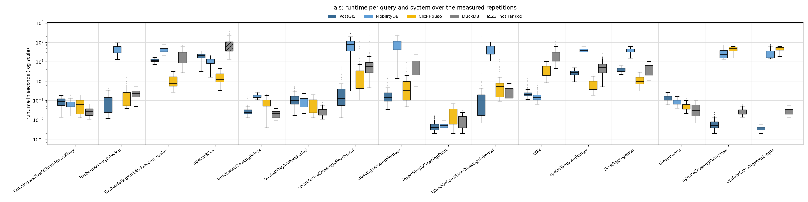
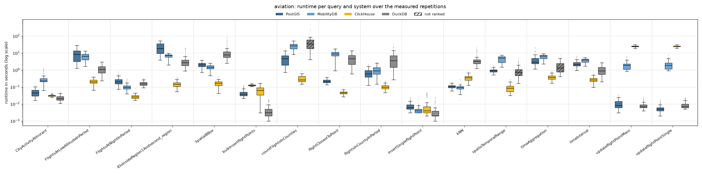
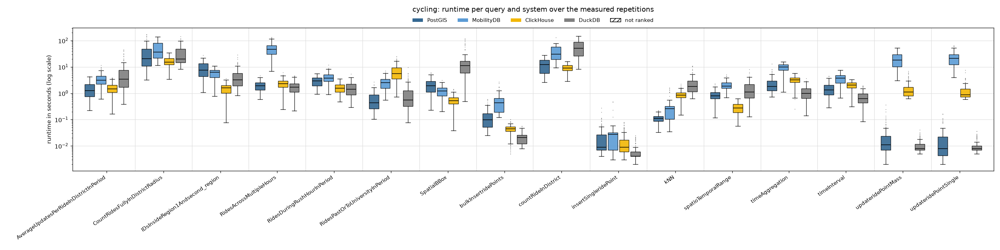
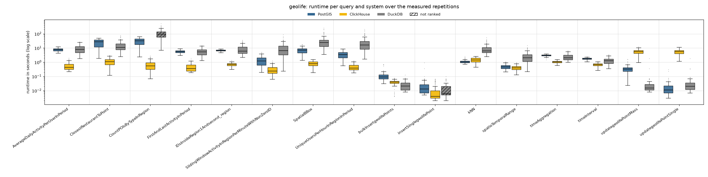

# Reads and writes 75/25, 8 client threads

Run of 2026-10-27 to 2026-10-27. Every system alone on the five-node cluster, one system after the other; 8 client threads taking the queries from one shared queue (so 8 queries run at the same time). Each of the 48 read queries runs with **128 measured parameter sets** (the same sets in every client-thread run) after 8 warm-up repetitions. Write queries (inserts, updates, bulk inserts of 10 rows) are mixed in: 25 % of the measured executions; everything they added is removed after each system (`purge_writes.sh`). Systems without write support are not part of this workload. Timeout 600 s per query. The configuration of every system is described in the [main README](../../../../../README.md#configuration). All numbers below come from the CSV files in this folder (`build_results.py`, `empty_results.py`); [`tables.md`](tables.md) has every table in full.

## Summary

| System | Queries won | Ranked on | Geo-mean slowdown vs fastest | Median slowdown | Measured executions | Failed |
|---|---:|---:|---:|---:|---:|---:|
| ClickHouse | 30 | 48 of 48 | 1.50× | 1.00× | 7,937 | 2 |
| DuckDB | 9 | 43 of 48 | 6.96× | 6.08× | 7,937 | 18 |
| PostGIS | 7 | 48 of 48 | 4.23× | 3.70× | 7,937 | 2 |
| MobilityDB | 2 | 36 of 36 | 11.48× | 8.59× | 5,889 | 2 |

Wins and slowdowns count the read queries only (comparable with the read-only runs); the writes are below (*Writes*). *Slowdown*: a system's mean runtime on a query divided by the fastest ranked system's, over the queries the system is ranked on. A system is ranked on a query when every measured repetition succeeded and its results match PostGIS (pre-run equivalence check; accepted: nearest-neighbour ties, numbers within 1 %, an empty answer as no row or one row of zeros).

**Wins by scenario and by query type:**

| | PostGIS | MobilityDB | ClickHouse | DuckDB |
|---|---:|---:|---:|---:|
| AIS | 3 | 1 | 4 | 4 |
| Aviation | – | 1 | 10 | 1 |
| Cycling | 3 | – | 5 | 4 |
| Geolife | 1 | – | 11 | – |
| spatial | 4 | 2 | 10 | – |
| temporal | – | – | 9 | 7 |
| spatiotemporal | 3 | – | 11 | 2 |

## Total runtime, pair by pair

Sum of the measured repetitions' runtimes over only the queries both systems completed.

| System A | System B | Common queries | A | B | A / B |
|---|---|---:|---:|---:|---:|
| PostGIS | MobilityDB | 48 | 318.0 min | 1459.0 min | 0.22 |
| PostGIS | ClickHouse | 64 | 525.0 min | 498.5 min | 1.05 |
| PostGIS | DuckDB | 58 | 396.1 min | 683.8 min | 0.58 |
| MobilityDB | ClickHouse | 48 | 1459.0 min | 454.5 min | 3.21 |
| MobilityDB | DuckDB | 44 | 1389.4 min | 401.0 min | 3.46 |
| ClickHouse | DuckDB | 58 | 492.0 min | 683.8 min | 0.72 |

## Failures

Parameter sets left out for every system:

| Scenario | Query | Repetition | Reason |
|---|---|---:|---|
| ais | countActiveCrossingsNearIsland | 87 | every system timed out |
| ais | countActiveCrossingsNearIsland | 102 | every system timed out |

Measured executions that did not succeed (including those in the parameter sets above):

| System | Scenario | Query | Status | Count |
|---|---|---|---|---:|
| ClickHouse | ais | countActiveCrossingsNearIsland | timeout | 2 |
| DuckDB | ais | SpatialBBox | timeout | 1 |
| DuckDB | ais | countActiveCrossingsNearIsland | timeout | 2 |
| DuckDB | aviation | countFlightsInCounties | timeout | 1 |
| DuckDB | aviation | spatioTemporalRange | error | 1 |
| DuckDB | aviation | timeAggregation | error | 1 |
| DuckDB | geolife | CountPOIsByTypeInRegion | interrupted | 3 |
| DuckDB | geolife | CountPOIsByTypeInRegion | timeout | 8 |
| DuckDB | geolife | insertSinglegeolifePoint | error | 1 |
| MobilityDB | ais | countActiveCrossingsNearIsland | timeout | 2 |
| PostGIS | ais | countActiveCrossingsNearIsland | timeout | 2 |

## Not ranked

| Scenario | Query | System | Reason |
|---|---|---|---|
| ais | SpatialBBox | DuckDB | 127/128 succeeded |
| aviation | countFlightsInCounties | DuckDB | 52/53 succeeded |
| aviation | spatioTemporalRange | DuckDB | 127/128 succeeded |
| aviation | timeAggregation | DuckDB | 127/128 succeeded |
| geolife | CountPOIsByTypeInRegion | DuckDB | 117/125 succeeded |
| geolife | insertSinglegeolifePoint | DuckDB | 127/128 succeeded |

## Writes

Mean (95th percentile) runtime of each write query, over its measured executions; **bold**: fastest. An update moves points that an insert of the same run added; ClickHouse writes an update as a re-insert plus a lightweight delete, MobilityDB writes into its trajectories.

| Scenario | Write query | PostGIS | MobilityDB | ClickHouse | DuckDB |
|---|---|---:|---:|---:|---:|
| AIS | bulkInsertCrossingPoints | 31 ms (59 ms) | 173 ms (248 ms) | 81 ms (156 ms) | **21 ms** (35 ms) |
| AIS | insertSingleCrossingPoint | **5 ms** (13 ms) | 6 ms (12 ms) | 20 ms (56 ms) | 10 ms (22 ms) |
| AIS | updateCrossingPointMass | **6 ms** (15 ms) | 29.46 s (59.54 s) | 46.57 s (60.67 s) | 29 ms (47 ms) |
| AIS | updateCrossingPointSingle | **4 ms** (10 ms) | 30.80 s (69.35 s) | 48.85 s (61.13 s) | 28 ms (48 ms) |
| Aviation | bulkInsertflightPoints | 45 ms (102 ms) | 126 ms (155 ms) | 63 ms (135 ms) | **5 ms** (15 ms) |
| Aviation | insertSingleflightPoint | 8 ms (17 ms) | 5 ms (8 ms) | 10 ms (39 ms) | **4 ms** (14 ms) |
| Aviation | updateflightPointMass | 11 ms (24 ms) | 1.98 s (3.86 s) | 24.84 s (29.33 s) | **8 ms** (20 ms) |
| Aviation | updateflightPointSingle | **6 ms** (13 ms) | 2.18 s (5.20 s) | 24.88 s (29.00 s) | 10 ms (21 ms) |
| Cycling | bulkInsertridePoints | 134 ms (350 ms) | 492 ms (1.28 s) | 44 ms (72 ms) | **21 ms** (37 ms) |
| Cycling | insertSingleridePoint | 24 ms (89 ms) | 31 ms (46 ms) | 16 ms (52 ms) | **6 ms** (18 ms) |
| Cycling | updateridePointMass | 27 ms (97 ms) | 20.70 s (44.10 s) | 1.53 s (4.02 s) | **11 ms** (24 ms) |
| Cycling | updateridePointSingle | 20 ms (82 ms) | 22.75 s (43.60 s) | 1.29 s (3.23 s) | **11 ms** (24 ms) |
| Geolife | bulkInsertgeolifePoints | 122 ms (230 ms) | – | 39 ms (63 ms) | **29 ms** (68 ms) |
| Geolife | insertSinglegeolifePoint | 29 ms (61 ms) | – | **12 ms** (47 ms) | 18 ms (59 ms) |
| Geolife | updategeolifePointMass | 367 ms (704 ms) | – | 5.74 s (10.27 s) | **39 ms** (66 ms) |
| Geolife | updategeolifePointSingle | **20 ms** (46 ms) | – | 5.84 s (11.17 s) | 46 ms (69 ms) |

| System | Write queries won | Geo-mean slowdown vs fastest |
|---|---:|---:|
| PostGIS | 5 | 2.23× |
| MobilityDB | 0 | 93.16× |
| ClickHouse | 1 | 51.74× |
| DuckDB | 10 | 1.43× |

## Latency per scenario

One section per scenario. The box plot shows every system's runtimes over the measured repetitions that succeeded (box: 25th to 75th percentile, line: median, whiskers: 1.5 × the box height, dots: outliers; log scale; hatched: not ranked). The table below it gives mean, median, 95th and 99th percentile and standard deviation over those repetitions (n); the variance (standard deviation squared, ms²) is in `summary.csv` (`var_ms2`). **Bold**: fastest ranked system on the query (by mean).

### AIS

| Query | System | n | Mean | Median | p95 | p99 | Std dev |
|---|---|---:|---:|---:|---:|---:|---:|
| `CrossingsActiveAtGivenHourOfDay` | PostGIS | 128 | 89 ms | 86 ms | 157 ms | 185 ms | 45 ms |
|  | MobilityDB | 128 | 69 ms | 59 ms | 133 ms | 207 ms | 37 ms |
|  | ClickHouse | 128 | 69 ms | 62 ms | 150 ms | 178 ms | 47 ms |
|  | **DuckDB** | 128 | **29 ms** | 27 ms | 53 ms | 60 ms | 13 ms |
| `HarbourActivityInPeriod` | **PostGIS** | 128 | **98 ms** | 56 ms | 299 ms | 414 ms | 97 ms |
|  | MobilityDB | 128 | 48.02 s | 44.40 s | 83.28 s | 94.46 s | 21.12 s |
|  | ClickHouse | 128 | 225 ms | 192 ms | 638 ms | 974 ms | 227 ms |
|  | DuckDB | 128 | 261 ms | 227 ms | 644 ms | 813 ms | 171 ms |
| `IDsInsideRegion1Andsecond_region` | PostGIS | 128 | 12.19 s | 11.91 s | 16.89 s | 17.80 s | 2.41 s |
|  | MobilityDB | 128 | 41.75 s | 41.03 s | 65.38 s | 69.21 s | 12.20 s |
|  | **ClickHouse** | 128 | **1.11 s** | 776 ms | 2.37 s | 2.95 s | 704 ms |
|  | DuckDB | 128 | 21.06 s | 13.85 s | 59.07 s | 68.76 s | 17.04 s |
| `SpatialBBox` | PostGIS | 128 | 20.71 s | 21.02 s | 33.03 s | 36.13 s | 6.48 s |
|  | MobilityDB | 128 | 10.86 s | 10.57 s | 17.22 s | 19.86 s | 3.59 s |
|  | **ClickHouse** | 128 | **1.71 s** | 1.22 s | 4.00 s | 4.81 s | 1.09 s |
|  | DuckDB | 127 | 87.56 s | 58.18 s | 285.76 s | 405.54 s | 87.16 s |
| `bulkInsertCrossingPoints` | PostGIS | 128 | 31 ms | 25 ms | 59 ms | 128 ms | 21 ms |
|  | MobilityDB | 128 | 173 ms | 169 ms | 248 ms | 264 ms | 36 ms |
|  | ClickHouse | 128 | 81 ms | 74 ms | 156 ms | 195 ms | 41 ms |
|  | **DuckDB** | 128 | **21 ms** | 22 ms | 35 ms | 40 ms | 8 ms |
| `busiestDayInWeekPeriod` | PostGIS | 128 | 143 ms | 96 ms | 426 ms | 516 ms | 118 ms |
|  | MobilityDB | 128 | 95 ms | 66 ms | 267 ms | 306 ms | 71 ms |
|  | ClickHouse | 128 | 77 ms | 64 ms | 174 ms | 203 ms | 55 ms |
|  | **DuckDB** | 128 | **28 ms** | 26 ms | 51 ms | 73 ms | 13 ms |
| `countActiveCrossingsNearIsland` | **PostGIS** | 126 | **1.67 s** | 123 ms | 3.96 s | 16.80 s | 10.95 s |
|  | MobilityDB | 126 | 81.30 s | 76.53 s | 171.58 s | 255.60 s | 56.11 s |
|  | ClickHouse | 126 | 12.99 s | 1.31 s | 76.66 s | 157.07 s | 53.88 s |
|  | DuckDB | 126 | 10.72 s | 5.48 s | 31.73 s | 105.35 s | 24.62 s |
| `crossingsAroundHarbour` | **PostGIS** | 128 | **266 ms** | 139 ms | 812 ms | 1.48 s | 340 ms |
|  | MobilityDB | 128 | 83.20 s | 80.75 s | 170.13 s | 256.31 s | 56.83 s |
|  | ClickHouse | 128 | 985 ms | 326 ms | 4.34 s | 9.70 s | 1.84 s |
|  | DuckDB | 128 | 7.52 s | 4.65 s | 21.69 s | 29.97 s | 7.34 s |
| `insertSingleCrossingPoint` | **PostGIS** | 128 | **5 ms** | 4 ms | 13 ms | 15 ms | 3 ms |
|  | MobilityDB | 128 | 6 ms | 5 ms | 12 ms | 25 ms | 6 ms |
|  | ClickHouse | 128 | 20 ms | 8 ms | 56 ms | 62 ms | 19 ms |
|  | DuckDB | 128 | 10 ms | 6 ms | 22 ms | 25 ms | 7 ms |
| `islandOrCoastLineCrossingsInPeriod` | PostGIS | 128 | 1.76 s | 66 ms | 492 ms | 2.17 s | 18.21 s |
|  | MobilityDB | 128 | 45.20 s | 35.94 s | 91.75 s | 100.44 s | 26.49 s |
|  | ClickHouse | 128 | 3.67 s | 508 ms | 4.66 s | 12.48 s | 30.71 s |
|  | **DuckDB** | 128 | **1.06 s** | 213 ms | 1.59 s | 4.34 s | 7.24 s |
| `kNN` | PostGIS | 128 | 267 ms | 201 ms | 664 ms | 1.07 s | 199 ms |
|  | **MobilityDB** | 128 | **187 ms** | 143 ms | 453 ms | 698 ms | 139 ms |
|  | ClickHouse | 128 | 3.88 s | 2.88 s | 7.94 s | 9.94 s | 2.41 s |
|  | DuckDB | 128 | 24.13 s | 15.52 s | 69.77 s | 83.96 s | 21.11 s |
| `spatioTemporalRange` | PostGIS | 128 | 2.80 s | 2.71 s | 4.08 s | 5.00 s | 823 ms |
|  | MobilityDB | 128 | 39.36 s | 39.38 s | 57.59 s | 62.70 s | 10.67 s |
|  | **ClickHouse** | 128 | **720 ms** | 545 ms | 1.57 s | 2.05 s | 460 ms |
|  | DuckDB | 128 | 5.98 s | 5.06 s | 13.69 s | 17.93 s | 4.43 s |
| `timeAggregation` | PostGIS | 128 | 3.96 s | 3.83 s | 5.80 s | 6.66 s | 1.05 s |
|  | MobilityDB | 128 | 39.87 s | 40.25 s | 58.05 s | 62.63 s | 10.52 s |
|  | **ClickHouse** | 128 | **1.20 s** | 952 ms | 2.39 s | 2.86 s | 620 ms |
|  | DuckDB | 128 | 4.35 s | 3.86 s | 8.16 s | 9.53 s | 2.43 s |
| `timeInterval` | PostGIS | 128 | 143 ms | 136 ms | 233 ms | 254 ms | 48 ms |
|  | MobilityDB | 128 | 88 ms | 86 ms | 144 ms | 182 ms | 32 ms |
|  | ClickHouse | 128 | 50 ms | 45 ms | 83 ms | 100 ms | 19 ms |
|  | **DuckDB** | 128 | **41 ms** | 30 ms | 85 ms | 95 ms | 35 ms |
| `updateCrossingPointMass` | **PostGIS** | 128 | **6 ms** | 5 ms | 15 ms | 19 ms | 4 ms |
|  | MobilityDB | 128 | 29.46 s | 23.83 s | 59.54 s | 80.47 s | 16.77 s |
|  | ClickHouse | 128 | 46.57 s | 50.40 s | 60.67 s | 62.01 s | 12.55 s |
|  | DuckDB | 128 | 29 ms | 29 ms | 47 ms | 64 ms | 11 ms |
| `updateCrossingPointSingle` | **PostGIS** | 128 | **4 ms** | 3 ms | 10 ms | 13 ms | 3 ms |
|  | MobilityDB | 128 | 30.80 s | 25.49 s | 69.35 s | 81.56 s | 17.75 s |
|  | ClickHouse | 128 | 48.85 s | 53.85 s | 61.13 s | 62.82 s | 11.49 s |
|  | DuckDB | 128 | 28 ms | 28 ms | 48 ms | 56 ms | 10 ms |

### Aviation

| Query | System | n | Mean | Median | p95 | p99 | Std dev |
|---|---|---:|---:|---:|---:|---:|---:|
| `CityActivityAtInstant` | PostGIS | 128 | 49 ms | 43 ms | 87 ms | 103 ms | 24 ms |
|  | MobilityDB | 128 | 316 ms | 225 ms | 871 ms | 1.14 s | 235 ms |
|  | ClickHouse | 128 | 31 ms | 30 ms | 38 ms | 45 ms | 5 ms |
|  | **DuckDB** | 128 | **23 ms** | 20 ms | 39 ms | 45 ms | 8 ms |
| `FlightsAtLowAltitudeInPeriod` | PostGIS | 128 | 9.52 s | 8.33 s | 22.65 s | 30.71 s | 7.08 s |
|  | MobilityDB | 128 | 6.37 s | 6.32 s | 10.56 s | 11.40 s | 2.69 s |
|  | **ClickHouse** | 128 | **216 ms** | 200 ms | 335 ms | 399 ms | 70 ms |
|  | DuckDB | 128 | 1.19 s | 1.07 s | 2.39 s | 2.84 s | 642 ms |
| `FlightsAtNightInPeriod` | PostGIS | 128 | 239 ms | 196 ms | 493 ms | 668 ms | 128 ms |
|  | MobilityDB | 128 | 104 ms | 92 ms | 190 ms | 269 ms | 45 ms |
|  | **ClickHouse** | 128 | **27 ms** | 26 ms | 37 ms | 54 ms | 8 ms |
|  | DuckDB | 128 | 164 ms | 153 ms | 262 ms | 302 ms | 49 ms |
| `IDsInsideRegion1Andsecond_region` | PostGIS | 128 | 22.82 s | 18.28 s | 47.40 s | 50.90 s | 14.59 s |
|  | MobilityDB | 128 | 6.55 s | 7.17 s | 9.20 s | 9.59 s | 2.21 s |
|  | **ClickHouse** | 128 | **152 ms** | 142 ms | 278 ms | 357 ms | 68 ms |
|  | DuckDB | 128 | 4.03 s | 2.70 s | 14.76 s | 19.06 s | 4.10 s |
| `SpatialBBox` | PostGIS | 128 | 2.05 s | 2.02 s | 3.18 s | 3.66 s | 686 ms |
|  | MobilityDB | 128 | 1.47 s | 1.43 s | 2.21 s | 2.32 s | 457 ms |
|  | **ClickHouse** | 128 | **168 ms** | 165 ms | 277 ms | 385 ms | 66 ms |
|  | DuckDB | 128 | 12.71 s | 7.58 s | 47.75 s | 78.50 s | 15.48 s |
| `bulkInsertflightPoints` | PostGIS | 122 | 45 ms | 36 ms | 102 ms | 115 ms | 23 ms |
|  | MobilityDB | 122 | 126 ms | 123 ms | 155 ms | 170 ms | 14 ms |
|  | ClickHouse | 122 | 63 ms | 62 ms | 135 ms | 157 ms | 40 ms |
|  | **DuckDB** | 122 | **5 ms** | 3 ms | 15 ms | 18 ms | 4 ms |
| `countFlightsInCounties` | PostGIS | 53 | 5.30 s | 4.54 s | 12.55 s | 16.84 s | 4.08 s |
|  | MobilityDB | 53 | 26.86 s | 26.01 s | 47.20 s | 50.97 s | 11.44 s |
|  | **ClickHouse** | 53 | **323 ms** | 261 ms | 597 ms | 807 ms | 161 ms |
|  | DuckDB | 52 | 52.02 s | 34.35 s | 133.21 s | 354.06 s | 73.48 s |
| `flightClosestToPoint` | PostGIS | 128 | 223 ms | 206 ms | 339 ms | 373 ms | 57 ms |
|  | MobilityDB | 128 | 9.08 s | 8.75 s | 15.10 s | 17.37 s | 3.47 s |
|  | **ClickHouse** | 128 | **49 ms** | 45 ms | 64 ms | 78 ms | 29 ms |
|  | DuckDB | 128 | 5.05 s | 4.62 s | 10.52 s | 13.35 s | 3.23 s |
| `flightsInCountyInPeriod` | PostGIS | 128 | 701 ms | 592 ms | 1.54 s | 1.97 s | 410 ms |
|  | MobilityDB | 128 | 1.04 s | 887 ms | 2.22 s | 2.67 s | 602 ms |
|  | **ClickHouse** | 128 | **103 ms** | 96 ms | 163 ms | 215 ms | 34 ms |
|  | DuckDB | 128 | 5.36 s | 3.50 s | 15.80 s | 25.81 s | 5.64 s |
| `insertSingleflightPoint` | PostGIS | 122 | 8 ms | 6 ms | 17 ms | 23 ms | 5 ms |
|  | MobilityDB | 122 | 5 ms | 4 ms | 8 ms | 22 ms | 3 ms |
|  | ClickHouse | 122 | 10 ms | 4 ms | 39 ms | 45 ms | 12 ms |
|  | **DuckDB** | 122 | **4 ms** | 2 ms | 14 ms | 23 ms | 5 ms |
| `kNN` | PostGIS | 128 | 107 ms | 105 ms | 159 ms | 174 ms | 26 ms |
|  | **MobilityDB** | 128 | **94 ms** | 94 ms | 133 ms | 233 ms | 32 ms |
|  | ClickHouse | 128 | 359 ms | 347 ms | 605 ms | 745 ms | 133 ms |
|  | DuckDB | 128 | 4.23 s | 3.12 s | 12.49 s | 17.35 s | 3.72 s |
| `spatioTemporalRange` | PostGIS | 128 | 924 ms | 904 ms | 1.35 s | 1.69 s | 235 ms |
|  | MobilityDB | 128 | 4.63 s | 5.10 s | 6.87 s | 7.29 s | 1.74 s |
|  | **ClickHouse** | 128 | **95 ms** | 84 ms | 198 ms | 272 ms | 53 ms |
|  | DuckDB | 127 | 983 ms | 718 ms | 2.89 s | 4.06 s | 855 ms |
| `timeAggregation` | PostGIS | 128 | 4.18 s | 2.89 s | 11.07 s | 19.74 s | 3.42 s |
|  | MobilityDB | 128 | 6.00 s | 6.62 s | 8.31 s | 8.77 s | 1.87 s |
|  | **ClickHouse** | 128 | **384 ms** | 357 ms | 648 ms | 835 ms | 136 ms |
|  | DuckDB | 127 | 1.74 s | 1.28 s | 4.29 s | 5.09 s | 1.29 s |
| `timeInterval` | PostGIS | 128 | 2.34 s | 2.04 s | 4.16 s | 6.17 s | 1.01 s |
|  | MobilityDB | 128 | 3.67 s | 3.82 s | 4.87 s | 5.24 s | 908 ms |
|  | **ClickHouse** | 128 | **279 ms** | 260 ms | 480 ms | 558 ms | 103 ms |
|  | DuckDB | 128 | 1.05 s | 876 ms | 2.34 s | 2.71 s | 643 ms |
| `updateflightPointMass` | PostGIS | 122 | 11 ms | 8 ms | 24 ms | 33 ms | 7 ms |
|  | MobilityDB | 122 | 1.98 s | 1.84 s | 3.86 s | 5.82 s | 1.09 s |
|  | ClickHouse | 122 | 24.84 s | 24.76 s | 29.33 s | 30.46 s | 2.69 s |
|  | **DuckDB** | 122 | **8 ms** | 7 ms | 20 ms | 23 ms | 4 ms |
| `updateflightPointSingle` | **PostGIS** | 121 | **6 ms** | 5 ms | 13 ms | 17 ms | 3 ms |
|  | MobilityDB | 121 | 2.18 s | 1.84 s | 5.20 s | 7.05 s | 1.32 s |
|  | ClickHouse | 121 | 24.88 s | 25.27 s | 29.00 s | 30.37 s | 2.58 s |
|  | DuckDB | 121 | 10 ms | 7 ms | 21 ms | 23 ms | 5 ms |

### Cycling

| Query | System | n | Mean | Median | p95 | p99 | Std dev |
|---|---|---:|---:|---:|---:|---:|---:|
| `AverageUpdatesPerRideInDistrictInPeriod` | **PostGIS** | 128 | **1.50 s** | 1.24 s | 3.18 s | 4.13 s | 948 ms |
|  | MobilityDB | 128 | 3.56 s | 3.17 s | 6.98 s | 9.64 s | 2.00 s |
|  | ClickHouse | 128 | 1.64 s | 1.45 s | 3.57 s | 3.75 s | 848 ms |
|  | DuckDB | 128 | 6.47 s | 3.39 s | 25.03 s | 40.95 s | 8.39 s |
| `CountRidesFullyInDistrictRadius` | PostGIS | 128 | 34.77 s | 20.68 s | 104.84 s | 161.01 s | 34.43 s |
|  | MobilityDB | 128 | 51.03 s | 36.58 s | 110.96 s | 128.76 s | 34.66 s |
|  | **ClickHouse** | 128 | **17.00 s** | 15.20 s | 30.48 s | 32.49 s | 6.78 s |
|  | DuckDB | 128 | 34.39 s | 20.26 s | 92.97 s | 117.07 s | 29.01 s |
| `IDsInsideRegion1Andsecond_region` | PostGIS | 128 | 9.14 s | 7.45 s | 19.59 s | 22.12 s | 5.81 s |
|  | MobilityDB | 128 | 5.87 s | 6.20 s | 9.29 s | 10.49 s | 2.30 s |
|  | **ClickHouse** | 128 | **1.54 s** | 1.59 s | 2.64 s | 3.12 s | 716 ms |
|  | DuckDB | 128 | 4.64 s | 3.26 s | 13.19 s | 22.31 s | 4.39 s |
| `RidesAcrossMultipleHours` | PostGIS | 128 | 1.99 s | 1.93 s | 3.38 s | 3.99 s | 789 ms |
|  | MobilityDB | 128 | 51.52 s | 46.71 s | 105.19 s | 126.40 s | 27.97 s |
|  | ClickHouse | 128 | 2.37 s | 2.28 s | 4.21 s | 4.89 s | 1.04 s |
|  | **DuckDB** | 128 | **1.86 s** | 1.71 s | 4.07 s | 4.52 s | 1.02 s |
| `RidesDuringRushHourInPeriod` | PostGIS | 128 | 2.96 s | 2.96 s | 4.85 s | 5.26 s | 1.15 s |
|  | MobilityDB | 128 | 4.15 s | 3.74 s | 7.55 s | 8.94 s | 1.80 s |
|  | ClickHouse | 128 | 1.66 s | 1.57 s | 2.76 s | 3.45 s | 678 ms |
|  | **DuckDB** | 128 | **1.60 s** | 1.41 s | 3.29 s | 3.93 s | 963 ms |
| `RidesPastOrToUniversityInPeriod` | **PostGIS** | 128 | **606 ms** | 437 ms | 1.56 s | 2.07 s | 489 ms |
|  | MobilityDB | 128 | 2.62 s | 2.54 s | 4.96 s | 6.20 s | 1.31 s |
|  | ClickHouse | 128 | 7.12 s | 5.53 s | 17.51 s | 23.41 s | 4.96 s |
|  | DuckDB | 128 | 1.07 s | 554 ms | 3.60 s | 5.69 s | 1.38 s |
| `SpatialBBox` | PostGIS | 128 | 2.15 s | 1.90 s | 4.67 s | 5.51 s | 1.28 s |
|  | MobilityDB | 128 | 1.23 s | 1.22 s | 2.24 s | 2.55 s | 580 ms |
|  | **ClickHouse** | 128 | **553 ms** | 523 ms | 1.04 s | 1.39 s | 276 ms |
|  | DuckDB | 128 | 17.81 s | 11.23 s | 71.60 s | 114.55 s | 22.98 s |
| `bulkInsertridePoints` | PostGIS | 119 | 134 ms | 99 ms | 350 ms | 561 ms | 111 ms |
|  | MobilityDB | 119 | 492 ms | 434 ms | 1.28 s | 2.30 s | 428 ms |
|  | ClickHouse | 119 | 44 ms | 44 ms | 72 ms | 97 ms | 19 ms |
|  | **DuckDB** | 119 | **21 ms** | 21 ms | 37 ms | 53 ms | 10 ms |
| `countRideInDistrict` | PostGIS | 12 | 13.44 s | 12.27 s | 27.72 s | 28.15 s | 9.16 s |
|  | MobilityDB | 12 | 42.05 s | 30.99 s | 102.97 s | 126.01 s | 35.58 s |
|  | **ClickHouse** | 12 | **9.42 s** | 9.15 s | 15.81 s | 16.07 s | 4.19 s |
|  | DuckDB | 12 | 57.31 s | 51.41 s | 118.32 s | 142.64 s | 42.11 s |
| `insertSingleridePoint` | PostGIS | 118 | 24 ms | 9 ms | 89 ms | 176 ms | 37 ms |
|  | MobilityDB | 118 | 31 ms | 27 ms | 46 ms | 426 ms | 63 ms |
|  | ClickHouse | 118 | 16 ms | 9 ms | 52 ms | 76 ms | 17 ms |
|  | **DuckDB** | 118 | **6 ms** | 4 ms | 18 ms | 22 ms | 5 ms |
| `kNN` | **PostGIS** | 128 | **114 ms** | 112 ms | 184 ms | 215 ms | 39 ms |
|  | MobilityDB | 128 | 284 ms | 262 ms | 1.08 s | 1.52 s | 294 ms |
|  | ClickHouse | 128 | 902 ms | 852 ms | 1.54 s | 1.94 s | 355 ms |
|  | DuckDB | 128 | 2.42 s | 1.82 s | 5.98 s | 10.43 s | 1.93 s |
| `spatioTemporalRange` | PostGIS | 128 | 870 ms | 806 ms | 1.47 s | 2.01 s | 374 ms |
|  | MobilityDB | 128 | 2.05 s | 1.87 s | 3.37 s | 4.46 s | 812 ms |
|  | **ClickHouse** | 128 | **288 ms** | 278 ms | 514 ms | 595 ms | 131 ms |
|  | DuckDB | 128 | 1.51 s | 1.11 s | 3.70 s | 6.08 s | 1.29 s |
| `timeAggregation` | PostGIS | 128 | 2.43 s | 1.82 s | 6.13 s | 7.93 s | 1.82 s |
|  | MobilityDB | 128 | 9.62 s | 10.02 s | 14.48 s | 15.53 s | 3.37 s |
|  | ClickHouse | 128 | 3.18 s | 3.23 s | 4.71 s | 5.05 s | 1.05 s |
|  | **DuckDB** | 128 | **1.14 s** | 990 ms | 2.33 s | 2.92 s | 673 ms |
| `timeInterval` | PostGIS | 128 | 1.55 s | 1.33 s | 3.18 s | 4.16 s | 893 ms |
|  | MobilityDB | 128 | 3.78 s | 3.74 s | 6.39 s | 7.11 s | 1.53 s |
|  | ClickHouse | 128 | 2.02 s | 2.04 s | 3.09 s | 3.23 s | 672 ms |
|  | **DuckDB** | 128 | **718 ms** | 617 ms | 1.65 s | 1.87 s | 414 ms |
| `updateridePointMass` | PostGIS | 118 | 27 ms | 11 ms | 97 ms | 236 ms | 48 ms |
|  | MobilityDB | 118 | 20.70 s | 18.12 s | 44.10 s | 50.66 s | 12.56 s |
|  | ClickHouse | 118 | 1.53 s | 1.12 s | 4.02 s | 5.96 s | 1.18 s |
|  | **DuckDB** | 118 | **11 ms** | 8 ms | 24 ms | 32 ms | 7 ms |
| `updateridePointSingle` | PostGIS | 118 | 20 ms | 8 ms | 82 ms | 151 ms | 28 ms |
|  | MobilityDB | 118 | 22.75 s | 20.97 s | 43.60 s | 60.75 s | 12.62 s |
|  | ClickHouse | 118 | 1.29 s | 862 ms | 3.23 s | 5.74 s | 1.02 s |
|  | **DuckDB** | 118 | **11 ms** | 8 ms | 24 ms | 35 ms | 6 ms |

### Geolife

| Query | System | n | Mean | Median | p95 | p99 | Std dev |
|---|---|---:|---:|---:|---:|---:|---:|
| `AverageDailyActivityPerUserInPeriod` | PostGIS | 128 | 7.78 s | 7.74 s | 11.12 s | 11.55 s | 1.85 s |
|  | **ClickHouse** | 128 | **597 ms** | 432 ms | 1.38 s | 1.66 s | 378 ms |
|  | DuckDB | 128 | 9.57 s | 7.86 s | 23.62 s | 26.13 s | 6.35 s |
| `ClosestRestaurantToPoint` | PostGIS | 128 | 25.40 s | 27.19 s | 46.16 s | 48.35 s | 14.08 s |
|  | **ClickHouse** | 128 | **1.21 s** | 1.08 s | 2.63 s | 2.95 s | 682 ms |
|  | DuckDB | 128 | 16.97 s | 11.18 s | 50.45 s | 66.30 s | 14.36 s |
| `CountPOIsByTypeInRegion` | PostGIS | 128 | 32.38 s | 32.60 s | 59.61 s | 63.52 s | 17.35 s |
|  | **ClickHouse** | 128 | **697 ms** | 548 ms | 1.96 s | 2.39 s | 553 ms |
|  | DuckDB | 117 | 109.57 s | 92.93 s | 277.38 s | 372.12 s | 81.23 s |
| `FirstAndLastActivityInPeriod` | PostGIS | 128 | 5.70 s | 5.65 s | 7.81 s | 8.72 s | 1.34 s |
|  | **ClickHouse** | 128 | **477 ms** | 352 ms | 1.12 s | 1.46 s | 328 ms |
|  | DuckDB | 128 | 5.80 s | 5.38 s | 12.03 s | 14.16 s | 3.21 s |
| `IDsInsideRegion1Andsecond_region` | PostGIS | 128 | 6.66 s | 6.63 s | 7.89 s | 8.18 s | 832 ms |
|  | **ClickHouse** | 128 | **714 ms** | 700 ms | 1.03 s | 1.18 s | 188 ms |
|  | DuckDB | 128 | 8.84 s | 6.10 s | 24.56 s | 31.60 s | 6.96 s |
| `SlidingWindowActivityInRegionPerMinuteWithNonZeroID` | PostGIS | 128 | 1.45 s | 1.24 s | 3.49 s | 4.43 s | 992 ms |
|  | **ClickHouse** | 128 | **331 ms** | 242 ms | 826 ms | 1.02 s | 233 ms |
|  | DuckDB | 128 | 11.62 s | 6.49 s | 34.41 s | 61.80 s | 13.99 s |
| `SpatialBBox` | PostGIS | 128 | 7.08 s | 7.04 s | 13.49 s | 16.94 s | 3.35 s |
|  | **ClickHouse** | 128 | **816 ms** | 806 ms | 1.28 s | 1.41 s | 302 ms |
|  | DuckDB | 128 | 34.51 s | 24.21 s | 110.75 s | 205.01 s | 38.75 s |
| `UniqueUsersPerHourInRegionInPeriod` | PostGIS | 128 | 3.66 s | 3.41 s | 7.48 s | 8.65 s | 2.01 s |
|  | **ClickHouse** | 128 | **491 ms** | 384 ms | 1.00 s | 1.16 s | 260 ms |
|  | DuckDB | 128 | 28.88 s | 16.29 s | 99.68 s | 164.61 s | 34.82 s |
| `bulkInsertgeolifePoints` | PostGIS | 128 | 122 ms | 92 ms | 230 ms | 673 ms | 116 ms |
|  | ClickHouse | 128 | 39 ms | 40 ms | 63 ms | 75 ms | 16 ms |
|  | **DuckDB** | 128 | **29 ms** | 21 ms | 68 ms | 76 ms | 23 ms |
| `insertSinglegeolifePoint` | PostGIS | 128 | 29 ms | 13 ms | 61 ms | 291 ms | 87 ms |
|  | **ClickHouse** | 128 | **12 ms** | 4 ms | 47 ms | 61 ms | 16 ms |
|  | DuckDB | 127 | 18 ms | 6 ms | 59 ms | 70 ms | 22 ms |
| `kNN` | **PostGIS** | 128 | **1.12 s** | 1.06 s | 1.66 s | 2.16 s | 298 ms |
|  | ClickHouse | 128 | 1.50 s | 1.46 s | 2.33 s | 2.63 s | 564 ms |
|  | DuckDB | 128 | 9.77 s | 6.37 s | 28.88 s | 41.58 s | 8.74 s |
| `spatioTemporalRange` | PostGIS | 128 | 494 ms | 468 ms | 827 ms | 999 ms | 173 ms |
|  | **ClickHouse** | 128 | **415 ms** | 408 ms | 697 ms | 882 ms | 161 ms |
|  | DuckDB | 128 | 2.68 s | 2.08 s | 8.19 s | 10.89 s | 2.45 s |
| `timeAggregation` | PostGIS | 128 | 3.02 s | 3.06 s | 3.67 s | 3.87 s | 420 ms |
|  | **ClickHouse** | 128 | **1.03 s** | 1.05 s | 1.29 s | 1.42 s | 177 ms |
|  | DuckDB | 128 | 2.47 s | 2.05 s | 5.55 s | 5.93 s | 1.26 s |
| `timeInterval` | PostGIS | 128 | 1.76 s | 1.76 s | 2.17 s | 2.28 s | 278 ms |
|  | **ClickHouse** | 128 | **692 ms** | 683 ms | 1.03 s | 1.10 s | 176 ms |
|  | DuckDB | 128 | 1.35 s | 1.25 s | 2.75 s | 3.14 s | 689 ms |
| `updategeolifePointMass` | PostGIS | 128 | 367 ms | 333 ms | 704 ms | 1.45 s | 242 ms |
|  | ClickHouse | 128 | 5.74 s | 5.50 s | 10.27 s | 10.83 s | 2.36 s |
|  | **DuckDB** | 128 | **39 ms** | 16 ms | 66 ms | 282 ms | 164 ms |
| `updategeolifePointSingle` | **PostGIS** | 128 | **20 ms** | 11 ms | 46 ms | 189 ms | 35 ms |
|  | ClickHouse | 128 | 5.84 s | 5.67 s | 11.17 s | 11.43 s | 2.54 s |
|  | DuckDB | 128 | 46 ms | 20 ms | 69 ms | 349 ms | 166 ms |

## Hardware

Means over the five nodes and over the time the system ran (5 s samples; per scenario and node in `hardware_by_phase.csv`).

| System | Run time | CPU busy | Memory used | Disk read |
|---|---:|---:|---:|---:|
| PostGIS | 1.2 h | 69 % | 20.6 GB | 2746 MB/s |
| MobilityDB | 3.3 h | 35 % | 19.5 GB | 3596 MB/s |
| ClickHouse | 1.1 h | 60 % | 5.1 GB | 20 MB/s |
| DuckDB | 3.2 h | 20 % | 8.8 GB | 64 MB/s |

## Caveats

- **SpaceTime's Geolife data** differs slightly from the other systems'; its Geolife queries whose results differ from PostGIS (SlidingWindowActivityInRegionPerMinuteWithNonZeroID, UniqueUsersPerHourInRegionInPeriod, timeAggregation) are ranked on request (`equivalence.csv`).
- **Client host:** the benchmark client runs on a separate host with one CPU core and 1 GB of RAM. Results are read in batches of 100,000 rows; with several client threads, the client can become a limit for queries with large results.
- **Sedona** skips GeoParquet files by their bounding box only when a query compares with a constant geometry; joins with a whole reference table (harbours, islands, districts, counties) read the whole table.
- **Parameters** are drawn where the data is (points, regions, time windows and places from a sample of the loaded data; see benchmark/configuration/README.md), each measured parameter set of a query distinct; every system answers the same parameter sets.

## Files

| File | One row per |
|---|---|
| `executions.csv` | query execution (scenario, system, query, repetition, warm-up, status, duration, parameters, SQL) |
| `summary.csv` | (scenario, query, system): runs, failures, mean/median/p95/p99/min/max/std dev/variance, equivalence, rank |
| `winners.csv` | (scenario, query): fastest ranked system, runner-up, margin |
| `system_scores.csv` | system: wins, completed and ranked queries, slowdowns |
| `pairwise_total_time.csv` | pair of systems: total runtime over the queries both completed |
| `empty_results.csv` | (scenario, query, system): measured executions without a row |
| `equivalence.csv` | (scenario, query, system): result compared with PostGIS |
| `hardware_by_phase.csv` | (scenario, system): CPU, memory, disk and network per node |
| `dropped_parameter_sets.csv` | parameter sets left out for every system |
| `tables.md`, `plots/` | the tables and figures generated from the above (`plots/boxplot_<scenario>.png`: the box plots) |
| `raw/` | client logs, query files, hardware samples, the equivalence check |
