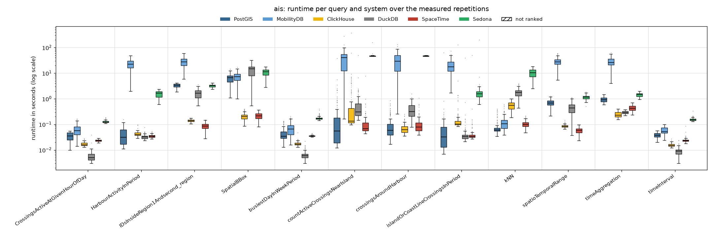
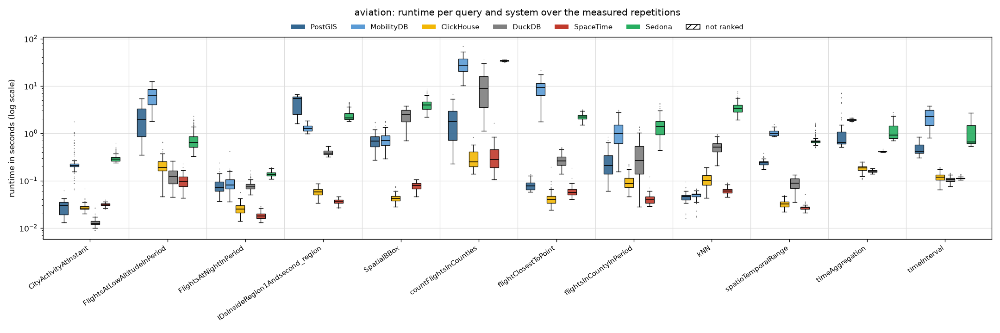
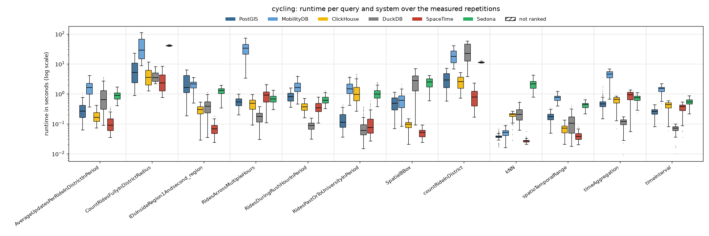
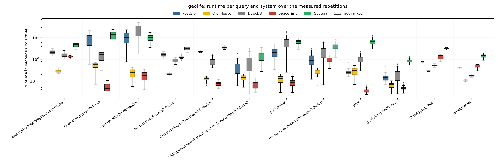

# Read-only, 1 client thread

Run of 2026-10-24 to 2026-10-26. Every system alone on the five-node cluster, one system after the other; 1 client thread taking the queries from one shared queue. Each of the 48 read queries runs with **128 measured parameter sets** (the same sets in every client-thread run) after 1 warm-up repetition. Timeout 600 s per query. The configuration of every system is described in the [main README](../../../../../README.md#configuration). All numbers below come from the CSV files in this folder (`build_results.py`, `empty_results.py`); [`tables.md`](tables.md) has every table in full.

## Summary

| System | Queries won | Ranked on | Geo-mean slowdown vs fastest | Median slowdown | Measured executions | Failed |
|---|---:|---:|---:|---:|---:|---:|
| SpaceTime | 22 | 47 of 48 | 1.65× | 1.07× | 5,953 | 2 |
| DuckDB | 13 | 48 of 48 | 5.14× | 5.49× | 5,953 | 2 |
| ClickHouse | 11 | 48 of 48 | 2.13× | 1.65× | 5,953 | 2 |
| PostGIS | 2 | 48 of 48 | 6.20× | 4.64× | 5,953 | 2 |
| Sedona | 0 | 48 of 48 | 26.49× | 20.57× | 5,953 | 2 |
| MobilityDB | 0 | 36 of 36 | 30.71× | 23.01× | 4,417 | 2 |

*Slowdown*: a system's mean runtime on a query divided by the fastest ranked system's, over the queries the system is ranked on. A system is ranked on a query when every measured repetition succeeded and its results match PostGIS (pre-run equivalence check; accepted: nearest-neighbour ties, numbers within 1 %, an empty answer as no row or one row of zeros).

**Wins by scenario and by query type:**

| | PostGIS | ClickHouse | DuckDB | SpaceTime |
|---|---:|---:|---:|---:|
| AIS | 1 | 3 | 5 | 3 |
| Aviation | 1 | 3 | 3 | 5 |
| Cycling | – | – | 5 | 7 |
| Geolife | – | 5 | – | 7 |
| spatial | 2 | 5 | – | 9 |
| temporal | – | 5 | 9 | 2 |
| spatiotemporal | – | 1 | 4 | 11 |

## Total runtime, pair by pair

Sum of the measured repetitions' runtimes over only the queries both systems completed.

| System A | System B | Common queries | A | B | A / B |
|---|---|---:|---:|---:|---:|
| PostGIS | MobilityDB | 36 | 78.3 min | 726.3 min | 0.11 |
| PostGIS | ClickHouse | 48 | 146.0 min | 40.8 min | 3.58 |
| PostGIS | DuckDB | 48 | 146.0 min | 174.3 min | 0.84 |
| PostGIS | SpaceTime | 48 | 146.0 min | 31.4 min | 4.64 |
| PostGIS | Sedona | 48 | 146.0 min | 578.5 min | 0.25 |
| MobilityDB | ClickHouse | 36 | 726.3 min | 35.1 min | 20.7 |
| MobilityDB | DuckDB | 36 | 726.3 min | 86.0 min | 8.44 |
| MobilityDB | SpaceTime | 36 | 726.3 min | 18.8 min | 38.55 |
| MobilityDB | Sedona | 36 | 726.3 min | 451.7 min | 1.61 |
| ClickHouse | DuckDB | 48 | 40.8 min | 174.3 min | 0.23 |
| ClickHouse | SpaceTime | 48 | 40.8 min | 31.4 min | 1.3 |
| ClickHouse | Sedona | 48 | 40.8 min | 578.5 min | 0.07 |
| DuckDB | SpaceTime | 48 | 174.3 min | 31.4 min | 5.54 |
| DuckDB | Sedona | 48 | 174.3 min | 578.5 min | 0.3 |
| SpaceTime | Sedona | 48 | 31.4 min | 578.5 min | 0.05 |

## Failures

Parameter sets left out for every system:

| Scenario | Query | Repetition | Reason |
|---|---|---:|---|
| ais | countActiveCrossingsNearIsland | 80 | every system timed out |
| ais | countActiveCrossingsNearIsland | 95 | every system timed out |

Measured executions that did not succeed (including those in the parameter sets above):

| System | Scenario | Query | Status | Count |
|---|---|---|---|---:|
| ClickHouse | ais | countActiveCrossingsNearIsland | timeout | 2 |
| DuckDB | ais | countActiveCrossingsNearIsland | timeout | 2 |
| MobilityDB | ais | countActiveCrossingsNearIsland | timeout | 2 |
| PostGIS | ais | countActiveCrossingsNearIsland | timeout | 2 |
| Sedona | ais | countActiveCrossingsNearIsland | timeout | 2 |
| SpaceTime | ais | countActiveCrossingsNearIsland | timeout | 2 |

## Not ranked

| Scenario | Query | System | Reason |
|---|---|---|---|
| ais | HarbourActivityInPeriod | SpaceTime | DIFF 1 vs 1 rows, e.g. postgis=[('Mariager', '7')] spacetime=[('Mariager', '8')] [1/5 para |

## Latency per scenario

One section per scenario. The box plot shows every system's runtimes over the measured repetitions that succeeded (box: 25th to 75th percentile, line: median, whiskers: 1.5 × the box height, dots: outliers; log scale; hatched: not ranked). The table below it gives mean, median, 95th and 99th percentile and standard deviation over those repetitions (n); the variance (standard deviation squared, ms²) is in `summary.csv` (`var_ms2`). **Bold**: fastest ranked system on the query (by mean).

### AIS

| Query | System | n | Mean | Median | p95 | p99 | Std dev |
|---|---|---:|---:|---:|---:|---:|---:|
| `CrossingsActiveAtGivenHourOfDay` | PostGIS | 128 | 35 ms | 36 ms | 52 ms | 52 ms | 13 ms |
|  | MobilityDB | 128 | 62 ms | 57 ms | 125 ms | 157 ms | 31 ms |
|  | ClickHouse | 128 | 17 ms | 16 ms | 23 ms | 26 ms | 3 ms |
|  | **DuckDB** | 128 | **6 ms** | 5 ms | 10 ms | 17 ms | 4 ms |
|  | SpaceTime | 128 | 24 ms | 23 ms | 28 ms | 28 ms | 2 ms |
|  | Sedona | 128 | 126 ms | 123 ms | 156 ms | 180 ms | 14 ms |
| `HarbourActivityInPeriod` | PostGIS | 128 | 41 ms | 31 ms | 99 ms | 118 ms | 31 ms |
|  | MobilityDB | 128 | 23.49 s | 22.39 s | 43.75 s | 47.92 s | 9.76 s |
|  | ClickHouse | 128 | 42 ms | 40 ms | 55 ms | 86 ms | 10 ms |
|  | **DuckDB** | 128 | **33 ms** | 32 ms | 47 ms | 52 ms | 7 ms |
|  | SpaceTime | 128 | 34 ms | 34 ms | 43 ms | 48 ms | 5 ms |
|  | Sedona | 128 | 1.56 s | 1.64 s | 2.25 s | 2.32 s | 456 ms |
| `IDsInsideRegion1Andsecond_region` | PostGIS | 128 | 3.31 s | 3.33 s | 4.13 s | 4.18 s | 528 ms |
|  | MobilityDB | 128 | 29.59 s | 27.47 s | 51.25 s | 55.51 s | 11.79 s |
|  | ClickHouse | 128 | 140 ms | 138 ms | 165 ms | 176 ms | 15 ms |
|  | DuckDB | 128 | 1.60 s | 1.63 s | 2.57 s | 3.05 s | 621 ms |
|  | **SpaceTime** | 128 | **85 ms** | 85 ms | 132 ms | 147 ms | 26 ms |
|  | Sedona | 128 | 3.25 s | 3.29 s | 3.77 s | 4.03 s | 380 ms |
| `SpatialBBox` | PostGIS | 128 | 6.59 s | 6.58 s | 11.88 s | 13.13 s | 2.63 s |
|  | MobilityDB | 128 | 7.57 s | 7.34 s | 13.13 s | 14.83 s | 2.97 s |
|  | **ClickHouse** | 128 | **208 ms** | 204 ms | 336 ms | 383 ms | 63 ms |
|  | DuckDB | 128 | 14.11 s | 14.67 s | 27.68 s | 30.55 s | 7.52 s |
|  | SpaceTime | 128 | 213 ms | 213 ms | 307 ms | 346 ms | 62 ms |
|  | Sedona | 128 | 10.95 s | 11.25 s | 16.34 s | 17.22 s | 3.63 s |
| `busiestDayInWeekPeriod` | PostGIS | 128 | 47 ms | 34 ms | 111 ms | 132 ms | 27 ms |
|  | MobilityDB | 128 | 73 ms | 66 ms | 155 ms | 178 ms | 41 ms |
|  | ClickHouse | 128 | 18 ms | 17 ms | 24 ms | 26 ms | 4 ms |
|  | **DuckDB** | 128 | **6 ms** | 6 ms | 11 ms | 15 ms | 3 ms |
|  | SpaceTime | 128 | 36 ms | 35 ms | 39 ms | 44 ms | 2 ms |
|  | Sedona | 128 | 177 ms | 168 ms | 246 ms | 334 ms | 36 ms |
| `countActiveCrossingsNearIsland` | PostGIS | 126 | 596 ms | 54 ms | 1.99 s | 5.10 s | 3.49 s |
|  | MobilityDB | 126 | 39.17 s | 40.08 s | 85.19 s | 122.35 s | 33.28 s |
|  | ClickHouse | 126 | 4.26 s | 132 ms | 5.71 s | 48.35 s | 33.50 s |
|  | DuckDB | 126 | 947 ms | 303 ms | 1.95 s | 5.62 s | 4.42 s |
|  | **SpaceTime** | 126 | **172 ms** | 68 ms | 276 ms | 896 ms | 691 ms |
|  | Sedona | 126 | 47.90 s | 46.69 s | 49.44 s | 55.67 s | 9.88 s |
| `crossingsAroundHarbour` | PostGIS | 128 | 112 ms | 58 ms | 348 ms | 637 ms | 136 ms |
|  | MobilityDB | 128 | 33.23 s | 29.59 s | 66.92 s | 104.48 s | 23.61 s |
|  | **ClickHouse** | 128 | **73 ms** | 61 ms | 148 ms | 214 ms | 37 ms |
|  | DuckDB | 128 | 397 ms | 311 ms | 806 ms | 1.10 s | 247 ms |
|  | SpaceTime | 128 | 113 ms | 78 ms | 258 ms | 593 ms | 122 ms |
|  | Sedona | 128 | 47.02 s | 46.60 s | 49.82 s | 50.14 s | 1.24 s |
| `islandOrCoastLineCrossingsInPeriod` | PostGIS | 128 | 559 ms | 32 ms | 190 ms | 710 ms | 5.65 s |
|  | MobilityDB | 128 | 20.95 s | 17.58 s | 44.89 s | 52.93 s | 12.62 s |
|  | ClickHouse | 128 | 1.20 s | 102 ms | 870 ms | 3.94 s | 11.22 s |
|  | **DuckDB** | 128 | **352 ms** | 33 ms | 109 ms | 584 ms | 3.47 s |
|  | SpaceTime | 128 | 435 ms | 33 ms | 98 ms | 337 ms | 4.44 s |
|  | Sedona | 128 | 3.17 s | 1.56 s | 2.38 s | 6.18 s | 17.67 s |
| `kNN` | **PostGIS** | 128 | **84 ms** | 60 ms | 249 ms | 357 ms | 67 ms |
|  | MobilityDB | 128 | 129 ms | 106 ms | 314 ms | 528 ms | 95 ms |
|  | ClickHouse | 128 | 557 ms | 560 ms | 893 ms | 943 ms | 188 ms |
|  | DuckDB | 128 | 1.76 s | 1.74 s | 3.01 s | 3.55 s | 700 ms |
|  | SpaceTime | 128 | 104 ms | 99 ms | 161 ms | 204 ms | 31 ms |
|  | Sedona | 128 | 10.50 s | 10.35 s | 16.79 s | 17.52 s | 3.95 s |
| `spatioTemporalRange` | PostGIS | 128 | 707 ms | 679 ms | 1.03 s | 1.20 s | 208 ms |
|  | MobilityDB | 128 | 28.41 s | 27.80 s | 48.22 s | 56.63 s | 10.27 s |
|  | ClickHouse | 128 | 86 ms | 84 ms | 105 ms | 123 ms | 11 ms |
|  | DuckDB | 128 | 436 ms | 441 ms | 824 ms | 1.06 s | 237 ms |
|  | **SpaceTime** | 128 | **58 ms** | 59 ms | 85 ms | 92 ms | 15 ms |
|  | Sedona | 128 | 1.15 s | 1.15 s | 1.51 s | 1.74 s | 220 ms |
| `timeAggregation` | PostGIS | 128 | 935 ms | 909 ms | 1.30 s | 1.43 s | 203 ms |
|  | MobilityDB | 128 | 28.89 s | 25.85 s | 50.54 s | 55.38 s | 11.46 s |
|  | **ClickHouse** | 128 | **247 ms** | 228 ms | 351 ms | 381 ms | 60 ms |
|  | DuckDB | 128 | 296 ms | 290 ms | 360 ms | 371 ms | 37 ms |
|  | SpaceTime | 128 | 439 ms | 420 ms | 637 ms | 687 ms | 115 ms |
|  | Sedona | 128 | 1.44 s | 1.47 s | 1.78 s | 1.91 s | 224 ms |
| `timeInterval` | PostGIS | 128 | 38 ms | 37 ms | 49 ms | 53 ms | 8 ms |
|  | MobilityDB | 128 | 58 ms | 52 ms | 91 ms | 95 ms | 19 ms |
|  | ClickHouse | 128 | 15 ms | 15 ms | 20 ms | 22 ms | 2 ms |
|  | **DuckDB** | 128 | **9 ms** | 9 ms | 15 ms | 22 ms | 4 ms |
|  | SpaceTime | 128 | 24 ms | 23 ms | 32 ms | 46 ms | 7 ms |
|  | Sedona | 128 | 155 ms | 150 ms | 192 ms | 214 ms | 24 ms |

### Aviation

| Query | System | n | Mean | Median | p95 | p99 | Std dev |
|---|---|---:|---:|---:|---:|---:|---:|
| `CityActivityAtInstant` | PostGIS | 128 | 27 ms | 30 ms | 38 ms | 42 ms | 9 ms |
|  | MobilityDB | 128 | 263 ms | 208 ms | 639 ms | 1.04 s | 212 ms |
|  | ClickHouse | 128 | 28 ms | 26 ms | 36 ms | 42 ms | 5 ms |
|  | **DuckDB** | 128 | **13 ms** | 12 ms | 17 ms | 24 ms | 3 ms |
|  | SpaceTime | 128 | 31 ms | 31 ms | 36 ms | 38 ms | 2 ms |
|  | Sedona | 128 | 299 ms | 282 ms | 429 ms | 499 ms | 61 ms |
| `FlightsAtLowAltitudeInPeriod` | PostGIS | 128 | 2.11 s | 1.93 s | 4.26 s | 5.13 s | 1.32 s |
|  | MobilityDB | 128 | 6.43 s | 6.28 s | 11.03 s | 12.17 s | 2.75 s |
|  | ClickHouse | 128 | 214 ms | 192 ms | 358 ms | 588 ms | 88 ms |
|  | DuckDB | 128 | 128 ms | 124 ms | 223 ms | 254 ms | 52 ms |
|  | **SpaceTime** | 128 | **98 ms** | 94 ms | 147 ms | 184 ms | 32 ms |
|  | Sedona | 128 | 784 ms | 646 ms | 1.69 s | 1.99 s | 405 ms |
| `FlightsAtNightInPeriod` | PostGIS | 128 | 81 ms | 73 ms | 132 ms | 172 ms | 29 ms |
|  | MobilityDB | 128 | 92 ms | 81 ms | 153 ms | 179 ms | 42 ms |
|  | ClickHouse | 128 | 26 ms | 25 ms | 37 ms | 42 ms | 7 ms |
|  | DuckDB | 128 | 79 ms | 74 ms | 117 ms | 136 ms | 18 ms |
|  | **SpaceTime** | 128 | **19 ms** | 18 ms | 24 ms | 27 ms | 3 ms |
|  | Sedona | 128 | 139 ms | 136 ms | 176 ms | 186 ms | 18 ms |
| `IDsInsideRegion1Andsecond_region` | PostGIS | 128 | 4.50 s | 5.50 s | 6.15 s | 6.33 s | 1.69 s |
|  | MobilityDB | 128 | 1.29 s | 1.27 s | 1.59 s | 1.76 s | 191 ms |
|  | ClickHouse | 128 | 58 ms | 58 ms | 79 ms | 84 ms | 11 ms |
|  | DuckDB | 128 | 397 ms | 382 ms | 498 ms | 518 ms | 50 ms |
|  | **SpaceTime** | 128 | **37 ms** | 37 ms | 43 ms | 46 ms | 4 ms |
|  | Sedona | 128 | 2.46 s | 2.11 s | 4.22 s | 4.47 s | 746 ms |
| `SpatialBBox` | PostGIS | 128 | 699 ms | 681 ms | 1.06 s | 1.61 s | 252 ms |
|  | MobilityDB | 128 | 744 ms | 695 ms | 1.19 s | 1.78 s | 290 ms |
|  | **ClickHouse** | 128 | **43 ms** | 42 ms | 57 ms | 70 ms | 8 ms |
|  | DuckDB | 128 | 2.41 s | 2.46 s | 3.53 s | 3.69 s | 806 ms |
|  | SpaceTime | 128 | 78 ms | 80 ms | 100 ms | 104 ms | 15 ms |
|  | Sedona | 128 | 4.09 s | 3.96 s | 6.11 s | 7.87 s | 1.17 s |
| `countFlightsInCounties` | PostGIS | 53 | 1.95 s | 1.75 s | 4.25 s | 5.93 s | 1.45 s |
|  | MobilityDB | 53 | 29.49 s | 27.54 s | 49.94 s | 60.38 s | 12.65 s |
|  | **ClickHouse** | 53 | **309 ms** | 249 ms | 546 ms | 692 ms | 146 ms |
|  | DuckDB | 53 | 10.30 s | 8.90 s | 23.37 s | 33.13 s | 8.23 s |
|  | SpaceTime | 53 | 344 ms | 279 ms | 697 ms | 1.23 s | 254 ms |
|  | Sedona | 53 | 34.11 s | 34.33 s | 35.22 s | 35.62 s | 929 ms |
| `flightClosestToPoint` | PostGIS | 128 | 81 ms | 78 ms | 120 ms | 134 ms | 19 ms |
|  | MobilityDB | 128 | 9.19 s | 9.38 s | 15.28 s | 17.30 s | 3.74 s |
|  | **ClickHouse** | 128 | **44 ms** | 40 ms | 70 ms | 96 ms | 19 ms |
|  | DuckDB | 128 | 276 ms | 262 ms | 441 ms | 496 ms | 80 ms |
|  | SpaceTime | 128 | 60 ms | 57 ms | 78 ms | 107 ms | 16 ms |
|  | Sedona | 128 | 2.23 s | 2.20 s | 2.72 s | 3.09 s | 310 ms |
| `flightsInCountyInPeriod` | PostGIS | 128 | 255 ms | 208 ms | 547 ms | 698 ms | 152 ms |
|  | MobilityDB | 128 | 1.10 s | 984 ms | 2.29 s | 2.89 s | 639 ms |
|  | ClickHouse | 128 | 96 ms | 86 ms | 156 ms | 210 ms | 34 ms |
|  | DuckDB | 128 | 353 ms | 269 ms | 818 ms | 1.31 s | 280 ms |
|  | **SpaceTime** | 128 | **41 ms** | 39 ms | 54 ms | 67 ms | 10 ms |
|  | Sedona | 128 | 1.54 s | 1.38 s | 3.20 s | 4.20 s | 846 ms |
| `kNN` | **PostGIS** | 128 | **45 ms** | 46 ms | 55 ms | 72 ms | 9 ms |
|  | MobilityDB | 128 | 48 ms | 50 ms | 57 ms | 66 ms | 8 ms |
|  | ClickHouse | 128 | 108 ms | 102 ms | 176 ms | 183 ms | 36 ms |
|  | DuckDB | 128 | 524 ms | 513 ms | 807 ms | 910 ms | 161 ms |
|  | SpaceTime | 128 | 61 ms | 60 ms | 77 ms | 88 ms | 9 ms |
|  | Sedona | 128 | 3.56 s | 3.36 s | 5.49 s | 6.94 s | 1.01 s |
| `spatioTemporalRange` | PostGIS | 128 | 238 ms | 236 ms | 289 ms | 324 ms | 30 ms |
|  | MobilityDB | 128 | 1.02 s | 980 ms | 1.25 s | 1.37 s | 139 ms |
|  | ClickHouse | 128 | 32 ms | 32 ms | 41 ms | 47 ms | 6 ms |
|  | DuckDB | 128 | 88 ms | 89 ms | 127 ms | 132 ms | 26 ms |
|  | **SpaceTime** | 128 | **27 ms** | 27 ms | 31 ms | 36 ms | 3 ms |
|  | Sedona | 128 | 731 ms | 669 ms | 1.18 s | 1.53 s | 202 ms |
| `timeAggregation` | PostGIS | 128 | 1.05 s | 643 ms | 2.50 s | 6.67 s | 1.13 s |
|  | MobilityDB | 128 | 1.94 s | 1.93 s | 2.06 s | 2.17 s | 96 ms |
|  | ClickHouse | 128 | 183 ms | 187 ms | 237 ms | 248 ms | 33 ms |
|  | **DuckDB** | 128 | **160 ms** | 160 ms | 177 ms | 180 ms | 10 ms |
|  | SpaceTime | 128 | 410 ms | 410 ms | 419 ms | 445 ms | 9 ms |
|  | Sedona | 128 | 1.14 s | 910 ms | 2.01 s | 2.41 s | 471 ms |
| `timeInterval` | PostGIS | 128 | 461 ms | 416 ms | 682 ms | 733 ms | 120 ms |
|  | MobilityDB | 128 | 2.27 s | 2.28 s | 3.42 s | 3.67 s | 891 ms |
|  | ClickHouse | 128 | 121 ms | 119 ms | 174 ms | 187 ms | 27 ms |
|  | **DuckDB** | 128 | **106 ms** | 105 ms | 128 ms | 142 ms | 13 ms |
|  | SpaceTime | 128 | 113 ms | 112 ms | 123 ms | 136 ms | 6 ms |
|  | Sedona | 128 | 1.01 s | 650 ms | 2.11 s | 2.30 s | 550 ms |

### Cycling

| Query | System | n | Mean | Median | p95 | p99 | Std dev |
|---|---|---:|---:|---:|---:|---:|---:|
| `AverageUpdatesPerRideInDistrictInPeriod` | PostGIS | 128 | 314 ms | 264 ms | 653 ms | 875 ms | 197 ms |
|  | MobilityDB | 128 | 1.73 s | 1.64 s | 3.19 s | 3.55 s | 821 ms |
|  | ClickHouse | 128 | 183 ms | 162 ms | 350 ms | 408 ms | 82 ms |
|  | DuckDB | 128 | 904 ms | 633 ms | 2.55 s | 3.43 s | 789 ms |
|  | **SpaceTime** | 128 | **115 ms** | 89 ms | 289 ms | 334 ms | 74 ms |
|  | Sedona | 128 | 912 ms | 896 ms | 1.45 s | 1.61 s | 300 ms |
| `CountRidesFullyInDistrictRadius` | PostGIS | 128 | 7.04 s | 5.15 s | 19.11 s | 22.61 s | 5.58 s |
|  | MobilityDB | 128 | 41.81 s | 29.03 s | 100.17 s | 110.79 s | 30.51 s |
|  | ClickHouse | 128 | 4.29 s | 3.54 s | 9.57 s | 11.42 s | 2.62 s |
|  | DuckDB | 128 | 4.02 s | 3.51 s | 6.92 s | 8.06 s | 1.57 s |
|  | **SpaceTime** | 128 | **2.98 s** | 2.33 s | 7.10 s | 8.46 s | 2.05 s |
|  | Sedona | 128 | 41.01 s | 40.71 s | 43.21 s | 44.86 s | 1.21 s |
| `IDsInsideRegion1Andsecond_region` | PostGIS | 128 | 2.57 s | 1.64 s | 5.35 s | 6.32 s | 1.70 s |
|  | MobilityDB | 128 | 2.04 s | 2.17 s | 2.83 s | 2.99 s | 599 ms |
|  | ClickHouse | 128 | 294 ms | 302 ms | 464 ms | 515 ms | 114 ms |
|  | DuckDB | 128 | 417 ms | 385 ms | 793 ms | 1.05 s | 228 ms |
|  | **SpaceTime** | 128 | **72 ms** | 68 ms | 125 ms | 167 ms | 32 ms |
|  | Sedona | 128 | 1.27 s | 1.29 s | 1.79 s | 1.91 s | 338 ms |
| `RidesAcrossMultipleHours` | PostGIS | 128 | 566 ms | 542 ms | 946 ms | 994 ms | 220 ms |
|  | MobilityDB | 128 | 34.56 s | 33.49 s | 63.59 s | 64.91 s | 15.96 s |
|  | ClickHouse | 128 | 481 ms | 479 ms | 850 ms | 862 ms | 206 ms |
|  | **DuckDB** | 128 | **181 ms** | 176 ms | 329 ms | 349 ms | 80 ms |
|  | SpaceTime | 128 | 901 ms | 908 ms | 1.68 s | 2.10 s | 455 ms |
|  | Sedona | 128 | 709 ms | 672 ms | 1.10 s | 1.23 s | 220 ms |
| `RidesDuringRushHourInPeriod` | PostGIS | 128 | 820 ms | 796 ms | 1.25 s | 1.45 s | 283 ms |
|  | MobilityDB | 128 | 1.81 s | 1.62 s | 3.24 s | 3.77 s | 790 ms |
|  | ClickHouse | 128 | 384 ms | 366 ms | 633 ms | 660 ms | 131 ms |
|  | **DuckDB** | 128 | **87 ms** | 88 ms | 130 ms | 149 ms | 27 ms |
|  | SpaceTime | 128 | 364 ms | 340 ms | 603 ms | 656 ms | 142 ms |
|  | Sedona | 128 | 654 ms | 608 ms | 1.01 s | 1.19 s | 195 ms |
| `RidesPastOrToUniversityInPeriod` | PostGIS | 128 | 152 ms | 114 ms | 345 ms | 404 ms | 98 ms |
|  | MobilityDB | 128 | 1.65 s | 1.47 s | 3.04 s | 3.81 s | 784 ms |
|  | ClickHouse | 128 | 1.33 s | 964 ms | 3.54 s | 4.57 s | 1.03 s |
|  | **DuckDB** | 128 | **89 ms** | 60 ms | 270 ms | 353 ms | 77 ms |
|  | SpaceTime | 128 | 122 ms | 76 ms | 393 ms | 548 ms | 118 ms |
|  | Sedona | 128 | 1.05 s | 980 ms | 1.81 s | 2.36 s | 438 ms |
| `SpatialBBox` | PostGIS | 128 | 517 ms | 488 ms | 939 ms | 1.12 s | 265 ms |
|  | MobilityDB | 128 | 645 ms | 611 ms | 1.23 s | 1.66 s | 361 ms |
|  | ClickHouse | 128 | 91 ms | 96 ms | 132 ms | 144 ms | 30 ms |
|  | DuckDB | 128 | 2.78 s | 2.75 s | 5.48 s | 6.85 s | 1.74 s |
|  | **SpaceTime** | 128 | **51 ms** | 52 ms | 75 ms | 85 ms | 15 ms |
|  | Sedona | 128 | 2.44 s | 2.48 s | 3.79 s | 3.97 s | 918 ms |
| `countRideInDistrict` | PostGIS | 12 | 3.35 s | 2.90 s | 6.74 s | 7.12 s | 2.26 s |
|  | MobilityDB | 12 | 21.27 s | 17.86 s | 40.23 s | 40.48 s | 12.32 s |
|  | ClickHouse | 12 | 2.68 s | 2.54 s | 4.67 s | 5.08 s | 1.42 s |
|  | DuckDB | 12 | 27.53 s | 22.58 s | 53.03 s | 57.71 s | 18.80 s |
|  | **SpaceTime** | 12 | **867 ms** | 774 ms | 1.85 s | 2.21 s | 635 ms |
|  | Sedona | 12 | 11.62 s | 11.34 s | 13.52 s | 14.49 s | 1.10 s |
| `kNN` | PostGIS | 128 | 38 ms | 37 ms | 57 ms | 64 ms | 10 ms |
|  | MobilityDB | 128 | 52 ms | 52 ms | 74 ms | 89 ms | 14 ms |
|  | ClickHouse | 128 | 191 ms | 206 ms | 240 ms | 252 ms | 50 ms |
|  | DuckDB | 128 | 227 ms | 207 ms | 414 ms | 526 ms | 110 ms |
|  | **SpaceTime** | 128 | **27 ms** | 27 ms | 34 ms | 50 ms | 5 ms |
|  | Sedona | 128 | 2.17 s | 2.16 s | 3.80 s | 3.92 s | 819 ms |
| `spatioTemporalRange` | PostGIS | 128 | 177 ms | 172 ms | 282 ms | 309 ms | 54 ms |
|  | MobilityDB | 128 | 746 ms | 762 ms | 1.02 s | 1.17 s | 170 ms |
|  | ClickHouse | 128 | 69 ms | 71 ms | 107 ms | 126 ms | 24 ms |
|  | DuckDB | 128 | 125 ms | 104 ms | 284 ms | 368 ms | 86 ms |
|  | **SpaceTime** | 128 | **40 ms** | 38 ms | 66 ms | 76 ms | 13 ms |
|  | Sedona | 128 | 426 ms | 433 ms | 587 ms | 635 ms | 94 ms |
| `timeAggregation` | PostGIS | 128 | 548 ms | 457 ms | 1.12 s | 1.78 s | 380 ms |
|  | MobilityDB | 128 | 4.40 s | 4.62 s | 6.29 s | 6.76 s | 1.40 s |
|  | ClickHouse | 128 | 603 ms | 650 ms | 831 ms | 846 ms | 185 ms |
|  | **DuckDB** | 128 | **113 ms** | 118 ms | 161 ms | 167 ms | 34 ms |
|  | SpaceTime | 128 | 882 ms | 924 ms | 1.32 s | 1.37 s | 321 ms |
|  | Sedona | 128 | 712 ms | 744 ms | 918 ms | 948 ms | 163 ms |
| `timeInterval` | PostGIS | 128 | 259 ms | 256 ms | 416 ms | 434 ms | 83 ms |
|  | MobilityDB | 128 | 1.43 s | 1.49 s | 1.88 s | 2.12 s | 348 ms |
|  | ClickHouse | 128 | 409 ms | 435 ms | 564 ms | 580 ms | 118 ms |
|  | **DuckDB** | 128 | **69 ms** | 71 ms | 93 ms | 97 ms | 17 ms |
|  | SpaceTime | 128 | 351 ms | 374 ms | 501 ms | 534 ms | 111 ms |
|  | Sedona | 128 | 541 ms | 540 ms | 766 ms | 804 ms | 129 ms |

### Geolife

| Query | System | n | Mean | Median | p95 | p99 | Std dev |
|---|---|---:|---:|---:|---:|---:|---:|
| `AverageDailyActivityPerUserInPeriod` | PostGIS | 128 | 2.13 s | 2.11 s | 2.81 s | 2.96 s | 430 ms |
|  | **ClickHouse** | 128 | **286 ms** | 282 ms | 341 ms | 380 ms | 36 ms |
|  | DuckDB | 128 | 1.61 s | 1.58 s | 2.17 s | 2.33 s | 328 ms |
|  | SpaceTime | 128 | 1.35 s | 1.37 s | 1.48 s | 1.76 s | 141 ms |
|  | Sedona | 128 | 4.79 s | 4.68 s | 6.62 s | 7.08 s | 1.10 s |
| `ClosestRestaurantToPoint` | PostGIS | 128 | 8.86 s | 8.99 s | 16.79 s | 19.19 s | 5.16 s |
|  | ClickHouse | 128 | 532 ms | 587 ms | 716 ms | 722 ms | 171 ms |
|  | DuckDB | 128 | 1.56 s | 1.68 s | 2.56 s | 2.74 s | 701 ms |
|  | **SpaceTime** | 128 | **55 ms** | 45 ms | 102 ms | 154 ms | 28 ms |
|  | Sedona | 128 | 13.59 s | 14.05 s | 21.61 s | 23.48 s | 5.39 s |
| `CountPOIsByTypeInRegion` | PostGIS | 128 | 11.43 s | 10.42 s | 22.70 s | 23.55 s | 6.64 s |
|  | ClickHouse | 128 | 250 ms | 245 ms | 421 ms | 437 ms | 112 ms |
|  | DuckDB | 128 | 24.91 s | 22.87 s | 49.82 s | 51.83 s | 14.74 s |
|  | **SpaceTime** | 128 | **190 ms** | 182 ms | 337 ms | 485 ms | 96 ms |
|  | Sedona | 128 | 10.33 s | 10.23 s | 15.99 s | 17.26 s | 3.44 s |
| `FirstAndLastActivityInPeriod` | PostGIS | 128 | 1.67 s | 1.66 s | 2.17 s | 2.25 s | 319 ms |
|  | **ClickHouse** | 128 | **215 ms** | 214 ms | 246 ms | 251 ms | 20 ms |
|  | DuckDB | 128 | 914 ms | 918 ms | 1.16 s | 1.23 s | 170 ms |
|  | SpaceTime | 128 | 1.26 s | 1.27 s | 1.59 s | 1.77 s | 165 ms |
|  | Sedona | 128 | 3.29 s | 3.21 s | 4.41 s | 5.35 s | 722 ms |
| `IDsInsideRegion1Andsecond_region` | PostGIS | 128 | 2.25 s | 2.25 s | 2.37 s | 2.44 s | 79 ms |
|  | ClickHouse | 128 | 124 ms | 128 ms | 158 ms | 164 ms | 24 ms |
|  | DuckDB | 128 | 802 ms | 750 ms | 1.33 s | 1.57 s | 300 ms |
|  | **SpaceTime** | 128 | **76 ms** | 74 ms | 109 ms | 125 ms | 19 ms |
|  | Sedona | 128 | 3.38 s | 3.34 s | 3.81 s | 4.02 s | 234 ms |
| `SlidingWindowActivityInRegionPerMinuteWithNonZeroID` | PostGIS | 128 | 447 ms | 402 ms | 1.06 s | 1.43 s | 316 ms |
|  | ClickHouse | 128 | 143 ms | 142 ms | 207 ms | 212 ms | 41 ms |
|  | DuckDB | 128 | 811 ms | 612 ms | 2.32 s | 3.07 s | 698 ms |
|  | **SpaceTime** | 128 | **70 ms** | 64 ms | 123 ms | 154 ms | 28 ms |
|  | Sedona | 128 | 1.49 s | 1.39 s | 2.94 s | 3.64 s | 806 ms |
| `SpatialBBox` | PostGIS | 128 | 2.27 s | 2.12 s | 4.43 s | 5.70 s | 1.18 s |
|  | ClickHouse | 128 | 124 ms | 130 ms | 196 ms | 211 ms | 49 ms |
|  | DuckDB | 128 | 6.44 s | 6.14 s | 14.74 s | 19.10 s | 3.98 s |
|  | **SpaceTime** | 128 | **88 ms** | 86 ms | 158 ms | 174 ms | 32 ms |
|  | Sedona | 128 | 6.38 s | 6.50 s | 9.23 s | 9.82 s | 1.65 s |
| `UniqueUsersPerHourInRegionInPeriod` | PostGIS | 128 | 1.08 s | 888 ms | 2.46 s | 3.01 s | 670 ms |
|  | **ClickHouse** | 128 | **268 ms** | 261 ms | 371 ms | 398 ms | 62 ms |
|  | DuckDB | 128 | 2.36 s | 1.95 s | 5.30 s | 6.08 s | 1.53 s |
|  | SpaceTime | 128 | 975 ms | 999 ms | 1.44 s | 1.74 s | 296 ms |
|  | Sedona | 128 | 4.07 s | 3.79 s | 6.81 s | 8.05 s | 1.39 s |
| `kNN` | PostGIS | 128 | 274 ms | 239 ms | 479 ms | 697 ms | 105 ms |
|  | ClickHouse | 128 | 285 ms | 307 ms | 459 ms | 480 ms | 117 ms |
|  | DuckDB | 128 | 1.07 s | 1.04 s | 1.85 s | 2.02 s | 430 ms |
|  | **SpaceTime** | 128 | **35 ms** | 34 ms | 48 ms | 60 ms | 7 ms |
|  | Sedona | 128 | 6.67 s | 6.49 s | 10.36 s | 12.18 s | 2.03 s |
| `spatioTemporalRange` | PostGIS | 128 | 143 ms | 141 ms | 219 ms | 288 ms | 52 ms |
|  | ClickHouse | 128 | 63 ms | 68 ms | 93 ms | 98 ms | 18 ms |
|  | DuckDB | 128 | 212 ms | 202 ms | 539 ms | 606 ms | 137 ms |
|  | **SpaceTime** | 128 | **46 ms** | 44 ms | 70 ms | 82 ms | 10 ms |
|  | Sedona | 128 | 840 ms | 827 ms | 1.14 s | 1.32 s | 161 ms |
| `timeAggregation` | PostGIS | 128 | 756 ms | 755 ms | 814 ms | 824 ms | 29 ms |
|  | **ClickHouse** | 128 | **294 ms** | 293 ms | 313 ms | 325 ms | 10 ms |
|  | DuckDB | 128 | 518 ms | 516 ms | 576 ms | 604 ms | 37 ms |
|  | SpaceTime | 128 | 1.27 s | 1.28 s | 1.60 s | 1.63 s | 242 ms |
|  | Sedona | 128 | 3.14 s | 3.11 s | 3.53 s | 3.69 s | 228 ms |
| `timeInterval` | PostGIS | 128 | 403 ms | 409 ms | 427 ms | 431 ms | 20 ms |
|  | **ClickHouse** | 128 | **110 ms** | 110 ms | 122 ms | 132 ms | 6 ms |
|  | DuckDB | 128 | 178 ms | 176 ms | 204 ms | 233 ms | 17 ms |
|  | SpaceTime | 128 | 494 ms | 546 ms | 577 ms | 584 ms | 86 ms |
|  | Sedona | 128 | 1.46 s | 1.49 s | 1.89 s | 1.98 s | 247 ms |

## Empty results

Share of the measured parameter sets for which a query returned no row (from the row counts the client prints; SpaceTime's client does not print them). Aggregates that always return one row (a count, an average, ...) answer "no data" with a row of zeros, which row counts cannot show; they are not listed.

| Scenario | Query | Empty | Rows (median / max) |
|---|---|---:|---|

Every system that prints row counts returned no row on exactly the same parameter sets.

## Hardware

Means over the five nodes and over the time the system ran (5 s samples; per scenario and node in `hardware_by_phase.csv`).

| System | Run time | CPU busy | Memory used | Disk read |
|---|---:|---:|---:|---:|
| PostGIS | 2.8 h | 25 % | 18.1 GB | 1022 MB/s |
| MobilityDB | 12.6 h | 6 % | 16.4 GB | 346 MB/s |
| ClickHouse | 1.0 h | 71 % | 4.8 GB | 21 MB/s |
| DuckDB | 3.3 h | 19 % | 13.8 GB | 62 MB/s |
| SpaceTime | 0.9 h | 49 % | 2.9 GB | 27 MB/s |
| Sedona | 10.1 h | 50 % | 26.6 GB | 130 MB/s |

## Caveats

- **SpaceTime's Geolife data** differs slightly from the other systems'; its Geolife queries whose results differ from PostGIS (SlidingWindowActivityInRegionPerMinuteWithNonZeroID, UniqueUsersPerHourInRegionInPeriod, timeAggregation) are ranked on request (`equivalence.csv`).
- **Client host:** the benchmark client runs on a separate host with one CPU core and 1 GB of RAM. Results are read in batches of 100,000 rows; with several client threads, the client can become a limit for queries with large results.
- **Sedona** skips GeoParquet files by their bounding box only when a query compares with a constant geometry; joins with a whole reference table (harbours, islands, districts, counties) read the whole table.
- **Parameters** are drawn where the data is (points, regions, time windows and places from a sample of the loaded data; see benchmark/configuration/README.md), each measured parameter set of a query distinct; every system answers the same parameter sets.

## Files

| File | One row per |
|---|---|
| `executions.csv` | query execution (scenario, system, query, repetition, warm-up, status, duration, parameters, SQL) |
| `summary.csv` | (scenario, query, system): runs, failures, mean/median/p95/p99/min/max/std dev/variance, equivalence, rank |
| `winners.csv` | (scenario, query): fastest ranked system, runner-up, margin |
| `system_scores.csv` | system: wins, completed and ranked queries, slowdowns |
| `pairwise_total_time.csv` | pair of systems: total runtime over the queries both completed |
| `empty_results.csv` | (scenario, query, system): measured executions without a row |
| `equivalence.csv` | (scenario, query, system): result compared with PostGIS |
| `hardware_by_phase.csv` | (scenario, system): CPU, memory, disk and network per node |
| `dropped_parameter_sets.csv` | parameter sets left out for every system |
| `tables.md`, `plots/` | the tables and figures generated from the above (`plots/boxplot_<scenario>.png`: the box plots) |
| `raw/` | client logs, query files, hardware samples, the equivalence check |
