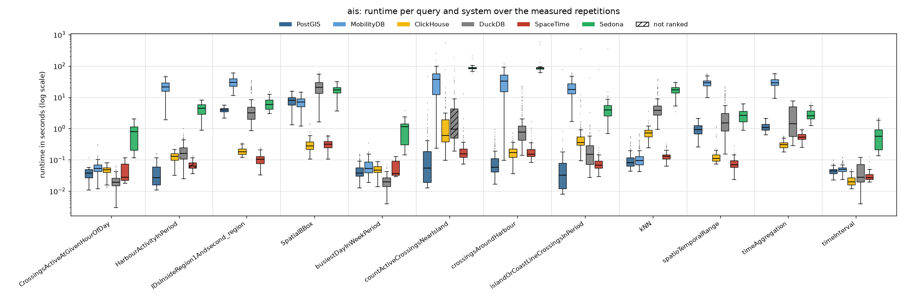
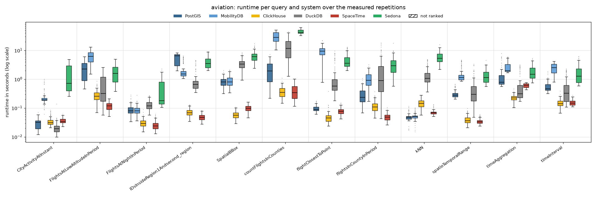
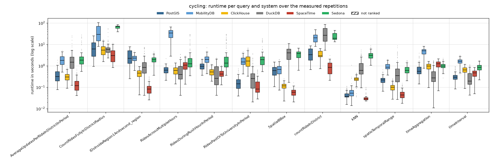
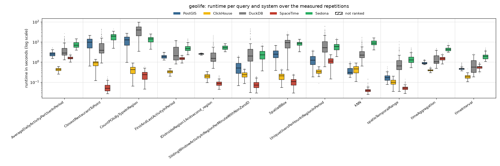

# Read-only, 2 client threads

Run of 2026-10-22 to 2026-10-23. Every system alone on the five-node cluster, one system after the other; 2 client threads taking the queries from one shared queue (so 2 queries run at the same time). Each of the 48 read queries runs with **128 measured parameter sets** (the same sets in every client-thread run) after 2 warm-up repetitions. Timeout 600 s per query. The configuration of every system is described in the [main README](../../../../../README.md#configuration). All numbers below come from the CSV files in this folder (`build_results.py`, `empty_results.py`); [`tables.md`](tables.md) has every table in full.

## Summary

| System | Queries won | Ranked on | Geo-mean slowdown vs fastest | Median slowdown | Measured executions | Failed |
|---|---:|---:|---:|---:|---:|---:|
| SpaceTime | 25 | 47 of 48 | 1.37× | 1.00× | 5,953 | 2 |
| ClickHouse | 13 | 48 of 48 | 2.10× | 1.83× | 5,953 | 2 |
| DuckDB | 6 | 47 of 48 | 11.70× | 15.66× | 5,953 | 3 |
| PostGIS | 4 | 48 of 48 | 4.76× | 3.71× | 5,953 | 2 |
| MobilityDB | 0 | 36 of 36 | 20.21× | 17.77× | 4,417 | 2 |
| Sedona | 0 | 48 of 48 | 34.67× | 32.83× | 5,953 | 2 |

*Slowdown*: a system's mean runtime on a query divided by the fastest ranked system's, over the queries the system is ranked on. A system is ranked on a query when every measured repetition succeeded and its results match PostGIS (pre-run equivalence check; accepted: nearest-neighbour ties, numbers within 1 %, an empty answer as no row or one row of zeros).

**Wins by scenario and by query type:**

| | PostGIS | ClickHouse | DuckDB | SpaceTime |
|---|---:|---:|---:|---:|
| AIS | 3 | 3 | 3 | 3 |
| Aviation | 1 | 4 | 1 | 6 |
| Cycling | – | 1 | 2 | 9 |
| Geolife | – | 5 | – | 7 |
| spatial | 3 | 3 | – | 10 |
| temporal | – | 9 | 4 | 3 |
| spatiotemporal | 1 | 1 | 2 | 12 |

## Total runtime, pair by pair

Sum of the measured repetitions' runtimes over only the queries both systems completed.

| System A | System B | Common queries | A | B | A / B |
|---|---|---:|---:|---:|---:|
| PostGIS | MobilityDB | 36 | 93.9 min | 746.5 min | 0.13 |
| PostGIS | ClickHouse | 48 | 171.9 min | 65.6 min | 2.62 |
| PostGIS | DuckDB | 47 | 170.4 min | 375.4 min | 0.45 |
| PostGIS | SpaceTime | 48 | 171.9 min | 40.3 min | 4.26 |
| PostGIS | Sedona | 48 | 171.9 min | 995.2 min | 0.17 |
| MobilityDB | ClickHouse | 36 | 746.5 min | 56.6 min | 13.2 |
| MobilityDB | DuckDB | 35 | 664.4 min | 181.9 min | 3.65 |
| MobilityDB | SpaceTime | 36 | 746.5 min | 25.0 min | 29.85 |
| MobilityDB | Sedona | 36 | 746.5 min | 812.9 min | 0.92 |
| ClickHouse | DuckDB | 47 | 51.1 min | 375.4 min | 0.14 |
| ClickHouse | SpaceTime | 48 | 65.6 min | 40.3 min | 1.63 |
| ClickHouse | Sedona | 48 | 65.6 min | 995.2 min | 0.07 |
| DuckDB | SpaceTime | 47 | 375.4 min | 39.6 min | 9.47 |
| DuckDB | Sedona | 47 | 375.4 min | 812.0 min | 0.46 |
| SpaceTime | Sedona | 48 | 40.3 min | 995.2 min | 0.04 |

## Failures

Parameter sets left out for every system:

| Scenario | Query | Repetition | Reason |
|---|---|---:|---|
| ais | countActiveCrossingsNearIsland | 81 | every system timed out |
| ais | countActiveCrossingsNearIsland | 96 | every system timed out |

Measured executions that did not succeed (including those in the parameter sets above):

| System | Scenario | Query | Status | Count |
|---|---|---|---|---:|
| ClickHouse | ais | countActiveCrossingsNearIsland | timeout | 2 |
| DuckDB | ais | countActiveCrossingsNearIsland | error | 1 |
| DuckDB | ais | countActiveCrossingsNearIsland | timeout | 2 |
| MobilityDB | ais | countActiveCrossingsNearIsland | timeout | 2 |
| PostGIS | ais | countActiveCrossingsNearIsland | timeout | 2 |
| Sedona | ais | countActiveCrossingsNearIsland | timeout | 2 |
| SpaceTime | ais | countActiveCrossingsNearIsland | timeout | 2 |

## Not ranked

| Scenario | Query | System | Reason |
|---|---|---|---|
| ais | HarbourActivityInPeriod | SpaceTime | DIFF 1 vs 1 rows, e.g. postgis=[('Mariager', '7')] spacetime=[('Mariager', '8')] [1/5 para |
| ais | countActiveCrossingsNearIsland | DuckDB | 125/126 succeeded |

## Latency per scenario

One section per scenario. The box plot shows every system's runtimes over the measured repetitions that succeeded (box: 25th to 75th percentile, line: median, whiskers: 1.5 × the box height, dots: outliers; log scale; hatched: not ranked). The table below it gives mean, median, 95th and 99th percentile and standard deviation over those repetitions (n); the variance (standard deviation squared, ms²) is in `summary.csv` (`var_ms2`). **Bold**: fastest ranked system on the query (by mean).

### AIS

| Query | System | n | Mean | Median | p95 | p99 | Std dev |
|---|---|---:|---:|---:|---:|---:|---:|
| `CrossingsActiveAtGivenHourOfDay` | PostGIS | 128 | 37 ms | 38 ms | 54 ms | 58 ms | 15 ms |
|  | MobilityDB | 128 | 59 ms | 53 ms | 110 ms | 245 ms | 38 ms |
|  | ClickHouse | 128 | 46 ms | 48 ms | 68 ms | 76 ms | 16 ms |
|  | **DuckDB** | 128 | **21 ms** | 19 ms | 41 ms | 57 ms | 10 ms |
|  | SpaceTime | 128 | 45 ms | 28 ms | 91 ms | 101 ms | 28 ms |
|  | Sedona | 128 | 742 ms | 792 ms | 1.56 s | 1.94 s | 514 ms |
| `HarbourActivityInPeriod` | **PostGIS** | 128 | **42 ms** | 27 ms | 96 ms | 144 ms | 32 ms |
|  | MobilityDB | 128 | 22.61 s | 21.11 s | 39.33 s | 46.23 s | 9.84 s |
|  | ClickHouse | 128 | 126 ms | 130 ms | 192 ms | 216 ms | 50 ms |
|  | DuckDB | 128 | 206 ms | 160 ms | 505 ms | 931 ms | 172 ms |
|  | SpaceTime | 128 | 70 ms | 64 ms | 110 ms | 122 ms | 20 ms |
|  | Sedona | 128 | 4.28 s | 4.38 s | 6.96 s | 7.47 s | 1.75 s |
| `IDsInsideRegion1Andsecond_region` | PostGIS | 128 | 3.95 s | 3.90 s | 5.12 s | 5.58 s | 682 ms |
|  | MobilityDB | 128 | 31.49 s | 29.65 s | 53.36 s | 59.35 s | 11.69 s |
|  | ClickHouse | 128 | 196 ms | 179 ms | 322 ms | 344 ms | 56 ms |
|  | DuckDB | 128 | 6.49 s | 3.12 s | 21.73 s | 33.49 s | 7.90 s |
|  | **SpaceTime** | 128 | **109 ms** | 104 ms | 189 ms | 234 ms | 43 ms |
|  | Sedona | 128 | 6.54 s | 5.82 s | 11.25 s | 14.03 s | 2.68 s |
| `SpatialBBox` | PostGIS | 128 | 8.06 s | 7.83 s | 13.35 s | 15.38 s | 3.01 s |
|  | MobilityDB | 128 | 7.32 s | 7.13 s | 12.08 s | 14.53 s | 2.75 s |
|  | **ClickHouse** | 128 | **318 ms** | 282 ms | 559 ms | 1.22 s | 184 ms |
|  | DuckDB | 128 | 22.21 s | 20.95 s | 40.88 s | 56.06 s | 12.21 s |
|  | SpaceTime | 128 | 321 ms | 314 ms | 507 ms | 619 ms | 107 ms |
|  | Sedona | 128 | 17.38 s | 17.04 s | 25.82 s | 30.81 s | 5.29 s |
| `busiestDayInWeekPeriod` | PostGIS | 128 | 50 ms | 38 ms | 121 ms | 152 ms | 31 ms |
|  | MobilityDB | 128 | 70 ms | 54 ms | 151 ms | 183 ms | 45 ms |
|  | ClickHouse | 128 | 48 ms | 47 ms | 77 ms | 84 ms | 17 ms |
|  | **DuckDB** | 128 | **21 ms** | 20 ms | 39 ms | 59 ms | 11 ms |
|  | SpaceTime | 128 | 58 ms | 37 ms | 117 ms | 128 ms | 33 ms |
|  | Sedona | 128 | 986 ms | 1.13 s | 1.79 s | 2.38 s | 644 ms |
| `countActiveCrossingsNearIsland` | PostGIS | 126 | 687 ms | 54 ms | 2.00 s | 5.94 s | 4.18 s |
|  | MobilityDB | 126 | 39.13 s | 37.57 s | 89.88 s | 140.94 s | 33.71 s |
|  | ClickHouse | 126 | 6.90 s | 602 ms | 10.17 s | 60.58 s | 49.38 s |
|  | DuckDB | 125 | 6.35 s | 948 ms | 31.27 s | 79.06 s | 20.25 s |
|  | **SpaceTime** | 126 | **323 ms** | 155 ms | 579 ms | 1.82 s | 1.18 s |
|  | Sedona | 126 | 87.25 s | 85.75 s | 96.49 s | 155.03 s | 15.72 s |
| `crossingsAroundHarbour` | **PostGIS** | 128 | **120 ms** | 58 ms | 401 ms | 738 ms | 152 ms |
|  | MobilityDB | 128 | 34.33 s | 32.60 s | 71.99 s | 106.29 s | 23.51 s |
|  | ClickHouse | 128 | 188 ms | 172 ms | 363 ms | 537 ms | 107 ms |
|  | DuckDB | 128 | 2.30 s | 760 ms | 10.62 s | 21.40 s | 4.29 s |
|  | SpaceTime | 128 | 206 ms | 152 ms | 378 ms | 998 ms | 188 ms |
|  | Sedona | 128 | 91.22 s | 84.92 s | 95.61 s | 385.67 s | 57.19 s |
| `islandOrCoastLineCrossingsInPeriod` | PostGIS | 128 | 640 ms | 32 ms | 200 ms | 742 ms | 6.55 s |
|  | MobilityDB | 128 | 21.09 s | 17.95 s | 45.92 s | 55.02 s | 11.90 s |
|  | ClickHouse | 128 | 3.60 s | 358 ms | 4.43 s | 11.08 s | 31.80 s |
|  | **DuckDB** | 128 | **587 ms** | 148 ms | 868 ms | 2.76 s | 3.71 s |
|  | SpaceTime | 128 | 676 ms | 68 ms | 154 ms | 676 ms | 6.73 s |
|  | Sedona | 128 | 6.89 s | 3.94 s | 7.92 s | 14.05 s | 30.78 s |
| `kNN` | **PostGIS** | 128 | **114 ms** | 82 ms | 290 ms | 506 ms | 90 ms |
|  | MobilityDB | 128 | 133 ms | 96 ms | 357 ms | 619 ms | 111 ms |
|  | ClickHouse | 128 | 760 ms | 731 ms | 1.17 s | 1.82 s | 369 ms |
|  | DuckDB | 128 | 6.16 s | 3.80 s | 20.41 s | 35.80 s | 6.72 s |
|  | SpaceTime | 128 | 134 ms | 128 ms | 232 ms | 289 ms | 47 ms |
|  | Sedona | 128 | 17.10 s | 17.34 s | 25.20 s | 29.59 s | 5.61 s |
| `spatioTemporalRange` | PostGIS | 128 | 999 ms | 929 ms | 1.69 s | 2.04 s | 396 ms |
|  | MobilityDB | 128 | 29.19 s | 28.97 s | 45.73 s | 54.77 s | 9.23 s |
|  | ClickHouse | 128 | 144 ms | 110 ms | 202 ms | 966 ms | 148 ms |
|  | DuckDB | 128 | 3.48 s | 1.49 s | 13.23 s | 19.32 s | 4.61 s |
|  | **SpaceTime** | 128 | **79 ms** | 70 ms | 135 ms | 206 ms | 36 ms |
|  | Sedona | 128 | 2.66 s | 2.60 s | 4.37 s | 5.24 s | 1.13 s |
| `timeAggregation` | PostGIS | 128 | 1.17 s | 1.08 s | 1.90 s | 2.10 s | 362 ms |
|  | MobilityDB | 128 | 30.25 s | 28.83 s | 47.43 s | 56.63 s | 10.10 s |
|  | **ClickHouse** | 128 | **320 ms** | 306 ms | 496 ms | 565 ms | 93 ms |
|  | DuckDB | 128 | 2.42 s | 1.41 s | 6.73 s | 7.54 s | 2.30 s |
|  | SpaceTime | 128 | 556 ms | 538 ms | 819 ms | 916 ms | 154 ms |
|  | Sedona | 128 | 2.93 s | 2.54 s | 5.00 s | 6.05 s | 1.17 s |
| `timeInterval` | PostGIS | 128 | 45 ms | 44 ms | 69 ms | 92 ms | 13 ms |
|  | MobilityDB | 128 | 53 ms | 50 ms | 89 ms | 120 ms | 18 ms |
|  | **ClickHouse** | 128 | **22 ms** | 20 ms | 40 ms | 49 ms | 8 ms |
|  | DuckDB | 128 | 44 ms | 28 ms | 93 ms | 113 ms | 30 ms |
|  | SpaceTime | 128 | 31 ms | 27 ms | 47 ms | 81 ms | 13 ms |
|  | Sedona | 128 | 696 ms | 562 ms | 1.98 s | 2.14 s | 563 ms |

### Aviation

| Query | System | n | Mean | Median | p95 | p99 | Std dev |
|---|---|---:|---:|---:|---:|---:|---:|
| `CityActivityAtInstant` | PostGIS | 128 | 29 ms | 32 ms | 46 ms | 58 ms | 11 ms |
|  | MobilityDB | 128 | 243 ms | 192 ms | 678 ms | 959 ms | 164 ms |
|  | ClickHouse | 128 | 35 ms | 31 ms | 63 ms | 78 ms | 13 ms |
|  | **DuckDB** | 128 | **22 ms** | 19 ms | 38 ms | 45 ms | 13 ms |
|  | SpaceTime | 128 | 36 ms | 34 ms | 50 ms | 55 ms | 7 ms |
|  | Sedona | 128 | 1.57 s | 725 ms | 4.19 s | 4.64 s | 1.44 s |
| `FlightsAtLowAltitudeInPeriod` | PostGIS | 128 | 2.35 s | 2.24 s | 4.97 s | 5.83 s | 1.50 s |
|  | MobilityDB | 128 | 6.30 s | 6.14 s | 10.80 s | 12.26 s | 2.76 s |
|  | ClickHouse | 128 | 288 ms | 258 ms | 573 ms | 676 ms | 134 ms |
|  | DuckDB | 128 | 698 ms | 316 ms | 2.13 s | 2.43 s | 710 ms |
|  | **SpaceTime** | 128 | **119 ms** | 120 ms | 187 ms | 203 ms | 38 ms |
|  | Sedona | 128 | 1.87 s | 1.59 s | 4.12 s | 4.66 s | 1.16 s |
| `FlightsAtNightInPeriod` | PostGIS | 128 | 91 ms | 80 ms | 159 ms | 243 ms | 39 ms |
|  | MobilityDB | 128 | 87 ms | 80 ms | 145 ms | 176 ms | 32 ms |
|  | ClickHouse | 128 | 31 ms | 29 ms | 49 ms | 68 ms | 11 ms |
|  | DuckDB | 128 | 133 ms | 120 ms | 234 ms | 269 ms | 51 ms |
|  | **SpaceTime** | 128 | **26 ms** | 24 ms | 46 ms | 56 ms | 9 ms |
|  | Sedona | 128 | 464 ms | 180 ms | 1.39 s | 1.99 s | 483 ms |
| `IDsInsideRegion1Andsecond_region` | PostGIS | 128 | 5.42 s | 6.42 s | 7.76 s | 8.01 s | 2.09 s |
|  | MobilityDB | 128 | 2.19 s | 1.51 s | 5.61 s | 6.01 s | 1.46 s |
|  | ClickHouse | 128 | 72 ms | 68 ms | 120 ms | 127 ms | 22 ms |
|  | DuckDB | 128 | 1.02 s | 664 ms | 3.59 s | 4.42 s | 1.00 s |
|  | **SpaceTime** | 128 | **49 ms** | 47 ms | 74 ms | 80 ms | 12 ms |
|  | Sedona | 128 | 3.95 s | 3.52 s | 7.14 s | 8.47 s | 1.68 s |
| `SpatialBBox` | PostGIS | 128 | 838 ms | 806 ms | 1.39 s | 1.68 s | 301 ms |
|  | MobilityDB | 128 | 915 ms | 802 ms | 1.80 s | 2.01 s | 425 ms |
|  | **ClickHouse** | 128 | **59 ms** | 56 ms | 88 ms | 101 ms | 16 ms |
|  | DuckDB | 128 | 3.51 s | 3.36 s | 6.58 s | 7.77 s | 1.44 s |
|  | SpaceTime | 128 | 98 ms | 96 ms | 147 ms | 158 ms | 25 ms |
|  | Sedona | 128 | 6.39 s | 6.11 s | 11.95 s | 14.82 s | 2.61 s |
| `countFlightsInCounties` | PostGIS | 53 | 2.20 s | 1.95 s | 4.74 s | 6.66 s | 1.60 s |
|  | MobilityDB | 53 | 29.47 s | 28.34 s | 48.60 s | 51.23 s | 11.46 s |
|  | ClickHouse | 53 | 398 ms | 348 ms | 723 ms | 979 ms | 195 ms |
|  | DuckDB | 53 | 14.21 s | 11.80 s | 36.31 s | 42.98 s | 11.01 s |
|  | **SpaceTime** | 53 | **390 ms** | 343 ms | 793 ms | 932 ms | 218 ms |
|  | Sedona | 53 | 45.51 s | 41.84 s | 61.31 s | 62.03 s | 8.78 s |
| `flightClosestToPoint` | PostGIS | 128 | 97 ms | 90 ms | 143 ms | 173 ms | 22 ms |
|  | MobilityDB | 128 | 9.44 s | 9.49 s | 15.46 s | 20.51 s | 3.65 s |
|  | **ClickHouse** | 128 | **51 ms** | 46 ms | 82 ms | 125 ms | 35 ms |
|  | DuckDB | 128 | 1.51 s | 574 ms | 7.03 s | 8.11 s | 2.12 s |
|  | SpaceTime | 128 | 79 ms | 76 ms | 121 ms | 142 ms | 21 ms |
|  | Sedona | 128 | 4.66 s | 3.58 s | 10.94 s | 12.49 s | 2.65 s |
| `flightsInCountyInPeriod` | PostGIS | 128 | 290 ms | 232 ms | 619 ms | 884 ms | 180 ms |
|  | MobilityDB | 128 | 1.05 s | 912 ms | 2.17 s | 2.68 s | 592 ms |
|  | ClickHouse | 128 | 121 ms | 108 ms | 229 ms | 267 ms | 53 ms |
|  | DuckDB | 128 | 2.34 s | 906 ms | 9.94 s | 16.18 s | 3.42 s |
|  | **SpaceTime** | 128 | **50 ms** | 48 ms | 70 ms | 89 ms | 13 ms |
|  | Sedona | 128 | 3.39 s | 2.94 s | 7.01 s | 9.71 s | 2.33 s |
| `kNN` | **PostGIS** | 128 | **50 ms** | 48 ms | 85 ms | 104 ms | 16 ms |
|  | MobilityDB | 128 | 52 ms | 50 ms | 78 ms | 98 ms | 14 ms |
|  | ClickHouse | 128 | 147 ms | 144 ms | 230 ms | 257 ms | 49 ms |
|  | DuckDB | 128 | 1.51 s | 1.06 s | 4.39 s | 4.74 s | 1.13 s |
|  | SpaceTime | 128 | 71 ms | 68 ms | 101 ms | 128 ms | 14 ms |
|  | Sedona | 128 | 5.91 s | 5.29 s | 10.36 s | 12.48 s | 2.50 s |
| `spatioTemporalRange` | PostGIS | 128 | 313 ms | 281 ms | 558 ms | 658 ms | 104 ms |
|  | MobilityDB | 128 | 1.56 s | 1.14 s | 4.12 s | 4.53 s | 1.01 s |
|  | ClickHouse | 128 | 40 ms | 36 ms | 70 ms | 80 ms | 13 ms |
|  | DuckDB | 128 | 549 ms | 296 ms | 1.93 s | 3.07 s | 654 ms |
|  | **SpaceTime** | 128 | **35 ms** | 33 ms | 51 ms | 56 ms | 7 ms |
|  | Sedona | 128 | 1.34 s | 1.13 s | 2.78 s | 3.25 s | 714 ms |
| `timeAggregation` | PostGIS | 128 | 1.27 s | 780 ms | 3.70 s | 6.00 s | 1.20 s |
|  | MobilityDB | 128 | 2.73 s | 1.97 s | 5.55 s | 5.87 s | 1.32 s |
|  | **ClickHouse** | 128 | **228 ms** | 224 ms | 346 ms | 416 ms | 61 ms |
|  | DuckDB | 128 | 668 ms | 312 ms | 2.66 s | 3.08 s | 779 ms |
|  | SpaceTime | 128 | 614 ms | 624 ms | 768 ms | 776 ms | 101 ms |
|  | Sedona | 128 | 1.87 s | 1.48 s | 3.82 s | 4.86 s | 988 ms |
| `timeInterval` | PostGIS | 128 | 569 ms | 461 ms | 1.07 s | 1.60 s | 251 ms |
|  | MobilityDB | 128 | 2.46 s | 2.52 s | 3.65 s | 3.93 s | 931 ms |
|  | **ClickHouse** | 128 | **151 ms** | 140 ms | 229 ms | 289 ms | 48 ms |
|  | DuckDB | 128 | 596 ms | 328 ms | 1.96 s | 2.13 s | 611 ms |
|  | SpaceTime | 128 | 156 ms | 148 ms | 216 ms | 247 ms | 34 ms |
|  | Sedona | 128 | 1.74 s | 1.27 s | 4.36 s | 5.88 s | 1.23 s |

### Cycling

| Query | System | n | Mean | Median | p95 | p99 | Std dev |
|---|---|---:|---:|---:|---:|---:|---:|
| `AverageUpdatesPerRideInDistrictInPeriod` | PostGIS | 128 | 402 ms | 320 ms | 906 ms | 1.32 s | 288 ms |
|  | MobilityDB | 128 | 1.97 s | 1.80 s | 3.46 s | 4.49 s | 997 ms |
|  | ClickHouse | 128 | 323 ms | 301 ms | 614 ms | 760 ms | 150 ms |
|  | DuckDB | 128 | 2.38 s | 1.48 s | 5.48 s | 20.34 s | 3.43 s |
|  | **SpaceTime** | 128 | **157 ms** | 118 ms | 401 ms | 574 ms | 121 ms |
|  | Sedona | 128 | 3.25 s | 1.86 s | 14.11 s | 23.34 s | 4.83 s |
| `CountRidesFullyInDistrictRadius` | PostGIS | 128 | 8.09 s | 6.15 s | 21.52 s | 24.38 s | 6.28 s |
|  | MobilityDB | 128 | 42.10 s | 29.47 s | 97.85 s | 103.63 s | 30.25 s |
|  | ClickHouse | 128 | 6.12 s | 5.42 s | 13.75 s | 15.52 s | 3.46 s |
|  | DuckDB | 128 | 7.13 s | 5.77 s | 14.24 s | 47.93 s | 7.19 s |
|  | **SpaceTime** | 128 | **3.73 s** | 3.01 s | 9.19 s | 10.23 s | 2.56 s |
|  | Sedona | 128 | 64.64 s | 69.60 s | 77.67 s | 79.06 s | 11.74 s |
| `IDsInsideRegion1Andsecond_region` | PostGIS | 128 | 3.18 s | 2.26 s | 6.56 s | 7.60 s | 2.08 s |
|  | MobilityDB | 128 | 2.37 s | 2.30 s | 3.95 s | 4.20 s | 849 ms |
|  | ClickHouse | 128 | 458 ms | 458 ms | 782 ms | 854 ms | 197 ms |
|  | DuckDB | 128 | 1.38 s | 834 ms | 5.70 s | 6.99 s | 1.60 s |
|  | **SpaceTime** | 128 | **94 ms** | 83 ms | 186 ms | 280 ms | 55 ms |
|  | Sedona | 128 | 2.03 s | 1.93 s | 3.38 s | 4.09 s | 786 ms |
| `RidesAcrossMultipleHours` | PostGIS | 128 | 665 ms | 622 ms | 1.15 s | 1.23 s | 286 ms |
|  | MobilityDB | 128 | 34.91 s | 34.29 s | 62.25 s | 64.34 s | 15.84 s |
|  | **ClickHouse** | 128 | **624 ms** | 614 ms | 1.05 s | 1.31 s | 275 ms |
|  | DuckDB | 128 | 726 ms | 400 ms | 2.40 s | 3.20 s | 746 ms |
|  | SpaceTime | 128 | 1.14 s | 1.07 s | 2.36 s | 2.77 s | 613 ms |
|  | Sedona | 128 | 3.33 s | 1.26 s | 16.51 s | 28.07 s | 6.00 s |
| `RidesDuringRushHourInPeriod` | PostGIS | 128 | 996 ms | 961 ms | 1.57 s | 1.95 s | 363 ms |
|  | MobilityDB | 128 | 2.19 s | 1.99 s | 3.88 s | 4.93 s | 1.04 s |
|  | ClickHouse | 128 | 543 ms | 520 ms | 947 ms | 1.11 s | 214 ms |
|  | DuckDB | 128 | 586 ms | 261 ms | 1.81 s | 2.15 s | 610 ms |
|  | **SpaceTime** | 128 | **460 ms** | 419 ms | 817 ms | 975 ms | 197 ms |
|  | Sedona | 128 | 3.95 s | 1.35 s | 18.99 s | 28.48 s | 6.52 s |
| `RidesPastOrToUniversityInPeriod` | PostGIS | 128 | 182 ms | 144 ms | 401 ms | 636 ms | 132 ms |
|  | MobilityDB | 128 | 1.77 s | 1.52 s | 3.37 s | 3.96 s | 849 ms |
|  | ClickHouse | 128 | 2.09 s | 1.69 s | 5.14 s | 6.34 s | 1.53 s |
|  | DuckDB | 128 | 434 ms | 252 ms | 1.57 s | 3.28 s | 602 ms |
|  | **SpaceTime** | 128 | **146 ms** | 82 ms | 466 ms | 610 ms | 138 ms |
|  | Sedona | 128 | 2.88 s | 1.94 s | 12.86 s | 17.02 s | 3.47 s |
| `SpatialBBox` | PostGIS | 128 | 624 ms | 594 ms | 1.13 s | 1.46 s | 323 ms |
|  | MobilityDB | 128 | 712 ms | 682 ms | 1.28 s | 1.92 s | 384 ms |
|  | ClickHouse | 128 | 116 ms | 116 ms | 196 ms | 219 ms | 47 ms |
|  | DuckDB | 128 | 4.22 s | 4.10 s | 9.14 s | 10.69 s | 2.74 s |
|  | **SpaceTime** | 128 | **60 ms** | 58 ms | 98 ms | 116 ms | 24 ms |
|  | Sedona | 128 | 3.56 s | 3.76 s | 5.69 s | 6.28 s | 1.40 s |
| `countRideInDistrict` | PostGIS | 12 | 4.11 s | 3.30 s | 8.38 s | 8.62 s | 2.91 s |
|  | MobilityDB | 12 | 23.14 s | 20.15 s | 46.75 s | 48.52 s | 13.60 s |
|  | ClickHouse | 12 | 3.61 s | 2.96 s | 6.23 s | 6.43 s | 1.79 s |
|  | DuckDB | 12 | 36.10 s | 26.85 s | 76.38 s | 84.83 s | 26.89 s |
|  | **SpaceTime** | 12 | **1.03 s** | 844 ms | 2.54 s | 2.99 s | 859 ms |
|  | Sedona | 12 | 23.94 s | 19.34 s | 40.65 s | 44.28 s | 10.60 s |
| `kNN` | PostGIS | 128 | 43 ms | 38 ms | 79 ms | 101 ms | 17 ms |
|  | MobilityDB | 128 | 70 ms | 52 ms | 119 ms | 288 ms | 99 ms |
|  | ClickHouse | 128 | 242 ms | 242 ms | 390 ms | 452 ms | 82 ms |
|  | DuckDB | 128 | 1.04 s | 608 ms | 3.10 s | 4.35 s | 1.00 s |
|  | **SpaceTime** | 128 | **32 ms** | 29 ms | 56 ms | 90 ms | 13 ms |
|  | Sedona | 128 | 3.24 s | 3.07 s | 5.91 s | 7.34 s | 1.37 s |
| `spatioTemporalRange` | PostGIS | 128 | 233 ms | 219 ms | 427 ms | 522 ms | 98 ms |
|  | MobilityDB | 128 | 970 ms | 856 ms | 1.68 s | 1.91 s | 369 ms |
|  | ClickHouse | 128 | 104 ms | 99 ms | 196 ms | 238 ms | 45 ms |
|  | DuckDB | 128 | 788 ms | 350 ms | 3.52 s | 6.37 s | 1.27 s |
|  | **SpaceTime** | 128 | **50 ms** | 44 ms | 103 ms | 130 ms | 25 ms |
|  | Sedona | 128 | 700 ms | 614 ms | 1.33 s | 1.73 s | 320 ms |
| `timeAggregation` | PostGIS | 128 | 733 ms | 560 ms | 1.57 s | 2.81 s | 541 ms |
|  | MobilityDB | 128 | 4.73 s | 5.01 s | 6.80 s | 7.51 s | 1.52 s |
|  | ClickHouse | 128 | 945 ms | 976 ms | 1.34 s | 1.45 s | 322 ms |
|  | **DuckDB** | 128 | **470 ms** | 270 ms | 1.47 s | 1.70 s | 446 ms |
|  | SpaceTime | 128 | 1.20 s | 1.23 s | 1.84 s | 2.09 s | 459 ms |
|  | Sedona | 128 | 1.03 s | 967 ms | 1.76 s | 2.04 s | 359 ms |
| `timeInterval` | PostGIS | 128 | 328 ms | 292 ms | 691 ms | 897 ms | 156 ms |
|  | MobilityDB | 128 | 1.64 s | 1.62 s | 2.61 s | 3.00 s | 514 ms |
|  | ClickHouse | 128 | 646 ms | 642 ms | 962 ms | 1.15 s | 222 ms |
|  | **DuckDB** | 128 | **310 ms** | 193 ms | 848 ms | 1.06 s | 256 ms |
|  | SpaceTime | 128 | 459 ms | 464 ms | 698 ms | 831 ms | 168 ms |
|  | Sedona | 128 | 871 ms | 841 ms | 1.45 s | 1.73 s | 315 ms |

### Geolife

| Query | System | n | Mean | Median | p95 | p99 | Std dev |
|---|---|---:|---:|---:|---:|---:|---:|
| `AverageDailyActivityPerUserInPeriod` | PostGIS | 128 | 2.55 s | 2.52 s | 3.44 s | 4.76 s | 625 ms |
|  | **ClickHouse** | 128 | **436 ms** | 430 ms | 563 ms | 600 ms | 79 ms |
|  | DuckDB | 128 | 5.13 s | 2.83 s | 14.80 s | 18.91 s | 4.92 s |
|  | SpaceTime | 128 | 1.64 s | 1.58 s | 2.13 s | 2.36 s | 306 ms |
|  | Sedona | 128 | 7.57 s | 6.88 s | 12.20 s | 13.65 s | 2.56 s |
| `ClosestRestaurantToPoint` | PostGIS | 128 | 9.88 s | 9.68 s | 17.95 s | 20.43 s | 5.43 s |
|  | ClickHouse | 128 | 866 ms | 941 ms | 1.27 s | 1.34 s | 290 ms |
|  | DuckDB | 128 | 7.82 s | 3.88 s | 25.28 s | 42.34 s | 9.10 s |
|  | **SpaceTime** | 128 | **60 ms** | 50 ms | 125 ms | 160 ms | 32 ms |
|  | Sedona | 128 | 18.67 s | 19.17 s | 30.77 s | 34.11 s | 7.55 s |
| `CountPOIsByTypeInRegion` | PostGIS | 128 | 12.98 s | 12.55 s | 24.89 s | 26.20 s | 7.11 s |
|  | ClickHouse | 128 | 424 ms | 426 ms | 750 ms | 894 ms | 199 ms |
|  | DuckDB | 128 | 39.05 s | 39.27 s | 72.48 s | 90.66 s | 21.95 s |
|  | **SpaceTime** | 128 | **243 ms** | 238 ms | 444 ms | 504 ms | 119 ms |
|  | Sedona | 128 | 13.83 s | 14.10 s | 21.19 s | 24.48 s | 4.45 s |
| `FirstAndLastActivityInPeriod` | PostGIS | 128 | 1.90 s | 1.87 s | 2.62 s | 3.12 s | 412 ms |
|  | **ClickHouse** | 128 | **339 ms** | 336 ms | 451 ms | 471 ms | 64 ms |
|  | DuckDB | 128 | 3.63 s | 2.04 s | 10.41 s | 11.45 s | 3.07 s |
|  | SpaceTime | 128 | 1.55 s | 1.50 s | 2.02 s | 2.14 s | 270 ms |
|  | Sedona | 128 | 5.27 s | 4.69 s | 9.70 s | 13.18 s | 2.26 s |
| `IDsInsideRegion1Andsecond_region` | PostGIS | 128 | 2.55 s | 2.56 s | 2.80 s | 2.84 s | 142 ms |
|  | ClickHouse | 128 | 206 ms | 201 ms | 307 ms | 324 ms | 56 ms |
|  | DuckDB | 128 | 3.13 s | 1.52 s | 10.90 s | 18.22 s | 3.82 s |
|  | **SpaceTime** | 128 | **92 ms** | 86 ms | 153 ms | 202 ms | 32 ms |
|  | Sedona | 128 | 5.42 s | 5.17 s | 7.73 s | 8.20 s | 1.27 s |
| `SlidingWindowActivityInRegionPerMinuteWithNonZeroID` | PostGIS | 128 | 614 ms | 508 ms | 1.45 s | 1.98 s | 455 ms |
|  | ClickHouse | 128 | 245 ms | 236 ms | 401 ms | 440 ms | 87 ms |
|  | DuckDB | 128 | 5.34 s | 1.99 s | 26.92 s | 41.63 s | 8.81 s |
|  | **SpaceTime** | 128 | **82 ms** | 72 ms | 169 ms | 186 ms | 40 ms |
|  | Sedona | 128 | 2.63 s | 2.26 s | 5.66 s | 6.86 s | 1.66 s |
| `SpatialBBox` | PostGIS | 128 | 2.69 s | 2.48 s | 5.09 s | 6.69 s | 1.36 s |
|  | ClickHouse | 128 | 206 ms | 206 ms | 351 ms | 425 ms | 89 ms |
|  | DuckDB | 128 | 9.56 s | 9.19 s | 20.28 s | 26.57 s | 5.66 s |
|  | **SpaceTime** | 128 | **112 ms** | 107 ms | 187 ms | 252 ms | 48 ms |
|  | Sedona | 128 | 8.22 s | 8.44 s | 11.65 s | 12.66 s | 2.21 s |
| `UniqueUsersPerHourInRegionInPeriod` | PostGIS | 128 | 1.41 s | 1.24 s | 2.95 s | 3.82 s | 830 ms |
|  | **ClickHouse** | 128 | **348 ms** | 333 ms | 528 ms | 561 ms | 94 ms |
|  | DuckDB | 128 | 9.82 s | 5.14 s | 35.02 s | 54.69 s | 11.66 s |
|  | SpaceTime | 128 | 1.19 s | 1.13 s | 1.91 s | 2.27 s | 418 ms |
|  | Sedona | 128 | 6.48 s | 5.94 s | 12.37 s | 14.96 s | 3.03 s |
| `kNN` | PostGIS | 128 | 390 ms | 304 ms | 855 ms | 1.02 s | 196 ms |
|  | ClickHouse | 128 | 453 ms | 454 ms | 756 ms | 894 ms | 204 ms |
|  | DuckDB | 128 | 3.53 s | 2.21 s | 10.20 s | 15.61 s | 3.24 s |
|  | **SpaceTime** | 128 | **42 ms** | 39 ms | 67 ms | 124 ms | 17 ms |
|  | Sedona | 128 | 9.27 s | 8.80 s | 13.93 s | 15.35 s | 2.74 s |
| `spatioTemporalRange` | PostGIS | 128 | 182 ms | 166 ms | 335 ms | 501 ms | 84 ms |
|  | ClickHouse | 128 | 104 ms | 100 ms | 166 ms | 192 ms | 36 ms |
|  | DuckDB | 128 | 1.29 s | 647 ms | 4.46 s | 7.68 s | 1.69 s |
|  | **SpaceTime** | 128 | **54 ms** | 50 ms | 94 ms | 110 ms | 18 ms |
|  | Sedona | 128 | 1.58 s | 1.29 s | 3.38 s | 4.82 s | 914 ms |
| `timeAggregation` | PostGIS | 128 | 929 ms | 860 ms | 1.26 s | 1.33 s | 161 ms |
|  | **ClickHouse** | 128 | **400 ms** | 392 ms | 499 ms | 558 ms | 55 ms |
|  | DuckDB | 128 | 1.59 s | 1.04 s | 3.84 s | 4.54 s | 1.10 s |
|  | SpaceTime | 128 | 1.52 s | 1.50 s | 2.11 s | 2.52 s | 366 ms |
|  | Sedona | 128 | 4.49 s | 4.31 s | 6.45 s | 7.73 s | 1.03 s |
| `timeInterval` | PostGIS | 128 | 493 ms | 463 ms | 753 ms | 893 ms | 112 ms |
|  | **ClickHouse** | 128 | **192 ms** | 186 ms | 266 ms | 296 ms | 49 ms |
|  | DuckDB | 128 | 797 ms | 558 ms | 1.90 s | 2.35 s | 587 ms |
|  | SpaceTime | 128 | 591 ms | 575 ms | 898 ms | 950 ms | 144 ms |
|  | Sedona | 128 | 2.05 s | 1.97 s | 3.70 s | 4.55 s | 774 ms |

## Hardware

Means over the five nodes and over the time the system ran (5 s samples; per scenario and node in `hardware_by_phase.csv`).

| System | Run time | CPU busy | Memory used | Disk read |
|---|---:|---:|---:|---:|
| PostGIS | 1.6 h | 46 % | 18.5 GB | 1786 MB/s |
| MobilityDB | 6.5 h | 12 % | 16.9 GB | 677 MB/s |
| ClickHouse | 0.7 h | 82 % | 6.9 GB | 29 MB/s |
| DuckDB | 3.5 h | 20 % | 14.1 GB | 52 MB/s |
| SpaceTime | 0.5 h | 51 % | 3.9 GB | 44 MB/s |
| Sedona | 8.6 h | 60 % | 27.5 GB | 162 MB/s |

## Caveats

- **SpaceTime's Geolife data** differs slightly from the other systems'; its Geolife queries whose results differ from PostGIS (SlidingWindowActivityInRegionPerMinuteWithNonZeroID, UniqueUsersPerHourInRegionInPeriod, timeAggregation) are ranked on request (`equivalence.csv`).
- **Client host:** the benchmark client runs on a separate host with one CPU core and 1 GB of RAM. Results are read in batches of 100,000 rows; with several client threads, the client can become a limit for queries with large results.
- **Sedona** skips GeoParquet files by their bounding box only when a query compares with a constant geometry; joins with a whole reference table (harbours, islands, districts, counties) read the whole table.
- **Parameters** are drawn where the data is (points, regions, time windows and places from a sample of the loaded data; see benchmark/configuration/README.md), each measured parameter set of a query distinct; every system answers the same parameter sets.

## Files

| File | One row per |
|---|---|
| `executions.csv` | query execution (scenario, system, query, repetition, warm-up, status, duration, parameters, SQL) |
| `summary.csv` | (scenario, query, system): runs, failures, mean/median/p95/p99/min/max/std dev/variance, equivalence, rank |
| `winners.csv` | (scenario, query): fastest ranked system, runner-up, margin |
| `system_scores.csv` | system: wins, completed and ranked queries, slowdowns |
| `pairwise_total_time.csv` | pair of systems: total runtime over the queries both completed |
| `empty_results.csv` | (scenario, query, system): measured executions without a row |
| `equivalence.csv` | (scenario, query, system): result compared with PostGIS |
| `hardware_by_phase.csv` | (scenario, system): CPU, memory, disk and network per node |
| `dropped_parameter_sets.csv` | parameter sets left out for every system |
| `tables.md`, `plots/` | the tables and figures generated from the above (`plots/boxplot_<scenario>.png`: the box plots) |
| `raw/` | client logs, query files, hardware samples, the equivalence check |
