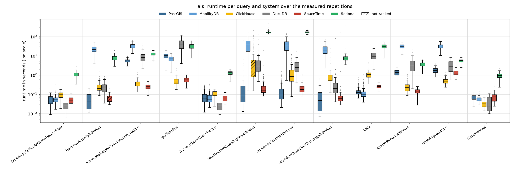
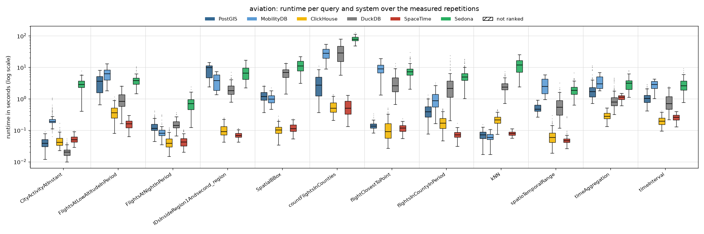
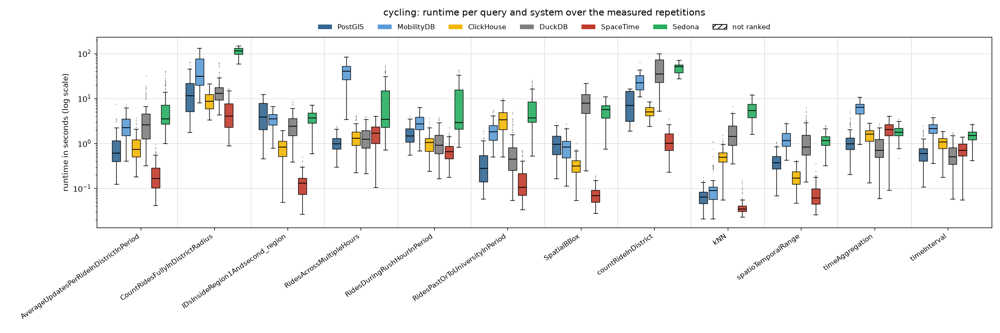
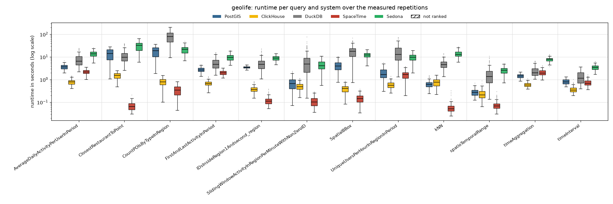

# Read-only, 4 client threads

Run of 2026-10-23 to 2026-10-24. Every system alone on the five-node cluster, one system after the other; 4 client threads taking the queries from one shared queue (so 4 queries run at the same time). Each of the 48 read queries runs with **128 measured parameter sets** (the same sets in every client-thread run) after 4 warm-up repetitions. Timeout 600 s per query. The configuration of every system is described in the [main README](../../../../../README.md#configuration). All numbers below come from the CSV files in this folder (`build_results.py`, `empty_results.py`); [`tables.md`](tables.md) has every table in full.

## Summary

| System | Queries won | Ranked on | Geo-mean slowdown vs fastest | Median slowdown | Measured executions | Failed |
|---|---:|---:|---:|---:|---:|---:|
| SpaceTime | 25 | 47 of 48 | 1.35× | 1.00× | 5,953 | 2 |
| ClickHouse | 12 | 47 of 48 | 2.45× | 2.20× | 5,953 | 3 |
| DuckDB | 5 | 48 of 48 | 12.71× | 16.71× | 5,953 | 2 |
| PostGIS | 4 | 48 of 48 | 4.97× | 3.79× | 5,953 | 2 |
| MobilityDB | 2 | 36 of 36 | 15.91× | 13.87× | 4,417 | 2 |
| Sedona | 0 | 48 of 48 | 40.76× | 37.90× | 5,953 | 2 |

*Slowdown*: a system's mean runtime on a query divided by the fastest ranked system's, over the queries the system is ranked on. A system is ranked on a query when every measured repetition succeeded and its results match PostGIS (pre-run equivalence check; accepted: nearest-neighbour ties, numbers within 1 %, an empty answer as no row or one row of zeros).

**Wins by scenario and by query type:**

| | PostGIS | MobilityDB | ClickHouse | DuckDB | SpaceTime |
|---|---:|---:|---:|---:|---:|
| AIS | 3 | 1 | 3 | 2 | 3 |
| Aviation | – | 1 | 4 | 1 | 6 |
| Cycling | 1 | – | – | 2 | 9 |
| Geolife | – | – | 5 | – | 7 |
| spatial | 1 | 2 | 2 | – | 11 |
| temporal | 1 | – | 9 | 4 | 2 |
| spatiotemporal | 2 | – | 1 | 1 | 12 |

## Total runtime, pair by pair

Sum of the measured repetitions' runtimes over only the queries both systems completed.

| System A | System B | Common queries | A | B | A / B |
|---|---|---:|---:|---:|---:|
| PostGIS | MobilityDB | 36 | 148.7 min | 822.2 min | 0.18 |
| PostGIS | ClickHouse | 47 | 259.2 min | 88.3 min | 2.94 |
| PostGIS | DuckDB | 48 | 261.3 min | 714.7 min | 0.37 |
| PostGIS | SpaceTime | 48 | 261.3 min | 60.5 min | 4.32 |
| PostGIS | Sedona | 48 | 261.3 min | 1822.4 min | 0.14 |
| MobilityDB | ClickHouse | 35 | 735.4 min | 71.8 min | 10.24 |
| MobilityDB | DuckDB | 36 | 822.2 min | 347.7 min | 2.36 |
| MobilityDB | SpaceTime | 36 | 822.2 min | 39.5 min | 20.79 |
| MobilityDB | Sedona | 36 | 822.2 min | 1521.1 min | 0.54 |
| ClickHouse | DuckDB | 47 | 88.3 min | 701.7 min | 0.13 |
| ClickHouse | SpaceTime | 47 | 88.3 min | 59.7 min | 1.48 |
| ClickHouse | Sedona | 47 | 88.3 min | 1460.2 min | 0.06 |
| DuckDB | SpaceTime | 48 | 714.7 min | 60.5 min | 11.81 |
| DuckDB | Sedona | 48 | 714.7 min | 1822.4 min | 0.39 |
| SpaceTime | Sedona | 48 | 60.5 min | 1822.4 min | 0.03 |

## Failures

Parameter sets left out for every system:

| Scenario | Query | Repetition | Reason |
|---|---|---:|---|
| ais | countActiveCrossingsNearIsland | 83 | every system timed out |
| ais | countActiveCrossingsNearIsland | 98 | every system timed out |

Measured executions that did not succeed (including those in the parameter sets above):

| System | Scenario | Query | Status | Count |
|---|---|---|---|---:|
| ClickHouse | ais | countActiveCrossingsNearIsland | timeout | 3 |
| DuckDB | ais | countActiveCrossingsNearIsland | timeout | 2 |
| MobilityDB | ais | countActiveCrossingsNearIsland | timeout | 2 |
| PostGIS | ais | countActiveCrossingsNearIsland | timeout | 2 |
| Sedona | ais | countActiveCrossingsNearIsland | timeout | 2 |
| SpaceTime | ais | countActiveCrossingsNearIsland | timeout | 2 |

## Not ranked

| Scenario | Query | System | Reason |
|---|---|---|---|
| ais | HarbourActivityInPeriod | SpaceTime | DIFF 1 vs 1 rows, e.g. postgis=[('Mariager', '7')] spacetime=[('Mariager', '8')] [1/5 para |
| ais | countActiveCrossingsNearIsland | ClickHouse | 125/126 succeeded |

## Latency per scenario

One section per scenario. The box plot shows every system's runtimes over the measured repetitions that succeeded (box: 25th to 75th percentile, line: median, whiskers: 1.5 × the box height, dots: outliers; log scale; hatched: not ranked). The table below it gives mean, median, 95th and 99th percentile and standard deviation over those repetitions (n); the variance (standard deviation squared, ms²) is in `summary.csv` (`var_ms2`). **Bold**: fastest ranked system on the query (by mean).

### AIS

| Query | System | n | Mean | Median | p95 | p99 | Std dev |
|---|---|---:|---:|---:|---:|---:|---:|
| `CrossingsActiveAtGivenHourOfDay` | PostGIS | 128 | 54 ms | 50 ms | 93 ms | 111 ms | 25 ms |
|  | MobilityDB | 128 | 59 ms | 53 ms | 102 ms | 160 ms | 34 ms |
|  | ClickHouse | 128 | 99 ms | 100 ms | 157 ms | 178 ms | 35 ms |
|  | **DuckDB** | 128 | **28 ms** | 25 ms | 55 ms | 84 ms | 14 ms |
|  | SpaceTime | 128 | 52 ms | 50 ms | 94 ms | 112 ms | 22 ms |
|  | Sedona | 128 | 1.12 s | 1.11 s | 1.60 s | 2.05 s | 344 ms |
| `HarbourActivityInPeriod` | **PostGIS** | 128 | **66 ms** | 44 ms | 178 ms | 205 ms | 55 ms |
|  | MobilityDB | 128 | 23.61 s | 21.81 s | 42.61 s | 48.79 s | 10.16 s |
|  | ClickHouse | 128 | 278 ms | 199 ms | 695 ms | 876 ms | 201 ms |
|  | DuckDB | 128 | 252 ms | 212 ms | 591 ms | 825 ms | 169 ms |
|  | SpaceTime | 128 | 64 ms | 65 ms | 101 ms | 123 ms | 26 ms |
|  | Sedona | 128 | 8.01 s | 7.86 s | 11.90 s | 13.96 s | 2.49 s |
| `IDsInsideRegion1Andsecond_region` | PostGIS | 128 | 5.69 s | 5.52 s | 7.88 s | 9.31 s | 1.27 s |
|  | MobilityDB | 128 | 33.65 s | 32.18 s | 56.14 s | 61.24 s | 10.83 s |
|  | ClickHouse | 128 | 382 ms | 342 ms | 722 ms | 1.00 s | 185 ms |
|  | DuckDB | 128 | 10.37 s | 8.16 s | 24.52 s | 40.66 s | 7.57 s |
|  | **SpaceTime** | 128 | **256 ms** | 249 ms | 419 ms | 459 ms | 89 ms |
|  | Sedona | 128 | 12.56 s | 12.56 s | 18.13 s | 19.17 s | 3.11 s |
| `SpatialBBox` | PostGIS | 128 | 10.79 s | 10.71 s | 17.65 s | 20.19 s | 3.78 s |
|  | MobilityDB | 128 | 7.54 s | 7.44 s | 12.29 s | 14.06 s | 2.52 s |
|  | **ClickHouse** | 128 | **543 ms** | 492 ms | 976 ms | 2.07 s | 309 ms |
|  | DuckDB | 128 | 43.68 s | 40.56 s | 86.02 s | 111.65 s | 23.96 s |
|  | SpaceTime | 128 | 569 ms | 562 ms | 849 ms | 988 ms | 176 ms |
|  | Sedona | 128 | 32.37 s | 32.83 s | 52.40 s | 59.24 s | 11.45 s |
| `busiestDayInWeekPeriod` | PostGIS | 128 | 80 ms | 58 ms | 209 ms | 283 ms | 59 ms |
|  | MobilityDB | 128 | 74 ms | 53 ms | 174 ms | 340 ms | 59 ms |
|  | ClickHouse | 128 | 114 ms | 116 ms | 167 ms | 182 ms | 35 ms |
|  | **DuckDB** | 128 | **28 ms** | 25 ms | 55 ms | 93 ms | 16 ms |
|  | SpaceTime | 128 | 66 ms | 66 ms | 105 ms | 122 ms | 23 ms |
|  | Sedona | 128 | 1.34 s | 1.34 s | 1.93 s | 2.42 s | 396 ms |
| `countActiveCrossingsNearIsland` | PostGIS | 126 | 1.01 s | 82 ms | 3.15 s | 9.70 s | 5.83 s |
|  | MobilityDB | 126 | 41.34 s | 36.99 s | 93.84 s | 154.84 s | 36.54 s |
|  | ClickHouse | 125 | 14.28 s | 1.82 s | 78.03 s | 186.10 s | 39.27 s |
|  | DuckDB | 126 | 6.17 s | 2.98 s | 19.04 s | 64.60 s | 13.44 s |
|  | **SpaceTime** | 126 | **406 ms** | 162 ms | 784 ms | 2.72 s | 1.69 s |
|  | Sedona | 126 | 172.48 s | 165.84 s | 228.15 s | 275.38 s | 34.82 s |
| `crossingsAroundHarbour` | **PostGIS** | 128 | **186 ms** | 92 ms | 617 ms | 1.12 s | 241 ms |
|  | MobilityDB | 128 | 38.95 s | 36.33 s | 82.92 s | 121.52 s | 26.87 s |
|  | ClickHouse | 128 | 1.76 s | 857 ms | 7.19 s | 11.16 s | 2.37 s |
|  | DuckDB | 128 | 3.72 s | 2.46 s | 11.04 s | 16.78 s | 3.42 s |
|  | SpaceTime | 128 | 234 ms | 178 ms | 512 ms | 1.08 s | 194 ms |
|  | Sedona | 128 | 170.77 s | 165.13 s | 218.58 s | 273.99 s | 26.70 s |
| `islandOrCoastLineCrossingsInPeriod` | **PostGIS** | 128 | **727 ms** | 48 ms | 352 ms | 1.54 s | 7.07 s |
|  | MobilityDB | 128 | 22.03 s | 18.43 s | 44.89 s | 52.85 s | 12.02 s |
|  | ClickHouse | 128 | 4.84 s | 633 ms | 13.01 s | 25.10 s | 32.80 s |
|  | DuckDB | 128 | 931 ms | 198 ms | 710 ms | 3.34 s | 7.06 s |
|  | SpaceTime | 128 | 1.32 s | 62 ms | 166 ms | 1.21 s | 14.05 s |
|  | Sedona | 128 | 10.88 s | 7.64 s | 12.41 s | 22.27 s | 34.81 s |
| `kNN` | PostGIS | 128 | 168 ms | 126 ms | 474 ms | 694 ms | 127 ms |
|  | **MobilityDB** | 128 | **147 ms** | 102 ms | 397 ms | 606 ms | 139 ms |
|  | ClickHouse | 128 | 1.18 s | 1.05 s | 2.33 s | 3.93 s | 674 ms |
|  | DuckDB | 128 | 11.48 s | 9.52 s | 24.79 s | 33.41 s | 6.82 s |
|  | SpaceTime | 128 | 260 ms | 258 ms | 359 ms | 404 ms | 58 ms |
|  | Sedona | 128 | 31.79 s | 30.84 s | 50.82 s | 59.14 s | 10.58 s |
| `spatioTemporalRange` | PostGIS | 128 | 1.40 s | 1.35 s | 2.28 s | 2.44 s | 498 ms |
|  | MobilityDB | 128 | 32.09 s | 31.51 s | 49.64 s | 56.50 s | 9.63 s |
|  | ClickHouse | 128 | 277 ms | 223 ms | 677 ms | 1.05 s | 194 ms |
|  | DuckDB | 128 | 4.44 s | 3.34 s | 13.77 s | 17.85 s | 4.05 s |
|  | **SpaceTime** | 128 | **149 ms** | 146 ms | 232 ms | 255 ms | 48 ms |
|  | Sedona | 128 | 3.72 s | 3.73 s | 5.50 s | 6.00 s | 1.07 s |
| `timeAggregation` | PostGIS | 128 | 1.84 s | 1.70 s | 2.98 s | 3.68 s | 646 ms |
|  | MobilityDB | 128 | 32.94 s | 33.37 s | 47.62 s | 56.38 s | 9.37 s |
|  | **ClickHouse** | 128 | **514 ms** | 485 ms | 810 ms | 1.04 s | 176 ms |
|  | DuckDB | 128 | 3.37 s | 2.74 s | 6.78 s | 7.86 s | 2.04 s |
|  | SpaceTime | 128 | 1.36 s | 1.28 s | 2.12 s | 2.34 s | 403 ms |
|  | Sedona | 128 | 5.61 s | 5.64 s | 7.60 s | 8.87 s | 1.32 s |
| `timeInterval` | PostGIS | 128 | 73 ms | 71 ms | 117 ms | 134 ms | 23 ms |
|  | MobilityDB | 128 | 58 ms | 57 ms | 83 ms | 124 ms | 18 ms |
|  | **ClickHouse** | 128 | **33 ms** | 32 ms | 55 ms | 72 ms | 13 ms |
|  | DuckDB | 128 | 42 ms | 24 ms | 95 ms | 105 ms | 31 ms |
|  | SpaceTime | 128 | 78 ms | 79 ms | 139 ms | 164 ms | 37 ms |
|  | Sedona | 128 | 973 ms | 960 ms | 1.51 s | 2.05 s | 356 ms |

### Aviation

| Query | System | n | Mean | Median | p95 | p99 | Std dev |
|---|---|---:|---:|---:|---:|---:|---:|
| `CityActivityAtInstant` | PostGIS | 128 | 41 ms | 38 ms | 71 ms | 78 ms | 16 ms |
|  | MobilityDB | 128 | 242 ms | 188 ms | 503 ms | 1.00 s | 166 ms |
|  | ClickHouse | 128 | 48 ms | 41 ms | 87 ms | 122 ms | 22 ms |
|  | **DuckDB** | 128 | **22 ms** | 20 ms | 38 ms | 45 ms | 8 ms |
|  | SpaceTime | 128 | 52 ms | 50 ms | 78 ms | 88 ms | 14 ms |
|  | Sedona | 128 | 2.98 s | 2.88 s | 5.32 s | 5.95 s | 1.24 s |
| `FlightsAtLowAltitudeInPeriod` | PostGIS | 128 | 3.55 s | 3.60 s | 6.75 s | 7.85 s | 2.03 s |
|  | MobilityDB | 128 | 6.33 s | 6.24 s | 10.78 s | 12.10 s | 2.66 s |
|  | ClickHouse | 128 | 395 ms | 358 ms | 729 ms | 935 ms | 192 ms |
|  | DuckDB | 128 | 1.03 s | 834 ms | 2.14 s | 2.52 s | 590 ms |
|  | **SpaceTime** | 128 | **163 ms** | 160 ms | 264 ms | 290 ms | 53 ms |
|  | Sedona | 128 | 3.93 s | 3.79 s | 6.26 s | 9.92 s | 1.57 s |
| `FlightsAtNightInPeriod` | PostGIS | 128 | 136 ms | 116 ms | 265 ms | 368 ms | 64 ms |
|  | MobilityDB | 128 | 91 ms | 80 ms | 147 ms | 291 ms | 42 ms |
|  | **ClickHouse** | 128 | **45 ms** | 38 ms | 91 ms | 115 ms | 23 ms |
|  | DuckDB | 128 | 158 ms | 143 ms | 256 ms | 327 ms | 54 ms |
|  | SpaceTime | 128 | 46 ms | 42 ms | 92 ms | 100 ms | 19 ms |
|  | Sedona | 128 | 744 ms | 699 ms | 1.50 s | 1.90 s | 412 ms |
| `IDsInsideRegion1Andsecond_region` | PostGIS | 128 | 8.51 s | 9.91 s | 12.49 s | 13.21 s | 3.39 s |
|  | MobilityDB | 128 | 3.84 s | 3.83 s | 6.77 s | 7.12 s | 1.98 s |
|  | ClickHouse | 128 | 106 ms | 90 ms | 210 ms | 238 ms | 47 ms |
|  | DuckDB | 128 | 2.18 s | 1.81 s | 4.48 s | 5.52 s | 1.10 s |
|  | **SpaceTime** | 128 | **71 ms** | 68 ms | 99 ms | 112 ms | 15 ms |
|  | Sedona | 128 | 6.92 s | 6.62 s | 12.10 s | 15.19 s | 3.28 s |
| `SpatialBBox` | PostGIS | 128 | 1.28 s | 1.17 s | 2.21 s | 2.47 s | 469 ms |
|  | MobilityDB | 128 | 1.04 s | 988 ms | 1.67 s | 1.82 s | 360 ms |
|  | **ClickHouse** | 128 | **110 ms** | 102 ms | 201 ms | 223 ms | 44 ms |
|  | DuckDB | 128 | 6.83 s | 6.93 s | 11.98 s | 13.37 s | 2.77 s |
|  | SpaceTime | 128 | 122 ms | 112 ms | 193 ms | 218 ms | 40 ms |
|  | Sedona | 128 | 11.72 s | 11.08 s | 19.45 s | 20.42 s | 4.78 s |
| `countFlightsInCounties` | PostGIS | 53 | 3.25 s | 2.75 s | 7.12 s | 9.74 s | 2.39 s |
|  | MobilityDB | 53 | 28.61 s | 28.10 s | 47.94 s | 52.20 s | 11.15 s |
|  | ClickHouse | 53 | 598 ms | 502 ms | 1.26 s | 1.35 s | 308 ms |
|  | DuckDB | 53 | 32.16 s | 28.70 s | 65.90 s | 73.81 s | 19.22 s |
|  | **SpaceTime** | 53 | **589 ms** | 500 ms | 1.13 s | 1.27 s | 320 ms |
|  | Sedona | 53 | 80.23 s | 77.78 s | 104.58 s | 120.96 s | 16.03 s |
| `flightClosestToPoint` | PostGIS | 128 | 143 ms | 136 ms | 208 ms | 282 ms | 39 ms |
|  | MobilityDB | 128 | 9.34 s | 8.94 s | 15.53 s | 18.69 s | 3.77 s |
|  | ClickHouse | 128 | 127 ms | 90 ms | 314 ms | 472 ms | 98 ms |
|  | DuckDB | 128 | 3.47 s | 2.56 s | 8.34 s | 10.67 s | 2.47 s |
|  | **SpaceTime** | 128 | **119 ms** | 117 ms | 181 ms | 196 ms | 35 ms |
|  | Sedona | 128 | 8.35 s | 7.27 s | 19.00 s | 21.71 s | 4.29 s |
| `flightsInCountyInPeriod` | PostGIS | 128 | 441 ms | 382 ms | 982 ms | 1.06 s | 252 ms |
|  | MobilityDB | 128 | 1.04 s | 869 ms | 2.24 s | 2.77 s | 629 ms |
|  | ClickHouse | 128 | 190 ms | 170 ms | 414 ms | 477 ms | 97 ms |
|  | DuckDB | 128 | 3.31 s | 2.13 s | 9.85 s | 18.29 s | 3.67 s |
|  | **SpaceTime** | 128 | **74 ms** | 71 ms | 110 ms | 122 ms | 21 ms |
|  | Sedona | 128 | 5.82 s | 4.92 s | 13.46 s | 17.45 s | 3.26 s |
| `kNN` | PostGIS | 128 | 74 ms | 72 ms | 110 ms | 125 ms | 23 ms |
|  | **MobilityDB** | 128 | **62 ms** | 60 ms | 90 ms | 101 ms | 17 ms |
|  | ClickHouse | 128 | 221 ms | 212 ms | 377 ms | 448 ms | 80 ms |
|  | DuckDB | 128 | 2.67 s | 2.35 s | 5.08 s | 6.30 s | 1.19 s |
|  | SpaceTime | 128 | 81 ms | 79 ms | 103 ms | 111 ms | 13 ms |
|  | Sedona | 128 | 12.34 s | 11.84 s | 22.84 s | 24.97 s | 6.03 s |
| `spatioTemporalRange` | PostGIS | 128 | 511 ms | 466 ms | 769 ms | 882 ms | 151 ms |
|  | MobilityDB | 128 | 2.85 s | 2.45 s | 5.35 s | 5.55 s | 1.51 s |
|  | ClickHouse | 128 | 70 ms | 59 ms | 163 ms | 225 ms | 44 ms |
|  | DuckDB | 128 | 667 ms | 538 ms | 1.60 s | 2.24 s | 512 ms |
|  | **SpaceTime** | 128 | **53 ms** | 46 ms | 78 ms | 256 ms | 34 ms |
|  | Sedona | 128 | 2.07 s | 1.87 s | 3.92 s | 4.44 s | 984 ms |
| `timeAggregation` | PostGIS | 128 | 2.26 s | 1.67 s | 7.27 s | 10.21 s | 1.98 s |
|  | MobilityDB | 128 | 3.57 s | 2.98 s | 6.32 s | 6.73 s | 1.62 s |
|  | **ClickHouse** | 128 | **290 ms** | 278 ms | 419 ms | 482 ms | 76 ms |
|  | DuckDB | 128 | 1.05 s | 783 ms | 2.49 s | 4.22 s | 781 ms |
|  | SpaceTime | 128 | 1.12 s | 1.14 s | 1.47 s | 1.50 s | 214 ms |
|  | Sedona | 128 | 3.12 s | 3.12 s | 5.38 s | 7.24 s | 1.34 s |
| `timeInterval` | PostGIS | 128 | 1.11 s | 1.03 s | 2.09 s | 2.76 s | 485 ms |
|  | MobilityDB | 128 | 2.79 s | 2.88 s | 4.03 s | 4.22 s | 909 ms |
|  | **ClickHouse** | 128 | **202 ms** | 196 ms | 308 ms | 372 ms | 62 ms |
|  | DuckDB | 128 | 902 ms | 707 ms | 2.18 s | 2.37 s | 564 ms |
|  | SpaceTime | 128 | 260 ms | 260 ms | 354 ms | 382 ms | 59 ms |
|  | Sedona | 128 | 2.97 s | 2.59 s | 5.62 s | 7.58 s | 1.49 s |

### Cycling

| Query | System | n | Mean | Median | p95 | p99 | Std dev |
|---|---|---:|---:|---:|---:|---:|---:|
| `AverageUpdatesPerRideInDistrictInPeriod` | PostGIS | 128 | 897 ms | 606 ms | 2.17 s | 3.56 s | 894 ms |
|  | MobilityDB | 128 | 2.59 s | 2.26 s | 5.28 s | 6.68 s | 1.42 s |
|  | ClickHouse | 128 | 926 ms | 738 ms | 2.10 s | 3.10 s | 625 ms |
|  | DuckDB | 128 | 4.03 s | 2.57 s | 13.08 s | 18.47 s | 4.64 s |
|  | **SpaceTime** | 128 | **224 ms** | 164 ms | 606 ms | 802 ms | 173 ms |
|  | Sedona | 128 | 7.41 s | 3.50 s | 24.48 s | 39.20 s | 8.57 s |
| `CountRidesFullyInDistrictRadius` | PostGIS | 128 | 15.17 s | 11.52 s | 39.59 s | 61.09 s | 12.73 s |
|  | MobilityDB | 128 | 45.73 s | 31.06 s | 108.22 s | 119.63 s | 31.97 s |
|  | ClickHouse | 128 | 9.44 s | 8.68 s | 17.84 s | 20.14 s | 4.27 s |
|  | DuckDB | 128 | 15.31 s | 13.03 s | 35.74 s | 59.55 s | 10.53 s |
|  | **SpaceTime** | 128 | **5.30 s** | 4.00 s | 12.82 s | 15.65 s | 3.71 s |
|  | Sedona | 128 | 112.69 s | 113.23 s | 143.46 s | 147.50 s | 22.85 s |
| `IDsInsideRegion1Andsecond_region` | PostGIS | 128 | 4.87 s | 3.84 s | 9.96 s | 11.91 s | 3.16 s |
|  | MobilityDB | 128 | 3.50 s | 3.49 s | 5.60 s | 6.50 s | 1.32 s |
|  | ClickHouse | 128 | 831 ms | 833 ms | 1.45 s | 1.58 s | 386 ms |
|  | DuckDB | 128 | 2.73 s | 2.38 s | 5.87 s | 7.91 s | 1.61 s |
|  | **SpaceTime** | 128 | **135 ms** | 130 ms | 278 ms | 405 ms | 82 ms |
|  | Sedona | 128 | 3.79 s | 3.72 s | 6.09 s | 6.87 s | 1.34 s |
| `RidesAcrossMultipleHours` | **PostGIS** | 128 | **1.07 s** | 986 ms | 1.89 s | 2.25 s | 430 ms |
|  | MobilityDB | 128 | 40.76 s | 40.36 s | 73.24 s | 80.83 s | 18.40 s |
|  | ClickHouse | 128 | 1.48 s | 1.29 s | 3.36 s | 4.03 s | 840 ms |
|  | DuckDB | 128 | 1.42 s | 1.23 s | 2.87 s | 3.69 s | 818 ms |
|  | SpaceTime | 128 | 1.70 s | 1.68 s | 3.49 s | 3.93 s | 920 ms |
|  | Sedona | 128 | 10.61 s | 3.43 s | 40.25 s | 49.39 s | 13.48 s |
| `RidesDuringRushHourInPeriod` | PostGIS | 128 | 1.61 s | 1.47 s | 2.81 s | 3.31 s | 692 ms |
|  | MobilityDB | 128 | 2.94 s | 2.70 s | 5.38 s | 6.19 s | 1.32 s |
|  | ClickHouse | 128 | 1.10 s | 1.05 s | 2.06 s | 2.94 s | 553 ms |
|  | DuckDB | 128 | 1.17 s | 900 ms | 2.71 s | 3.46 s | 798 ms |
|  | **SpaceTime** | 128 | **697 ms** | 650 ms | 1.27 s | 1.68 s | 341 ms |
|  | Sedona | 128 | 8.82 s | 2.89 s | 31.10 s | 40.58 s | 9.99 s |
| `RidesPastOrToUniversityInPeriod` | PostGIS | 128 | 388 ms | 276 ms | 1.12 s | 1.56 s | 341 ms |
|  | MobilityDB | 128 | 1.97 s | 1.80 s | 3.77 s | 5.20 s | 1.03 s |
|  | ClickHouse | 128 | 3.69 s | 3.36 s | 8.45 s | 9.57 s | 2.14 s |
|  | DuckDB | 128 | 749 ms | 446 ms | 2.70 s | 4.23 s | 876 ms |
|  | **SpaceTime** | 128 | **169 ms** | 106 ms | 529 ms | 674 ms | 154 ms |
|  | Sedona | 128 | 6.28 s | 3.72 s | 18.51 s | 23.65 s | 5.47 s |
| `SpatialBBox` | PostGIS | 128 | 1.06 s | 952 ms | 2.16 s | 2.51 s | 598 ms |
|  | MobilityDB | 128 | 849 ms | 828 ms | 1.66 s | 2.20 s | 459 ms |
|  | ClickHouse | 128 | 335 ms | 312 ms | 626 ms | 749 ms | 162 ms |
|  | DuckDB | 128 | 8.64 s | 7.94 s | 16.92 s | 20.99 s | 4.92 s |
|  | **SpaceTime** | 128 | **75 ms** | 70 ms | 144 ms | 182 ms | 35 ms |
|  | Sedona | 128 | 5.50 s | 5.61 s | 8.77 s | 9.79 s | 2.13 s |
| `countRideInDistrict` | PostGIS | 12 | 8.18 s | 6.91 s | 16.06 s | 16.40 s | 5.73 s |
|  | MobilityDB | 12 | 26.52 s | 22.36 s | 52.26 s | 60.69 s | 15.44 s |
|  | ClickHouse | 12 | 5.22 s | 5.02 s | 8.14 s | 8.33 s | 2.00 s |
|  | DuckDB | 12 | 46.81 s | 34.83 s | 96.96 s | 97.95 s | 33.90 s |
|  | **SpaceTime** | 12 | **1.32 s** | 998 ms | 3.06 s | 3.45 s | 970 ms |
|  | Sedona | 12 | 49.09 s | 50.46 s | 68.53 s | 71.06 s | 13.70 s |
| `kNN` | PostGIS | 128 | 69 ms | 64 ms | 122 ms | 149 ms | 28 ms |
|  | MobilityDB | 128 | 137 ms | 89 ms | 324 ms | 1.07 s | 181 ms |
|  | ClickHouse | 128 | 538 ms | 496 ms | 975 ms | 1.26 s | 235 ms |
|  | DuckDB | 128 | 1.83 s | 1.43 s | 3.97 s | 5.02 s | 1.21 s |
|  | **SpaceTime** | 128 | **42 ms** | 35 ms | 95 ms | 135 ms | 23 ms |
|  | Sedona | 128 | 5.71 s | 5.36 s | 9.71 s | 11.13 s | 2.35 s |
| `spatioTemporalRange` | PostGIS | 128 | 417 ms | 371 ms | 802 ms | 1.03 s | 204 ms |
|  | MobilityDB | 128 | 1.30 s | 1.16 s | 2.11 s | 2.73 s | 537 ms |
|  | ClickHouse | 128 | 185 ms | 168 ms | 341 ms | 413 ms | 83 ms |
|  | DuckDB | 128 | 1.21 s | 834 ms | 3.50 s | 5.13 s | 1.11 s |
|  | **SpaceTime** | 128 | **79 ms** | 61 ms | 176 ms | 229 ms | 50 ms |
|  | Sedona | 128 | 1.19 s | 1.14 s | 1.90 s | 2.39 s | 422 ms |
| `timeAggregation` | PostGIS | 128 | 1.22 s | 976 ms | 2.84 s | 4.47 s | 843 ms |
|  | MobilityDB | 128 | 6.10 s | 6.33 s | 9.17 s | 9.97 s | 2.09 s |
|  | ClickHouse | 128 | 1.55 s | 1.60 s | 2.42 s | 2.77 s | 553 ms |
|  | **DuckDB** | 128 | **885 ms** | 695 ms | 1.85 s | 2.46 s | 544 ms |
|  | SpaceTime | 128 | 2.04 s | 2.02 s | 3.32 s | 3.66 s | 834 ms |
|  | Sedona | 128 | 1.80 s | 1.77 s | 2.67 s | 3.06 s | 558 ms |
| `timeInterval` | PostGIS | 128 | 681 ms | 588 ms | 1.70 s | 1.99 s | 426 ms |
|  | MobilityDB | 128 | 2.17 s | 2.14 s | 3.45 s | 3.74 s | 773 ms |
|  | ClickHouse | 128 | 1.05 s | 1.08 s | 1.58 s | 1.74 s | 366 ms |
|  | **DuckDB** | 128 | **605 ms** | 500 ms | 1.29 s | 1.63 s | 350 ms |
|  | SpaceTime | 128 | 732 ms | 706 ms | 1.24 s | 1.35 s | 307 ms |
|  | Sedona | 128 | 1.52 s | 1.48 s | 2.23 s | 2.62 s | 444 ms |

### Geolife

| Query | System | n | Mean | Median | p95 | p99 | Std dev |
|---|---|---:|---:|---:|---:|---:|---:|
| `AverageDailyActivityPerUserInPeriod` | PostGIS | 128 | 3.70 s | 3.64 s | 5.15 s | 5.71 s | 917 ms |
|  | **ClickHouse** | 128 | **810 ms** | 791 ms | 1.29 s | 1.44 s | 234 ms |
|  | DuckDB | 128 | 8.32 s | 6.50 s | 20.78 s | 23.43 s | 5.43 s |
|  | SpaceTime | 128 | 2.24 s | 2.18 s | 3.28 s | 3.52 s | 563 ms |
|  | Sedona | 128 | 13.94 s | 13.92 s | 21.16 s | 23.63 s | 4.13 s |
| `ClosestRestaurantToPoint` | PostGIS | 128 | 14.07 s | 14.18 s | 25.46 s | 26.47 s | 7.40 s |
|  | ClickHouse | 128 | 1.49 s | 1.55 s | 2.06 s | 2.41 s | 444 ms |
|  | DuckDB | 128 | 12.29 s | 9.72 s | 33.34 s | 38.00 s | 8.67 s |
|  | **SpaceTime** | 128 | **73 ms** | 65 ms | 141 ms | 150 ms | 34 ms |
|  | Sedona | 128 | 31.97 s | 32.72 s | 54.31 s | 60.75 s | 13.42 s |
| `CountPOIsByTypeInRegion` | PostGIS | 128 | 18.55 s | 18.66 s | 34.46 s | 36.92 s | 9.70 s |
|  | ClickHouse | 128 | 821 ms | 801 ms | 1.36 s | 1.53 s | 315 ms |
|  | DuckDB | 128 | 82.99 s | 80.75 s | 145.85 s | 192.22 s | 44.99 s |
|  | **SpaceTime** | 128 | **356 ms** | 344 ms | 639 ms | 810 ms | 180 ms |
|  | Sedona | 128 | 21.57 s | 21.63 s | 37.03 s | 42.08 s | 8.51 s |
| `FirstAndLastActivityInPeriod` | PostGIS | 128 | 2.76 s | 2.65 s | 3.93 s | 4.36 s | 680 ms |
|  | **ClickHouse** | 128 | **696 ms** | 667 ms | 970 ms | 1.28 s | 182 ms |
|  | DuckDB | 128 | 5.81 s | 4.69 s | 12.81 s | 15.31 s | 3.44 s |
|  | SpaceTime | 128 | 2.06 s | 2.02 s | 2.98 s | 3.21 s | 484 ms |
|  | Sedona | 128 | 9.73 s | 9.37 s | 15.77 s | 18.90 s | 3.25 s |
| `IDsInsideRegion1Andsecond_region` | PostGIS | 128 | 3.47 s | 3.46 s | 3.96 s | 4.34 s | 332 ms |
|  | ClickHouse | 128 | 390 ms | 370 ms | 612 ms | 785 ms | 124 ms |
|  | DuckDB | 128 | 5.70 s | 4.74 s | 13.51 s | 19.60 s | 3.90 s |
|  | **SpaceTime** | 128 | **127 ms** | 112 ms | 232 ms | 341 ms | 58 ms |
|  | Sedona | 128 | 9.00 s | 8.99 s | 12.32 s | 13.00 s | 2.04 s |
| `SlidingWindowActivityInRegionPerMinuteWithNonZeroID` | PostGIS | 128 | 784 ms | 664 ms | 1.74 s | 2.15 s | 501 ms |
|  | ClickHouse | 128 | 507 ms | 481 ms | 897 ms | 1.10 s | 198 ms |
|  | DuckDB | 128 | 8.54 s | 4.85 s | 29.34 s | 45.29 s | 10.99 s |
|  | **SpaceTime** | 128 | **116 ms** | 102 ms | 250 ms | 278 ms | 63 ms |
|  | Sedona | 128 | 4.51 s | 4.08 s | 7.68 s | 9.59 s | 2.08 s |
| `SpatialBBox` | PostGIS | 128 | 4.24 s | 3.93 s | 7.74 s | 10.14 s | 1.99 s |
|  | ClickHouse | 128 | 412 ms | 408 ms | 692 ms | 819 ms | 163 ms |
|  | DuckDB | 128 | 19.46 s | 17.60 s | 44.95 s | 52.52 s | 12.05 s |
|  | **SpaceTime** | 128 | **153 ms** | 144 ms | 299 ms | 343 ms | 70 ms |
|  | Sedona | 128 | 12.42 s | 12.24 s | 18.63 s | 20.38 s | 3.59 s |
| `UniqueUsersPerHourInRegionInPeriod` | PostGIS | 128 | 2.06 s | 1.70 s | 4.39 s | 4.90 s | 1.14 s |
|  | **ClickHouse** | 128 | **610 ms** | 566 ms | 1.01 s | 1.33 s | 219 ms |
|  | DuckDB | 128 | 17.81 s | 12.96 s | 45.89 s | 69.75 s | 14.74 s |
|  | SpaceTime | 128 | 1.70 s | 1.69 s | 2.90 s | 3.60 s | 706 ms |
|  | Sedona | 128 | 9.89 s | 9.70 s | 17.36 s | 19.49 s | 3.83 s |
| `kNN` | PostGIS | 128 | 642 ms | 609 ms | 1.08 s | 1.43 s | 245 ms |
|  | ClickHouse | 128 | 763 ms | 767 ms | 1.23 s | 1.55 s | 305 ms |
|  | DuckDB | 128 | 5.07 s | 4.55 s | 8.87 s | 13.47 s | 2.27 s |
|  | **SpaceTime** | 128 | **62 ms** | 52 ms | 123 ms | 272 ms | 43 ms |
|  | Sedona | 128 | 14.24 s | 13.15 s | 23.17 s | 27.43 s | 4.83 s |
| `spatioTemporalRange` | PostGIS | 128 | 288 ms | 272 ms | 524 ms | 575 ms | 111 ms |
|  | ClickHouse | 128 | 240 ms | 208 ms | 424 ms | 621 ms | 122 ms |
|  | DuckDB | 128 | 2.06 s | 1.38 s | 6.29 s | 9.15 s | 2.05 s |
|  | **SpaceTime** | 128 | **79 ms** | 68 ms | 167 ms | 206 ms | 41 ms |
|  | Sedona | 128 | 2.59 s | 2.57 s | 3.94 s | 4.69 s | 822 ms |
| `timeAggregation` | PostGIS | 128 | 1.44 s | 1.45 s | 1.86 s | 2.03 s | 286 ms |
|  | **ClickHouse** | 128 | **607 ms** | 573 ms | 854 ms | 963 ms | 139 ms |
|  | DuckDB | 128 | 2.49 s | 2.01 s | 5.31 s | 6.47 s | 1.31 s |
|  | SpaceTime | 128 | 2.12 s | 1.94 s | 3.34 s | 3.77 s | 652 ms |
|  | Sedona | 128 | 7.83 s | 7.94 s | 10.63 s | 12.20 s | 1.61 s |
| `timeInterval` | PostGIS | 128 | 826 ms | 789 ms | 1.19 s | 1.28 s | 215 ms |
|  | **ClickHouse** | 128 | **375 ms** | 348 ms | 599 ms | 754 ms | 127 ms |
|  | DuckDB | 128 | 1.49 s | 1.16 s | 3.22 s | 3.48 s | 915 ms |
|  | SpaceTime | 128 | 756 ms | 678 ms | 1.29 s | 1.46 s | 270 ms |
|  | Sedona | 128 | 3.55 s | 3.46 s | 5.11 s | 5.92 s | 931 ms |

## Hardware

Means over the five nodes and over the time the system ran (5 s samples; per scenario and node in `hardware_by_phase.csv`).

| System | Run time | CPU busy | Memory used | Disk read |
|---|---:|---:|---:|---:|
| PostGIS | 1.2 h | 64 % | 20.3 GB | 2550 MB/s |
| MobilityDB | 3.6 h | 22 % | 18.8 GB | 1275 MB/s |
| ClickHouse | 0.6 h | 88 % | 5.3 GB | 34 MB/s |
| DuckDB | 3.2 h | 20 % | 14.1 GB | 68 MB/s |
| SpaceTime | 0.4 h | 62 % | 3.1 GB | 60 MB/s |
| Sedona | 8.0 h | 62 % | 28.1 GB | 180 MB/s |

## Caveats

- **SpaceTime's Geolife data** differs slightly from the other systems'; its Geolife queries whose results differ from PostGIS (SlidingWindowActivityInRegionPerMinuteWithNonZeroID, UniqueUsersPerHourInRegionInPeriod, timeAggregation) are ranked on request (`equivalence.csv`).
- **Client host:** the benchmark client runs on a separate host with one CPU core and 1 GB of RAM. Results are read in batches of 100,000 rows; with several client threads, the client can become a limit for queries with large results.
- **Sedona** skips GeoParquet files by their bounding box only when a query compares with a constant geometry; joins with a whole reference table (harbours, islands, districts, counties) read the whole table.
- **Parameters** are drawn where the data is (points, regions, time windows and places from a sample of the loaded data; see benchmark/configuration/README.md), each measured parameter set of a query distinct; every system answers the same parameter sets.

## Files

| File | One row per |
|---|---|
| `executions.csv` | query execution (scenario, system, query, repetition, warm-up, status, duration, parameters, SQL) |
| `summary.csv` | (scenario, query, system): runs, failures, mean/median/p95/p99/min/max/std dev/variance, equivalence, rank |
| `winners.csv` | (scenario, query): fastest ranked system, runner-up, margin |
| `system_scores.csv` | system: wins, completed and ranked queries, slowdowns |
| `pairwise_total_time.csv` | pair of systems: total runtime over the queries both completed |
| `empty_results.csv` | (scenario, query, system): measured executions without a row |
| `equivalence.csv` | (scenario, query, system): result compared with PostGIS |
| `hardware_by_phase.csv` | (scenario, system): CPU, memory, disk and network per node |
| `dropped_parameter_sets.csv` | parameter sets left out for every system |
| `tables.md`, `plots/` | the tables and figures generated from the above (`plots/boxplot_<scenario>.png`: the box plots) |
| `raw/` | client logs, query files, hardware samples, the equivalence check |
