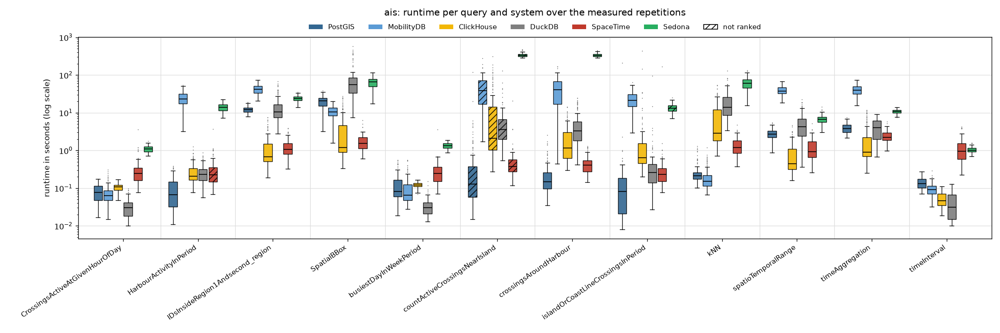
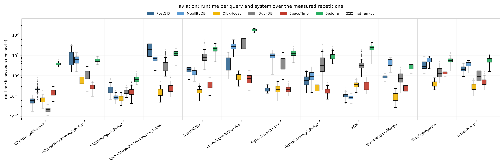
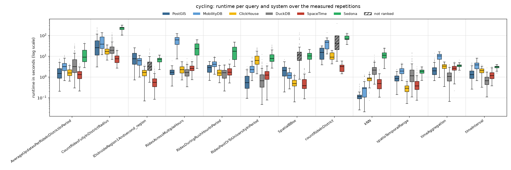
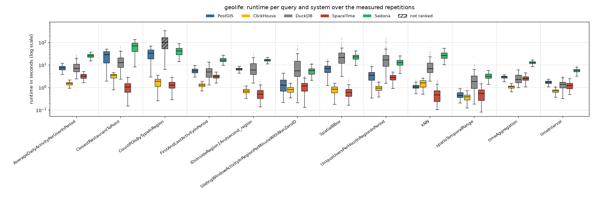

# Read-only, 8 client threads

Run of 2026-10-24 to 2026-10-24. Every system alone on the five-node cluster, one system after the other; 8 client threads taking the queries from one shared queue (so 8 queries run at the same time). Each of the 48 read queries runs with **128 measured parameter sets** (the same sets in every client-thread run) after 8 warm-up repetitions. Timeout 600 s per query. The configuration of every system is described in the [main README](../../../../../README.md#configuration). All numbers below come from the CSV files in this folder (`build_results.py`, `empty_results.py`); [`tables.md`](tables.md) has every table in full.

## Summary

| System | Queries won | Ranked on | Geo-mean slowdown vs fastest | Median slowdown | Measured executions | Failed |
|---|---:|---:|---:|---:|---:|---:|
| ClickHouse | 17 | 47 of 48 | 1.85× | 1.24× | 5,953 | 3 |
| SpaceTime | 14 | 46 of 48 | 1.90× | 1.61× | 5,953 | 2 |
| DuckDB | 8 | 43 of 48 | 6.38× | 5.98× | 5,953 | 12 |
| PostGIS | 6 | 47 of 48 | 3.84× | 3.27× | 5,953 | 2 |
| MobilityDB | 2 | 35 of 36 | 9.57× | 8.09× | 4,417 | 2 |
| Sedona | 0 | 46 of 48 | 26.85× | 23.20× | 5,953 | 4 |

*Slowdown*: a system's mean runtime on a query divided by the fastest ranked system's, over the queries the system is ranked on. A system is ranked on a query when every measured repetition succeeded and its results match PostGIS (pre-run equivalence check; accepted: nearest-neighbour ties, numbers within 1 %, an empty answer as no row or one row of zeros).

**Wins by scenario and by query type:**

| | PostGIS | MobilityDB | ClickHouse | DuckDB | SpaceTime |
|---|---:|---:|---:|---:|---:|
| AIS | 2 | 1 | 2 | 4 | 2 |
| Aviation | 1 | 1 | 6 | 1 | 3 |
| Cycling | 3 | – | 2 | 3 | 4 |
| Geolife | – | – | 7 | – | 5 |
| spatial | 3 | 2 | 2 | – | 8 |
| temporal | 1 | – | 8 | 6 | 1 |
| spatiotemporal | 2 | – | 7 | 2 | 5 |

## Total runtime, pair by pair

Sum of the measured repetitions' runtimes over only the queries both systems completed.

| System A | System B | Common queries | A | B | A / B |
|---|---|---:|---:|---:|---:|
| PostGIS | MobilityDB | 35 | 333.4 min | 924.0 min | 0.36 |
| PostGIS | ClickHouse | 47 | 542.1 min | 185.0 min | 2.93 |
| PostGIS | DuckDB | 43 | 442.9 min | 808.4 min | 0.55 |
| PostGIS | SpaceTime | 47 | 542.1 min | 125.5 min | 4.32 |
| PostGIS | Sedona | 46 | 538.3 min | 2760.3 min | 0.2 |
| MobilityDB | ClickHouse | 35 | 924.0 min | 153.3 min | 6.03 |
| MobilityDB | DuckDB | 32 | 899.3 min | 538.0 min | 1.67 |
| MobilityDB | SpaceTime | 35 | 924.0 min | 84.3 min | 10.96 |
| MobilityDB | Sedona | 34 | 873.9 min | 2198.2 min | 0.4 |
| ClickHouse | DuckDB | 43 | 174.5 min | 808.4 min | 0.22 |
| ClickHouse | SpaceTime | 47 | 185.0 min | 125.5 min | 1.47 |
| ClickHouse | Sedona | 46 | 170.3 min | 2760.3 min | 0.06 |
| DuckDB | SpaceTime | 43 | 808.4 min | 119.2 min | 6.78 |
| DuckDB | Sedona | 42 | 805.7 min | 2616.2 min | 0.31 |
| SpaceTime | Sedona | 46 | 122.2 min | 2760.3 min | 0.04 |

## Failures

Parameter sets left out for every system:

| Scenario | Query | Repetition | Reason |
|---|---|---:|---|
| ais | countActiveCrossingsNearIsland | 87 | every system timed out |

Measured executions that did not succeed (including those in the parameter sets above):

| System | Scenario | Query | Status | Count |
|---|---|---|---|---:|
| ClickHouse | ais | countActiveCrossingsNearIsland | timeout | 3 |
| DuckDB | ais | countActiveCrossingsNearIsland | error | 1 |
| DuckDB | ais | countActiveCrossingsNearIsland | timeout | 1 |
| DuckDB | cycling | IDsInsideRegion1Andsecond_region | error | 1 |
| DuckDB | cycling | SpatialBBox | error | 1 |
| DuckDB | cycling | countRideInDistrict | timeout | 1 |
| DuckDB | geolife | CountPOIsByTypeInRegion | interrupted | 1 |
| DuckDB | geolife | CountPOIsByTypeInRegion | timeout | 6 |
| MobilityDB | ais | countActiveCrossingsNearIsland | timeout | 2 |
| PostGIS | ais | countActiveCrossingsNearIsland | timeout | 2 |
| Sedona | ais | countActiveCrossingsNearIsland | timeout | 3 |
| Sedona | ais | islandOrCoastLineCrossingsInPeriod | timeout | 1 |
| SpaceTime | ais | countActiveCrossingsNearIsland | timeout | 2 |

## Not ranked

| Scenario | Query | System | Reason |
|---|---|---|---|
| ais | HarbourActivityInPeriod | SpaceTime | DIFF 1 vs 1 rows, e.g. postgis=[('Mariager', '7')] spacetime=[('Mariager', '8')] [1/5 para |
| ais | countActiveCrossingsNearIsland | PostGIS | 126/127 succeeded |
| ais | countActiveCrossingsNearIsland | MobilityDB | 126/127 succeeded |
| ais | countActiveCrossingsNearIsland | ClickHouse | 125/127 succeeded |
| ais | countActiveCrossingsNearIsland | DuckDB | 126/127 succeeded |
| ais | countActiveCrossingsNearIsland | SpaceTime | 126/127 succeeded |
| ais | countActiveCrossingsNearIsland | Sedona | 125/127 succeeded |
| ais | islandOrCoastLineCrossingsInPeriod | Sedona | 127/128 succeeded |
| cycling | IDsInsideRegion1Andsecond_region | DuckDB | 127/128 succeeded |
| cycling | SpatialBBox | DuckDB | 127/128 succeeded |
| cycling | countRideInDistrict | DuckDB | 11/12 succeeded |
| geolife | CountPOIsByTypeInRegion | DuckDB | 121/127 succeeded |

## Latency per scenario

One section per scenario. The box plot shows every system's runtimes over the measured repetitions that succeeded (box: 25th to 75th percentile, line: median, whiskers: 1.5 × the box height, dots: outliers; log scale; hatched: not ranked). The table below it gives mean, median, 95th and 99th percentile and standard deviation over those repetitions (n); the variance (standard deviation squared, ms²) is in `summary.csv` (`var_ms2`). **Bold**: fastest ranked system on the query (by mean).

### AIS

| Query | System | n | Mean | Median | p95 | p99 | Std dev |
|---|---|---:|---:|---:|---:|---:|---:|
| `CrossingsActiveAtGivenHourOfDay` | PostGIS | 128 | 83 ms | 78 ms | 148 ms | 165 ms | 41 ms |
|  | MobilityDB | 128 | 76 ms | 63 ms | 178 ms | 270 ms | 49 ms |
|  | ClickHouse | 128 | 107 ms | 107 ms | 143 ms | 163 ms | 23 ms |
|  | **DuckDB** | 128 | **32 ms** | 30 ms | 58 ms | 88 ms | 17 ms |
|  | SpaceTime | 128 | 324 ms | 246 ms | 839 ms | 1.20 s | 363 ms |
|  | Sedona | 128 | 1.10 s | 1.09 s | 1.47 s | 1.58 s | 214 ms |
| `HarbourActivityInPeriod` | **PostGIS** | 128 | **103 ms** | 66 ms | 285 ms | 358 ms | 91 ms |
|  | MobilityDB | 128 | 24.90 s | 23.28 s | 44.96 s | 50.06 s | 10.77 s |
|  | ClickHouse | 128 | 288 ms | 208 ms | 675 ms | 988 ms | 204 ms |
|  | DuckDB | 128 | 266 ms | 234 ms | 570 ms | 722 ms | 151 ms |
|  | SpaceTime | 128 | 319 ms | 224 ms | 807 ms | 1.10 s | 376 ms |
|  | Sedona | 128 | 14.01 s | 13.85 s | 19.38 s | 21.95 s | 3.37 s |
| `IDsInsideRegion1Andsecond_region` | PostGIS | 128 | 12.21 s | 11.94 s | 16.67 s | 18.60 s | 2.43 s |
|  | MobilityDB | 128 | 42.58 s | 41.48 s | 67.67 s | 72.26 s | 12.45 s |
|  | ClickHouse | 128 | 1.36 s | 671 ms | 4.71 s | 7.28 s | 1.51 s |
|  | DuckDB | 128 | 15.32 s | 10.58 s | 41.03 s | 57.12 s | 12.78 s |
|  | **SpaceTime** | 128 | **1.27 s** | 1.06 s | 2.56 s | 3.60 s | 694 ms |
|  | Sedona | 128 | 24.01 s | 24.08 s | 30.62 s | 32.86 s | 3.91 s |
| `SpatialBBox` | PostGIS | 128 | 20.45 s | 20.65 s | 32.53 s | 35.17 s | 6.42 s |
|  | MobilityDB | 128 | 11.08 s | 10.60 s | 17.70 s | 19.14 s | 3.61 s |
|  | ClickHouse | 128 | 4.33 s | 1.21 s | 17.42 s | 24.92 s | 6.10 s |
|  | DuckDB | 128 | 91.88 s | 55.80 s | 349.16 s | 449.65 s | 106.25 s |
|  | **SpaceTime** | 128 | **1.74 s** | 1.53 s | 2.98 s | 4.79 s | 863 ms |
|  | Sedona | 128 | 65.21 s | 65.77 s | 105.08 s | 114.89 s | 22.62 s |
| `busiestDayInWeekPeriod` | PostGIS | 128 | 136 ms | 81 ms | 424 ms | 528 ms | 116 ms |
|  | MobilityDB | 128 | 106 ms | 64 ms | 325 ms | 542 ms | 103 ms |
|  | ClickHouse | 128 | 121 ms | 121 ms | 153 ms | 162 ms | 22 ms |
|  | **DuckDB** | 128 | **33 ms** | 30 ms | 59 ms | 110 ms | 20 ms |
|  | SpaceTime | 128 | 299 ms | 248 ms | 562 ms | 693 ms | 332 ms |
|  | Sedona | 128 | 1.35 s | 1.33 s | 1.77 s | 1.86 s | 237 ms |
| `countActiveCrossingsNearIsland` | PostGIS | 126 | 1.67 s | 130 ms | 4.16 s | 16.49 s | 10.88 s |
|  | MobilityDB | 126 | 46.84 s | 38.70 s | 102.95 s | 183.62 s | 40.96 s |
|  | ClickHouse | 125 | 20.31 s | 2.13 s | 110.26 s | 178.90 s | 43.63 s |
|  | DuckDB | 126 | 7.05 s | 3.64 s | 19.04 s | 57.20 s | 14.00 s |
|  | SpaceTime | 126 | 657 ms | 380 ms | 1.10 s | 3.71 s | 1.88 s |
|  | Sedona | 125 | 339.43 s | 332.39 s | 398.91 s | 469.62 s | 36.69 s |
| `crossingsAroundHarbour` | **PostGIS** | 128 | **270 ms** | 146 ms | 886 ms | 1.67 s | 360 ms |
|  | MobilityDB | 128 | 45.38 s | 40.23 s | 100.83 s | 161.69 s | 33.58 s |
|  | ClickHouse | 128 | 2.34 s | 1.15 s | 7.92 s | 13.06 s | 2.72 s |
|  | DuckDB | 128 | 5.31 s | 3.26 s | 18.27 s | 23.56 s | 5.49 s |
|  | SpaceTime | 128 | 457 ms | 404 ms | 972 ms | 1.21 s | 245 ms |
|  | Sedona | 128 | 336.14 s | 326.61 s | 402.30 s | 431.57 s | 34.31 s |
| `islandOrCoastLineCrossingsInPeriod` | PostGIS | 128 | 1.76 s | 80 ms | 528 ms | 1.96 s | 18.28 s |
|  | MobilityDB | 128 | 23.52 s | 21.12 s | 48.03 s | 52.75 s | 12.07 s |
|  | ClickHouse | 128 | 6.89 s | 636 ms | 13.23 s | 113.85 s | 40.78 s |
|  | **DuckDB** | 128 | **1.25 s** | 260 ms | 1.29 s | 11.83 s | 8.56 s |
|  | SpaceTime | 128 | 1.57 s | 230 ms | 659 ms | 1.41 s | 14.61 s |
|  | Sedona | 127 | 13.60 s | 13.29 s | 19.66 s | 21.92 s | 3.54 s |
| `kNN` | PostGIS | 128 | 276 ms | 212 ms | 684 ms | 1.13 s | 210 ms |
|  | **MobilityDB** | 128 | **210 ms** | 152 ms | 571 ms | 736 ms | 170 ms |
|  | ClickHouse | 128 | 8.61 s | 2.84 s | 30.80 s | 49.62 s | 11.28 s |
|  | DuckDB | 128 | 20.21 s | 13.88 s | 55.00 s | 81.29 s | 18.64 s |
|  | SpaceTime | 128 | 1.44 s | 1.19 s | 2.87 s | 3.42 s | 766 ms |
|  | Sedona | 128 | 61.98 s | 60.15 s | 98.23 s | 123.16 s | 21.54 s |
| `spatioTemporalRange` | PostGIS | 128 | 2.79 s | 2.71 s | 4.16 s | 5.09 s | 818 ms |
|  | MobilityDB | 128 | 39.79 s | 37.39 s | 60.82 s | 64.06 s | 11.23 s |
|  | **ClickHouse** | 128 | **854 ms** | 448 ms | 2.70 s | 3.93 s | 863 ms |
|  | DuckDB | 128 | 5.40 s | 4.20 s | 14.55 s | 18.85 s | 4.39 s |
|  | SpaceTime | 128 | 1.25 s | 926 ms | 2.74 s | 3.57 s | 825 ms |
|  | Sedona | 128 | 6.79 s | 6.72 s | 9.64 s | 12.08 s | 1.73 s |
| `timeAggregation` | PostGIS | 128 | 3.89 s | 3.78 s | 5.51 s | 6.67 s | 1.05 s |
|  | MobilityDB | 128 | 40.67 s | 39.15 s | 58.65 s | 68.36 s | 11.24 s |
|  | **ClickHouse** | 128 | **2.35 s** | 903 ms | 9.56 s | 11.34 s | 2.87 s |
|  | DuckDB | 128 | 4.14 s | 3.97 s | 8.00 s | 8.55 s | 2.39 s |
|  | SpaceTime | 128 | 2.49 s | 2.24 s | 4.06 s | 4.99 s | 876 ms |
|  | Sedona | 128 | 10.77 s | 10.83 s | 12.65 s | 13.62 s | 1.27 s |
| `timeInterval` | PostGIS | 128 | 142 ms | 132 ms | 230 ms | 261 ms | 47 ms |
|  | MobilityDB | 128 | 96 ms | 90 ms | 170 ms | 211 ms | 40 ms |
|  | ClickHouse | 128 | 52 ms | 47 ms | 90 ms | 106 ms | 22 ms |
|  | **DuckDB** | 128 | **41 ms** | 32 ms | 84 ms | 90 ms | 28 ms |
|  | SpaceTime | 128 | 1.18 s | 939 ms | 2.71 s | 3.95 s | 816 ms |
|  | Sedona | 128 | 1.06 s | 1.02 s | 1.39 s | 1.57 s | 183 ms |

### Aviation

| Query | System | n | Mean | Median | p95 | p99 | Std dev |
|---|---|---:|---:|---:|---:|---:|---:|
| `CityActivityAtInstant` | PostGIS | 128 | 59 ms | 59 ms | 96 ms | 111 ms | 23 ms |
|  | MobilityDB | 128 | 244 ms | 208 ms | 517 ms | 765 ms | 125 ms |
|  | ClickHouse | 128 | 68 ms | 64 ms | 104 ms | 147 ms | 24 ms |
|  | **DuckDB** | 128 | **23 ms** | 21 ms | 37 ms | 44 ms | 8 ms |
|  | SpaceTime | 128 | 162 ms | 140 ms | 307 ms | 454 ms | 78 ms |
|  | Sedona | 128 | 3.87 s | 3.83 s | 4.95 s | 5.35 s | 620 ms |
| `FlightsAtLowAltitudeInPeriod` | PostGIS | 128 | 9.84 s | 9.04 s | 22.64 s | 32.30 s | 7.35 s |
|  | MobilityDB | 128 | 6.57 s | 6.30 s | 11.03 s | 12.57 s | 2.78 s |
|  | ClickHouse | 128 | 688 ms | 596 ms | 1.45 s | 2.01 s | 415 ms |
|  | DuckDB | 128 | 1.21 s | 1.06 s | 2.44 s | 2.87 s | 635 ms |
|  | **SpaceTime** | 128 | **286 ms** | 270 ms | 453 ms | 544 ms | 91 ms |
|  | Sedona | 128 | 5.89 s | 5.73 s | 8.32 s | 9.50 s | 1.33 s |
| `FlightsAtNightInPeriod` | PostGIS | 128 | 236 ms | 189 ms | 498 ms | 706 ms | 134 ms |
|  | MobilityDB | 128 | 95 ms | 84 ms | 180 ms | 237 ms | 40 ms |
|  | **ClickHouse** | 128 | **79 ms** | 72 ms | 127 ms | 150 ms | 28 ms |
|  | DuckDB | 128 | 165 ms | 156 ms | 263 ms | 307 ms | 47 ms |
|  | SpaceTime | 128 | 176 ms | 157 ms | 354 ms | 489 ms | 94 ms |
|  | Sedona | 128 | 706 ms | 662 ms | 1.09 s | 1.48 s | 246 ms |
| `IDsInsideRegion1Andsecond_region` | PostGIS | 128 | 23.95 s | 19.27 s | 48.55 s | 55.97 s | 15.77 s |
|  | MobilityDB | 128 | 6.43 s | 7.04 s | 8.80 s | 9.52 s | 2.14 s |
|  | **ClickHouse** | 128 | **169 ms** | 159 ms | 298 ms | 451 ms | 82 ms |
|  | DuckDB | 128 | 4.30 s | 2.70 s | 13.07 s | 16.34 s | 3.96 s |
|  | SpaceTime | 128 | 319 ms | 226 ms | 874 ms | 1.28 s | 256 ms |
|  | Sedona | 128 | 12.35 s | 12.15 s | 19.67 s | 21.30 s | 4.17 s |
| `SpatialBBox` | PostGIS | 128 | 2.02 s | 2.00 s | 3.08 s | 3.74 s | 689 ms |
|  | MobilityDB | 128 | 1.47 s | 1.47 s | 2.21 s | 2.42 s | 459 ms |
|  | **ClickHouse** | 128 | **182 ms** | 176 ms | 281 ms | 372 ms | 59 ms |
|  | DuckDB | 128 | 12.56 s | 7.89 s | 46.73 s | 60.72 s | 13.67 s |
|  | SpaceTime | 128 | 424 ms | 308 ms | 927 ms | 1.47 s | 282 ms |
|  | Sedona | 128 | 21.17 s | 20.80 s | 31.93 s | 38.21 s | 6.84 s |
| `countFlightsInCounties` | PostGIS | 53 | 5.18 s | 4.11 s | 12.24 s | 14.10 s | 3.78 s |
|  | MobilityDB | 53 | 29.54 s | 26.42 s | 51.61 s | 57.89 s | 12.19 s |
|  | ClickHouse | 53 | 919 ms | 880 ms | 1.59 s | 1.73 s | 375 ms |
|  | DuckDB | 53 | 62.11 s | 43.88 s | 189.31 s | 321.98 s | 67.96 s |
|  | **SpaceTime** | 53 | **778 ms** | 719 ms | 1.48 s | 1.92 s | 414 ms |
|  | Sedona | 53 | 175.31 s | 176.41 s | 209.59 s | 213.34 s | 21.18 s |
| `flightClosestToPoint` | **PostGIS** | 128 | **214 ms** | 202 ms | 311 ms | 353 ms | 54 ms |
|  | MobilityDB | 128 | 9.96 s | 9.72 s | 16.22 s | 18.16 s | 3.69 s |
|  | ClickHouse | 128 | 242 ms | 214 ms | 462 ms | 559 ms | 115 ms |
|  | DuckDB | 128 | 4.74 s | 3.69 s | 10.95 s | 13.81 s | 3.22 s |
|  | SpaceTime | 128 | 230 ms | 210 ms | 421 ms | 548 ms | 93 ms |
|  | Sedona | 128 | 13.73 s | 12.43 s | 22.55 s | 34.16 s | 5.77 s |
| `flightsInCountyInPeriod` | PostGIS | 128 | 687 ms | 572 ms | 1.67 s | 1.94 s | 436 ms |
|  | MobilityDB | 128 | 1.08 s | 902 ms | 2.45 s | 2.72 s | 622 ms |
|  | ClickHouse | 128 | 297 ms | 247 ms | 611 ms | 1.03 s | 185 ms |
|  | DuckDB | 128 | 5.56 s | 3.08 s | 17.97 s | 27.91 s | 6.11 s |
|  | **SpaceTime** | 128 | **184 ms** | 172 ms | 324 ms | 427 ms | 72 ms |
|  | Sedona | 128 | 9.22 s | 8.26 s | 16.32 s | 21.18 s | 3.79 s |
| `kNN` | PostGIS | 128 | 104 ms | 100 ms | 144 ms | 184 ms | 30 ms |
|  | **MobilityDB** | 128 | **86 ms** | 85 ms | 123 ms | 150 ms | 24 ms |
|  | ClickHouse | 128 | 374 ms | 364 ms | 558 ms | 740 ms | 125 ms |
|  | DuckDB | 128 | 4.27 s | 3.19 s | 12.84 s | 18.68 s | 3.70 s |
|  | SpaceTime | 128 | 362 ms | 280 ms | 781 ms | 1.34 s | 233 ms |
|  | Sedona | 128 | 23.54 s | 24.57 s | 34.49 s | 40.88 s | 7.48 s |
| `spatioTemporalRange` | PostGIS | 128 | 920 ms | 874 ms | 1.31 s | 1.83 s | 253 ms |
|  | MobilityDB | 128 | 4.72 s | 5.15 s | 6.89 s | 7.60 s | 1.81 s |
|  | **ClickHouse** | 128 | **102 ms** | 86 ms | 200 ms | 286 ms | 56 ms |
|  | DuckDB | 128 | 903 ms | 713 ms | 2.02 s | 2.61 s | 565 ms |
|  | SpaceTime | 128 | 317 ms | 224 ms | 956 ms | 1.35 s | 272 ms |
|  | Sedona | 128 | 3.00 s | 2.65 s | 5.53 s | 6.85 s | 1.29 s |
| `timeAggregation` | PostGIS | 128 | 4.30 s | 2.84 s | 14.57 s | 20.88 s | 3.97 s |
|  | MobilityDB | 128 | 5.96 s | 6.50 s | 8.19 s | 8.91 s | 1.85 s |
|  | **ClickHouse** | 128 | **408 ms** | 378 ms | 621 ms | 787 ms | 132 ms |
|  | DuckDB | 128 | 1.76 s | 1.26 s | 4.68 s | 5.00 s | 1.26 s |
|  | SpaceTime | 128 | 1.42 s | 1.38 s | 2.07 s | 2.37 s | 310 ms |
|  | Sedona | 128 | 5.78 s | 5.70 s | 8.59 s | 11.74 s | 1.91 s |
| `timeInterval` | PostGIS | 128 | 2.25 s | 2.03 s | 3.88 s | 4.70 s | 848 ms |
|  | MobilityDB | 128 | 3.63 s | 3.80 s | 4.87 s | 5.20 s | 956 ms |
|  | **ClickHouse** | 128 | **300 ms** | 274 ms | 488 ms | 624 ms | 118 ms |
|  | DuckDB | 128 | 1.18 s | 887 ms | 2.55 s | 2.66 s | 733 ms |
|  | SpaceTime | 128 | 560 ms | 482 ms | 1.24 s | 1.56 s | 305 ms |
|  | Sedona | 128 | 5.71 s | 5.28 s | 9.48 s | 10.98 s | 1.97 s |

### Cycling

| Query | System | n | Mean | Median | p95 | p99 | Std dev |
|---|---|---:|---:|---:|---:|---:|---:|
| `AverageUpdatesPerRideInDistrictInPeriod` | PostGIS | 128 | 1.92 s | 1.47 s | 4.84 s | 6.86 s | 1.46 s |
|  | MobilityDB | 128 | 3.64 s | 3.11 s | 7.83 s | 10.61 s | 2.21 s |
|  | ClickHouse | 128 | 1.73 s | 1.53 s | 3.20 s | 4.05 s | 788 ms |
|  | DuckDB | 128 | 6.14 s | 3.10 s | 24.72 s | 31.95 s | 7.44 s |
|  | **SpaceTime** | 128 | **1.40 s** | 1.29 s | 2.87 s | 3.84 s | 778 ms |
|  | Sedona | 128 | 13.54 s | 9.01 s | 35.47 s | 40.81 s | 10.44 s |
| `CountRidesFullyInDistrictRadius` | PostGIS | 128 | 42.08 s | 25.53 s | 137.85 s | 208.13 s | 44.66 s |
|  | MobilityDB | 128 | 54.39 s | 37.49 s | 122.22 s | 135.95 s | 36.26 s |
|  | ClickHouse | 128 | 18.01 s | 16.78 s | 31.48 s | 34.94 s | 7.01 s |
|  | DuckDB | 128 | 28.79 s | 18.90 s | 83.30 s | 108.82 s | 25.46 s |
|  | **SpaceTime** | 128 | **8.28 s** | 7.37 s | 15.80 s | 19.78 s | 4.28 s |
|  | Sedona | 128 | 218.21 s | 228.66 s | 280.03 s | 302.87 s | 46.35 s |
| `IDsInsideRegion1Andsecond_region` | PostGIS | 128 | 9.29 s | 7.43 s | 19.33 s | 22.22 s | 5.79 s |
|  | MobilityDB | 128 | 5.81 s | 6.09 s | 9.66 s | 10.63 s | 2.42 s |
|  | ClickHouse | 128 | 1.60 s | 1.63 s | 2.69 s | 3.21 s | 730 ms |
|  | DuckDB | 127 | 4.16 s | 3.02 s | 9.54 s | 18.52 s | 3.42 s |
|  | **SpaceTime** | 128 | **694 ms** | 545 ms | 1.87 s | 2.45 s | 541 ms |
|  | Sedona | 128 | 6.75 s | 7.03 s | 9.51 s | 10.84 s | 1.84 s |
| `RidesAcrossMultipleHours` | **PostGIS** | 128 | **1.81 s** | 1.68 s | 3.10 s | 3.46 s | 789 ms |
|  | MobilityDB | 128 | 59.79 s | 61.00 s | 110.08 s | 118.58 s | 28.24 s |
|  | ClickHouse | 128 | 2.42 s | 2.21 s | 4.57 s | 5.22 s | 1.07 s |
|  | DuckDB | 128 | 1.92 s | 1.61 s | 4.18 s | 5.40 s | 1.19 s |
|  | SpaceTime | 128 | 2.78 s | 2.58 s | 4.71 s | 5.73 s | 1.11 s |
|  | Sedona | 128 | 26.21 s | 23.20 s | 53.56 s | 59.42 s | 17.02 s |
| `RidesDuringRushHourInPeriod` | PostGIS | 128 | 2.81 s | 2.83 s | 4.73 s | 5.15 s | 1.17 s |
|  | MobilityDB | 128 | 4.46 s | 4.08 s | 7.67 s | 9.45 s | 1.77 s |
|  | ClickHouse | 128 | 1.75 s | 1.53 s | 3.21 s | 4.09 s | 794 ms |
|  | **DuckDB** | 128 | **1.60 s** | 1.61 s | 3.20 s | 3.75 s | 843 ms |
|  | SpaceTime | 128 | 1.95 s | 1.69 s | 3.52 s | 5.90 s | 1.03 s |
|  | Sedona | 128 | 18.26 s | 17.26 s | 40.25 s | 47.20 s | 12.17 s |
| `RidesPastOrToUniversityInPeriod` | **PostGIS** | 128 | **759 ms** | 532 ms | 1.96 s | 2.58 s | 626 ms |
|  | MobilityDB | 128 | 2.62 s | 2.24 s | 5.26 s | 8.25 s | 1.46 s |
|  | ClickHouse | 128 | 7.86 s | 6.18 s | 17.52 s | 24.44 s | 5.33 s |
|  | DuckDB | 128 | 1.18 s | 650 ms | 4.07 s | 6.44 s | 1.58 s |
|  | SpaceTime | 128 | 1.40 s | 1.24 s | 2.83 s | 3.54 s | 781 ms |
|  | Sedona | 128 | 9.73 s | 7.74 s | 21.92 s | 30.98 s | 6.12 s |
| `SpatialBBox` | PostGIS | 128 | 2.17 s | 2.04 s | 4.23 s | 5.28 s | 1.27 s |
|  | MobilityDB | 128 | 1.24 s | 1.20 s | 2.19 s | 2.75 s | 577 ms |
|  | **ClickHouse** | 128 | **544 ms** | 480 ms | 1.10 s | 1.30 s | 279 ms |
|  | DuckDB | 127 | 15.41 s | 11.21 s | 40.06 s | 105.03 s | 18.56 s |
|  | SpaceTime | 128 | 586 ms | 372 ms | 1.55 s | 2.50 s | 507 ms |
|  | Sedona | 128 | 10.40 s | 10.22 s | 17.24 s | 19.36 s | 4.36 s |
| `countRideInDistrict` | PostGIS | 12 | 16.53 s | 15.00 s | 30.91 s | 31.49 s | 10.38 s |
|  | MobilityDB | 12 | 48.67 s | 46.77 s | 105.16 s | 133.20 s | 35.05 s |
|  | ClickHouse | 12 | 10.67 s | 8.90 s | 18.08 s | 18.82 s | 5.09 s |
|  | DuckDB | 11 | 81.31 s | 39.87 s | 238.72 s | 351.10 s | 105.71 s |
|  | **SpaceTime** | 12 | **3.02 s** | 3.12 s | 5.00 s | 5.70 s | 1.35 s |
|  | Sedona | 12 | 78.99 s | 67.82 s | 131.46 s | 138.41 s | 30.09 s |
| `kNN` | **PostGIS** | 128 | **122 ms** | 112 ms | 212 ms | 402 ms | 63 ms |
|  | MobilityDB | 128 | 295 ms | 274 ms | 1.08 s | 1.12 s | 270 ms |
|  | ClickHouse | 128 | 838 ms | 816 ms | 1.53 s | 1.71 s | 320 ms |
|  | DuckDB | 128 | 2.53 s | 2.10 s | 6.00 s | 8.50 s | 1.80 s |
|  | SpaceTime | 128 | 574 ms | 476 ms | 1.27 s | 2.12 s | 413 ms |
|  | Sedona | 128 | 11.59 s | 10.89 s | 21.15 s | 24.30 s | 5.14 s |
| `spatioTemporalRange` | PostGIS | 128 | 902 ms | 830 ms | 1.68 s | 2.27 s | 423 ms |
|  | MobilityDB | 128 | 2.07 s | 1.93 s | 3.69 s | 4.27 s | 865 ms |
|  | **ClickHouse** | 128 | **293 ms** | 286 ms | 508 ms | 687 ms | 136 ms |
|  | DuckDB | 128 | 1.86 s | 1.13 s | 6.34 s | 12.70 s | 2.31 s |
|  | SpaceTime | 128 | 519 ms | 370 ms | 1.49 s | 2.46 s | 481 ms |
|  | Sedona | 128 | 1.86 s | 1.86 s | 2.72 s | 3.00 s | 455 ms |
| `timeAggregation` | PostGIS | 128 | 2.51 s | 1.97 s | 6.17 s | 8.07 s | 1.89 s |
|  | MobilityDB | 128 | 9.61 s | 10.15 s | 14.59 s | 15.43 s | 3.48 s |
|  | ClickHouse | 128 | 3.22 s | 3.29 s | 4.90 s | 5.24 s | 1.09 s |
|  | **DuckDB** | 128 | **1.19 s** | 1.04 s | 2.62 s | 3.77 s | 779 ms |
|  | SpaceTime | 128 | 2.67 s | 2.61 s | 4.12 s | 5.01 s | 956 ms |
|  | Sedona | 128 | 3.49 s | 3.49 s | 4.41 s | 4.89 s | 646 ms |
| `timeInterval` | PostGIS | 128 | 1.52 s | 1.27 s | 3.17 s | 4.32 s | 929 ms |
|  | MobilityDB | 128 | 3.76 s | 3.76 s | 6.18 s | 7.29 s | 1.51 s |
|  | ClickHouse | 128 | 2.00 s | 2.01 s | 3.11 s | 3.33 s | 683 ms |
|  | **DuckDB** | 128 | **727 ms** | 644 ms | 1.44 s | 1.81 s | 410 ms |
|  | SpaceTime | 128 | 1.29 s | 1.15 s | 2.57 s | 3.00 s | 628 ms |
|  | Sedona | 128 | 3.00 s | 3.04 s | 3.72 s | 3.87 s | 492 ms |

### Geolife

| Query | System | n | Mean | Median | p95 | p99 | Std dev |
|---|---|---:|---:|---:|---:|---:|---:|
| `AverageDailyActivityPerUserInPeriod` | PostGIS | 128 | 7.49 s | 7.37 s | 10.28 s | 11.18 s | 1.69 s |
|  | **ClickHouse** | 128 | **1.51 s** | 1.50 s | 1.95 s | 2.10 s | 261 ms |
|  | DuckDB | 128 | 9.01 s | 6.99 s | 21.31 s | 26.09 s | 5.71 s |
|  | SpaceTime | 128 | 3.30 s | 3.24 s | 4.70 s | 5.19 s | 870 ms |
|  | Sedona | 128 | 26.12 s | 25.68 s | 34.59 s | 37.46 s | 5.58 s |
| `ClosestRestaurantToPoint` | PostGIS | 128 | 26.04 s | 28.34 s | 46.84 s | 50.14 s | 14.31 s |
|  | ClickHouse | 128 | 3.20 s | 3.50 s | 4.34 s | 4.58 s | 952 ms |
|  | DuckDB | 128 | 16.49 s | 12.61 s | 42.64 s | 59.53 s | 12.85 s |
|  | **SpaceTime** | 128 | **1.11 s** | 1.06 s | 2.37 s | 2.97 s | 650 ms |
|  | Sedona | 128 | 68.76 s | 70.33 s | 117.58 s | 130.13 s | 30.89 s |
| `CountPOIsByTypeInRegion` | PostGIS | 128 | 33.45 s | 32.64 s | 62.11 s | 65.56 s | 17.84 s |
|  | ClickHouse | 128 | 1.75 s | 1.87 s | 2.75 s | 3.18 s | 723 ms |
|  | DuckDB | 121 | 123.47 s | 99.87 s | 310.03 s | 395.53 s | 91.68 s |
|  | **SpaceTime** | 128 | **1.40 s** | 1.28 s | 2.54 s | 3.28 s | 624 ms |
|  | Sedona | 128 | 42.97 s | 42.30 s | 75.23 s | 83.08 s | 17.94 s |
| `FirstAndLastActivityInPeriod` | PostGIS | 128 | 5.56 s | 5.41 s | 7.69 s | 8.57 s | 1.37 s |
|  | **ClickHouse** | 128 | **1.29 s** | 1.29 s | 1.72 s | 1.83 s | 260 ms |
|  | DuckDB | 128 | 5.48 s | 4.87 s | 12.53 s | 13.56 s | 3.19 s |
|  | SpaceTime | 128 | 3.14 s | 3.09 s | 4.48 s | 4.67 s | 736 ms |
|  | Sedona | 128 | 17.03 s | 16.30 s | 24.21 s | 26.76 s | 3.83 s |
| `IDsInsideRegion1Andsecond_region` | PostGIS | 128 | 6.57 s | 6.62 s | 7.78 s | 7.99 s | 840 ms |
|  | ClickHouse | 128 | 713 ms | 696 ms | 994 ms | 1.14 s | 183 ms |
|  | DuckDB | 128 | 8.56 s | 6.00 s | 21.47 s | 31.89 s | 6.96 s |
|  | **SpaceTime** | 128 | **601 ms** | 511 ms | 1.28 s | 1.84 s | 366 ms |
|  | Sedona | 128 | 16.59 s | 16.49 s | 20.50 s | 21.26 s | 2.35 s |
| `SlidingWindowActivityInRegionPerMinuteWithNonZeroID` | PostGIS | 128 | 1.55 s | 1.28 s | 3.81 s | 4.39 s | 1.08 s |
|  | **ClickHouse** | 128 | **839 ms** | 821 ms | 1.31 s | 1.46 s | 278 ms |
|  | DuckDB | 128 | 12.19 s | 5.53 s | 46.31 s | 70.61 s | 14.98 s |
|  | SpaceTime | 128 | 1.20 s | 1.17 s | 2.35 s | 2.97 s | 660 ms |
|  | Sedona | 128 | 5.67 s | 5.67 s | 9.36 s | 11.63 s | 2.21 s |
| `SpatialBBox` | PostGIS | 128 | 7.08 s | 7.05 s | 13.42 s | 17.08 s | 3.38 s |
|  | ClickHouse | 128 | 830 ms | 842 ms | 1.35 s | 1.51 s | 331 ms |
|  | DuckDB | 128 | 30.27 s | 21.76 s | 98.56 s | 146.10 s | 29.65 s |
|  | **SpaceTime** | 128 | **673 ms** | 610 ms | 1.26 s | 2.15 s | 395 ms |
|  | Sedona | 128 | 22.85 s | 22.57 s | 35.92 s | 42.11 s | 7.49 s |
| `UniqueUsersPerHourInRegionInPeriod` | PostGIS | 128 | 3.77 s | 3.50 s | 8.12 s | 10.14 s | 2.16 s |
|  | **ClickHouse** | 128 | **988 ms** | 942 ms | 1.68 s | 1.85 s | 340 ms |
|  | DuckDB | 128 | 27.23 s | 16.95 s | 103.56 s | 133.78 s | 29.81 s |
|  | SpaceTime | 128 | 2.81 s | 2.79 s | 4.22 s | 4.79 s | 919 ms |
|  | Sedona | 128 | 13.35 s | 12.73 s | 23.49 s | 26.09 s | 5.13 s |
| `kNN` | PostGIS | 128 | 1.12 s | 1.04 s | 1.72 s | 2.13 s | 311 ms |
|  | ClickHouse | 128 | 1.56 s | 1.61 s | 2.49 s | 2.60 s | 594 ms |
|  | DuckDB | 128 | 10.72 s | 6.91 s | 32.59 s | 47.76 s | 10.09 s |
|  | **SpaceTime** | 128 | **594 ms** | 468 ms | 1.58 s | 2.06 s | 446 ms |
|  | Sedona | 128 | 28.23 s | 26.45 s | 48.18 s | 55.61 s | 10.46 s |
| `spatioTemporalRange` | PostGIS | 128 | 499 ms | 446 ms | 821 ms | 988 ms | 193 ms |
|  | **ClickHouse** | 128 | **392 ms** | 386 ms | 655 ms | 916 ms | 157 ms |
|  | DuckDB | 128 | 2.61 s | 1.85 s | 7.58 s | 10.07 s | 2.90 s |
|  | SpaceTime | 128 | 595 ms | 544 ms | 1.34 s | 1.73 s | 384 ms |
|  | Sedona | 128 | 3.29 s | 3.14 s | 4.92 s | 5.58 s | 900 ms |
| `timeAggregation` | PostGIS | 128 | 2.93 s | 2.98 s | 3.49 s | 3.64 s | 418 ms |
|  | **ClickHouse** | 128 | **1.06 s** | 1.08 s | 1.35 s | 1.40 s | 174 ms |
|  | DuckDB | 128 | 2.72 s | 2.22 s | 5.37 s | 6.07 s | 1.38 s |
|  | SpaceTime | 128 | 2.61 s | 2.52 s | 4.04 s | 4.49 s | 748 ms |
|  | Sedona | 128 | 12.79 s | 12.84 s | 15.36 s | 16.82 s | 1.70 s |
| `timeInterval` | PostGIS | 128 | 1.72 s | 1.75 s | 2.15 s | 2.26 s | 293 ms |
|  | **ClickHouse** | 128 | **722 ms** | 710 ms | 973 ms | 1.09 s | 149 ms |
|  | DuckDB | 128 | 1.42 s | 1.39 s | 2.82 s | 3.25 s | 676 ms |
|  | SpaceTime | 128 | 1.29 s | 1.23 s | 2.19 s | 2.50 s | 502 ms |
|  | Sedona | 128 | 5.81 s | 5.61 s | 7.58 s | 8.60 s | 1.02 s |

## Hardware

Means over the five nodes and over the time the system ran (5 s samples; per scenario and node in `hardware_by_phase.csv`).

| System | Run time | CPU busy | Memory used | Disk read |
|---|---:|---:|---:|---:|
| PostGIS | 1.3 h | 66 % | 23.4 GB | 2750 MB/s |
| MobilityDB | 2.3 h | 38 % | 21.9 GB | 2137 MB/s |
| ClickHouse | 0.6 h | 90 % | 5.7 GB | 37 MB/s |
| DuckDB | 3.0 h | 20 % | 11.3 GB | 69 MB/s |
| SpaceTime | 0.4 h | 62 % | 3.2 GB | 59 MB/s |
| Sedona | 7.9 h | 63 % | 27.1 GB | 170 MB/s |

## Caveats

- **SpaceTime's Geolife data** differs slightly from the other systems'; its Geolife queries whose results differ from PostGIS (SlidingWindowActivityInRegionPerMinuteWithNonZeroID, UniqueUsersPerHourInRegionInPeriod, timeAggregation) are ranked on request (`equivalence.csv`).
- **Client host:** the benchmark client runs on a separate host with one CPU core and 1 GB of RAM. Results are read in batches of 100,000 rows; with several client threads, the client can become a limit for queries with large results.
- **Sedona** skips GeoParquet files by their bounding box only when a query compares with a constant geometry; joins with a whole reference table (harbours, islands, districts, counties) read the whole table.
- **Parameters** are drawn where the data is (points, regions, time windows and places from a sample of the loaded data; see benchmark/configuration/README.md), each measured parameter set of a query distinct; every system answers the same parameter sets.

## Files

| File | One row per |
|---|---|
| `executions.csv` | query execution (scenario, system, query, repetition, warm-up, status, duration, parameters, SQL) |
| `summary.csv` | (scenario, query, system): runs, failures, mean/median/p95/p99/min/max/std dev/variance, equivalence, rank |
| `winners.csv` | (scenario, query): fastest ranked system, runner-up, margin |
| `system_scores.csv` | system: wins, completed and ranked queries, slowdowns |
| `pairwise_total_time.csv` | pair of systems: total runtime over the queries both completed |
| `empty_results.csv` | (scenario, query, system): measured executions without a row |
| `equivalence.csv` | (scenario, query, system): result compared with PostGIS |
| `hardware_by_phase.csv` | (scenario, system): CPU, memory, disk and network per node |
| `dropped_parameter_sets.csv` | parameter sets left out for every system |
| `tables.md`, `plots/` | the tables and figures generated from the above (`plots/boxplot_<scenario>.png`: the box plots) |
| `raw/` | client logs, query files, hardware samples, the equivalence check |
