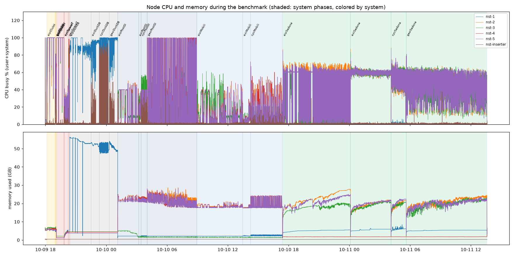

# GeoBenchr results — 52-repetition run (2026-10-09 to 2026-10-11)

> **Preliminary results — not final.** These numbers come from a run whose setup is still being
> revised for fairness across the systems: Sedona is being measured again on all five nodes with all
> four point tables as GeoParquet, DuckDB's AIS scenario again after a change to its table order,
> and further adjustments (equal resource settings and tuning for every system) are under
> consideration. Rankings and timings may change; please do not cite them as final.

Six systems answered the same 48 read queries over the same data on a five-node cluster, each system
alone on the cluster, each query 52 times with different parameters. This page describes how the
run was done and what came out of it. All numbers come from the files in [`results/`](results/),
built by `build_results.py`; [`analysis.ipynb`](analysis.ipynb) explores them.

## Summary

| System | Queries won | Ranked on | Geo-mean slowdown vs fastest | Median slowdown | Time to run all its queries |
|---|---:|---:|---:|---:|---:|
| ClickHouse | 17 | 47 of 47 | 1.55× | 1.29× | 16 min |
| SpaceTime | 17 | 44 of 48 | 1.91× | 1.56× | 33 min |
| DuckDB | 9 | 48 of 48 | 11.3× | 7.12× | 3.9 h |
| PostGIS | 5 | 47 of 48 | 14.3× | 15.9× | 6.7 h |
| MobilityDB | 0 | 35 of 36 | 29.0× | 28.0× | 7.3 h |
| Sedona | 0 | 48 of 48 | 159× | 214× | 18.7 h |

*Slowdown*: a system's mean runtime on a query divided by the fastest ranked system's, over the
queries the system is ranked on. *Time*: sum of the measured repetitions' runtimes.

**Wins by scenario and by query type:**

| | ClickHouse | SpaceTime | DuckDB | PostGIS |
|---|---:|---:|---:|---:|
| AIS | 5 | 4 | 3 | – |
| Aviation | 4 | 5 | 2 | 1 |
| Cycling | 1 | 4 | 3 | 4 |
| Geolife | 7 | 4 | 1 | – |
| spatial | 8 | 4 | – | 4 |
| temporal | 5 | 2 | 9 | – |
| spatiotemporal | 4 | 11 | – | 1 |

- **ClickHouse and SpaceTime** are the fastest overall and win 34 of the 48 queries between them.
  ClickHouse is rarely far behind (median 1.29× the fastest); it wins most spatial queries (through
  its H3 primary key) and most of Geolife. SpaceTime wins 11 of the 16 spatiotemporal queries.
- **DuckDB** (a single node) wins 9 of the 16 temporal queries: its point tables are sorted by time
  first, so a time filter reads only the matching row groups. Spatial queries without a time filter
  are where it is slowest (seconds to tens of seconds).
- **PostGIS** wins the small cycling queries (`SpatialBBox`, `kNN`, `spatioTemporalRange`, a few ms
  through its GiST indexes), cycling `CountRidesFullyInDistrictRadius` and aviation `kNN`, but large Geolife and AIS queries
  take tens of seconds to minutes.
- **MobilityDB** keeps up with PostGIS on some trip-level questions (`flightsInCountyInPeriod`,
  `timeInterval` in cycling); questions about individual points are slower on trajectories than on
  points.
- **Sedona** has a floor of 0.1–0.3 s per query (planning and scheduling a Spark job) and needs 5–80 s
  for most queries over a whole point table; it is never fastest here, where the data fits the other
  systems' indexes.
- **Four parameter sets no system answers within 600 s**: `countActiveCrossingsNearIsland` (AIS, no
  time filter) on islands 43 and 44, over all 6 billion crossing points. They are left out for every
  system (see below).

The per-query tables are under [Results per scenario](#results-per-scenario); one plot per query is in
[`results/plots/queries/`](results/plots/queries/).

## What was measured

### Systems

| System | Where it runs | Spatial pruning |
|---|---|---|
| PostGIS | Citus: coordinator nst-1, workers nst-2..5 | GiST index on the geometry |
| MobilityDB | same Citus cluster; one `tgeompoint` trajectory per trip | GiST index on the trajectory |
| ClickHouse | 5 nodes (`cluster_1`); point tables sorted by `(h3, timestamp, id)` | queries filter `h3 GLOBAL IN (<cells covering the search area>)` before the exact predicate |
| DuckDB | nst-1 only, served over HTTP (quack) | point tables sorted by time bucket (month/day/hour), then Hilbert curve; `ST_Intersects_Extent` skips row groups by their bounding boxes |
| SpaceTime | nst-1..5, run by its developers | its own |
| Sedona | Spark on YARN over HDFS (replication 2); 36 executors (1 core, 2 GB) | `flight_points`, `ride_points`, `geolife_points` as GeoParquet with a bounding-box column, sorted by geohash within each file; `crossing_points` as plain Parquet |

ClickHouse is the only system for which we define functions (the H3 cell covers, SQL lambdas over
ClickHouse's own H3 functions); see [`clickhouse_additions.md`](clickhouse_additions.md). On all 5
parameter sets of every affected query, the H3 queries return the same results as the earlier
scan-only queries ([`results/h3_vs_scan.csv`](results/h3_vs_scan.csv)).

### Queries and parameters

48 read queries, 12 per scenario (AIS, aviation, cycling, Geolife): six that are the same in every
scenario (`SpatialBBox`, `kNN`, `timeInterval`, `timeAggregation`, `spatioTemporalRange`,
`IDsInsideRegion1Andsecond_region`) and six specific to each. Each system runs its own translation;
all get the same parameters, drawn by a seeded generator (52 parameter sets per query). MobilityDB
has no Geolife queries (check-in data has no trajectories), ClickHouse no
`CountRidesFullyInDistrictRadius`. The exact queries run are in [`results/raw/queries/`](results/raw/queries/).

### How a run measures

- **One system at a time.** Before each system's run, every other benchmarked system was stopped on
  all five nodes (PostgreSQL/Citus, ClickHouse and Keeper, the DuckDB server, HDFS/YARN, MinIO) and the
  system under test started and checked; SpaceTime, run by its developers, stayed up but idle. Order:
  ClickHouse, SpaceTime, DuckDB, PostGIS, MobilityDB, Sedona; within a system AIS, aviation, cycling,
  Geolife.
- **One query at a time** (`NUM_THREADS=1`), from one client on nst-inserter (Sedona's client on nst-1,
  where its Spark driver runs). Each query's 52 repetitions run in the order of the query file, each
  with its own parameters.
- **Warm-up.** Repetitions 1 and 2 of every query are warm-up and not counted. They were 4–51 %
  slower than the measured ones (median; PostGIS 1.51×, MobilityDB 1.30×, SpaceTime 1.23×).
- **A timing** covers sending the query, executing it, and reading every result row on the client.
  Each system keeps one open session for the whole run (for SpaceTime a long-lived worker process, for
  Sedona one Spark session with the tables registered once), and connecting is not timed. Sedona reads
  its files from HDFS on every query; nothing is cached in Spark.
- **Timeout:** 600 s per query, counted from the query's start. A query past that is stopped on the
  server before the next one starts (JDBC cancel for PostGIS, MobilityDB and ClickHouse, a killed
  worker for SpaceTime, cancelled Spark jobs for Sedona, a server restart for DuckDB, whose driver
  cannot cancel).
- **Hardware:** CPU, memory, disk and network of nst-1..5 and the client host, every 5 s.

### Ranking

A system is ranked on a query only if all its measured repetitions succeeded and its result matches
PostGIS: identical, within 1 % (border points of polygons, ride timestamps in whole seconds), or, for
kNN, the same rows up to the order of ties at equal distance. Result equality was checked on one
parameter set of every query before the run (values for results up to 2,000 rows, row counts above):

| System | identical | within 1 % | kNN, ties only | different | no query |
|---|---:|---:|---:|---:|---:|
| MobilityDB | 36 | – | – | – | 12 |
| ClickHouse | 38 | 5 | 4 | – | 1 |
| DuckDB | 44 | – | 4 | – | – |
| Sedona | 43 | 1 | 4 | – | – |
| SpaceTime | 31 | 10 | 4 | 3 | – |

SpaceTime's three differences are Geolife queries: its `geolife_points` has 50.5 million more rows
(3,999,980,061 vs 3,949,479,382). Sedona's HDFS copy of `geolife_points` has 0.27 % more rows.

### Left out for every system

[`results/dropped_parameter_sets.csv`](results/dropped_parameter_sets.csv):

| Query | Repetitions | Why |
|---|---|---|
| AIS `countActiveCrossingsNearIsland` | 8, 15, 20, 46 (islands 43 and 44) | every system hit the 600 s timeout |
| AIS `HarbourActivityInPeriod` | 4 | the harbour name `'t Waar` was not escaped by the query generator (fixed since), a syntax error on every system |

### Not ranked

| Query | System | Why |
|---|---|---|
| AIS `SpatialBBox` | PostGIS, MobilityDB | one timeout each (repetitions 33 and 39) |
| cycling `CountRidesFullyInDistrictRadius` | SpaceTime | 3 of 50 repetitions failed: "Query memory limit exceeded" |
| Geolife `SlidingWindowActivityInRegionPerMinuteWithNonZeroID`, `SpatialBBox`, `timeAggregation` | SpaceTime | results differ from PostGIS (extra rows, above) |

Of the 13,720 measured executions, 13,715 succeeded; the five failures are the ones above.

## Results per scenario

Mean runtime over the measured repetitions. **Bold** = fastest ranked system; ≈ = result within 1 % /
kNN ties of PostGIS; ≠ = different result (not ranked); k/n = only k of n repetitions succeeded (not
ranked); n/a = no query for this system. *Margin* = runner-up / fastest.

### AIS (`crossing_points`, 5.98 billion points)

| Query | Type | PostGIS | MobilityDB | ClickHouse | DuckDB | SpaceTime | Sedona | Fastest | Margin |
|---|---|---:|---:|---:|---:|---:|---:|---|---:|
| CrossingsActiveAtGivenHourOfDay | temporal | 30 ms | 52 ms | 18 ms | **14 ms** | 24 ms | 200 ms | DuckDB | 1.35× |
| HarbourActivityInPeriod | spatiotemporal | 181 ms | 28.87 s | 36 ms | 1.24 s | **35 ms** | 21.61 s | SpaceTime | 1.05× |
| IDsInsideRegion1Andsecond_region | spatiotemporal | 3.64 s | 21.36 s | 130 ms | 1.26 s | **56 ms** | 21.38 s | SpaceTime | 2.31× |
| SpatialBBox | spatial | 56.28 s (49/50) | 56.99 s (49/50) | **133 ms** | 23.75 s | 310 ms | 79.56 s | ClickHouse | 2.34× |
| busiestDayInWeekPeriod | temporal | 62 ms | 84 ms | 21 ms | **14 ms** | 34 ms | 286 ms | DuckDB | 1.51× |
| countActiveCrossingsNearIsland | spatial | 14.40 s | 54.27 s | 9.15 s | 25.29 s | **358 ms** | 78.73 s | SpaceTime | 25.53× |
| crossingsAroundHarbour | spatial | 216 ms | 27.59 s | **50 ms** | 23.98 s | 120 ms | 72.60 s | ClickHouse | 2.42× |
| islandOrCoastLineCrossingsInPeriod | spatiotemporal | 6.93 s | 30.50 s | **2.67 s** | 3.67 s | 3.63 s | 32.54 s | ClickHouse | 1.36× |
| kNN | spatial | 331 ms | 430 ms | **97 ms ≈** | 20.41 s ≈ | 110 ms ≈ | 78.51 s ≈ | ClickHouse | 1.13× |
| spatioTemporalRange | spatiotemporal | 2.14 s | 21.23 s | 74 ms | 1.17 s | **32 ms** | 26.93 s | SpaceTime | 2.32× |
| timeAggregation | temporal | 4.14 s | 22.25 s | **121 ms** | 442 ms | 474 ms | 10.51 s | ClickHouse | 3.66× |
| timeInterval | temporal | 40 ms | 53 ms | 14 ms | **12 ms** | 22 ms | 216 ms | DuckDB | 1.19× |

### Aviation (`flight_points`, 2.70 billion points)

| Query | Type | PostGIS | MobilityDB | ClickHouse | DuckDB | SpaceTime | Sedona | Fastest | Margin |
|---|---|---:|---:|---:|---:|---:|---:|---|---:|
| CityActivityAtInstant | spatiotemporal | 54 ms | 446 ms | **31 ms** | 31 ms | 31 ms | 26.30 s | ClickHouse | 1.01× |
| FlightsAtLowAltitudeInPeriod | temporal | 896 ms | 6.25 s | 222 ms | 807 ms | **170 ms ≈** | 10.94 s | SpaceTime | 1.3× |
| FlightsAtNightInPeriod | temporal | 95 ms | 104 ms | 26 ms | 540 ms | **19 ms** | 133 ms | SpaceTime | 1.37× |
| IDsInsideRegion1Andsecond_region | spatiotemporal | 713 ms | 2.06 s | 50 ms | 202 ms | **30 ms** | 26.50 s | SpaceTime | 1.63× |
| SpatialBBox | spatial | 4.06 s | 5.04 s | **43 ms** | 11.05 s | 166 ms | 36.94 s | ClickHouse | 3.87× |
| countFlightsInCounties | spatial | 8.03 s | 22.41 s | **366 ms ≈** | 19.42 s | 642 ms ≈ | 33.73 s | ClickHouse | 1.75× |
| flightClosestToPoint | spatial | 257 ms | 8.17 s | **40 ms** | 11.44 s | 106 ms ≈ | 30.23 s | ClickHouse | 2.63× |
| flightsInCountyInPeriod | spatiotemporal | 1.06 s | 1.02 s | 93 ms | 614 ms | **43 ms** | 26.93 s | SpaceTime | 2.16× |
| kNN | spatial | **43 ms** | 48 ms | 49 ms ≈ | 10.94 s ≈ | 67 ms ≈ | 39.80 s ≈ | PostGIS | 1.13× |
| spatioTemporalRange | spatiotemporal | 487 ms | 1.56 s | 30 ms | 153 ms | **24 ms** | 27.95 s | SpaceTime | 1.27× |
| timeAggregation | temporal | 351 ms | 1.93 s | 111 ms | **85 ms** | 197 ms ≈ | 8.45 s | DuckDB | 1.31× |
| timeInterval | temporal | 371 ms | 1.59 s | 87 ms | **64 ms** | 119 ms ≈ | 8.36 s | DuckDB | 1.36× |

### Cycling (`ride_points`, 1.18 billion points)

| Query | Type | PostGIS | MobilityDB | ClickHouse | DuckDB | SpaceTime | Sedona | Fastest | Margin |
|---|---|---:|---:|---:|---:|---:|---:|---|---:|
| AverageUpdatesPerRideInDistrictInPeriod | spatiotemporal | 1.15 s | 1.53 s | 135 ms ≈ | 534 ms | **95 ms** | 11.57 s | SpaceTime | 1.43× |
| CountRidesFullyInDistrictRadius | spatial | **23.78 s** | 175.43 s | n/a | 32.73 s | 22.06 s (47/50) | 32.31 s | PostGIS | 1.36× |
| IDsInsideRegion1Andsecond_region | spatiotemporal | 786 ms | 836 ms | 26 ms | 86 ms | **22 ms** | 11.50 s | SpaceTime | 1.2× |
| RidesAcrossMultipleHours | temporal | 1.03 s | 12.16 s | **209 ms** | 509 ms | 495 ms | 4.73 s | ClickHouse | 2.37× |
| RidesDuringRushHourInPeriod | temporal | 1.04 s | 1.54 s | 151 ms | **34 ms** | 190 ms | 4.51 s | DuckDB | 4.46× |
| RidesPastOrToUniversityInPeriod | spatiotemporal | 387 ms | 2.20 s | 522 ms ≈ | 211 ms | **56 ms** | 11.56 s | SpaceTime | 3.8× |
| SpatialBBox | spatial | **13 ms** | 13 ms | 16 ms | 3.56 s | 14 ms | 159 ms | PostGIS | 1.01× |
| countRideInDistrict | spatial | 11.92 s | 24.51 s | 2.86 s ≈ | 28.95 s | **1.43 s ≈** | 16.31 s | SpaceTime | 2.0× |
| kNN | spatial | **10 ms** | 12 ms | 17 ms | 3.55 s | 16 ms | 138 ms | PostGIS | 1.14× |
| spatioTemporalRange | spatiotemporal | **7 ms** | 481 ms | 17 ms | 71 ms | 15 ms | 179 ms | PostGIS | 2.03× |
| timeAggregation | temporal | 654 ms | 1.15 s | 164 ms ≈ | **41 ms** | 336 ms | 4.44 s | DuckDB | 3.99× |
| timeInterval | temporal | 600 ms | 592 ms | 136 ms | **33 ms** | 230 ms | 4.51 s | DuckDB | 4.07× |

### Geolife (`geolife_points`, 3.95 billion points)

| Query | Type | PostGIS | MobilityDB | ClickHouse | DuckDB | SpaceTime | Sedona | Fastest | Margin |
|---|---|---:|---:|---:|---:|---:|---:|---|---:|
| AverageDailyActivityPerUserInPeriod | temporal | 10.86 s | n/a | **282 ms** | 2.15 s | 2.14 s | 32.38 s | ClickHouse | 7.56× |
| ClosestRestaurantToPoint | spatial | 92.60 s | n/a | 356 ms ≈ | 7.55 s ≈ | **115 ms ≈** | 54.47 s ≈ | SpaceTime | 3.1× |
| CountPOIsByTypeInRegion | spatial | 115.38 s | n/a | **135 ms** | 20.70 s | 2.08 s | 51.60 s | ClickHouse | 15.36× |
| FirstAndLastActivityInPeriod | temporal | 8.29 s | n/a | **227 ms** | 1.77 s | 2.02 s | 31.94 s | ClickHouse | 7.8× |
| IDsInsideRegion1Andsecond_region | spatiotemporal | 6.56 s | n/a | 122 ms | 228 ms | **64 ms ≈** | 37.72 s | SpaceTime | 1.93× |
| SlidingWindowActivityInRegionPerMinuteWithNonZeroID | spatiotemporal | 8.20 s | n/a | **128 ms** | 679 ms | 145 ms ≠ | 76.96 s | ClickHouse | 5.32× |
| SpatialBBox | spatial | 45.25 s | n/a | **80 ms** | 10.87 s | 253 ms ≠ | 49.38 s ≈ | ClickHouse | 135.57× |
| UniqueUsersPerHourInRegionInPeriod | spatiotemporal | 36.98 s | n/a | **229 ms** | 1.77 s | 1.40 s ≈ | 62.52 s | ClickHouse | 6.08× |
| kNN | spatial | 709 ms | n/a | 111 ms ≈ | 10.59 s ≈ | **102 ms ≈** | 51.83 s ≈ | SpaceTime | 1.09× |
| spatioTemporalRange | spatiotemporal | 1.13 s | n/a | 56 ms | 137 ms | **40 ms ≈** | 39.31 s | SpaceTime | 1.39× |
| timeAggregation | temporal | 6.81 s | n/a | **186 ms** | 193 ms | 573 ms ≠ | 32.00 s | ClickHouse | 1.04× |
| timeInterval | temporal | 6.29 s | n/a | 143 ms | **107 ms** | 452 ms | 31.71 s | DuckDB | 1.33× |

## Hardware

Mean CPU busy (user + system) and memory used per node while each system ran, weighted over its four
scenarios ([`results/hardware_by_phase.csv`](results/hardware_by_phase.csv) has every phase, plus
disk, I/O wait and CPU per process group):

| System | Wall time | nst-1 | nst-2 | nst-3 | nst-4 | nst-5 |
|---|---:|---:|---:|---:|---:|---:|
| ClickHouse | 0.9 h | 91 % / 5.5 GB | 90 % / 5.8 GB | 91 % / 6.7 GB | 91 % / 6.1 GB | 91 % / 5.6 GB |
| SpaceTime | 1.3 h | 58 % / 2.4 GB | 58 % / 2.3 GB | 62 % / 2.9 GB | 58 % / 2.3 GB | 58 % / 2.2 GB |
| DuckDB | 4.7 h | 86 % / 52.4 GB | idle | idle | idle | idle |
| PostGIS | 7.8 h | 0 % / 2.2 GB | 18 % / 21.8 GB | 14 % / 2.3 GB | 18 % / 21.0 GB | 18 % / 20.8 GB |
| MobilityDB | 8.4 h | 1 % / 2.3 GB | 7 % / 18.8 GB | 10 % / 1.4 GB | 8 % / 18.6 GB | 8 % / 18.6 GB |
| Sedona | 20.1 h | 0 % / 5.3 GB | 53 % / 21.1 GB | 38 % / 18.9 GB | 0 % / 1.8 GB | 50 % / 20.3 GB |

- ClickHouse's and SpaceTime's averages are dominated by the four island queries no system answers:
  40 of ClickHouse's 57 minutes and 40 of SpaceTime's 78 were spent on them, at full CPU.
- DuckDB runs on nst-1 only and keeps about 50 GB in memory.
- Sedona's executors ran on nst-2, nst-3 and nst-5: nst-1 is excluded from YARN executors (it also
  runs the Spark driver), and YARN marked nst-4 unhealthy because its disk is 92 % full, so the 36
  executors shared three nodes.

## Files

| Path | Content |
|---|---|
| `results/executions.csv` | every execution: scenario, system, query, repetition, warm-up flag, status, duration, parameters, SQL |
| `results/summary.csv` | per (scenario, query, system): runs, failures, mean/median/min/max/std/cv, equivalence, rank, slowdown |
| `results/winners.csv` | per query: fastest system, runner-up, margin, full ranking, systems not ranked and why |
| `results/system_scores.csv` | per system: wins, completed and ranked queries, slowdowns, total runtime |
| `results/dropped_parameter_sets.csv` | parameter sets left out for every system, with the reason |
| `results/equivalence.csv` | per (scenario, query, system): result compared with PostGIS |
| `results/h3_vs_scan.csv` | ClickHouse H3 vs scan-only queries, every parameter set |
| `results/hardware_by_phase.csv` | CPU, memory, disk per node and CPU per process group for each (scenario, system) phase |
| `results/tables.md` | the tables above, generated |
| `results/plots/` | one plot per query (`queries/`), one overview per scenario, wins, slowdown heatmap, hardware timeline |
| `results/raw/` | the inputs: client logs, the exact query files, equivalence results, hardware samples, phase times |
| `build_results.py` | turns `results/raw/` into everything above (`WARMUP_REPS=2`, the default) |
| `analysis.ipynb` | notebook over the CSVs (generated by `make_notebook.py`) |
| [`clickhouse_additions.md`](clickhouse_additions.md) | everything we add to ClickHouse, and to the other systems |
| [`superseded/`](superseded/) | earlier result sets, e.g. the 5-repetition run of 2026-10-07/08 |

To rebuild: `python3 build_results.py`, then `python3 make_notebook.py`. The run itself is driven by
[`../configuration/scripts/realbench/`](../configuration/scripts/realbench/).
