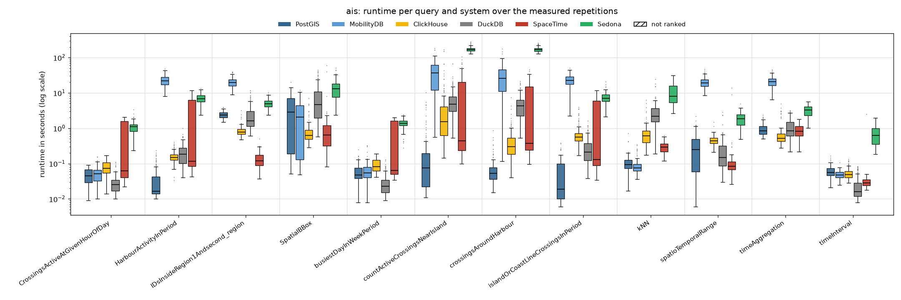
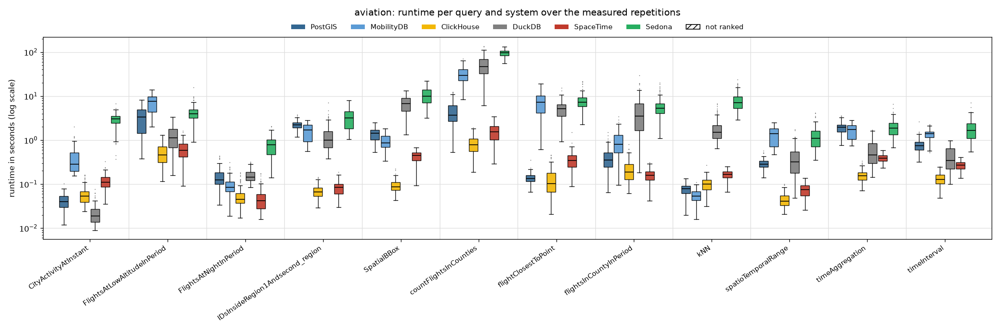
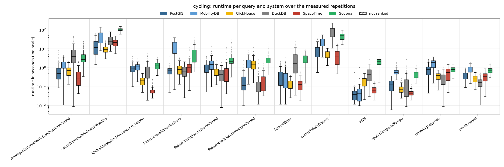
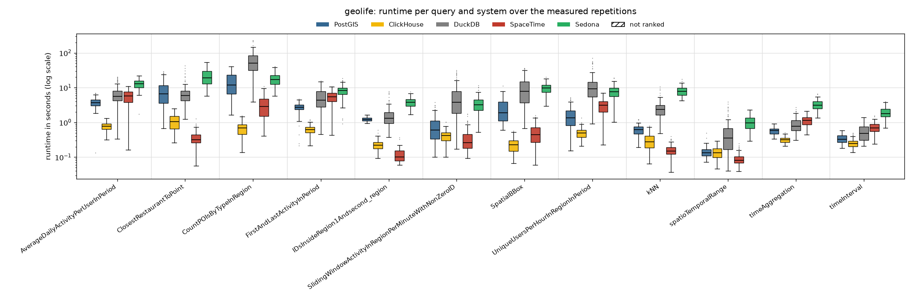

# Read-only, 4 client threads

Run of 2026-10-16 to 2026-10-16. Every system alone on the five-node cluster, one system after the other; 4 client threads taking the queries from one shared queue (so 4 queries run at the same time). Each of the 48 read queries runs with **128 measured parameter sets** (the same sets in every client-thread run) after 4 warm-up repetitions. Timeout 600 s per query. The configuration of every system is described in the [main README](../../../../README.md#configuration). All numbers below come from the CSV files in this folder (`build_results.py`, `empty_results.py`); [`tables.md`](tables.md) has every table in full.

## Summary

| System | Queries won | Ranked on | Geo-mean slowdown vs fastest | Median slowdown | Measured executions | Failed |
|---|---:|---:|---:|---:|---:|---:|
| ClickHouse | 20 | 48 of 48 | 1.81× | 1.31× | 6,144 | 2 |
| SpaceTime | 12 | 48 of 48 | 2.69× | 1.92× | 6,144 | 2 |
| DuckDB | 9 | 48 of 48 | 7.32× | 9.08× | 6,144 | 2 |
| PostGIS | 5 | 48 of 48 | 3.08× | 2.30× | 6,144 | 2 |
| MobilityDB | 2 | 36 of 36 | 11.83× | 10.15× | 4,608 | 2 |
| Sedona | 0 | 48 of 48 | 26.78× | 22.23× | 6,144 | 2 |

*Slowdown*: a system's mean runtime on a query divided by the fastest ranked system's, over the queries the system is ranked on. A system is ranked on a query when every measured repetition succeeded and its results match PostGIS (pre-run equivalence check; accepted: nearest-neighbour ties, numbers within 1 %, an empty answer as no row or one row of zeros).

**Wins by scenario and by query type:**

| | PostGIS | MobilityDB | ClickHouse | DuckDB | SpaceTime |
|---|---:|---:|---:|---:|---:|
| AIS | 4 | 1 | 2 | 3 | 2 |
| Aviation | – | 1 | 8 | 1 | 2 |
| Cycling | 1 | – | 3 | 5 | 3 |
| Geolife | – | – | 7 | – | 5 |
| spatial | 3 | 2 | 9 | – | 2 |
| temporal | – | – | 8 | 7 | 1 |
| spatiotemporal | 2 | – | 3 | 2 | 9 |

## Total runtime, pair by pair

Sum of the measured repetitions' runtimes over only the queries both systems completed.

| System A | System B | Common queries | A | B | A / B |
|---|---|---:|---:|---:|---:|
| PostGIS | MobilityDB | 36 | 118.4 min | 711.7 min | 0.17 |
| PostGIS | ClickHouse | 48 | 200.9 min | 92.3 min | 2.18 |
| PostGIS | DuckDB | 48 | 200.9 min | 760.0 min | 0.26 |
| PostGIS | SpaceTime | 48 | 200.9 min | 179.0 min | 1.12 |
| PostGIS | Sedona | 48 | 200.9 min | 1759.0 min | 0.11 |
| MobilityDB | ClickHouse | 36 | 711.7 min | 80.3 min | 8.86 |
| MobilityDB | DuckDB | 36 | 711.7 min | 510.3 min | 1.39 |
| MobilityDB | SpaceTime | 36 | 711.7 min | 133.5 min | 5.33 |
| MobilityDB | Sedona | 36 | 711.7 min | 1541.7 min | 0.46 |
| ClickHouse | DuckDB | 48 | 92.3 min | 760.0 min | 0.12 |
| ClickHouse | SpaceTime | 48 | 92.3 min | 179.0 min | 0.52 |
| ClickHouse | Sedona | 48 | 92.3 min | 1759.0 min | 0.05 |
| DuckDB | SpaceTime | 48 | 760.0 min | 179.0 min | 4.25 |
| DuckDB | Sedona | 48 | 760.0 min | 1759.0 min | 0.43 |
| SpaceTime | Sedona | 48 | 179.0 min | 1759.0 min | 0.1 |

## Failures

Parameter sets left out for every system:

| Scenario | Query | Repetition | Reason |
|---|---|---:|---|
| ais | countActiveCrossingsNearIsland | 17 | every system timed out |
| ais | countActiveCrossingsNearIsland | 121 | every system timed out |

Measured executions that did not succeed (including those in the parameter sets above):

| System | Scenario | Query | Status | Count |
|---|---|---|---|---:|
| ClickHouse | ais | countActiveCrossingsNearIsland | timeout | 2 |
| DuckDB | ais | countActiveCrossingsNearIsland | timeout | 2 |
| MobilityDB | ais | countActiveCrossingsNearIsland | timeout | 2 |
| PostGIS | ais | countActiveCrossingsNearIsland | timeout | 2 |
| Sedona | ais | countActiveCrossingsNearIsland | timeout | 2 |
| SpaceTime | ais | countActiveCrossingsNearIsland | timeout | 2 |

## Latency per scenario

One section per scenario. The box plot shows every system's runtimes over the measured repetitions that succeeded (box: 25th to 75th percentile, line: median, whiskers: 1.5 × the box height, dots: outliers; log scale; hatched: not ranked). The table below it gives mean, median, 95th and 99th percentile and standard deviation over those repetitions (n); the variance (standard deviation squared, ms²) is in `summary.csv` (`var_ms2`). **Bold**: fastest ranked system on the query (by mean).

### AIS

| Query | System | n | Mean | Median | p95 | p99 | Std dev |
|---|---|---:|---:|---:|---:|---:|---:|
| `CrossingsActiveAtGivenHourOfDay` | PostGIS | 128 | 48 ms | 46 ms | 85 ms | 89 ms | 22 ms |
|  | MobilityDB | 128 | 56 ms | 52 ms | 109 ms | 144 ms | 29 ms |
|  | ClickHouse | 128 | 80 ms | 73 ms | 144 ms | 162 ms | 37 ms |
|  | **DuckDB** | 128 | **30 ms** | 26 ms | 74 ms | 100 ms | 19 ms |
|  | SpaceTime | 128 | 742 ms | 63 ms | 1.94 s | 2.03 s | 818 ms |
|  | Sedona | 128 | 1.08 s | 1.09 s | 1.69 s | 2.43 s | 446 ms |
| `HarbourActivityInPeriod` | **PostGIS** | 128 | **38 ms** | 16 ms | 137 ms | 193 ms | 44 ms |
|  | MobilityDB | 128 | 22.89 s | 22.12 s | 36.84 s | 42.58 s | 7.94 s |
|  | ClickHouse | 128 | 162 ms | 150 ms | 285 ms | 356 ms | 60 ms |
|  | DuckDB | 128 | 218 ms | 184 ms | 550 ms | 664 ms | 156 ms |
|  | SpaceTime | 128 | 2.45 s | 118 ms | 8.54 s | 9.94 s | 3.41 s |
|  | Sedona | 128 | 7.15 s | 6.92 s | 10.63 s | 12.24 s | 2.12 s |
| `IDsInsideRegion1Andsecond_region` | PostGIS | 128 | 2.42 s | 2.37 s | 3.27 s | 3.81 s | 505 ms |
|  | MobilityDB | 128 | 20.41 s | 19.42 s | 33.12 s | 38.31 s | 6.70 s |
|  | ClickHouse | 128 | 865 ms | 784 ms | 1.35 s | 2.33 s | 356 ms |
|  | DuckDB | 128 | 2.61 s | 1.62 s | 7.69 s | 11.35 s | 2.35 s |
|  | **SpaceTime** | 128 | **140 ms** | 120 ms | 261 ms | 312 ms | 73 ms |
|  | Sedona | 128 | 5.12 s | 4.99 s | 7.41 s | 8.99 s | 1.49 s |
| `SpatialBBox` | PostGIS | 128 | 3.85 s | 2.86 s | 11.62 s | 13.65 s | 4.13 s |
|  | MobilityDB | 128 | 2.72 s | 2.08 s | 7.56 s | 10.14 s | 2.79 s |
|  | **ClickHouse** | 128 | **899 ms** | 618 ms | 2.37 s | 4.89 s | 939 ms |
|  | DuckDB | 128 | 8.74 s | 4.71 s | 30.78 s | 40.60 s | 10.03 s |
|  | SpaceTime | 128 | 1.63 s | 646 ms | 2.26 s | 31.46 s | 6.25 s |
|  | Sedona | 128 | 14.86 s | 13.14 s | 32.94 s | 43.75 s | 9.28 s |
| `busiestDayInWeekPeriod` | PostGIS | 128 | 60 ms | 48 ms | 127 ms | 164 ms | 35 ms |
|  | MobilityDB | 128 | 69 ms | 55 ms | 133 ms | 312 ms | 50 ms |
|  | ClickHouse | 128 | 94 ms | 82 ms | 156 ms | 186 ms | 37 ms |
|  | **DuckDB** | 128 | **30 ms** | 23 ms | 80 ms | 113 ms | 22 ms |
|  | SpaceTime | 128 | 614 ms | 64 ms | 1.88 s | 2.02 s | 794 ms |
|  | Sedona | 128 | 1.37 s | 1.38 s | 2.09 s | 2.32 s | 402 ms |
| `countActiveCrossingsNearIsland` | **PostGIS** | 126 | **432 ms** | 74 ms | 2.08 s | 5.26 s | 1.26 s |
|  | MobilityDB | 126 | 40.94 s | 37.13 s | 83.06 s | 163.04 s | 33.50 s |
|  | ClickHouse | 126 | 8.69 s | 1.54 s | 33.95 s | 150.01 s | 25.35 s |
|  | DuckDB | 126 | 7.35 s | 4.81 s | 19.52 s | 57.73 s | 9.31 s |
|  | SpaceTime | 126 | 10.47 s | 439 ms | 49.97 s | 83.40 s | 19.13 s |
|  | Sedona | 126 | 173.01 s | 167.19 s | 220.79 s | 264.51 s | 25.82 s |
| `crossingsAroundHarbour` | **PostGIS** | 128 | **80 ms** | 54 ms | 245 ms | 528 ms | 105 ms |
|  | MobilityDB | 128 | 31.44 s | 26.00 s | 70.93 s | 142.93 s | 28.72 s |
|  | ClickHouse | 128 | 535 ms | 303 ms | 1.41 s | 4.11 s | 846 ms |
|  | DuckDB | 128 | 5.05 s | 4.33 s | 13.64 s | 18.74 s | 4.03 s |
|  | SpaceTime | 128 | 6.62 s | 372 ms | 24.47 s | 38.95 s | 10.65 s |
|  | Sedona | 128 | 170.81 s | 166.98 s | 233.31 s | 244.34 s | 25.98 s |
| `islandOrCoastLineCrossingsInPeriod` | **PostGIS** | 128 | **63 ms** | 19 ms | 217 ms | 341 ms | 77 ms |
|  | MobilityDB | 128 | 23.44 s | 22.41 s | 40.16 s | 44.66 s | 9.36 s |
|  | ClickHouse | 128 | 759 ms | 554 ms | 2.17 s | 3.50 s | 632 ms |
|  | DuckDB | 128 | 308 ms | 212 ms | 890 ms | 1.19 s | 283 ms |
|  | SpaceTime | 128 | 2.40 s | 130 ms | 8.54 s | 10.54 s | 3.38 s |
|  | Sedona | 128 | 7.65 s | 7.04 s | 11.80 s | 16.46 s | 2.61 s |
| `kNN` | PostGIS | 128 | 109 ms | 94 ms | 195 ms | 423 ms | 79 ms |
|  | **MobilityDB** | 128 | **89 ms** | 76 ms | 210 ms | 310 ms | 52 ms |
|  | ClickHouse | 128 | 774 ms | 602 ms | 1.76 s | 4.79 s | 816 ms |
|  | DuckDB | 128 | 3.13 s | 2.17 s | 7.05 s | 17.45 s | 3.23 s |
|  | SpaceTime | 128 | 302 ms | 296 ms | 511 ms | 568 ms | 108 ms |
|  | Sedona | 128 | 10.39 s | 8.09 s | 20.32 s | 28.83 s | 6.17 s |
| `spatioTemporalRange` | PostGIS | 128 | 334 ms | 248 ms | 1.08 s | 1.50 s | 354 ms |
|  | MobilityDB | 128 | 20.28 s | 19.29 s | 33.51 s | 41.20 s | 6.84 s |
|  | ClickHouse | 128 | 473 ms | 442 ms | 729 ms | 1.04 s | 164 ms |
|  | DuckDB | 128 | 290 ms | 150 ms | 722 ms | 2.35 s | 408 ms |
|  | **SpaceTime** | 128 | **274 ms** | 85 ms | 176 ms | 6.72 s | 1.44 s |
|  | Sedona | 128 | 1.90 s | 1.88 s | 3.15 s | 3.68 s | 797 ms |
| `timeAggregation` | PostGIS | 128 | 950 ms | 848 ms | 1.66 s | 2.08 s | 357 ms |
|  | MobilityDB | 128 | 21.36 s | 20.61 s | 35.73 s | 41.94 s | 7.20 s |
|  | **ClickHouse** | 128 | **735 ms** | 518 ms | 2.57 s | 3.59 s | 720 ms |
|  | DuckDB | 128 | 1.14 s | 852 ms | 2.61 s | 3.03 s | 714 ms |
|  | SpaceTime | 128 | 880 ms | 818 ms | 1.48 s | 1.73 s | 343 ms |
|  | Sedona | 128 | 3.21 s | 3.30 s | 4.79 s | 5.57 s | 1.06 s |
| `timeInterval` | PostGIS | 128 | 61 ms | 56 ms | 102 ms | 142 ms | 23 ms |
|  | MobilityDB | 128 | 50 ms | 48 ms | 74 ms | 78 ms | 13 ms |
|  | ClickHouse | 128 | 55 ms | 49 ms | 97 ms | 122 ms | 21 ms |
|  | **DuckDB** | 128 | **26 ms** | 16 ms | 70 ms | 81 ms | 21 ms |
|  | SpaceTime | 128 | 49 ms | 28 ms | 46 ms | 50 ms | 215 ms |
|  | Sedona | 128 | 724 ms | 619 ms | 1.50 s | 1.72 s | 414 ms |

### Aviation

| Query | System | n | Mean | Median | p95 | p99 | Std dev |
|---|---|---:|---:|---:|---:|---:|---:|
| `CityActivityAtInstant` | PostGIS | 128 | 41 ms | 40 ms | 71 ms | 77 ms | 17 ms |
|  | MobilityDB | 128 | 396 ms | 286 ms | 869 ms | 1.21 s | 280 ms |
|  | ClickHouse | 128 | 59 ms | 53 ms | 126 ms | 159 ms | 29 ms |
|  | **DuckDB** | 128 | **22 ms** | 19 ms | 41 ms | 64 ms | 12 ms |
|  | SpaceTime | 128 | 116 ms | 112 ms | 197 ms | 240 ms | 49 ms |
|  | Sedona | 128 | 2.94 s | 3.05 s | 4.36 s | 5.23 s | 1.00 s |
| `FlightsAtLowAltitudeInPeriod` | PostGIS | 128 | 3.29 s | 3.38 s | 6.11 s | 6.65 s | 1.88 s |
|  | MobilityDB | 128 | 7.21 s | 7.55 s | 11.66 s | 12.47 s | 3.09 s |
|  | **ClickHouse** | 128 | **518 ms** | 464 ms | 962 ms | 1.14 s | 265 ms |
|  | DuckDB | 128 | 1.27 s | 1.13 s | 2.53 s | 3.02 s | 730 ms |
|  | SpaceTime | 128 | 620 ms | 588 ms | 1.19 s | 1.44 s | 298 ms |
|  | Sedona | 128 | 4.26 s | 3.96 s | 7.72 s | 9.62 s | 1.90 s |
| `FlightsAtNightInPeriod` | PostGIS | 128 | 150 ms | 124 ms | 293 ms | 422 ms | 82 ms |
|  | MobilityDB | 128 | 96 ms | 85 ms | 185 ms | 246 ms | 45 ms |
|  | ClickHouse | 128 | 54 ms | 45 ms | 124 ms | 170 ms | 32 ms |
|  | DuckDB | 128 | 163 ms | 145 ms | 286 ms | 306 ms | 56 ms |
|  | **SpaceTime** | 128 | **50 ms** | 42 ms | 115 ms | 166 ms | 30 ms |
|  | Sedona | 128 | 783 ms | 782 ms | 1.43 s | 1.92 s | 385 ms |
| `IDsInsideRegion1Andsecond_region` | PostGIS | 128 | 2.22 s | 2.22 s | 2.95 s | 3.53 s | 472 ms |
|  | MobilityDB | 128 | 1.62 s | 1.69 s | 2.50 s | 2.61 s | 641 ms |
|  | **ClickHouse** | 128 | **71 ms** | 67 ms | 120 ms | 138 ms | 24 ms |
|  | DuckDB | 128 | 1.29 s | 994 ms | 3.12 s | 4.52 s | 982 ms |
|  | SpaceTime | 128 | 84 ms | 85 ms | 136 ms | 162 ms | 31 ms |
|  | Sedona | 128 | 3.32 s | 3.19 s | 6.50 s | 7.75 s | 1.66 s |
| `SpatialBBox` | PostGIS | 128 | 1.41 s | 1.43 s | 2.13 s | 2.47 s | 453 ms |
|  | MobilityDB | 128 | 957 ms | 865 ms | 1.67 s | 1.83 s | 358 ms |
|  | **ClickHouse** | 128 | **93 ms** | 87 ms | 149 ms | 198 ms | 31 ms |
|  | DuckDB | 128 | 6.88 s | 6.77 s | 12.27 s | 12.89 s | 2.82 s |
|  | SpaceTime | 128 | 433 ms | 449 ms | 614 ms | 651 ms | 124 ms |
|  | Sedona | 128 | 10.73 s | 9.96 s | 18.99 s | 20.62 s | 4.61 s |
| `countFlightsInCounties` | PostGIS | 128 | 4.35 s | 3.69 s | 9.48 s | 12.29 s | 2.65 s |
|  | MobilityDB | 128 | 32.04 s | 29.24 s | 55.91 s | 64.48 s | 13.44 s |
|  | **ClickHouse** | 128 | **854 ms** | 780 ms | 1.63 s | 1.82 s | 389 ms |
|  | DuckDB | 128 | 51.73 s | 47.13 s | 99.98 s | 126.00 s | 26.20 s |
|  | SpaceTime | 128 | 1.57 s | 1.54 s | 3.02 s | 3.23 s | 707 ms |
|  | Sedona | 128 | 96.09 s | 95.73 s | 122.38 s | 130.38 s | 16.16 s |
| `flightClosestToPoint` | PostGIS | 128 | 141 ms | 134 ms | 206 ms | 228 ms | 37 ms |
|  | MobilityDB | 128 | 7.54 s | 7.34 s | 15.57 s | 16.95 s | 4.14 s |
|  | **ClickHouse** | 128 | **134 ms** | 102 ms | 320 ms | 439 ms | 97 ms |
|  | DuckDB | 128 | 5.33 s | 5.16 s | 10.48 s | 12.69 s | 2.81 s |
|  | SpaceTime | 128 | 367 ms | 340 ms | 638 ms | 828 ms | 182 ms |
|  | Sedona | 128 | 8.04 s | 7.24 s | 14.20 s | 21.13 s | 3.52 s |
| `flightsInCountyInPeriod` | PostGIS | 128 | 412 ms | 349 ms | 887 ms | 1.22 s | 244 ms |
|  | MobilityDB | 128 | 964 ms | 811 ms | 2.08 s | 2.81 s | 599 ms |
|  | ClickHouse | 128 | 223 ms | 187 ms | 489 ms | 624 ms | 130 ms |
|  | DuckDB | 128 | 5.09 s | 3.52 s | 14.21 s | 19.50 s | 4.85 s |
|  | **SpaceTime** | 128 | **159 ms** | 158 ms | 264 ms | 297 ms | 58 ms |
|  | Sedona | 128 | 6.04 s | 5.29 s | 13.51 s | 18.12 s | 3.36 s |
| `kNN` | PostGIS | 128 | 78 ms | 79 ms | 114 ms | 127 ms | 21 ms |
|  | **MobilityDB** | 128 | **56 ms** | 53 ms | 91 ms | 97 ms | 18 ms |
|  | ClickHouse | 128 | 102 ms | 100 ms | 154 ms | 186 ms | 37 ms |
|  | DuckDB | 128 | 1.89 s | 1.50 s | 4.42 s | 6.28 s | 1.19 s |
|  | SpaceTime | 128 | 164 ms | 166 ms | 226 ms | 235 ms | 41 ms |
|  | Sedona | 128 | 7.95 s | 7.10 s | 16.64 s | 19.37 s | 3.84 s |
| `spatioTemporalRange` | PostGIS | 128 | 294 ms | 282 ms | 411 ms | 519 ms | 72 ms |
|  | MobilityDB | 128 | 1.32 s | 1.42 s | 2.06 s | 2.38 s | 557 ms |
|  | **ClickHouse** | 128 | **46 ms** | 41 ms | 75 ms | 96 ms | 17 ms |
|  | DuckDB | 128 | 414 ms | 323 ms | 1.06 s | 1.53 s | 321 ms |
|  | SpaceTime | 128 | 74 ms | 75 ms | 113 ms | 132 ms | 25 ms |
|  | Sedona | 128 | 1.26 s | 1.11 s | 2.59 s | 3.90 s | 741 ms |
| `timeAggregation` | PostGIS | 128 | 1.95 s | 1.96 s | 3.15 s | 3.40 s | 628 ms |
|  | MobilityDB | 128 | 1.66 s | 1.74 s | 2.40 s | 2.77 s | 575 ms |
|  | **ClickHouse** | 128 | **161 ms** | 154 ms | 256 ms | 301 ms | 49 ms |
|  | DuckDB | 128 | 624 ms | 460 ms | 1.60 s | 1.69 s | 427 ms |
|  | SpaceTime | 128 | 393 ms | 391 ms | 551 ms | 583 ms | 83 ms |
|  | Sedona | 128 | 2.02 s | 1.86 s | 3.52 s | 5.09 s | 941 ms |
| `timeInterval` | PostGIS | 128 | 793 ms | 748 ms | 1.26 s | 1.52 s | 296 ms |
|  | MobilityDB | 128 | 1.35 s | 1.41 s | 1.83 s | 2.19 s | 344 ms |
|  | **ClickHouse** | 128 | **135 ms** | 126 ms | 221 ms | 242 ms | 44 ms |
|  | DuckDB | 128 | 438 ms | 348 ms | 894 ms | 968 ms | 258 ms |
|  | SpaceTime | 128 | 267 ms | 269 ms | 370 ms | 401 ms | 60 ms |
|  | Sedona | 128 | 1.88 s | 1.65 s | 3.74 s | 5.20 s | 1.02 s |

### Cycling

| Query | System | n | Mean | Median | p95 | p99 | Std dev |
|---|---|---:|---:|---:|---:|---:|---:|
| `AverageUpdatesPerRideInDistrictInPeriod` | PostGIS | 128 | 913 ms | 494 ms | 3.10 s | 6.20 s | 1.22 s |
|  | MobilityDB | 128 | 1.55 s | 1.40 s | 3.05 s | 4.21 s | 876 ms |
|  | ClickHouse | 128 | 799 ms | 706 ms | 1.99 s | 2.28 s | 532 ms |
|  | DuckDB | 128 | 6.89 s | 3.97 s | 23.57 s | 38.27 s | 8.13 s |
|  | **SpaceTime** | 128 | **415 ms** | 280 ms | 958 ms | 2.02 s | 388 ms |
|  | Sedona | 128 | 4.92 s | 2.78 s | 17.35 s | 23.29 s | 5.12 s |
| `CountRidesFullyInDistrictRadius` | PostGIS | 128 | 17.01 s | 11.61 s | 52.03 s | 64.03 s | 15.29 s |
|  | MobilityDB | 128 | 46.58 s | 29.16 s | 115.84 s | 134.70 s | 35.31 s |
|  | **ClickHouse** | 128 | **10.31 s** | 8.93 s | 20.20 s | 23.91 s | 5.05 s |
|  | DuckDB | 128 | 30.83 s | 25.29 s | 65.53 s | 72.57 s | 17.64 s |
|  | SpaceTime | 128 | 22.14 s | 21.93 s | 39.62 s | 46.50 s | 9.92 s |
|  | Sedona | 128 | 106.20 s | 107.65 s | 131.33 s | 150.12 s | 18.60 s |
| `IDsInsideRegion1Andsecond_region` | PostGIS | 128 | 990 ms | 954 ms | 1.99 s | 3.02 s | 584 ms |
|  | MobilityDB | 128 | 1.12 s | 1.12 s | 1.98 s | 2.59 s | 551 ms |
|  | ClickHouse | 128 | 224 ms | 218 ms | 427 ms | 466 ms | 107 ms |
|  | DuckDB | 128 | 904 ms | 598 ms | 2.58 s | 5.17 s | 1.02 s |
|  | **SpaceTime** | 128 | **61 ms** | 52 ms | 116 ms | 196 ms | 31 ms |
|  | Sedona | 128 | 1.38 s | 1.36 s | 2.51 s | 3.30 s | 674 ms |
| `RidesAcrossMultipleHours` | PostGIS | 128 | 751 ms | 690 ms | 1.37 s | 1.95 s | 444 ms |
|  | MobilityDB | 128 | 13.98 s | 12.28 s | 30.31 s | 33.82 s | 9.34 s |
|  | ClickHouse | 128 | 931 ms | 808 ms | 2.19 s | 3.04 s | 642 ms |
|  | **DuckDB** | 128 | **745 ms** | 645 ms | 1.73 s | 1.99 s | 510 ms |
|  | SpaceTime | 128 | 1.43 s | 1.06 s | 3.75 s | 9.72 s | 1.81 s |
|  | Sedona | 128 | 7.49 s | 2.80 s | 30.46 s | 41.48 s | 9.78 s |
| `RidesDuringRushHourInPeriod` | PostGIS | 128 | 1.13 s | 977 ms | 2.39 s | 3.79 s | 735 ms |
|  | MobilityDB | 128 | 1.82 s | 1.47 s | 4.25 s | 7.61 s | 1.68 s |
|  | ClickHouse | 128 | 672 ms | 580 ms | 1.41 s | 1.70 s | 401 ms |
|  | **DuckDB** | 128 | **506 ms** | 430 ms | 1.14 s | 1.32 s | 366 ms |
|  | SpaceTime | 128 | 965 ms | 524 ms | 2.46 s | 10.03 s | 1.83 s |
|  | Sedona | 128 | 3.81 s | 2.10 s | 12.78 s | 21.96 s | 4.88 s |
| `RidesPastOrToUniversityInPeriod` | PostGIS | 128 | 275 ms | 117 ms | 942 ms | 2.17 s | 398 ms |
|  | MobilityDB | 128 | 1.92 s | 1.57 s | 4.35 s | 5.92 s | 1.31 s |
|  | ClickHouse | 128 | 1.87 s | 1.54 s | 4.35 s | 7.33 s | 1.57 s |
|  | **DuckDB** | 128 | **226 ms** | 108 ms | 968 ms | 2.22 s | 416 ms |
|  | SpaceTime | 128 | 275 ms | 108 ms | 876 ms | 1.57 s | 377 ms |
|  | Sedona | 128 | 3.39 s | 2.29 s | 10.52 s | 16.96 s | 3.38 s |
| `SpatialBBox` | PostGIS | 128 | 447 ms | 258 ms | 1.62 s | 1.91 s | 499 ms |
|  | MobilityDB | 128 | 428 ms | 260 ms | 1.37 s | 2.12 s | 525 ms |
|  | **ClickHouse** | 128 | **152 ms** | 140 ms | 324 ms | 351 ms | 84 ms |
|  | DuckDB | 128 | 3.53 s | 1.73 s | 11.47 s | 19.36 s | 4.42 s |
|  | SpaceTime | 128 | 157 ms | 126 ms | 430 ms | 585 ms | 130 ms |
|  | Sedona | 128 | 3.34 s | 2.81 s | 6.64 s | 8.62 s | 1.87 s |
| `countRideInDistrict` | PostGIS | 128 | 8.97 s | 7.61 s | 21.33 s | 30.80 s | 6.87 s |
|  | MobilityDB | 128 | 24.62 s | 22.63 s | 49.92 s | 59.82 s | 13.78 s |
|  | **ClickHouse** | 128 | **5.30 s** | 5.35 s | 8.68 s | 10.01 s | 2.27 s |
|  | DuckDB | 128 | 90.40 s | 88.47 s | 180.44 s | 210.21 s | 53.01 s |
|  | SpaceTime | 128 | 5.38 s | 3.81 s | 16.76 s | 18.60 s | 5.09 s |
|  | Sedona | 128 | 47.91 s | 48.90 s | 78.14 s | 94.37 s | 18.25 s |
| `kNN` | **PostGIS** | 128 | **46 ms** | 38 ms | 95 ms | 178 ms | 55 ms |
|  | MobilityDB | 128 | 86 ms | 42 ms | 275 ms | 1.04 s | 181 ms |
|  | ClickHouse | 128 | 202 ms | 176 ms | 426 ms | 533 ms | 123 ms |
|  | DuckDB | 128 | 552 ms | 428 ms | 1.49 s | 1.58 s | 446 ms |
|  | SpaceTime | 128 | 74 ms | 64 ms | 145 ms | 180 ms | 37 ms |
|  | Sedona | 128 | 2.27 s | 2.10 s | 4.18 s | 5.96 s | 1.16 s |
| `spatioTemporalRange` | PostGIS | 128 | 141 ms | 136 ms | 301 ms | 408 ms | 98 ms |
|  | MobilityDB | 128 | 636 ms | 574 ms | 1.09 s | 1.60 s | 277 ms |
|  | ClickHouse | 128 | 82 ms | 72 ms | 158 ms | 253 ms | 45 ms |
|  | DuckDB | 128 | 196 ms | 59 ms | 682 ms | 1.26 s | 333 ms |
|  | **SpaceTime** | 128 | **49 ms** | 45 ms | 99 ms | 119 ms | 22 ms |
|  | Sedona | 128 | 471 ms | 412 ms | 950 ms | 1.27 s | 244 ms |
| `timeAggregation` | PostGIS | 128 | 846 ms | 831 ms | 1.69 s | 2.65 s | 526 ms |
|  | MobilityDB | 128 | 1.72 s | 1.84 s | 3.02 s | 3.32 s | 863 ms |
|  | ClickHouse | 128 | 377 ms | 382 ms | 653 ms | 750 ms | 169 ms |
|  | **DuckDB** | 128 | **292 ms** | 224 ms | 708 ms | 1.16 s | 240 ms |
|  | SpaceTime | 128 | 587 ms | 554 ms | 1.30 s | 1.43 s | 387 ms |
|  | Sedona | 128 | 827 ms | 794 ms | 1.27 s | 1.49 s | 275 ms |
| `timeInterval` | PostGIS | 128 | 404 ms | 368 ms | 745 ms | 1.04 s | 208 ms |
|  | MobilityDB | 128 | 832 ms | 832 ms | 1.45 s | 1.66 s | 371 ms |
|  | ClickHouse | 128 | 282 ms | 282 ms | 469 ms | 518 ms | 116 ms |
|  | **DuckDB** | 128 | **186 ms** | 169 ms | 392 ms | 568 ms | 118 ms |
|  | SpaceTime | 128 | 362 ms | 347 ms | 748 ms | 883 ms | 218 ms |
|  | Sedona | 128 | 769 ms | 694 ms | 1.42 s | 1.77 s | 317 ms |

### Geolife

| Query | System | n | Mean | Median | p95 | p99 | Std dev |
|---|---|---:|---:|---:|---:|---:|---:|
| `AverageDailyActivityPerUserInPeriod` | PostGIS | 128 | 3.79 s | 3.72 s | 5.63 s | 6.72 s | 1.09 s |
|  | **ClickHouse** | 128 | **775 ms** | 764 ms | 1.11 s | 1.23 s | 193 ms |
|  | DuckDB | 128 | 7.03 s | 5.56 s | 16.79 s | 20.00 s | 4.35 s |
|  | SpaceTime | 128 | 5.79 s | 5.83 s | 9.00 s | 9.74 s | 2.19 s |
|  | Sedona | 128 | 12.94 s | 12.84 s | 18.59 s | 21.42 s | 3.55 s |
| `ClosestRestaurantToPoint` | PostGIS | 128 | 8.79 s | 6.55 s | 24.69 s | 27.44 s | 7.01 s |
|  | ClickHouse | 128 | 1.09 s | 1.06 s | 1.89 s | 2.28 s | 515 ms |
|  | DuckDB | 128 | 7.40 s | 5.91 s | 20.06 s | 34.74 s | 6.24 s |
|  | **SpaceTime** | 128 | **368 ms** | 314 ms | 654 ms | 888 ms | 178 ms |
|  | Sedona | 128 | 22.38 s | 19.09 s | 44.88 s | 52.35 s | 12.07 s |
| `CountPOIsByTypeInRegion` | PostGIS | 128 | 15.41 s | 11.90 s | 36.41 s | 39.74 s | 10.79 s |
|  | **ClickHouse** | 128 | **702 ms** | 694 ms | 1.25 s | 1.49 s | 310 ms |
|  | DuckDB | 128 | 61.39 s | 50.30 s | 122.52 s | 218.12 s | 43.55 s |
|  | SpaceTime | 128 | 3.46 s | 2.90 s | 7.57 s | 9.15 s | 2.30 s |
|  | Sedona | 128 | 18.43 s | 17.03 s | 32.57 s | 39.60 s | 7.84 s |
| `FirstAndLastActivityInPeriod` | PostGIS | 128 | 2.71 s | 2.72 s | 4.04 s | 4.44 s | 808 ms |
|  | **ClickHouse** | 128 | **625 ms** | 620 ms | 912 ms | 1.12 s | 175 ms |
|  | DuckDB | 128 | 5.68 s | 4.33 s | 12.51 s | 14.83 s | 3.54 s |
|  | SpaceTime | 128 | 5.46 s | 5.41 s | 8.94 s | 10.45 s | 2.17 s |
|  | Sedona | 128 | 8.41 s | 8.32 s | 14.33 s | 15.98 s | 3.11 s |
| `IDsInsideRegion1Andsecond_region` | PostGIS | 128 | 1.23 s | 1.20 s | 1.50 s | 1.53 s | 151 ms |
|  | ClickHouse | 128 | 233 ms | 222 ms | 368 ms | 471 ms | 77 ms |
|  | DuckDB | 128 | 1.69 s | 1.30 s | 4.20 s | 7.14 s | 1.33 s |
|  | **SpaceTime** | 128 | **120 ms** | 101 ms | 207 ms | 296 ms | 53 ms |
|  | Sedona | 128 | 3.90 s | 3.82 s | 6.20 s | 6.76 s | 1.25 s |
| `SlidingWindowActivityInRegionPerMinuteWithNonZeroID` | PostGIS | 128 | 811 ms | 594 ms | 2.32 s | 3.08 s | 709 ms |
|  | ClickHouse | 128 | 416 ms | 424 ms | 713 ms | 951 ms | 166 ms |
|  | DuckDB | 128 | 5.95 s | 3.81 s | 21.02 s | 28.03 s | 6.36 s |
|  | **SpaceTime** | 128 | **372 ms** | 259 ms | 980 ms | 1.66 s | 309 ms |
|  | Sedona | 128 | 3.52 s | 3.19 s | 6.58 s | 10.31 s | 1.96 s |
| `SpatialBBox` | PostGIS | 128 | 2.61 s | 1.91 s | 6.30 s | 7.60 s | 1.95 s |
|  | **ClickHouse** | 128 | **233 ms** | 226 ms | 393 ms | 535 ms | 107 ms |
|  | DuckDB | 128 | 10.43 s | 7.92 s | 26.94 s | 34.81 s | 8.67 s |
|  | SpaceTime | 128 | 526 ms | 439 ms | 1.27 s | 1.42 s | 341 ms |
|  | Sedona | 128 | 10.01 s | 9.89 s | 15.81 s | 17.95 s | 3.33 s |
| `UniqueUsersPerHourInRegionInPeriod` | PostGIS | 128 | 1.64 s | 1.37 s | 3.89 s | 4.87 s | 1.11 s |
|  | **ClickHouse** | 128 | **508 ms** | 492 ms | 848 ms | 969 ms | 183 ms |
|  | DuckDB | 128 | 12.83 s | 9.20 s | 45.26 s | 56.02 s | 12.70 s |
|  | SpaceTime | 128 | 3.07 s | 3.09 s | 5.37 s | 6.18 s | 1.42 s |
|  | Sedona | 128 | 7.89 s | 7.52 s | 13.72 s | 17.77 s | 3.19 s |
| `kNN` | PostGIS | 128 | 623 ms | 612 ms | 950 ms | 1.20 s | 200 ms |
|  | ClickHouse | 128 | 315 ms | 276 ms | 627 ms | 748 ms | 166 ms |
|  | DuckDB | 128 | 2.60 s | 2.35 s | 4.99 s | 9.07 s | 1.57 s |
|  | **SpaceTime** | 128 | **162 ms** | 151 ms | 268 ms | 332 ms | 60 ms |
|  | Sedona | 128 | 8.13 s | 7.87 s | 12.97 s | 14.79 s | 2.54 s |
| `spatioTemporalRange` | PostGIS | 128 | 148 ms | 133 ms | 229 ms | 324 ms | 54 ms |
|  | ClickHouse | 128 | 141 ms | 132 ms | 244 ms | 281 ms | 55 ms |
|  | DuckDB | 128 | 584 ms | 358 ms | 2.18 s | 3.19 s | 677 ms |
|  | **SpaceTime** | 128 | **92 ms** | 81 ms | 166 ms | 209 ms | 37 ms |
|  | Sedona | 128 | 1.03 s | 964 ms | 1.81 s | 1.97 s | 449 ms |
| `timeAggregation` | PostGIS | 128 | 570 ms | 582 ms | 783 ms | 813 ms | 130 ms |
|  | **ClickHouse** | 128 | **324 ms** | 321 ms | 454 ms | 470 ms | 66 ms |
|  | DuckDB | 128 | 914 ms | 768 ms | 1.79 s | 2.29 s | 466 ms |
|  | SpaceTime | 128 | 1.17 s | 1.15 s | 1.86 s | 1.97 s | 363 ms |
|  | Sedona | 128 | 3.24 s | 3.10 s | 4.97 s | 6.16 s | 1.06 s |
| `timeInterval` | PostGIS | 128 | 346 ms | 324 ms | 512 ms | 567 ms | 101 ms |
|  | **ClickHouse** | 128 | **258 ms** | 248 ms | 394 ms | 475 ms | 73 ms |
|  | DuckDB | 128 | 556 ms | 482 ms | 1.10 s | 1.34 s | 290 ms |
|  | SpaceTime | 128 | 727 ms | 690 ms | 1.18 s | 1.40 s | 248 ms |
|  | Sedona | 128 | 2.00 s | 1.81 s | 3.61 s | 3.75 s | 753 ms |

## Hardware

Means over the five nodes and over the time the system ran (5 s samples; per scenario and node in `hardware_by_phase.csv`).

| System | Run time | CPU busy | Memory used | Disk read |
|---|---:|---:|---:|---:|
| PostGIS | 1.0 h | 59 % | 21.0 GB | 2396 MB/s |
| MobilityDB | 3.1 h | 20 % | 19.5 GB | 1135 MB/s |
| ClickHouse | 0.5 h | 91 % | 5.3 GB | 43 MB/s |
| DuckDB | 3.4 h | 20 % | 13.5 GB | 34 MB/s |
| SpaceTime | 0.9 h | 59 % | 3.3 GB | 22 MB/s |
| Sedona | 7.7 h | 62 % | 28.9 GB | 186 MB/s |

## Caveats

- **SpaceTime's Geolife queries and cycling `kNN`** are ranked; their comparison with PostGIS is repeated after the runs.
- **Client host:** the benchmark client runs on a separate host with one CPU core and 1 GB of RAM. Results are read in batches of 100,000 rows; with several client threads, the client can become a limit for queries with large results.
- **Sedona** skips GeoParquet files by their bounding box only when a query compares with a constant geometry; joins with a whole reference table (harbours, islands, districts, counties) read the whole table.
- **Parameters** are drawn uniformly over each scenario's area and time span, so some queries often find no data (see *Empty results*); every system answers the same parameter sets.

## Files

| File | One row per |
|---|---|
| `executions.csv` | query execution (scenario, system, query, repetition, warm-up, status, duration, parameters, SQL) |
| `summary.csv` | (scenario, query, system): runs, failures, mean/median/p95/p99/min/max/std dev/variance, equivalence, rank |
| `winners.csv` | (scenario, query): fastest ranked system, runner-up, margin |
| `system_scores.csv` | system: wins, completed and ranked queries, slowdowns |
| `pairwise_total_time.csv` | pair of systems: total runtime over the queries both completed |
| `empty_results.csv` | (scenario, query, system): measured executions without a row |
| `equivalence.csv` | (scenario, query, system): result compared with PostGIS |
| `hardware_by_phase.csv` | (scenario, system): CPU, memory, disk and network per node |
| `dropped_parameter_sets.csv` | parameter sets left out for every system |
| `tables.md`, `plots/` | the tables and figures generated from the above (`plots/boxplot_<scenario>.png`: the box plots) |
| `raw/` | client logs, query files, hardware samples, the equivalence check |
