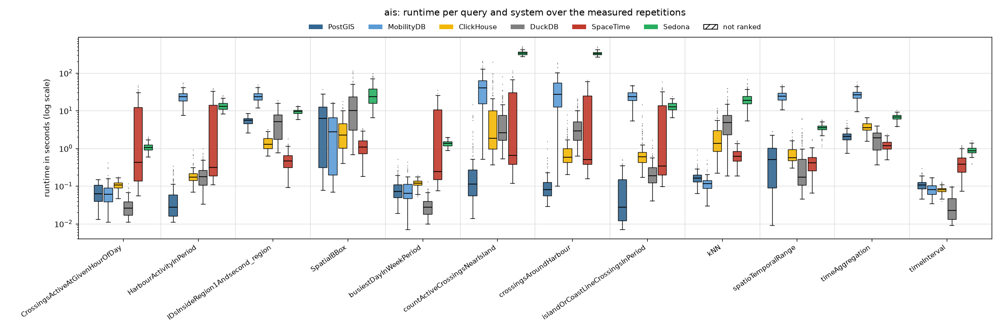
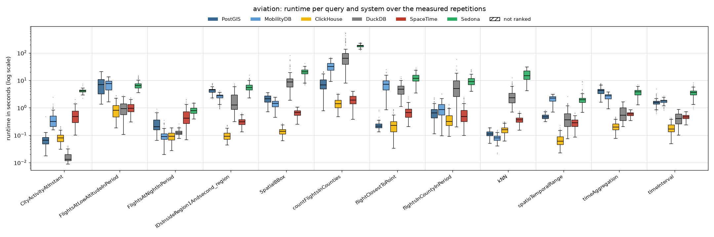
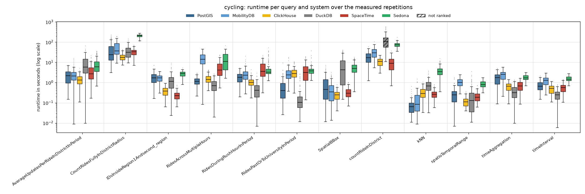
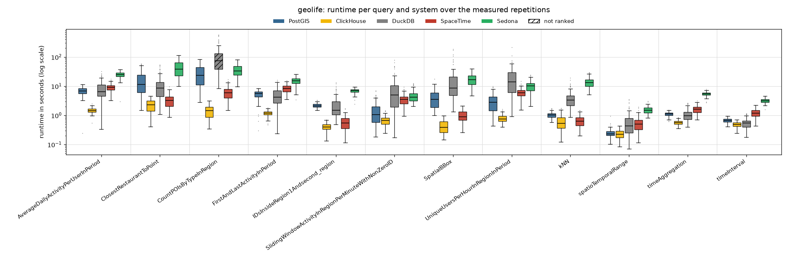

# Read-only, 8 client threads

Run of 2026-10-16 to 2026-10-17. Every system alone on the five-node cluster, one system after the other; 8 client threads taking the queries from one shared queue (so 8 queries run at the same time). Each of the 48 read queries runs with **128 measured parameter sets** (the same sets in every client-thread run) after 8 warm-up repetitions. Timeout 600 s per query. The configuration of every system is described in the [main README](../../../../README.md#configuration). All numbers below come from the CSV files in this folder (`build_results.py`, `empty_results.py`); [`tables.md`](tables.md) has every table in full.

## Summary

| System | Queries won | Ranked on | Geo-mean slowdown vs fastest | Median slowdown | Measured executions | Failed |
|---|---:|---:|---:|---:|---:|---:|
| ClickHouse | 25 | 48 of 48 | 1.81× | 1.00× | 6,144 | 2 |
| DuckDB | 9 | 46 of 48 | 5.04× | 4.73× | 6,144 | 16 |
| PostGIS | 6 | 48 of 48 | 3.26× | 2.85× | 6,144 | 2 |
| SpaceTime | 6 | 48 of 48 | 4.49× | 2.99× | 6,144 | 2 |
| MobilityDB | 2 | 36 of 36 | 9.81× | 8.36× | 4,608 | 2 |
| Sedona | 0 | 48 of 48 | 26.07× | 19.16× | 6,144 | 2 |

*Slowdown*: a system's mean runtime on a query divided by the fastest ranked system's, over the queries the system is ranked on. A system is ranked on a query when every measured repetition succeeded and its results match PostGIS (pre-run equivalence check; accepted: nearest-neighbour ties, numbers within 1 %, an empty answer as no row or one row of zeros).

**Wins by scenario and by query type:**

| | PostGIS | MobilityDB | ClickHouse | DuckDB | SpaceTime |
|---|---:|---:|---:|---:|---:|
| AIS | 4 | 1 | – | 3 | 4 |
| Aviation | 1 | 1 | 9 | 1 | – |
| Cycling | 1 | – | 4 | 5 | 2 |
| Geolife | – | – | 12 | – | – |
| spatial | 4 | 2 | 8 | – | 2 |
| temporal | – | – | 8 | 7 | 1 |
| spatiotemporal | 2 | – | 9 | 2 | 3 |

## Total runtime, pair by pair

Sum of the measured repetitions' runtimes over only the queries both systems completed.

| System A | System B | Common queries | A | B | A / B |
|---|---|---:|---:|---:|---:|
| PostGIS | MobilityDB | 36 | 264.3 min | 840.5 min | 0.31 |
| PostGIS | ClickHouse | 48 | 420.8 min | 173.0 min | 2.43 |
| PostGIS | DuckDB | 46 | 316.0 min | 682.5 min | 0.46 |
| PostGIS | SpaceTime | 48 | 420.8 min | 370.2 min | 1.14 |
| PostGIS | Sedona | 48 | 420.8 min | 3325.1 min | 0.13 |
| MobilityDB | ClickHouse | 36 | 840.5 min | 150.1 min | 5.6 |
| MobilityDB | DuckDB | 35 | 769.6 min | 504.1 min | 1.53 |
| MobilityDB | SpaceTime | 36 | 840.5 min | 279.1 min | 3.01 |
| MobilityDB | Sedona | 36 | 840.5 min | 2927.7 min | 0.29 |
| ClickHouse | DuckDB | 46 | 146.4 min | 682.5 min | 0.21 |
| ClickHouse | SpaceTime | 48 | 173.0 min | 370.2 min | 0.47 |
| ClickHouse | Sedona | 48 | 173.0 min | 3325.1 min | 0.05 |
| DuckDB | SpaceTime | 46 | 682.5 min | 335.1 min | 2.04 |
| DuckDB | Sedona | 46 | 682.5 min | 3083.6 min | 0.22 |
| SpaceTime | Sedona | 48 | 370.2 min | 3325.1 min | 0.11 |

## Failures

Parameter sets left out for every system:

| Scenario | Query | Repetition | Reason |
|---|---|---:|---|
| ais | countActiveCrossingsNearIsland | 21 | every system timed out |
| ais | countActiveCrossingsNearIsland | 125 | every system timed out |

Measured executions that did not succeed (including those in the parameter sets above):

| System | Scenario | Query | Status | Count |
|---|---|---|---|---:|
| ClickHouse | ais | countActiveCrossingsNearIsland | timeout | 2 |
| DuckDB | ais | countActiveCrossingsNearIsland | timeout | 2 |
| DuckDB | cycling | countRideInDistrict | interrupted | 4 |
| DuckDB | cycling | countRideInDistrict | timeout | 6 |
| DuckDB | geolife | CountPOIsByTypeInRegion | interrupted | 1 |
| DuckDB | geolife | CountPOIsByTypeInRegion | timeout | 3 |
| MobilityDB | ais | countActiveCrossingsNearIsland | timeout | 2 |
| PostGIS | ais | countActiveCrossingsNearIsland | timeout | 2 |
| Sedona | ais | countActiveCrossingsNearIsland | timeout | 2 |
| SpaceTime | ais | countActiveCrossingsNearIsland | timeout | 2 |

## Not ranked

| Scenario | Query | System | Reason |
|---|---|---|---|
| cycling | countRideInDistrict | DuckDB | 118/124 succeeded |
| geolife | CountPOIsByTypeInRegion | DuckDB | 124/127 succeeded |

## Latency per scenario

One section per scenario. The box plot shows every system's runtimes over the measured repetitions that succeeded (box: 25th to 75th percentile, line: median, whiskers: 1.5 × the box height, dots: outliers; log scale; hatched: not ranked). The table below it gives mean, median, 95th and 99th percentile and standard deviation over those repetitions (n); the variance (standard deviation squared, ms²) is in `summary.csv` (`var_ms2`). **Bold**: fastest ranked system on the query (by mean).

### AIS

| Query | System | n | Mean | Median | p95 | p99 | Std dev |
|---|---|---:|---:|---:|---:|---:|---:|
| `CrossingsActiveAtGivenHourOfDay` | PostGIS | 128 | 72 ms | 62 ms | 131 ms | 141 ms | 37 ms |
|  | MobilityDB | 128 | 74 ms | 60 ms | 153 ms | 304 ms | 55 ms |
|  | ClickHouse | 128 | 107 ms | 106 ms | 148 ms | 166 ms | 26 ms |
|  | **DuckDB** | 128 | **30 ms** | 26 ms | 60 ms | 89 ms | 17 ms |
|  | SpaceTime | 128 | 7.53 s | 422 ms | 30.88 s | 41.20 s | 10.48 s |
|  | Sedona | 128 | 1.09 s | 1.04 s | 1.61 s | 1.84 s | 264 ms |
| `HarbourActivityInPeriod` | **PostGIS** | 128 | **57 ms** | 27 ms | 226 ms | 267 ms | 68 ms |
|  | MobilityDB | 128 | 24.12 s | 23.23 s | 37.48 s | 49.77 s | 8.43 s |
|  | ClickHouse | 128 | 201 ms | 172 ms | 387 ms | 675 ms | 120 ms |
|  | DuckDB | 128 | 216 ms | 175 ms | 529 ms | 726 ms | 158 ms |
|  | SpaceTime | 128 | 6.61 s | 307 ms | 25.77 s | 35.59 s | 10.02 s |
|  | Sedona | 128 | 13.65 s | 13.09 s | 19.88 s | 23.57 s | 3.54 s |
| `IDsInsideRegion1Andsecond_region` | PostGIS | 128 | 5.46 s | 5.50 s | 7.31 s | 8.25 s | 1.12 s |
|  | MobilityDB | 128 | 24.37 s | 23.40 s | 38.05 s | 43.86 s | 7.56 s |
|  | ClickHouse | 128 | 1.45 s | 1.26 s | 2.68 s | 3.16 s | 613 ms |
|  | DuckDB | 128 | 5.54 s | 5.11 s | 12.88 s | 18.11 s | 4.07 s |
|  | **SpaceTime** | 128 | **508 ms** | 467 ms | 984 ms | 1.29 s | 269 ms |
|  | Sedona | 128 | 9.49 s | 9.37 s | 12.28 s | 13.13 s | 1.62 s |
| `SpatialBBox` | PostGIS | 128 | 7.65 s | 6.21 s | 21.34 s | 27.14 s | 7.88 s |
|  | MobilityDB | 128 | 3.88 s | 2.75 s | 10.46 s | 16.26 s | 4.07 s |
|  | ClickHouse | 128 | 3.44 s | 2.22 s | 9.70 s | 13.95 s | 3.23 s |
|  | DuckDB | 128 | 18.36 s | 10.09 s | 60.90 s | 103.67 s | 22.36 s |
|  | **SpaceTime** | 128 | **1.20 s** | 1.08 s | 2.46 s | 3.30 s | 667 ms |
|  | Sedona | 128 | 29.44 s | 23.42 s | 70.20 s | 92.96 s | 19.60 s |
| `busiestDayInWeekPeriod` | PostGIS | 128 | 96 ms | 72 ms | 233 ms | 337 ms | 71 ms |
|  | MobilityDB | 128 | 90 ms | 63 ms | 258 ms | 333 ms | 70 ms |
|  | ClickHouse | 128 | 119 ms | 118 ms | 160 ms | 177 ms | 25 ms |
|  | **DuckDB** | 128 | **31 ms** | 27 ms | 65 ms | 84 ms | 18 ms |
|  | SpaceTime | 128 | 5.63 s | 244 ms | 23.45 s | 27.53 s | 8.36 s |
|  | Sedona | 128 | 1.35 s | 1.34 s | 1.71 s | 1.95 s | 225 ms |
| `countActiveCrossingsNearIsland` | **PostGIS** | 126 | **643 ms** | 112 ms | 2.77 s | 7.41 s | 1.85 s |
|  | MobilityDB | 126 | 46.14 s | 40.66 s | 107.48 s | 196.03 s | 39.15 s |
|  | ClickHouse | 126 | 11.72 s | 1.85 s | 58.41 s | 95.34 s | 25.05 s |
|  | DuckDB | 126 | 7.16 s | 2.61 s | 24.90 s | 46.22 s | 10.73 s |
|  | SpaceTime | 126 | 14.32 s | 655 ms | 62.82 s | 95.81 s | 23.75 s |
|  | Sedona | 126 | 339.47 s | 330.98 s | 416.03 s | 472.00 s | 42.19 s |
| `crossingsAroundHarbour` | **PostGIS** | 128 | **125 ms** | 80 ms | 362 ms | 856 ms | 173 ms |
|  | MobilityDB | 128 | 35.72 s | 26.67 s | 82.04 s | 165.29 s | 32.83 s |
|  | ClickHouse | 128 | 962 ms | 586 ms | 3.07 s | 5.32 s | 1.06 s |
|  | DuckDB | 128 | 4.46 s | 2.87 s | 14.17 s | 19.44 s | 4.43 s |
|  | SpaceTime | 128 | 11.05 s | 503 ms | 47.53 s | 59.19 s | 17.74 s |
|  | Sedona | 128 | 332.10 s | 323.12 s | 388.62 s | 457.14 s | 36.53 s |
| `islandOrCoastLineCrossingsInPeriod` | **PostGIS** | 128 | **95 ms** | 27 ms | 343 ms | 462 ms | 115 ms |
|  | MobilityDB | 128 | 24.79 s | 23.36 s | 41.72 s | 45.67 s | 8.71 s |
|  | ClickHouse | 128 | 1.06 s | 602 ms | 3.15 s | 7.25 s | 1.64 s |
|  | DuckDB | 128 | 257 ms | 184 ms | 623 ms | 1.15 s | 233 ms |
|  | SpaceTime | 128 | 7.56 s | 341 ms | 31.68 s | 40.76 s | 11.68 s |
|  | Sedona | 128 | 13.20 s | 12.63 s | 19.16 s | 20.40 s | 3.39 s |
| `kNN` | PostGIS | 128 | 180 ms | 164 ms | 311 ms | 623 ms | 100 ms |
|  | **MobilityDB** | 128 | **124 ms** | 116 ms | 201 ms | 386 ms | 62 ms |
|  | ClickHouse | 128 | 2.46 s | 1.33 s | 9.56 s | 11.22 s | 2.72 s |
|  | DuckDB | 128 | 6.77 s | 4.87 s | 20.00 s | 36.94 s | 7.11 s |
|  | SpaceTime | 128 | 674 ms | 607 ms | 1.29 s | 1.52 s | 308 ms |
|  | Sedona | 128 | 20.82 s | 18.90 s | 40.26 s | 52.12 s | 10.44 s |
| `spatioTemporalRange` | PostGIS | 128 | 679 ms | 498 ms | 1.94 s | 2.64 s | 641 ms |
|  | MobilityDB | 128 | 24.70 s | 24.17 s | 40.12 s | 45.44 s | 7.74 s |
|  | ClickHouse | 128 | 760 ms | 558 ms | 1.65 s | 2.64 s | 481 ms |
|  | DuckDB | 128 | 565 ms | 172 ms | 2.22 s | 5.22 s | 962 ms |
|  | **SpaceTime** | 128 | **466 ms** | 416 ms | 968 ms | 1.48 s | 280 ms |
|  | Sedona | 128 | 3.52 s | 3.52 s | 5.05 s | 5.44 s | 801 ms |
| `timeAggregation` | PostGIS | 128 | 2.16 s | 2.04 s | 3.44 s | 4.66 s | 746 ms |
|  | MobilityDB | 128 | 26.94 s | 25.93 s | 42.53 s | 48.73 s | 8.42 s |
|  | ClickHouse | 128 | 3.79 s | 3.57 s | 6.08 s | 6.59 s | 1.10 s |
|  | DuckDB | 128 | 1.81 s | 1.89 s | 3.50 s | 3.91 s | 960 ms |
|  | **SpaceTime** | 128 | **1.23 s** | 1.17 s | 1.98 s | 2.21 s | 405 ms |
|  | Sedona | 128 | 6.70 s | 6.69 s | 8.24 s | 8.98 s | 1.04 s |
| `timeInterval` | PostGIS | 128 | 111 ms | 105 ms | 194 ms | 225 ms | 42 ms |
|  | MobilityDB | 128 | 84 ms | 81 ms | 138 ms | 165 ms | 30 ms |
|  | ClickHouse | 128 | 80 ms | 79 ms | 105 ms | 122 ms | 15 ms |
|  | **DuckDB** | 128 | **32 ms** | 22 ms | 85 ms | 94 ms | 25 ms |
|  | SpaceTime | 128 | 422 ms | 376 ms | 914 ms | 1.12 s | 250 ms |
|  | Sedona | 128 | 903 ms | 866 ms | 1.28 s | 1.42 s | 202 ms |

### Aviation

| Query | System | n | Mean | Median | p95 | p99 | Std dev |
|---|---|---:|---:|---:|---:|---:|---:|
| `CityActivityAtInstant` | PostGIS | 128 | 69 ms | 66 ms | 103 ms | 124 ms | 43 ms |
|  | MobilityDB | 128 | 425 ms | 319 ms | 1.01 s | 1.30 s | 315 ms |
|  | ClickHouse | 128 | 84 ms | 80 ms | 145 ms | 198 ms | 35 ms |
|  | **DuckDB** | 128 | **16 ms** | 13 ms | 31 ms | 38 ms | 7 ms |
|  | SpaceTime | 128 | 557 ms | 476 ms | 1.18 s | 1.53 s | 344 ms |
|  | Sedona | 128 | 4.17 s | 4.09 s | 5.06 s | 6.15 s | 639 ms |
| `FlightsAtLowAltitudeInPeriod` | PostGIS | 128 | 7.41 s | 6.97 s | 15.02 s | 16.90 s | 4.40 s |
|  | MobilityDB | 128 | 7.15 s | 7.68 s | 11.51 s | 12.56 s | 3.06 s |
|  | **ClickHouse** | 128 | **930 ms** | 802 ms | 2.01 s | 2.60 s | 592 ms |
|  | DuckDB | 128 | 1.02 s | 932 ms | 2.10 s | 2.49 s | 585 ms |
|  | SpaceTime | 128 | 1.02 s | 942 ms | 1.70 s | 2.27 s | 419 ms |
|  | Sedona | 128 | 6.83 s | 6.35 s | 11.66 s | 13.89 s | 2.14 s |
| `FlightsAtNightInPeriod` | PostGIS | 128 | 264 ms | 200 ms | 580 ms | 724 ms | 162 ms |
|  | MobilityDB | 128 | 104 ms | 89 ms | 247 ms | 280 ms | 55 ms |
|  | **ClickHouse** | 128 | **94 ms** | 90 ms | 155 ms | 165 ms | 34 ms |
|  | DuckDB | 128 | 126 ms | 120 ms | 182 ms | 204 ms | 29 ms |
|  | SpaceTime | 128 | 526 ms | 412 ms | 1.30 s | 1.92 s | 388 ms |
|  | Sedona | 128 | 818 ms | 776 ms | 1.25 s | 1.46 s | 250 ms |
| `IDsInsideRegion1Andsecond_region` | PostGIS | 128 | 4.35 s | 4.48 s | 6.44 s | 7.48 s | 1.04 s |
|  | MobilityDB | 128 | 2.56 s | 2.74 s | 3.41 s | 3.63 s | 713 ms |
|  | **ClickHouse** | 128 | **100 ms** | 92 ms | 175 ms | 225 ms | 40 ms |
|  | DuckDB | 128 | 2.08 s | 1.26 s | 5.44 s | 6.79 s | 1.61 s |
|  | SpaceTime | 128 | 316 ms | 306 ms | 517 ms | 595 ms | 99 ms |
|  | Sedona | 128 | 5.87 s | 5.47 s | 9.95 s | 11.81 s | 2.21 s |
| `SpatialBBox` | PostGIS | 128 | 2.14 s | 2.13 s | 3.15 s | 3.46 s | 655 ms |
|  | MobilityDB | 128 | 1.41 s | 1.43 s | 2.12 s | 2.35 s | 448 ms |
|  | **ClickHouse** | 128 | **141 ms** | 139 ms | 219 ms | 257 ms | 42 ms |
|  | DuckDB | 128 | 11.88 s | 8.70 s | 34.17 s | 56.44 s | 11.95 s |
|  | SpaceTime | 128 | 653 ms | 668 ms | 886 ms | 997 ms | 169 ms |
|  | Sedona | 128 | 20.25 s | 20.64 s | 28.33 s | 32.98 s | 5.76 s |
| `countFlightsInCounties` | PostGIS | 128 | 7.76 s | 6.83 s | 17.00 s | 20.66 s | 4.66 s |
|  | MobilityDB | 128 | 33.05 s | 32.20 s | 56.47 s | 68.35 s | 13.12 s |
|  | **ClickHouse** | 128 | **1.48 s** | 1.40 s | 2.44 s | 3.09 s | 595 ms |
|  | DuckDB | 128 | 96.95 s | 64.33 s | 319.07 s | 521.21 s | 103.01 s |
|  | SpaceTime | 128 | 2.02 s | 1.93 s | 3.51 s | 3.86 s | 822 ms |
|  | Sedona | 128 | 182.14 s | 181.53 s | 220.58 s | 234.30 s | 20.83 s |
| `flightClosestToPoint` | **PostGIS** | 128 | **236 ms** | 213 ms | 337 ms | 676 ms | 89 ms |
|  | MobilityDB | 128 | 7.57 s | 7.11 s | 14.91 s | 19.72 s | 4.24 s |
|  | ClickHouse | 128 | 259 ms | 229 ms | 530 ms | 847 ms | 165 ms |
|  | DuckDB | 128 | 5.02 s | 4.73 s | 9.46 s | 11.71 s | 2.48 s |
|  | SpaceTime | 128 | 736 ms | 668 ms | 1.40 s | 1.98 s | 378 ms |
|  | Sedona | 128 | 12.94 s | 11.72 s | 22.34 s | 25.74 s | 5.01 s |
| `flightsInCountyInPeriod` | PostGIS | 128 | 708 ms | 642 ms | 1.54 s | 2.12 s | 414 ms |
|  | MobilityDB | 128 | 962 ms | 851 ms | 1.83 s | 2.94 s | 564 ms |
|  | **ClickHouse** | 128 | **399 ms** | 319 ms | 935 ms | 1.19 s | 253 ms |
|  | DuckDB | 128 | 7.16 s | 5.06 s | 17.71 s | 31.04 s | 7.21 s |
|  | SpaceTime | 128 | 629 ms | 479 ms | 1.65 s | 2.23 s | 480 ms |
|  | Sedona | 128 | 9.72 s | 8.99 s | 16.38 s | 23.87 s | 4.12 s |
| `kNN` | PostGIS | 128 | 115 ms | 111 ms | 161 ms | 183 ms | 27 ms |
|  | **MobilityDB** | 128 | **81 ms** | 80 ms | 118 ms | 143 ms | 22 ms |
|  | ClickHouse | 128 | 162 ms | 159 ms | 275 ms | 299 ms | 52 ms |
|  | DuckDB | 128 | 2.90 s | 2.30 s | 7.26 s | 8.83 s | 2.06 s |
|  | SpaceTime | 128 | 377 ms | 358 ms | 624 ms | 728 ms | 120 ms |
|  | Sedona | 128 | 15.99 s | 14.70 s | 26.49 s | 29.87 s | 6.51 s |
| `spatioTemporalRange` | PostGIS | 128 | 486 ms | 465 ms | 688 ms | 768 ms | 104 ms |
|  | MobilityDB | 128 | 2.12 s | 2.26 s | 2.92 s | 3.12 s | 627 ms |
|  | **ClickHouse** | 128 | **69 ms** | 60 ms | 119 ms | 181 ms | 34 ms |
|  | DuckDB | 128 | 491 ms | 364 ms | 1.26 s | 1.43 s | 394 ms |
|  | SpaceTime | 128 | 287 ms | 282 ms | 484 ms | 603 ms | 110 ms |
|  | Sedona | 128 | 2.17 s | 1.96 s | 4.39 s | 8.27 s | 1.23 s |
| `timeAggregation` | PostGIS | 128 | 4.22 s | 4.27 s | 7.17 s | 7.48 s | 1.34 s |
|  | MobilityDB | 128 | 2.51 s | 2.75 s | 3.28 s | 3.71 s | 699 ms |
|  | **ClickHouse** | 128 | **219 ms** | 198 ms | 377 ms | 433 ms | 77 ms |
|  | DuckDB | 128 | 693 ms | 534 ms | 1.47 s | 1.62 s | 419 ms |
|  | SpaceTime | 128 | 592 ms | 587 ms | 783 ms | 812 ms | 107 ms |
|  | Sedona | 128 | 3.70 s | 3.80 s | 5.20 s | 6.08 s | 1.02 s |
| `timeInterval` | PostGIS | 128 | 1.59 s | 1.57 s | 2.53 s | 3.24 s | 535 ms |
|  | MobilityDB | 128 | 1.73 s | 1.76 s | 2.20 s | 2.45 s | 326 ms |
|  | **ClickHouse** | 128 | **191 ms** | 168 ms | 354 ms | 411 ms | 81 ms |
|  | DuckDB | 128 | 429 ms | 404 ms | 741 ms | 839 ms | 195 ms |
|  | SpaceTime | 128 | 471 ms | 458 ms | 674 ms | 720 ms | 108 ms |
|  | Sedona | 128 | 3.63 s | 3.58 s | 5.64 s | 6.92 s | 1.17 s |

### Cycling

| Query | System | n | Mean | Median | p95 | p99 | Std dev |
|---|---|---:|---:|---:|---:|---:|---:|
| `AverageUpdatesPerRideInDistrictInPeriod` | PostGIS | 128 | 2.45 s | 2.20 s | 5.85 s | 6.98 s | 1.74 s |
|  | MobilityDB | 128 | 2.81 s | 2.12 s | 7.02 s | 13.47 s | 2.54 s |
|  | **ClickHouse** | 128 | **1.51 s** | 1.33 s | 3.17 s | 3.93 s | 886 ms |
|  | DuckDB | 128 | 9.92 s | 5.88 s | 28.72 s | 43.83 s | 10.70 s |
|  | SpaceTime | 128 | 4.01 s | 2.67 s | 11.73 s | 17.42 s | 3.86 s |
|  | Sedona | 128 | 9.39 s | 5.99 s | 28.22 s | 35.44 s | 8.58 s |
| `CountRidesFullyInDistrictRadius` | PostGIS | 128 | 45.83 s | 24.19 s | 150.80 s | 197.39 s | 47.62 s |
|  | MobilityDB | 128 | 57.58 s | 36.88 s | 143.52 s | 194.77 s | 44.64 s |
|  | **ClickHouse** | 128 | **19.47 s** | 17.43 s | 36.30 s | 40.90 s | 7.98 s |
|  | DuckDB | 128 | 39.29 s | 31.75 s | 92.04 s | 121.25 s | 25.95 s |
|  | SpaceTime | 128 | 33.05 s | 33.20 s | 56.70 s | 67.16 s | 12.69 s |
|  | Sedona | 128 | 207.69 s | 211.10 s | 261.46 s | 278.97 s | 37.52 s |
| `IDsInsideRegion1Andsecond_region` | PostGIS | 128 | 1.92 s | 1.73 s | 3.73 s | 6.49 s | 1.17 s |
|  | MobilityDB | 128 | 1.68 s | 1.70 s | 2.97 s | 3.31 s | 756 ms |
|  | ClickHouse | 128 | 398 ms | 382 ms | 736 ms | 875 ms | 203 ms |
|  | DuckDB | 128 | 1.46 s | 1.13 s | 3.98 s | 7.26 s | 1.46 s |
|  | **SpaceTime** | 128 | **246 ms** | 229 ms | 447 ms | 633 ms | 120 ms |
|  | Sedona | 128 | 2.73 s | 2.82 s | 4.00 s | 4.46 s | 849 ms |
| `RidesAcrossMultipleHours` | PostGIS | 128 | 1.23 s | 1.16 s | 2.35 s | 2.93 s | 565 ms |
|  | MobilityDB | 128 | 16.78 s | 14.12 s | 37.18 s | 42.32 s | 10.86 s |
|  | ClickHouse | 128 | 1.65 s | 1.41 s | 3.65 s | 4.01 s | 886 ms |
|  | **DuckDB** | 128 | **833 ms** | 698 ms | 1.96 s | 2.47 s | 622 ms |
|  | SpaceTime | 128 | 5.98 s | 4.17 s | 16.11 s | 22.05 s | 5.05 s |
|  | Sedona | 128 | 16.12 s | 11.30 s | 42.26 s | 46.00 s | 13.89 s |
| `RidesDuringRushHourInPeriod` | PostGIS | 128 | 1.92 s | 1.82 s | 3.72 s | 4.83 s | 1.04 s |
|  | MobilityDB | 128 | 2.98 s | 2.35 s | 6.47 s | 12.94 s | 2.58 s |
|  | ClickHouse | 128 | 1.12 s | 1.03 s | 1.96 s | 3.08 s | 583 ms |
|  | **DuckDB** | 128 | **517 ms** | 420 ms | 1.29 s | 2.09 s | 456 ms |
|  | SpaceTime | 128 | 5.63 s | 3.53 s | 15.01 s | 18.00 s | 4.75 s |
|  | Sedona | 128 | 6.56 s | 3.30 s | 24.24 s | 37.34 s | 8.34 s |
| `RidesPastOrToUniversityInPeriod` | PostGIS | 128 | 755 ms | 402 ms | 2.49 s | 4.11 s | 1.09 s |
|  | MobilityDB | 128 | 3.38 s | 2.38 s | 7.73 s | 16.97 s | 3.01 s |
|  | ClickHouse | 128 | 3.26 s | 2.78 s | 8.70 s | 9.93 s | 2.19 s |
|  | **DuckDB** | 128 | **260 ms** | 104 ms | 1.51 s | 2.40 s | 484 ms |
|  | SpaceTime | 128 | 4.50 s | 3.17 s | 13.33 s | 18.33 s | 4.16 s |
|  | Sedona | 128 | 4.63 s | 3.79 s | 8.29 s | 20.84 s | 4.05 s |
| `SpatialBBox` | PostGIS | 128 | 1.03 s | 463 ms | 3.77 s | 5.76 s | 1.33 s |
|  | MobilityDB | 128 | 572 ms | 342 ms | 1.99 s | 2.53 s | 633 ms |
|  | **ClickHouse** | 128 | **262 ms** | 246 ms | 521 ms | 621 ms | 147 ms |
|  | DuckDB | 128 | 8.33 s | 4.27 s | 31.42 s | 37.42 s | 10.02 s |
|  | SpaceTime | 128 | 353 ms | 294 ms | 765 ms | 992 ms | 210 ms |
|  | Sedona | 128 | 5.93 s | 4.98 s | 14.03 s | 16.00 s | 3.62 s |
| `countRideInDistrict` | PostGIS | 128 | 19.17 s | 17.27 s | 39.41 s | 47.56 s | 11.73 s |
|  | MobilityDB | 128 | 33.24 s | 29.88 s | 66.66 s | 76.75 s | 18.48 s |
|  | ClickHouse | 128 | 10.98 s | 11.09 s | 18.20 s | 20.22 s | 4.50 s |
|  | DuckDB | 118 | 131.48 s | 107.75 s | 355.39 s | 543.69 s | 111.17 s |
|  | **SpaceTime** | 128 | **10.03 s** | 9.00 s | 21.48 s | 29.60 s | 7.11 s |
|  | Sedona | 128 | 76.19 s | 75.25 s | 108.03 s | 127.76 s | 20.38 s |
| `kNN` | **PostGIS** | 128 | **82 ms** | 64 ms | 180 ms | 436 ms | 84 ms |
|  | MobilityDB | 128 | 166 ms | 85 ms | 519 ms | 1.08 s | 246 ms |
|  | ClickHouse | 128 | 344 ms | 286 ms | 751 ms | 893 ms | 216 ms |
|  | DuckDB | 128 | 834 ms | 680 ms | 1.95 s | 3.18 s | 624 ms |
|  | SpaceTime | 128 | 283 ms | 260 ms | 582 ms | 738 ms | 140 ms |
|  | Sedona | 128 | 4.16 s | 3.52 s | 10.19 s | 11.95 s | 2.70 s |
| `spatioTemporalRange` | PostGIS | 128 | 294 ms | 248 ms | 735 ms | 1.56 s | 291 ms |
|  | MobilityDB | 128 | 1.09 s | 1.03 s | 2.01 s | 2.19 s | 476 ms |
|  | **ClickHouse** | 128 | **121 ms** | 112 ms | 219 ms | 318 ms | 61 ms |
|  | DuckDB | 128 | 310 ms | 131 ms | 1.30 s | 2.30 s | 521 ms |
|  | SpaceTime | 128 | 225 ms | 188 ms | 476 ms | 656 ms | 131 ms |
|  | Sedona | 128 | 894 ms | 796 ms | 1.41 s | 1.68 s | 320 ms |
| `timeAggregation` | PostGIS | 128 | 1.79 s | 1.74 s | 3.64 s | 4.82 s | 1.09 s |
|  | MobilityDB | 128 | 2.42 s | 2.52 s | 4.29 s | 4.64 s | 1.19 s |
|  | ClickHouse | 128 | 660 ms | 654 ms | 1.23 s | 1.40 s | 322 ms |
|  | **DuckDB** | 128 | **412 ms** | 315 ms | 953 ms | 1.22 s | 299 ms |
|  | SpaceTime | 128 | 760 ms | 682 ms | 1.57 s | 1.64 s | 412 ms |
|  | Sedona | 128 | 1.82 s | 1.73 s | 2.62 s | 2.93 s | 523 ms |
| `timeInterval` | PostGIS | 128 | 748 ms | 662 ms | 1.50 s | 1.87 s | 400 ms |
|  | MobilityDB | 128 | 1.32 s | 1.31 s | 2.39 s | 2.55 s | 622 ms |
|  | ClickHouse | 128 | 510 ms | 514 ms | 861 ms | 1.06 s | 233 ms |
|  | **DuckDB** | 128 | **269 ms** | 248 ms | 607 ms | 725 ms | 174 ms |
|  | SpaceTime | 128 | 578 ms | 575 ms | 1.11 s | 1.38 s | 285 ms |
|  | Sedona | 128 | 1.60 s | 1.47 s | 2.54 s | 2.75 s | 501 ms |

### Geolife

| Query | System | n | Mean | Median | p95 | p99 | Std dev |
|---|---|---:|---:|---:|---:|---:|---:|
| `AverageDailyActivityPerUserInPeriod` | PostGIS | 128 | 6.88 s | 6.75 s | 10.13 s | 11.02 s | 1.94 s |
|  | **ClickHouse** | 128 | **1.48 s** | 1.46 s | 1.91 s | 2.21 s | 285 ms |
|  | DuckDB | 128 | 8.63 s | 6.49 s | 21.14 s | 26.48 s | 5.84 s |
|  | SpaceTime | 128 | 9.11 s | 9.17 s | 14.45 s | 15.83 s | 2.75 s |
|  | Sedona | 128 | 24.89 s | 25.00 s | 33.97 s | 36.35 s | 5.78 s |
| `ClosestRestaurantToPoint` | PostGIS | 128 | 16.96 s | 11.45 s | 49.26 s | 55.34 s | 14.31 s |
|  | **ClickHouse** | 128 | **2.31 s** | 2.32 s | 4.04 s | 4.33 s | 1.08 s |
|  | DuckDB | 128 | 11.88 s | 8.58 s | 36.52 s | 50.89 s | 11.00 s |
|  | SpaceTime | 128 | 3.37 s | 3.27 s | 5.92 s | 7.61 s | 1.63 s |
|  | Sedona | 128 | 44.88 s | 38.23 s | 101.89 s | 109.84 s | 27.22 s |
| `CountPOIsByTypeInRegion` | PostGIS | 128 | 29.99 s | 23.20 s | 73.74 s | 81.11 s | 21.59 s |
|  | **ClickHouse** | 128 | **1.47 s** | 1.45 s | 2.72 s | 2.99 s | 696 ms |
|  | DuckDB | 124 | 109.03 s | 74.57 s | 350.53 s | 558.37 s | 112.65 s |
|  | SpaceTime | 128 | 6.40 s | 5.88 s | 12.51 s | 14.93 s | 3.06 s |
|  | Sedona | 128 | 37.05 s | 33.22 s | 72.00 s | 76.78 s | 17.20 s |
| `FirstAndLastActivityInPeriod` | PostGIS | 128 | 5.33 s | 5.60 s | 7.32 s | 8.16 s | 1.55 s |
|  | **ClickHouse** | 128 | **1.19 s** | 1.20 s | 1.50 s | 1.68 s | 235 ms |
|  | DuckDB | 128 | 5.16 s | 4.25 s | 12.00 s | 14.27 s | 3.26 s |
|  | SpaceTime | 128 | 8.50 s | 8.46 s | 12.98 s | 14.45 s | 2.62 s |
|  | Sedona | 128 | 15.45 s | 15.39 s | 22.39 s | 24.66 s | 4.18 s |
| `IDsInsideRegion1Andsecond_region` | PostGIS | 128 | 2.17 s | 2.13 s | 2.66 s | 3.16 s | 330 ms |
|  | **ClickHouse** | 128 | **415 ms** | 404 ms | 614 ms | 684 ms | 119 ms |
|  | DuckDB | 128 | 2.45 s | 1.49 s | 7.20 s | 11.68 s | 2.27 s |
|  | SpaceTime | 128 | 584 ms | 542 ms | 1.09 s | 1.51 s | 286 ms |
|  | Sedona | 128 | 6.90 s | 7.02 s | 8.59 s | 9.14 s | 1.14 s |
| `SlidingWindowActivityInRegionPerMinuteWithNonZeroID` | PostGIS | 128 | 1.53 s | 1.06 s | 4.10 s | 6.21 s | 1.34 s |
|  | **ClickHouse** | 128 | **679 ms** | 662 ms | 1.10 s | 1.42 s | 238 ms |
|  | DuckDB | 128 | 8.91 s | 5.00 s | 27.32 s | 60.23 s | 12.03 s |
|  | SpaceTime | 128 | 3.58 s | 3.50 s | 6.38 s | 7.85 s | 1.58 s |
|  | Sedona | 128 | 4.73 s | 4.23 s | 9.33 s | 11.76 s | 2.18 s |
| `SpatialBBox` | PostGIS | 128 | 4.36 s | 3.50 s | 10.40 s | 11.77 s | 3.10 s |
|  | **ClickHouse** | 128 | **448 ms** | 390 ms | 807 ms | 947 ms | 211 ms |
|  | DuckDB | 128 | 19.12 s | 8.70 s | 69.51 s | 157.10 s | 28.36 s |
|  | SpaceTime | 128 | 985 ms | 903 ms | 1.70 s | 2.05 s | 419 ms |
|  | Sedona | 128 | 17.80 s | 16.73 s | 30.13 s | 35.56 s | 7.44 s |
| `UniqueUsersPerHourInRegionInPeriod` | PostGIS | 128 | 3.10 s | 2.80 s | 7.77 s | 9.20 s | 2.12 s |
|  | **ClickHouse** | 128 | **793 ms** | 752 ms | 1.21 s | 1.43 s | 232 ms |
|  | DuckDB | 128 | 21.14 s | 14.21 s | 57.36 s | 102.00 s | 24.77 s |
|  | SpaceTime | 128 | 6.11 s | 5.91 s | 9.74 s | 11.95 s | 2.16 s |
|  | Sedona | 128 | 10.31 s | 10.14 s | 18.46 s | 23.06 s | 4.20 s |
| `kNN` | PostGIS | 128 | 1.04 s | 1.03 s | 1.42 s | 1.65 s | 216 ms |
|  | **ClickHouse** | 128 | **630 ms** | 536 ms | 1.43 s | 1.62 s | 372 ms |
|  | DuckDB | 128 | 4.07 s | 3.35 s | 10.23 s | 15.22 s | 2.94 s |
|  | SpaceTime | 128 | 667 ms | 628 ms | 1.19 s | 1.42 s | 287 ms |
|  | Sedona | 128 | 14.10 s | 13.25 s | 24.23 s | 28.69 s | 5.33 s |
| `spatioTemporalRange` | PostGIS | 128 | 250 ms | 234 ms | 380 ms | 517 ms | 92 ms |
|  | **ClickHouse** | 128 | **235 ms** | 226 ms | 376 ms | 424 ms | 79 ms |
|  | DuckDB | 128 | 621 ms | 432 ms | 1.74 s | 3.16 s | 611 ms |
|  | SpaceTime | 128 | 554 ms | 497 ms | 1.16 s | 1.70 s | 322 ms |
|  | Sedona | 128 | 1.52 s | 1.50 s | 2.18 s | 2.78 s | 407 ms |
| `timeAggregation` | PostGIS | 128 | 1.11 s | 1.12 s | 1.38 s | 1.47 s | 174 ms |
|  | **ClickHouse** | 128 | **569 ms** | 566 ms | 766 ms | 834 ms | 102 ms |
|  | DuckDB | 128 | 1.06 s | 964 ms | 2.11 s | 2.53 s | 479 ms |
|  | SpaceTime | 128 | 1.62 s | 1.61 s | 2.41 s | 2.77 s | 481 ms |
|  | Sedona | 128 | 5.46 s | 5.47 s | 6.89 s | 7.24 s | 860 ms |
| `timeInterval` | PostGIS | 128 | 674 ms | 678 ms | 862 ms | 920 ms | 119 ms |
|  | **ClickHouse** | 128 | **490 ms** | 486 ms | 630 ms | 668 ms | 88 ms |
|  | DuckDB | 128 | 560 ms | 543 ms | 1.08 s | 1.12 s | 224 ms |
|  | SpaceTime | 128 | 1.24 s | 1.19 s | 1.93 s | 2.00 s | 375 ms |
|  | Sedona | 128 | 3.21 s | 3.20 s | 4.14 s | 4.28 s | 558 ms |

## Hardware

Means over the five nodes and over the time the system ran (5 s samples; per scenario and node in `hardware_by_phase.csv`).

| System | Run time | CPU busy | Memory used | Disk read |
|---|---:|---:|---:|---:|
| PostGIS | 1.0 h | 60 % | 24.4 GB | 2572 MB/s |
| MobilityDB | 1.9 h | 34 % | 22.3 GB | 2006 MB/s |
| ClickHouse | 0.5 h | 94 % | 6.4 GB | 43 MB/s |
| DuckDB | 3.3 h | 20 % | 11.4 GB | 21 MB/s |
| SpaceTime | 0.9 h | 58 % | 3.8 GB | 21 MB/s |
| Sedona | 7.4 h | 63 % | 28.2 GB | 163 MB/s |

## Caveats

- **SpaceTime's Geolife queries and cycling `kNN`** are ranked; their comparison with PostGIS is repeated after the runs.
- **Client host:** the benchmark client runs on a separate host with one CPU core and 1 GB of RAM. Results are read in batches of 100,000 rows; with several client threads, the client can become a limit for queries with large results.
- **Sedona** skips GeoParquet files by their bounding box only when a query compares with a constant geometry; joins with a whole reference table (harbours, islands, districts, counties) read the whole table.
- **Parameters** are drawn uniformly over each scenario's area and time span, so some queries often find no data (see *Empty results*); every system answers the same parameter sets.

## Files

| File | One row per |
|---|---|
| `executions.csv` | query execution (scenario, system, query, repetition, warm-up, status, duration, parameters, SQL) |
| `summary.csv` | (scenario, query, system): runs, failures, mean/median/p95/p99/min/max/std dev/variance, equivalence, rank |
| `winners.csv` | (scenario, query): fastest ranked system, runner-up, margin |
| `system_scores.csv` | system: wins, completed and ranked queries, slowdowns |
| `pairwise_total_time.csv` | pair of systems: total runtime over the queries both completed |
| `empty_results.csv` | (scenario, query, system): measured executions without a row |
| `equivalence.csv` | (scenario, query, system): result compared with PostGIS |
| `hardware_by_phase.csv` | (scenario, system): CPU, memory, disk and network per node |
| `dropped_parameter_sets.csv` | parameter sets left out for every system |
| `tables.md`, `plots/` | the tables and figures generated from the above (`plots/boxplot_<scenario>.png`: the box plots) |
| `raw/` | client logs, query files, hardware samples, the equivalence check |
